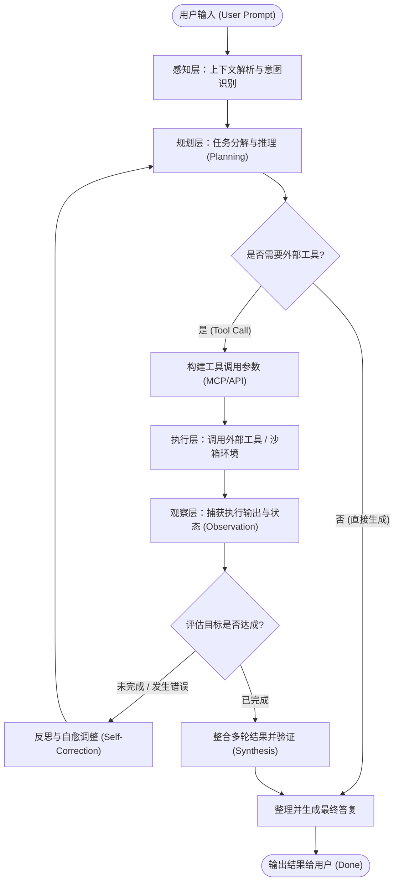
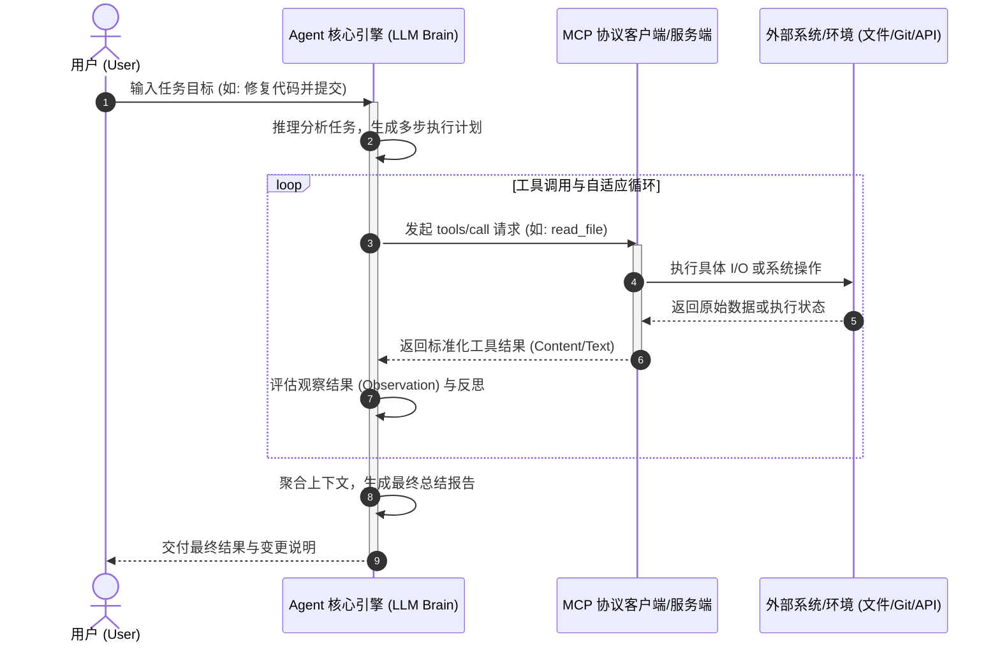

# 智能体（Agent）工作流与核心架构说明

本文档详细描述了现代 AI Agent（智能体）的标准工作流、核心组件架构以及基于 MCP（Model Context Protocol）的工具调用与反思机制。

---

## 1. 核心工作流架构 (Core Workflow)

Agent 的经典工作模式遵循 **感知 (Perception) -> 规划 (Planning) -> 行动 (Action) -> 观察 (Observation) -> 反思与总结 (Reflection & Synthesis)** 的闭环循环。

---

## 2. Agent 与工具交互时序 (Sequence Interaction)

当 Agent 通过协议（例如 Model Context Protocol, MCP）与系统服务交互时，交互时序如下：

---

## 3. 工作流关键阶段说明

### 3.1 感知与上下文注入 (Perception)
* **任务解析**：提取用户核心意图、前置依赖及隐式约束（如代码规范、分支限制等）。
* **上下文装配**：自动挂载系统提示词（System Prompt）、短期对话历史以及工作区元数据。

### 3.2 规划与决策 (Planning & Reasoning)
* **任务拆解 (Decomposition)**：将复合复杂任务分解为一系列独立的、可执行的原子步骤（Sub-tasks）。
* **推理范式**：结合 ReAct（Reasoning + Acting）与思维链（Chain-of-Thought），明确每一步操作的原因与预期目标。

### 3.3 执行与工具调用 (Action via Tools)
* **标准化接入**：通过 MCP（Model Context Protocol）暴露工具接口，保障环境沙箱安全与权限控制。
* **参数校验**：利用模式验证（如 Zod Schema）确保 LLM 生成的参数满足类型约束。

### 3.4 观察与反思循环 (Observation & Self-Correction)
* **结果比对**：将工具执行返回的结果与预期状态对比。
* **错误自愈 (Self-Healing)**：若遇到执行报错（如语法错误、Git 冲突），Agent 捕获堆栈日志并动态调整后续行动策略，重新生成修复指令。

### 3.5 终止与交付 (Completion)
* **完成度校验**：确保任务清单上的所有子目标均已满足。
* **结构化交付**：产出结构化说明、Diff 变更概览及下一步建议。

---

## 4. 关键保障机制

| 机制 | 说明 | 应对策略 |
| :--- | :--- | :--- |
| **死循环防护** | 防止 Agent 在错误中无限重试 | 设定最大迭代轮数（Max Steps），超时强制截断并请求人工介入 |
| **人机协同 (HITL)** | 高危敏感操作的安全确认 | 破坏性操作（如强制覆盖、远端推送）前暂停流并等待用户确认 |
| **幂等性控制** | 工具重复执行的副作用处理 | 工具侧设计具备幂等校验，防止重复追加或重复变更 |
