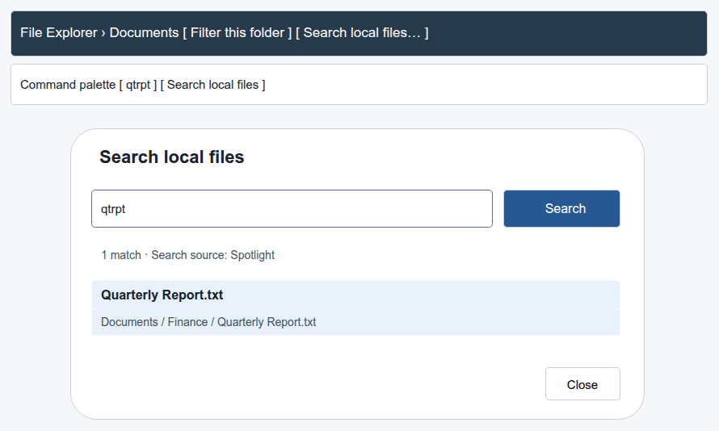

# File Explorer 本机文件名搜索与草稿恢复

基线为 `1a3b6b053`。原型 v1 的地址栏搜索限定在当前目录，可选递归和 glob。全局命令面板搜索工作区、已打开的标签、会话和命令。二者均缺少用户在未知位置寻找本机文件的能力。本次增加独立的本机文件名搜索动作，并修复恢复草稿时占据编辑区域的常驻提示。[原始 Explorer 设计](../file-explorer-design.md) · [当前 Explorer 实现与历史验收](implementation.md)

## 用户操作

| 验收 | 用户操作 | 可见结果 |
| --- | --- | --- |
| AC-01 | 在 Explorer 工具栏选择“搜索本机文件”，输入文件或文件夹名称，按 Enter 或点击搜索 | 初始焦点在名称框。输入 2–96 个字符后可以提交。更改输入需重新提交。目录内原有过滤与递归设置独立工作。 |
| AC-02 | 从应用全局命令面板输入文字，查看或移动普通命令，再选择“搜索本机文件” | 输入和移动高亮仅操作原有内存列表。点击按钮或聚焦按钮后按 Enter 才将文字带入本机查询。子窗口按 Esc 将焦点还给原按钮。 |
| AC-03 | 输入按顺序出现的部分字符，例如用 `qtrpt` 查找 `Quarterly Report.txt` | 匹配对象是文件和目录的名称，行内显示完整路径。同名对象可区分。精确匹配优先，再依次是前缀、子串、有序子序列。 |
| AC-04 | 点击结果，或从输入框向下选择后回车 | 目录通过现有 Explorer 路由打开，文件通过现有文件类型、首选打开方式及查看器路由打开。错误留在当前窗口，可修改查询重试。 |
| AC-05 | 在搜索中取消、改词、关闭窗口或重复提交 | 释放本次查询的资源。过期返回不会覆盖新查询。无结果、受限结果、可用来源与补查目录分别反馈。 |
| AC-06 | 在草稿中输入文字，关闭并重新打开应用 | 无路径草稿恢复内容和未保存标记，编辑区域保持可用。磁盘文件恢复未保存编辑时，使用可关闭的短时提示。磁盘版本变化时继续提供冲突处理。 |

共享模态框、按钮、主题和字体令牌用于两个入口。输入法组合期间按 Enter 保留组合行为。搜索状态通过 live region 通告。只有明确激活结果后打开文件；关闭模态框按原触发点恢复焦点。适用规则为 UI-DLG-03/04/06/07、UI-FOC-03 和 UI-BTN-03/04。未引入专用全局快捷键。图中展示英语环境下的操作关系，实际入口沿用所在工具栏的图标和本地化标签。

## 技术调研与取舍

| 决策 | 依据和权衡 | 结论 |
| --- | --- | --- |
| DEC-01 明确启动查询（用户指定） | 命令面板逐键过滤现有对象的成本低。若在同一循环启动跨卷查询，快速输入会重复查询系统目录。 | 使用专用动作，两处入口共享一个查询窗口；打开 Explorer 或普通命令面板不会初始化磁盘索引。 |
| DEC-02 索引所有权（设计决策） | 常驻索引或卷日志可以提高完整性和重复查询速度，也需要冷启动扫描、权限、持久化、变更追踪和磁盘预算。Everything 在 Windows 可利用 NTFS 索引；跨平台桌面程序无法假定 NTFS、已安装其服务或允许提升权限。 | 优先向操作系统的现成索引提交短查询。应用无需创建数据库、调度 updatedb 或注册文件系统观察器。 |
| DEC-03 索引缺失与新文件（设计决策） | 已安装索引的覆盖范围、更新时机及隐私排除由用户和操作系统决定。上一次系统索引更新后创建的文件也应能从打开的目录找到。 | 同一次操作按预算补查 Explorer 目录和用户主目录。结果说明来源、补查根和截断；没有可读根也没有可用索引时允许修复环境后重试。 |
| DEC-04 排序与范围（设计决策） | 读取文件内容、生成缩略图或计算编辑距离会增加 I/O 和 CPU，也会混淆文件名搜索与全文检索。 | 使用名称的大小写折叠和有序字符匹配，长度与跨度用于排序。每次最多保留 100 项；让用户缩小名称以查看超出预算的匹配。 |
| DEC-05 恢复提醒（原型与实现） | 无路径草稿没有可比对的磁盘原件。具名文件可能同时存在磁盘变更与恢复的缓冲区。 | 未命名草稿静默恢复。具名恢复提示独立计时；真正的冲突继续由冲突区域处理。 |

Windows 使用 OLE DB 的 Search SQL 查询当前用户可访问的现成索引。Windows Server 2025 上，独立 OLE DB 查询成功返回 ProgramData 中已入索引的文件，旧版 WinRT StorageFolder 全卷查询却遗漏了它。查询前先读取 WSearch 服务状态，仅在运行时启动单次无窗口的系统 PowerShell 查询，并由父进程限定用时。[WinRT 漏检的原生诊断](https://github.com/engcapa/taomni/actions/runs/46136138673) · [Windows Search 查询方式](https://learn.microsoft.com/en-us/windows/win32/search/using-sql-and-aqs-to-query-the-index) · [Everything 索引机制](https://www.voidtools.com/support/everything/indexes/)

macOS 通过 `mdfind -0` 查询 `kMDItemFSName`。原生诊断确认，`mdfind` 的大小写修饰符 `c` 放在匹配值之后。连续名字直接查询，模糊分支查询多个独立的名称片段，再由 Rust 验证字符顺序和排序。用户关闭索引或排除某些卷会影响结果覆盖。[原生命令对照](https://github.com/engcapa/taomni/actions/runs/46136526568) · [Apple 文件元数据查询语法](https://developer.apple.com/library/archive/documentation/Carbon/Conceptual/SpotlightQuery/Concepts/QueryFormat.html)

Linux 的 plocate 使用三字符倒排表加速含连续文字的匹配。完全拆开的短通配串难以利用这些 posting lists，要限制运行时间并尽量先取连续片段候选。按 basename 查询、NUL 分隔、限量及当前用户可见性来自工具本身。Linux 桌面未安装 plocate 或数据库缺失时，补查目录仍可用。[plocate 算法](https://plocate.sesse.net/) · [命令参数与退出状态](https://manpages.debian.org/bookworm/plocate/plocate.1.en.html)

## 接口、状态和资源所有权

`explorer_global_file_search({query, operationId, contextRoot?})` 返回 `{entries, provider, truncated, scannedRoots}`，条目为 `{path, name, isDirectory}`。provider 值为 `plocate`、`spotlight`、`windowsSearch` 或 `boundedScan`。Rust IPC 将每个请求注册到现有 Explorer 操作注册表。UI 持有请求 ID 并通过 `explorer_cancel_operation({operationId})` 取消；正常返回、异常和关闭都须释放所有权。应用模块接口与持久化格式均兼容原版本。

| 状态 | 进入和退出 |
| --- | --- |
| idle | 打开、改词或输入不足时不启动工作。允许输入、关闭。 |
| loading | 仅显式提交或从命令面板确认带入有效查询。按钮显示忙碌并禁止重复提交。 |
| done | 显示文件夹或文件、来源、范围和可能的截断；下一个输入清除旧结果。 |
| cancelled | 当前请求失效；允许新的提交。 |
| error | 参数、不可用目录或繁忙会产生可见反馈。输入原值即可重试。 |

系统层同时最多一个搜索 worker，允许短暂等待前一个已取消工作退出。文件夹扫描采用广度优先和条目数、深度、队列长度、用时四项限制。跳过符号链接、重解析点及已识别的网络或虚拟挂载。成功打开文件之前仍通过正常打开流程重新解析当前文件状态。浏览器使用 IndexedDB VFS 的名称和类型索引，测试可通过相同接口观察排序、预算和取消。

### 平台实现和查询预算

| 平台 | 生产接口 | 每次查询的资源约束 |
| --- | --- | --- |
| Windows | 无窗口、低优先级的系统 PowerShell，通过 ADO 连接 Search.CollatorDSO。精确与模糊条件按 Search SQL 转义，以环境数据传入固定脚本。验证结果时只接纳固定盘和 RAM 盘路径。 | 单个进程内连续、模糊查询合计 1,600 ms。索引服务停止时直接进入有限补查。 |
| macOS | 系统 mdfind 查询文件名，使用 NUL 分隔路径。读取内核挂载表以跳过远端文件系统。 | 连续匹配和最多两次片段查询共享 450 ms。到期或取消即终止并回收查询进程。 |
| Linux | 低优先级 plocate basename 查询，先匹配连续字符，再按预算放宽到稀疏字符。 | 连续查询单轮至多 650 ms，稀疏查询至多 180 ms，已有命中时补查预算 25 ms。 |

索引阶段最多读取 384 条候选和 512 KiB 输出，验证路径和文件类型的目标预算为 140 ms。补查使用 100 ms 时间预算，带索引时最多 1,500 项，降级时最多 6,000 项、512 个目录、深度六层。文件系统调用本身可能受磁盘负载影响，墙钟用时可能超过调度检查间隔。超过预算的子集会标为部分结果。

## 实施与验证

| 任务 | 代码及边界 | 验收 |
| --- | --- | --- |
| TASK-01 / V-01 草稿 | `ViewerShell` 与 `documentStore`。恢复无路径文档、具名文档、持久提示到期、标签切换与真实冲突分别断言。 | AC-06。TC-FILE-OPEN-002/047/050/051，包含原生进程退出重启、另存及独立字节核对。 |
| TASK-02 / V-02 索引与扫描 | `src-tauri/crates/taomni-file-search` 与现有 filebrowser handler。Rust 单测覆盖输入、匹配、上限、受限目录遍历、去重、取消和系统查询协议。可选 Linux 测量使用已索引的公共二进制。 | AC-03/05。TC-EXPLORER-015 检查新建文件，TC-EXPLORER-016 独立查询系统索引以选择补查根之外的文件，并同时检查产品结果和 provider 标识。无法找到索引参照时记录 index-probe.json 并验证补查。 |
| TASK-03 / V-03 入口和模态框 | `ExplorerCommandBar`、`GlobalCommandModal`、`FileSearchDialog`、`useGlobalFileSearch`。挂载测试记录查询和取消调用次数，覆盖 StrictMode、IME、过期返回、错误后重试。 | AC-01 至 AC-05。TC-EXPLORER-015 创建唯一名称和字节，经两个入口选择目录、模糊打开文件，TC-UIC-DLG-explorer-global-search 校验 Tab 循环、标题与焦点返回。 |
| TASK-04 / V-04 集成 | 保留普通命令执行、当前目录过滤与递归 glob、原有 Explorer 文件操作。用例注册在 policy、依赖表和控件目录。 | TC-UIC-034-global-command-palette、TC-EXPLORER-008/009，及受影响用例、ui-contract、crash-regression。 |

Linux browser 使用本地 Vite 和独立浏览器上下文。Linux native 使用与源一致的 `com.taomni.app.qa`、独立 Xvfb display、D-Bus 会话和 XDG 数据目录。在同一 Git 源上由 `qa-ui-auto-platforms.yml` 对 Windows/WebView2 和 macOS/WKWebView 执行 browser 与 native。fixture 即时创建的唯一名称检验未更新索引时的补查；仅通过此场景不能推断某个系统索引一定可用。性能样本应注明索引、目录、负载、是否热缓存和测量边界。
