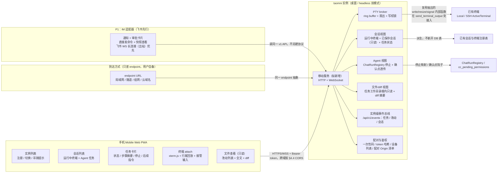

# taomni 移动端 P0：远程实例控制面 详细设计

> 本文档按仓库 `.agents/skills/feature-design` 的模板与工作流编制：决策 `DEC-*`、验收 `AC-*`、任务 `TASK-*`、验证 `V-*` 全程串联。设计状态不代表已经实现或验证。所有验证条目在设计阶段均为待执行。凡结论依赖 TASK-03/TASK-04 的盘点结果或 TASK-01 的 headless 证明，正文一律标“待盘点后确认”或“待证明后确认”，不作为既定事实。

## 1. 设计摘要与范围

- 类型：新功能。内容包括新增移动控制面，以及实例端移动服务。
- 文档位置：`docs-feature/mobile-remote-p0-design.md`。后续一切修订仍走“分支 + PR”：main 受 ruleset 保护，bypass 名单为空，管理员也不能直推。
- 设计状态：部分可实施。
  - DEC-01～DEC-12 均已定或可由 agent 自决，P0 核心任务可以开始。
  - 剩余待决不阻塞 P0 核心，包括：IM 的微信落地方式、diff 数据源、任务文件根来源、headless 下的终端来源。见 §10。
  - DEC/AC/TASK/V 编号全程稳定。
- 需求背景：
  - 移动端主要用于连接远程 PC 上运行的 taomni 实例，并管理多个远程实例；也要能连部署在云上的 taomni。
  - 重点是远程执行情况的便捷交互：正在执行的终端如何回显到手机并同步操作，但不要重到屏幕共享的程度。
  - 远程环境一般没有公网 IP。用户提出可考虑借助飞书、微信，并参考 ZCode（https://github.com/zai-org/ZCode.git）。
- 平台与运行方式：
  - 实例端（server）在 Windows、macOS、Linux 三端可运行，server 代码必须兼容三端构建与运行。
  - 实例端有两种运行模式（DEC-06）：桌面模式随 Tauri 桌面进程运行；headless 模式不建窗口，只跑核心 + 移动服务。两者对外是同一 v1 契约。
  - headless 能达到的能力范围待 TASK-01 证明后确认，见 AC-16。
  - 手机端只做 Mobile Web（PWA），在 Android Chrome / iOS Safari 中运行；不做原生壳，不上架（DEC-02）。
- 本轮真机执行端：Linux 实例端。
  - Windows/macOS 实例端与 Android/iOS 手机端均保留真机计划（§9）。
  - 本轮完成 Linux 实例端验证即可满足本轮真机交付条件，但不得声称三端均已通过。
  - headless 模式的真机验证与桌面模式分开记录。
- 推荐方案：
  - 给每个 taomni 实例加一个**移动服务**：新增的 HTTP + WebSocket 服务，见 §4.1。
  - 手机是一个**瘦控制面**：实例列表、会话列表、Agent 任务卡片、终端 attach 视图、只读文件查看与 diff 查看。
  - 执行、PTY、Agent 状态全部留在实例端，手机只展示和发指令。
  - PC 与云不分两套协议，区别只在手机用哪个 endpoint URL 到达实例。
  - 飞书/微信是 P1 的第二客户端面：调同一 v1 API，只做通知、审批、直接发命令与非实时快照查看，不承载实时终端流。

用户问题：人在外面时，想用手机了解家里 PC、公司 PC 或云主机上的 taomni 在跑什么、卡在哪一步；能看正在执行的终端输出，能接管输入，能停掉或继续一个任务，而不用在手机上复刻整个桌面工作台。

完成后的可观察结果：

- 手机打开 Mobile Web，看到多个实例的在线状态。
- 点进一个实例，看到它正在运行的终端和 Agent 任务。
- 点进一个正在跑的终端，能看到实时输出并可接管输入。
- 任务卡片上有状态、当前步骤摘要、停止与后续指令入口。
- 任务改了文件时，手机能看到改了哪些文件、看 diff、看文件全文（只读）。改动列表的实时来源待 TASK-04 盘点后确认。
- PC 关掉移动服务后，手机立即不可达，桌面本身不受影响。

本次范围（P0）：

- 实例端移动服务：配对、鉴权、会话视图、PTY broker、Agent 视图、只读文件/diff 视图、桌面与 headless 双运行模式。
- Mobile Web PWA：实例注册与切换、会话列表、任务卡片、终端 attach、文件查看、diff 查看、配对（扫码或手动输入）。
- 到达方式只抽象为 endpoint；中继与外网访问由用户自行解决（DEC-05）。
- 多实例管理：注册、切换、吊销。

本次范围（P1）：飞书/微信 IM 适配器，提供通知、审批入口、直接发命令、非实时结果与文件快照查看，见 TASK-07。它复用 P0 的 v1 API，不另建协议。

不做（明确排除）：

- 原生 App 壳与应用商店上架。
- 手机上改代码、保存文件、解决冲突。
- 手机上新建终端、新建 SSH 连接、SFTP、数据库、RDP/VNC。
- 云实例的开通、计费、多租户。
- 屏幕共享。
- IM 承载实时终端流。

兼容约束：

- 桌面终端、聊天、会话的现有行为不得改变（AC-12）。现有 `#[tauri::command]` 的签名与行为保持不变；为复用而抽出的内部函数只是重构，不改语义。
- 移动服务默认关闭。关闭时不监听、不产生新端口、不影响桌面启动。
- 移动服务开启后也不改变桌面 UI，唯一例外是 Settings 中新增的“移动服务”入口与已配对设备列表。
  - 该入口由主导航条底部 Settings 按钮打开，是实例级全局入口，不随当前工作区变化，不在单个工作区侧栏里重复出现。
- headless 模式不依赖任何窗口/WebView 状态。
- 移动 PWA 不复用桌面 workspace-first 壳层的布局状态。`layoutSlice`、`workspaceUiStore`、`workspaceRailStore`、`mainLayoutAppState` 等只属于桌面 WebView，手机布局独立，见 §4.2。

## 2. 当前实现与功能缺口

依据列中，“源码实查”指结论有锚点原文为据；“待核实”指无原文佐证，结论来自间接线索，须由实施者在动手前核对。

| 位置与符号 | 当前行为 / 契约 | 本次影响 | 依据与确定性 |
|---|---|---|---|
| `src-tauri/src/terminal/io_commands.rs`：`write_terminal`、`resize_terminal`、`send_terminal_signal`、`close_terminal` | 已有 `ActiveTerminal::Local` 与 `ActiveTerminal::Ssh` 两个分支的写入、改尺寸、发信号、关闭。逻辑直接写在 `#[tauri::command]` 函数体内，参数为 `State<'_, AppState>`。`write_terminal` 接收 base64 字符串。`resize_terminal` 接收 `u16` 列/行，SSH 分支走 `window_change`。本地信号：unix 支持 SIGINT/SIGTERM/SIGKILL/SIGQUIT/SIGHUP；非 unix 只支持 SIGTERM/SIGKILL，且都实现为 `kill()` | 移动服务运行在 Tauri IPC 之外，拿不到 `State<'_, AppState>`，**不能直接调用这些命令**。TASK-02 须把命令体抽成以 `&AppState` 为参数的内部函数，命令保留为薄包装，签名与行为不变。仓库已有同类模式：`record_local_directory_use_inner`，以及 `commit_run_snapshot` 与 `commit_welcome_run_snapshot` 的分层。Windows 本地终端没有不杀进程的“中断”信号，`stop` 的终端语义须单独定，见 TASK-02 | 源码实查 |
| `src-tauri/src/terminal/output.rs`：`send_terminal_output`、`attach_terminal_output`、`revoke_window_outputs` | 订阅者为 `TerminalOutputSubscriber { channel: Channel<InvokeResponseBody>, window_label }`，按窗口 label 管理。本地读循环 `read_loop_local` 与 SSH 输出任务都把数据交给 `send_terminal_output` 扇出 | 本地与 SSH 输出确实同源于 `send_terminal_output`，PTY broker 的接入点放在这里，保证桌面与手机看到同一份输出。但订阅者必须是 Tauri `Channel` 加窗口 label，手机无法作为现有订阅者接入。broker 须在 `send_terminal_output` 旁边增加一条独立的移动分支，不伪造窗口 label。`TerminalRuntime` 的字段定义在 `state/domains`，不在输入包内，新增字段的具体落点待核实 | 源码实查；`state/domains` 待核实 |
| `src-tauri/src/terminal/local_start.rs`：`create_local_terminal`、`create_command_terminal`、`register_routed_terminal` | 终端 `session_id` 由前端传入，后端只校验非空（`validate_session_id`），然后作为 `state.terminal.terminals` 的键。注册时需要 `on_output: Channel`、`AppHandle` 与 `WebviewWindow`。`register_routed_terminal` 在 EOF 后会从注册表移除终端；`create_local_terminal`、`create_command_terminal` 的读线程在 EOF 时只清理输出订阅、发送 `terminal-exit-{id}`，**不从 `terminals` 注册表移除**，要等 `close_terminal` 才移除 | ① 后端运行终端 id 实际是前端生成的不透明字符串。它与桌面 tab id 的字面关系（是否相同、如何构造）不在输入包内，待 TASK-02 盘点。② “在注册表里”不等于“仍在运行”：本地终端退出后可能残留在表中。会话视图须用退出事件或 broker 状态判断运行态，见 TASK-02。③ 所有终端创建路径都依赖桌面窗口；P0 不新建终端，因此 headless 下可能没有任何运行中终端，见 AC-16 | 源码实查 |
| `src-tauri/src/terminal/active.rs`：`ActiveTerminal` | Local 分支包含 writer、master、child、`_route`；Ssh 分支包含 channel、handle、forwards。**不携带已保存会话 id、工作区 id、终端尺寸** | 后端无法知道某个运行终端来自哪个已保存会话、哪个工作区，也不记录当前尺寸。因此移动侧：不做“已保存会话 → 运行实例”的关联；`workspace_context` 在 P0 没有后端来源；恢复桌面尺寸只能依赖 broker 自己记录的尺寸，见 §4.3 | 源码实查 |
| `src-tauri/src/terminal/ssh_start.rs`：`create_ssh_terminal` | SSH 输出经 `send_terminal_output` 扇出，会话结束时移除注册表项并发送 `terminal-exit-*`。GSSAPI/None 认证改走本机 OpenSSH，经 `register_routed_terminal` 注册为 Local。键盘交互认证经 `build_kbd_prompter` 发送 `ssh-auth-prompt-{id}` 事件 | broker 同时覆盖 russh 终端与 OpenSSH 包装终端。SSH 认证提示属于“连接中”阶段，P0 不接入手机，因为 P0 不新建连接 | 源码实查 |
| `src-tauri/src/terminal/pty.rs`（门面）、`pty/lifetime.rs` | 提供 `create_pty`、`create_command_pty`、`resize_pty` 等本地 PTY 能力 | P0 不新增 PTY 创建路径，只 attach 已有终端 | 源码实查（门面）；`lifetime.rs` 原文不在输入包内 |
| `src-tauri/src/session/mod.rs`：`list_sessions`；`session/models.rs`：`SessionConfig`、`SessionType` | 列出全部已保存配置，包括 RDP、VNC、数据库、Mail、S3 等。字段含 `host`、`username`、`auth_method`、`options_json`；`options_json` 内可能有 `passwordRef` 等 vault 引用 | 已保存会话在移动侧只作只读信息展示，不提供连接动作（P0 不新建连接）。只展示终端类类型（SSH、Telnet、Rlogin、Mosh、Serial、LocalShell、FTP），避免出现 RDP、数据库等入口（AC-14）。移动 API 只暴露 `id`、`name`、`session_type`、`group_path`，**不得返回** `host`、`username`、`auth_method`、`options_json` | 源码实查 |
| `src-tauri/src/session/resume.rs`（门面；记录在 `session/resume/model.rs`） | Home 页的上一轮运行快照，单行表，最多 200 项，含白名单本地终端，不含整个工作区 | 只能说明“桌面重启后恢复 tab”已有快照概念，**不能**当作手机断线重连的回放，也不覆盖 Agent 轮次。手机重连回放由新增的 PTY ring buffer 负责（§4.3） | 源码实查 |
| `src-tauri/src/chat/run.rs`：`ChatRunRegistry`、`ChatRunHandle::stop` | 按 thread id 索引在途聊天轮次。`DirectLlm` 用取消令牌；桥接进程调用 `stop()`。`stop(self)` 会消费 handle | 手机“停止当前轮次”映射到这里。命令分发表中已有 `chat_stop_stream`，其实现不在输入包内；移动停止应与其语义一致，待 TASK-03 核实 | 源码实查；`chat_stop_stream` 实现待核实 |
| `src-tauri/src/chat/mod.rs`：`ChatSendRequest`；`chat/store.rs`：`ChatThread` | 每轮请求由前端补齐上下文：`bound_session_id`、`cwd`、`local_terminal_env`、`bound_db_connection_id`、`code_workspace` 等。`ChatThread.linked_session_id` 是**桌面 tab id**，不是 `SessionConfig.id`。线程表没有运行状态列。流式输出以 `StreamEventOut` 事件发给前端 | ① 手机发起的后续指令没有这些桌面上下文，行为可能与桌面发起不同，待 TASK-03 确认。② 线程“运行中”只能由 `ChatRunRegistry` 是否有该线程判断。③ 流事件当前经 `AppHandle` 发出，须经 EventSink 转给事件流，见 §4.5 | 源码实查 |
| `src-tauri/src/state.rs`：`AgentRuntime` 的 `cc_pending_permissions`、`cc_pending_tool_calls`、`agent_thread_cwd`、`agent_code_workspaces`；`CcPermissionDecision`（Allow / AllowSession / Deny）；`CcToolOutcome` | Claude Code 权限提示：MCP 工具登记 oneshot、发送 `agent-cc-permission` 事件，阻塞等待前端 `cc_resolve_permission`。副作用工具（如 `run_in_terminal`、`sftp_upload`、`switch_tab`）由**前端执行**后经 `cc_resolve_tool_call` 回传。线程工作目录、代码工作区按轮次由前端桥接后存入后端 | ① CC 权限提示有明确的后端钩子，是 AC-06 最可能可透传的确认点，但仍待 TASK-03 盘点后确认。ACP 有 `acp_resolve_permission`，实现不在输入包内。② 副作用工具依赖桌面前端执行，headless 下无法完成，须在 TASK-03 盘点中标为“需桌面”。③ `agent_thread_cwd` 与 `agent_code_workspaces` 是后端已知的文件根候选，其值类型不在输入包内，待 TASK-04 盘点 | 源码实查（字段与注释）；`domains` 类型定义待核实 |
| `src/components/agent/`、`src/components/chat/` 确认卡片 | `ActionCard` 见于 `state.rs` 注释；`WebSearchConfirmCard` 不在输入包内 | TASK-03 须先盘点桌面已有确认点，再决定手机能透传哪几个 | `ActionCard` 有间接证据；其余待核实 |
| `src-tauri/src/lib.rs`：`run()` 与 `setup()` | 进程已有若干网络监听：LanChat 服务（按 start_on_launch 自启）、本地服务器自启（`servers::autostart_servers`）、隧道自启、macOS 上可选启用的 QA WebDriver 桥（仅当设置 `TAOMNI_QA_WEBDRIVER_PORT` 时启动本地 HTTP），命令表中另有 `nmedia_ws_port`。没有面向手机的鉴权 API。`setup()` 依赖 `AppHandle`：解析 app-data 目录、`ProfileLease::prepare`、`vault::default_vault_path(app.handle())`、`local_history::init_local_history(app.handle())`、`workspace.lsp.attach_app`、备份与调度初始化。退出时执行 `backup::scheduler::handle_exit_request` 与 `sockscap::shutdown_on_exit` | 移动服务是全新服务层，不是把 Tauri IPC 暴露出去，也不复用上述任何现有监听。headless 路径不能直接复用 `setup()`，须逐项盘点哪些初始化在 headless 必需、哪些须改为不依赖 `AppHandle`、哪些在 headless 不做，退出清理也要逐项处理，见 TASK-01。`AppState::new` 本身不依赖 `AppHandle`，可在 Tauri 外构造 | 源码实查 |
| `src-tauri/src/main.rs` | 不在输入包内。`lib.rs` 导出了 Windows 专用辅助进程入口：`run_screenshot_scroll_input`，以及 `VNC_SPECIAL_KEY_HOOK_ARG`（注释写明 `taomni --vnc-special-key-hook <pid>`）。这表明 `main.rs` 很可能在调用 `run()` 前有命令行分发 | “在 `main.rs` 进入 `run()` 前拦截 `--headless`”的路径方向可行，但现有先例是 Windows 专用；跨平台入口的具体写法待 TASK-01 核实 | 待核实 |
| `src-tauri/src/servers/http.rs`、`servers/ssh.rs` | 前者是用户配置的静态文件服务，可配 CORS（固定 `Access-Control-Allow-Origin: *`）、目录浏览、根目录回退到家目录；后者是内置 SSH/SFTP 服务，凭据来自服务配置 | **两者都不复用为移动入口**：前者没有鉴权，CORS 为 `*`；后者面向受信局域网。移动服务独立成模块，自带鉴权，默认绑定回环地址（§4.5） | 源码实查 |
| `src-tauri/src/workspace/paths.rs`、`file_commands.rs` | `resolve_existing_path`：先做相对路径净化（拒绝 `..` 与绝对路径），再 `canonicalize`（解析符号链接），最后 `ensure_inside`。`workspace_read_file` 有大小上限 `DEFAULT_MAX_TEXT_BYTES`。`workspace_read_loose_file` 可读取任意绝对路径。`ensure_inside` 除比较规范化路径外，还有 `target.starts_with(root)` 兜底分支 | 移动文件 API 可复用“净化 → 规范化 → 根内校验 → 大小上限”的思路，但：① 不得暴露 loose 读取；② 根内校验须以规范化后的根做逐段比较，不得依赖兜底分支放宽。复用 `workspace_read_file` 还是另写，由 TASK-04 决定 | 源码实查 |
| `src-tauri/src/workspace/git_roots.rs`：`detect_workspace_git_roots`；命令表中的 `git_diff`、`git_snapshot`、`git_blob_pair` | 按调用方给出的候选根做祖先/嵌套 git 根探测；git 相关命令实现不在输入包内 | 都是 TASK-04 diff 数据源盘点的候选。候选根仍由调用方传入，不能证明平台工作区定义已同步到后端 | `git_roots.rs` 源码实查；git 命令实现待核实 |
| workspace-first 平台壳：`src/components/sidebar/PrimaryNavigationRail.tsx`、`src/layouts/main/MainLayoutView.tsx`、`src/components/workspace/WorkspaceMainPanel.tsx`、`src/stores/workspacePlatformStore.ts`（`PlatformWorkspace`、`WorkspaceIsolatedTab`）、`workspacePlatformPersistence.ts`、`workspacePlatformTabActions.ts`、`workspacePlatformCodeActions.ts`、`src/stores/app/layoutSlice.ts` | 主导航条的模式按钮为 home/workspaces/sessions/tools，`MainLayoutView` 另有 `activeSideTab === "agents"` 分支。工作区有多根目录（`rootFolders`）、“★ 常用”已保存会话 id（`pinnedSessionIds`，仅快捷方式）、隔离 tab 列表，不触碰 `appStore.tabs`。工作区 tab id 均以 `ws:<workspaceId>:` 开头，形态多样：`…:local:<随机>`、`…:sess:<SessionConfig.id>:<随机>`、`…:file:<rootId>:<path>`、`…:git`、`…:code`、`…:duplicate:<uuid>`。底部 dock 终端的 tabId 为 `<workspaceId>:dock-terminal`，不带 `ws:` 前缀。状态只持久化在桌面 localStorage `taomni.platformWorkspaces.v1`，后端没有对应表 | 移动设计区分三类身份（硬约束，见 §4.3）：① **后端运行终端键**：`terminals` 注册表键，不透明，是 PTY attach 的唯一目标；② **已保存会话 id**：`SessionConfig.id`，只读展示；③ **桌面展示 tab id**：`appStore` Tab 或 `WorkspaceIsolatedTab`，移动服务不解析、不构造、不用它推导任何东西。同一已保存会话在两种模式下是两个独立运行实例，在后端表现为两个注册表键，移动列表按键分开展示，不按已保存会话合并 | 源码实查；`PrimaryNavMode` 类型定义、`WorkspaceSwitcher` 等其余壳层组件待核实 |
| 桌面设置入口：`PrimaryNavigationRail` 底部 Settings 按钮 → `onOpenSettings` → `MainLayoutView` 中的 `menuActions.handleCommand("settings")`（`useMainMenuActions` 经 `createHandleCommand` 打开设置 tab） | 设置入口由主导航条触发，不属于某个工作区，也不在 Sessions/Workspaces 模式间各有一份 | 配对码生成与已配对设备列表挂在该实例级设置入口下。`src/components/settings/` 的目录结构不在输入包内，待核实 | 接线源码实查；设置目录待核实 |
| `vite.config.ts`、`package.json`（`pnpm dev` 浏览器预览） | 旧版文档记载浏览器预览使用 Tauri stubs | stubs 不能证明手机能连上真实实例。P0 联调必须连真实移动服务（V-04） | 待核实 |
| ZCode、OpenCode Mobile 官方文档（外部事实） | ZCode 的手机是桌面遥控器，不能新建连接；OpenCode 定位为“实例跑活，Mobile 只是控制面”，通过 endpoint 档案切换实例 | 本设计采用控制面模型（DEC-01），协议与鉴权按 taomni 现状重写 | 本次未复核 |

短板归纳：

- 缺一个对外服务层。
- 缺 PTY 输出的跨进程扇出与回放。
- 缺可在 Tauri IPC 之外调用的终端/Agent 内部函数。
- 缺统一的“实例 → 运行中会话 → 任务”移动视图。
- 缺配对与 per-instance 鉴权。

P0 正面解决以上问题，不顺带重构桌面终端、聊天或 SSH。

## 3. 验收条件

| ID | 场景与前置条件 | 用户动作或触发 | 必须观察到的结果 | 适用平台 / 边界 |
|---|---|---|---|---|
| AC-01 | 桌面已开启移动服务，手机未配对 | 桌面显示配对码/二维码；手机扫码或手动输入 endpoint + 配对码 | 一次性码单次有效、5 分钟过期，过期或复用均失败。成功后手机拿到 per-instance token，桌面已配对设备列表出现该设备。token 不出现在 URL 中。扫码依赖安全上下文（HTTPS 或 localhost），非安全上下文只能手动输入 | 三端实例 + Android/iOS 浏览器 |
| AC-02 | 手机已配对两个实例（一台 PC、一台云主机 endpoint）；PWA 外壳由实例 A 托管 | 在实例列表切换到实例 B；在某个实例的桌面吊销该设备 | 切换后会话列表、任务状态立即属于新实例，旧实例 WS 断开。被吊销后该实例全部业务 API 返回鉴权失败，手机显示“已被实例吊销”，不自动用旧 token 重试。从 A 的 Origin 向 B 发请求时，B 按 §4.4 两级 CORS 策略处理：`/health`、`/pair` 回显 Origin；已配对 Origin 的业务预检通过，带 Authorization 头的响应可读；未配对 Origin 的业务预检不通过，浏览器不发出业务请求。吊销设备时，其 Origin 同步从 B 的放行清单删除。会话列表以带种类前缀的后端运行键为标识，同一已保存会话的两个独立运行实例显示为两条 | 三端实例 + 手机浏览器；PC 与云实例同一协议；混合内容（HTTPS 外壳调 HTTP 实例）会被浏览器拦截，见 §4.5 |
| AC-03 | PC 上某终端正在输出 | 手机打开该终端 attach 视图 | 先看到最近输出的尾部（§4.3 的行尾回放），随后实时输出与桌面同一 PTY 一致，不另开新 shell。退出视图再进入，仍是同一会话 | 本地终端（含 OpenSSH 包装的 SSH）与 russh SSH 终端均适用 |
| AC-04 | 桌面与手机同时看同一终端 | 手机默认只读；只读态下尝试改尺寸；手机点“接管输入”并改尺寸；之后桌面敲键盘或改尺寸 | 只读时，手机输入与 resize 均被服务端拒绝（回 `not_holder`，不转发给 PTY）。接管后，手机输入到达 PTY；resize 仅在持有写权时生效，并钳制在列 20～300、行 10～100。桌面一经 `write_terminal` 写入或经 `resize_terminal` 改尺寸，即抢回写权：手机收到提示并回到只读，PTY 尺寸恢复为 broker 记录的桌面最后尺寸（无记录时不恢复并记日志），不长期挤窄桌面终端。接管前有“输入可能打断正在执行的命令”的提示；能否识别“Agent 正在使用该终端”待 TASK-02/03 盘点后确认，无法识别时对所有终端统一提示 | 三端实例 + 手机浏览器 |
| AC-05 | 某 Agent 线程正在跑一轮 | 手机打开任务卡片，点“停止”；再发一条后续指令 | 停止映射到 `ChatRunRegistry` 的取消或进程停止，任务状态变为已停止。后续指令作为新一轮发出，不篡改已停止轮次的历史；线程有在途轮次时拒绝并返回 `turn_in_progress`。手机发起的轮次缺少桌面每轮注入的上下文（cwd、绑定会话等），差异范围待 TASK-03 盘点后确认并在卡片上提示 | 三端实例；停止与后续指令语义以 TASK-03 盘点为准 |
| AC-06 | 桌面有待确认点（如 TASK-03 盘点出的 CC 权限提示） | 手机在任务卡片上看到待确认项，点同意或拒绝 | 仅当盘点确认该确认点可透传时才出现按钮，决定回传到同一确认点：同意映射为 Allow，拒绝映射为 Deny，移动端不提供 AllowSession。桌面与手机都作答时，先到者生效，后到者收到 `already_resolved`。盘点确认不可透传的确认点，以及需要桌面前端执行的副作用工具，手机只显示“需在桌面确认”，不提供假按钮 | 条件性：以 TASK-03 盘点结论为准；不可透传时本条降级为提示 |
| AC-07 | 实例可通过用户自备的两种 endpoint 到达（如局域网地址与用户自建隧道/组网域名） | 手机分别用两个 endpoint URL 配对同一实例 | 两次都只需填 endpoint URL + 配对码，客户端代码无厂商分支。设计不提供、不选型、不配置中继与外网访问 | 三端实例；只验收“给定可达 endpoint 时能通” |
| AC-08 | 手机断网后恢复，或 WS 断开后重连 | 重连同一终端 attach 视图；重连实例级事件流 | 终端流按 `after_seq` 续接，不重复输出已收到的数据；`after_seq` 已超出 ring buffer 时，服务端重发 `replay` 并标 `gap: true`。事件流按事件序列号续接；超出最近 200 条事件缓冲时，服务端回 `resync`，手机改用 REST 重拉会话、任务、改动列表。重连期间显示“重连中”，不清空已收输出 | 手机浏览器；弱网为必测场景 |
| AC-09 | 移动服务关闭或实例下线；实例以桌面模式或 headless 模式运行 | 手机打开实例/会话；同一实例先后以两种模式提供服务（两种模式不同时运行于同一 app-data） | 移动服务关闭时实例端不监听新连接。手机显示实例离线与上次在线时间，不自动删除注册信息。重新开启后，token 未吊销即可重连。两种模式下 v1 契约一致；`/health` 与事件流 `hello` 返回 `run_mode` 仅作展示，不作客户端分支 | 三端实例；两种模式分开验证 |
| AC-10 | 安全基线：未配对请求、过期 token、跨实例 token、未配对 Origin | 直接调 API；复用另一实例的 token；暴力猜配对码；从未配对 Origin 发跨域请求 | ① 除 `/health`、`/pair` 与静态外壳外，全部 API（含 WS 升级）先鉴权后执行业务。② 配对接口限流，并记录失败（只记来源与计数，不记尝试的码）。③ token 在实例端只以哈希存储；手机端存于浏览器存储，这是已知短板，须在 UI 与文档中明示，不承诺 Keychain/Keystore。④ CORS 按 §4.4 两级策略：响应头不出现 `*`，**不发送** `Access-Control-Allow-Credentials`（token 只走 Authorization 头，不用 Cookie）；业务端点只回显同源或已配对 Origin；WS 握手同样校验 Origin。不得复用 `servers/http.rs` 的 `*` 做法。⑤ 日志不含 token、配对码、WS 票据、Authorization 头、终端输入输出字节、文件内容、已保存会话的连接字段 | 三端实例；安全回归见 V-06 |
| AC-11 | 手机消费慢、网络抖动 | 终端高速输出时手机从后台切回前台 | 服务端单连接出队有界；慢消费者被断开，可按序列号重连恢复。服务端内存不出现无界增长。心跳超时按 §4.4 处理 | 三端实例 |
| AC-12 | 桌面回归：移动服务关、开两种状态 | 正常使用桌面终端、聊天、会话切换、SSH 终端 | 两种状态下桌面行为与改前一致。移动服务开启不新增桌面弹窗、不改变现有会话列表顺序。桌面输入始终可抢回写权（AC-04）。为复用而抽出内部函数后，现有 `#[tauri::command]` 签名与行为不变 | 三端桌面 |
| AC-13 | PWA 安装与离线外壳；endpoint 为 HTTPS（或 localhost） | 手机浏览器“添加到主屏幕”，断网后打开 | 已缓存的外壳可以打开，显示实例列表与“离线”提示。实时数据缺失时不把过期数据当作最新，每块数据标注上次更新时间。HTTP 局域网 endpoint 不是安全上下文，Service Worker 不可用，该 endpoint 下本条不适用，UI 须明示 | Android Chrome / iOS Safari；离线仅指外壳，不承诺离线操作 |
| AC-14 | P0 边界（反向验收） | 在手机上寻找文件编辑、保存、冲突解决、SFTP、数据库、RDP/VNC、新建终端、新建 SSH 连接入口 | 均不存在，也不以占位按钮出现。已保存会话只作只读信息展示，不出现连接动作，不展示非终端类型。文件查看与 diff 查看是只读的（见 AC-15） | 手机浏览器 |
| AC-15 | 任务改了文件，手机正在看该任务；手机只看任务卡片或改动页，未打开任何终端 | 打开任务的“改动”页；任务又改了一个文件；点开一个文件 | 改动列表经实例级事件流 `WS /api/v1/events` 推送 `file_changed` 后刷新，不靠手动刷新，不依赖终端 WS。不开终端时 `task_status` 与改动推送仍能到达。点文件看到只读全文（行号；大文件截断并提示）；点 diff 看到该文件的统一 diff（分 hunk 折叠；超长截断）。文件 API 只接受“任务 id + 相对路径”，只允许后端已知的该任务工作目录根内的路径：先净化，再规范化（解析符号链接），再逐段校验在根内；越界或符号链接逃逸一律拒绝 | 三端实例；diff 数据源、`file_changed` 的事件来源、任务工作目录根的来源均待 TASK-04 盘点后确认（git diff 优先，工具改动摘要为 fallback），盘点前不承诺 |
| AC-16 | 同一实例以 headless 模式运行（无窗口）；Linux 云主机无 Display | 手机配对、看会话、看终端、停任务、看文件/diff；在无 Display 环境下启动 `--headless` | ① v1 契约与桌面模式一致；对 headless 下实际存在的终端与任务，行为一致。② headless 进程退出即实例离线，手机不自动改 endpoint。③ 配对码由命令行/日志输出，确切方式由 TASK-01 定。④ Linux 无 Display 下 `--headless` 不初始化 GTK/WebView/窗口，移动服务正常响应；该用例须在真正无 Display 的环境验证。⑤ 已知限制：P0 不新建终端，headless 又无桌面创建终端，因此终端列表可能为空，此时终端 attach 记为“不适用”而非“通过”；依赖桌面前端执行的 Agent 副作用工具在 headless 下须显式失败，不得挂起。能力范围待 TASK-01 证明后确认 | 三端实例；headless 为 P0 运行模式，证明失败时 headless 部分回流 |
| AC-17 | P1：飞书/微信 IM 已绑定实例；实例在无公网 IP / VPN 组网环境（无入站端口） | 任务完成、等待审批、实例掉线时 IM 收到消息；用户在 IM 里发“批准”“发一条后续指令”“看当前任务摘要/某文件” | IM 收到的是状态通知与审批入口卡片，不是实时终端流。批准/拒绝只回传到 TASK-03 确认可透传的点。后续指令作为新一轮发出。要结果或文件时，返回截断摘要 + 跳回 Mobile Web 的链接。IM 身份须绑定到白名单用户，未绑定身份的指令一律拒绝。无入站端口时，飞书适配器优先用官方 WebSocket 长连接（实例主动出站）；入站 webhook 仅为实例已有公网 endpoint 时的 fallback | P1；飞书先行，微信落地方式待决（§10）；IM 不替代 Mobile Web 的实时查看 |

## 4. 方案与关键决策

### 4.1 总体结构

关键结构决策：

- 移动服务与核心注册表同属实例进程。
  - 桌面模式下随桌面进程运行。
  - headless 模式下不建窗口，只跑核心 + 移动服务。
- 移动服务对外契约独立，不依赖任何窗口/WebView 状态。
  - 桌面模式与 headless 模式是同一服务的两种启动方式，不是两套后端。
  - 也避免了“手机直连 SSH 再绕回 taomni”的双通道不一致。
- 代价有两项：
  - TASK-01 必须划清“核心与 UI”的边界，并证明 headless 可运行。
  - TASK-02/03 必须把终端与 Agent 的命令体抽成可在 Tauri IPC 之外调用的内部函数。
- 两项结构约束：
  - 多实例切换本质是跨域。PWA 外壳由哪个实例托管只决定初始 Origin，向其他实例的请求一律走 §4.4 的 CORS 策略。
  - 任务、改动、会话事件走实例级事件总线，与 PTY 输出流分离。

### 4.2 用户流程与交互

入口：

- 桌面模式：在主导航条底部 Settings 按钮打开的设置中新增“移动服务”，包含开关、监听方式、配对码生成、已配对设备列表与吊销。该入口是实例级全局入口，不在工作区侧栏里按工作区重复。
- headless 模式：配对码由命令行/日志输出，确切方式由 TASK-01 定。
- 手机首次打开 Mobile Web：实例列表为空 → “添加实例” → 扫码（仅安全上下文）或手动输入 endpoint + 配对码 → 成功后进入该实例的会话列表。
- P1 的 IM 入口不在 Mobile Web 内：用户先在实例端绑定 IM 身份，再在飞书/微信里与机器人对话。

主流程状态表：

| 当前状态 | 动作或事件 | 前置条件 | 下一状态与可见反馈 | 失败 / 取消处理 |
|---|---|---|---|---|
| 实例列表 | 点实例 | 已配对，token 未吊销 | 进入会话列表，显示 WS/HTTP 连通性 | 离线：显示上次在线时间与重试，不删除注册 |
| 会话列表 | 点终端会话 | 该终端在 broker 中处于运行态 | 进入终端 attach：先行尾回放，再实时流 | 已退出：显示“已退出”与最后输出尾部，不自动新建 |
| 会话列表 | 点已保存会话条目 | 无 | 只读信息（名称、类型、分组），无连接动作 | 不适用 |
| 终端 attach（只读） | 点“接管输入” | 无其他写权持有者 | 获得写权，键盘条出现（Tab / Esc / Ctrl-C / Ctrl-L / 历史 / 粘贴） | 桌面写入或改尺寸时被抢回：立即回到只读并提示 |
| 终端 attach（只读） | 尝试改终端尺寸 | 未持有写权 | 尺寸不变，服务端回 `not_holder`，提示“只读态不能改尺寸” | 不转发给 PTY，不影响桌面终端尺寸 |
| 任务卡片（运行中，未打开终端） | 任务状态变化或文件改动 | 已连实例级事件流 | 任务卡片与改动列表经 `/api/v1/events` 实时更新 | 事件流断开：按事件序列号续接，或 `resync` 后 REST 重拉 |
| 任务卡片（运行中） | 点“停止” | 该轮次在 `ChatRunRegistry` 中 | 状态变为已停止 | 已自然结束：按钮变灰，不发重复取消 |
| 任务卡片（空闲） | 发后续指令 | 无在途轮次 | 作为新一轮发出，卡片提示“由手机发起，未带桌面上下文” | 有在途轮次：返回 `turn_in_progress` 并提示 |
| 任务卡片（待确认） | 点同意或拒绝 | TASK-03 确认该点可透传 | 决定回传，卡片状态更新 | 不可透传：只显示“需在桌面确认”；已被桌面作答：提示 `already_resolved` |
| 任务卡片（有改动） | 点“改动”、点文件、点 diff | 任务已有改动，且后端已知其工作目录根 | 改动列表实时更新；文件只读全文；diff 分 hunk 折叠 | 大文件或超长 diff：截断并提示；越界路径：拒绝；无工作目录根或无 diff：提示 `diff_unavailable` |
| 任意实时视图 | WS 断开 | 网络恢复 | 显示“重连中” → 按序列号续接 | 多次失败：停在可重试的错误态，不丢已收输出 |
| P1：IM 对话 | 发“批准”“继续做 X”“看当前任务/某文件” | IM 身份已绑定白名单 | 通知卡片、审批回传、后续指令发出、截断摘要 + Mobile Web 链接 | 未绑定身份：拒绝；要实时终端流：只给链接 |

手机键盘与版式：

- 竖屏以任务卡片为主、终端为辅；横屏可全屏终端。
- 终端视图除系统键盘外常驻常用键条。
- 粘贴为显式操作，不自动把剪贴板内容发往 PTY。剪贴板读取依赖安全上下文，非安全上下文下只能用系统键盘粘贴。
- 长输出默认折叠为摘要行，点“展开日志”才进入终端视图。

输入分两个通道，不得混用：

1. 终端通道：PTY 输入，走接管写权。
2. Agent 通道：提示词输入（多行编辑器、历史、常用指令模板、发送后清空），走 `message` 接口，不经过 PTY。

两个通道在 UI 上分开：终端键条只影响 PTY，任务卡片的编辑器只发提示词。

实时性定义：

- 终端输出由终端 WS 推送。
- 任务状态、改动列表、会话变化由实例级事件流推送。
- 两者都不靠定时轮询。
- IM 通道明确是非实时的。

### 4.3 数据流、状态与生命周期

权威状态在实例端，不在手机。

- 终端 PTY 状态、任务在途状态、配对设备清单均以实例端为准。
- 手机只缓存实例注册信息（endpoint、标签、上次在线），以及当前视图已收到的输出。
- 手机切后台、关页面、换实例，都不改变实例端的执行。

**三类身份规则（硬约束，§2、§4.4、TASK-02、TASK-04、V-02 统一以此为准）：**

1. **后端运行终端键**：即 `state.terminal.terminals` 的键。它由桌面前端在创建终端时传入，对移动服务是不透明字符串。
   - 移动服务原样使用，不解析、不改写，也不从桌面 tab id 或已保存会话 id 推导。
   - 它与某个桌面 tab id 是否字面相同，待 TASK-02 盘点；即使相同，也只当作不透明键。
   - PTY attach 只接受这个键。
2. **已保存会话 id**：即 `SessionConfig.id`，只用于只读展示，不作为运行实例的标识。
   - `ActiveTerminal` 不携带已保存会话 id，后端无法建立“已保存会话 → 运行实例”的关联，P0 不展示该关联。
3. **桌面展示 tab id**：包括 `appStore` Tab 与 `WorkspaceIsolatedTab`（`ws:` 前缀的多种形态、dock 终端的 `<workspaceId>:dock-terminal`）。
   - 移动服务不读取、不构造、不推导这些 id，移动 API 不提供任何以 tab id 为输入的接口。
   - 平台工作区状态只在桌面 localStorage，`workspace_context` 在 P0 没有后端来源，因此恒为空。
   - `ChatThread.linked_session_id` 是桌面 tab id，移动侧只作不透明展示字段，不用它查终端。

移动侧对外标识统一加种类前缀，避免终端键与线程 id 冲突：

- 终端为 `term:<后端运行终端键>`。
- Agent 线程为 `thread:<线程 id>`。
- 路径参数一律 URL 编码。

同一已保存会话在 Sessions 与 Workspaces 两种模式下是两个运行实例，对应两个后端键，在列表中是两条记录。

**PTY broker（拟新增，见 §5）：**

接入点：

- 在 `send_terminal_output` 处增加移动分支（本地与 SSH 输出同源于此），每个终端一个 ring buffer，只存内存，不落盘。
- 终端退出由 broker 记录运行态（本地终端退出后可能仍残留在 `terminals` 表中，见 §2），会话视图以 broker 运行态为准。

回放语义为**行尾回放 + 实时流**（DEC-04）。buffer 按行切分，保留最近 1000 行（含 ANSI 转义，由手机 xterm 渲染），同时受以下边界约束，任一先触发就淘汰最旧行：

1. 总字节上限 512 KiB，按 UTF-8 解码后的文本计。
2. 单行上限 16 KiB，超长行截断，并在行尾加截断标记。
3. `\r` 覆盖语义：不跟 `\n` 的 `\r` 视为改写当前行（如进度条），不产生新行。
4. UTF-8 跨 chunk 保护：用增量 UTF-8 解码器持有未完成的尾部字节，不对每个 chunk 单独做有损解码。

attach 流程：

- 先发最近 1000 行以内的尾部，并附 `last_seq`。
- 再发带单调序列号的实时增量。

不承诺“完整虚拟屏快照”，因为 P0 不在服务端引入 VT 屏幕解析器。同步的保证是“同一 PTY + 同一输出流”，不是“同一像素屏”。

**写权锁：**

- 每个终端一个写权持有者，取值 `desktop | mobile:<deviceId> | none`。手机初始为只读，需显式接管。
- 桌面抢回的触发条件：凡经 `write_terminal` 命令的写入，或经 `resize_terminal` 命令的改尺寸，都视为桌面侧动作。
  - broker 在接到桌面动作时把手机写权置为 `none`，并推送 `control-lost`。
  - 这包括多路广播、Agent 经前端调用的写入，以及桌面 xterm 的自动适配尺寸。
  - 这些来源是否会造成误抢回，待 TASK-02 盘点后确认，并回填 AC-04 备注。
- 手机写权在以下情况自动释放：显式释放、WS 断开、终端退出。
- 手机输入与桌面输入走同一 PTY，不做内容过滤。

**resize 权限（DEC-10，与写权共用一把锁）：**

- 手机只读态下，resize 一律回 `not_holder`，不转发给 PTY。
- 持有写权时 resize 才生效，并钳制在列 20～300、行 10～100；尺寸未变时不转发。
- `ActiveTerminal` 不记录尺寸，因此 broker 自己记录桌面最后尺寸，在每次桌面 `resize_terminal` 时更新。
- 手机释放写权或被抢回时，broker 恢复该尺寸；无记录时不恢复，只记日志。恢复失败也不阻塞写权释放。
- SSH 终端同样走抽出后的 resize 内部函数（SSH 分支为 `window_change`）。

**会话视图派生规则（P0 不新开持久化表）：**

- 运行中终端：来自 broker 运行态 + 终端注册表。
- 已保存会话：来自 `list_sessions`，只取终端类类型，只暴露 `id`、`name`、`session_type`、`group_path`。
- Agent 任务：来自线程记录 + `ChatRunRegistry`。在 registry 中才是“运行中”，否则为“空闲”；线程表没有状态列，不另造持久化状态。
- 若 TASK-02/03 盘点发现某字段无法派生，可在该任务内补一个只读派生字段，但不得为手机单独复制会话 DB。

**文件/diff 视图（P0 只读）：**

- 文件 API 以“任务 id + 相对路径”为输入，根是后端已知的该任务工作目录。
  - 候选来源为 `AgentRuntime.agent_thread_cwd` 与 `agent_code_workspaces`，其值按轮次由前端桥接，类型待 TASK-04 盘点。
  - 线程从未由桌面桥接过工作目录（例如只在手机或 headless 下发起），或工作目录是远端路径（SSH 绑定的线程）时，返回 `diff_unavailable` 或“无可读根”。
- 路径校验：
  - 先净化（拒绝 `..` 与绝对路径），再规范化（解析符号链接），再与规范化后的根逐段比较。
  - 越界一律拒绝，不依赖字符串前缀，也不复用 `ensure_inside` 的兜底分支。
  - 不暴露 loose 绝对路径读取。
- 不以平台工作区多根目录（`rootFolders`）为根：平台工作区只存在于桌面 localStorage，后端读不到。多根目录校验须由 TASK-04 先定同步方式，盘点前不承诺。
- 改动列表的数据源待 TASK-04 盘点（git diff 优先，工具改动摘要为 fallback）。
  - 现有 `CcToolActivity` 是仅流式期间存在、不持久化的展示事件，能否作为改动来源待盘点。
  - 盘点结论回填 AC-15 备注。
- 文件内容除手机端页面内存外不落持久化；大文件截断；diff 按 hunk 折叠，超长截断。
- `file_changed { task_id, path, change_kind }`、`task_status`、`session_changed` 一律经实例级事件流推送（§4.4）。
- 手机文件视图不复用桌面工作区组件。

**生命周期与资源：**

- WS 连接断开即释放该连接的订阅与写权。
- ring buffer 随终端退出释放。
- 配对设备吊销即吊销 token，后续 WS 握手失败。
- 移动服务关闭时，先断开全部手机 WS，再停止监听；桌面终端不受影响。

### 4.4 接口与共享契约（拟新增，v1）

**鉴权：**

- 除 `/health`、`/pair` 与静态外壳外，所有接口先鉴权后执行业务，鉴权头为 `Authorization: Bearer <token>`。
- WS 升级同样鉴权。浏览器 WS 无法自定义头，因此改用一次性短效 WS 票据：由已鉴权的 HTTP 接口签发，单次有效，60 秒过期。禁止把长期 token 放进 URL 查询串。

**跨域策略（DEC-09 配套契约）：**

PWA 外壳由哪个实例托管，只决定它首次加载的 Origin。切到另一实例时，浏览器向该实例 `/api/v1/*` 的请求就是跨域请求，不做 CORS 会在预检阶段被拦截。因此 `/api/v1/*` 显式支持跨域，按以下规则执行，不得以“同源托管”规避：

- **同源判断**：请求 Origin 与该请求的 Host 一致即视为同源，直接放行，不依赖清单（实例经多个 endpoint 打开自身外壳时均成立）。
  - 经用户自备反向代理到达时，Host 可能被改写，此时同源判断是否成立待 TASK-01 实测。
  - 无 Origin 头的非浏览器请求（如 P1 IM 适配器的进程内调用）不受 CORS 约束，但仍须鉴权。
- **第一级（`/health` 与 `/pair`）**：预检与实际响应都回显请求 Origin，并带 `Vary: Origin`。
  - 配对前服务端不知道该 Origin 是否可信，但这两个端点不暴露业务数据：`/health` 只返回服务元信息；配对仍须一次性码 + 限流。
  - 恶意站点通过预检也拿不到 token。
- **第二级（其他业务端点，含 WS 票据签发）**：仅当 Origin 同源，或在该实例的“已配对 Origin 清单”中时才回显，否则不回显 CORS 头。
  - 清单在配对成功时记录（配对请求的 Origin 与 device_id 对应），随设备清单一并持久化，设备吊销时同步删除该设备的全部 Origin。
  - 已配对设备从一个新的跨域 Origin 访问时，须用新配对码重新配对。重新配对会生成新的设备记录，旧记录保留到用户吊销为止。
- **响应头固定集**：
  - `Access-Control-Allow-Methods: GET, POST, OPTIONS`
  - `Access-Control-Allow-Headers: Authorization, Content-Type`
  - `Access-Control-Max-Age: 86400`
  - **不发送** `Access-Control-Allow-Credentials`
  - 禁止出现 `Access-Control-Allow-Origin: *`，不复用 `servers/http.rs` 的做法
  - 禁止把 token 放进 Cookie：没有 ambient 凭据，回显 Origin 就不构成越权；没有 token 的跨域请求仍会在业务层被拒绝
- **WS 握手**：服务端在握手时校验 Origin（同源，或在已配对清单中）与票据，缺一即拒绝升级。票据只能经已通过 CORS 与鉴权的 HTTP 接口签发，与上述规则是同一条信任链。
- **静态资源 `/`**：外壳只从当前打开的实例加载；切换实例时只跨域调用对方 API，不加载对方外壳，因此静态资源不开 CORS。

| 类型 / 名称 | 调用方 → 实现方 | 输入及序列化 | 输出 / 错误 / 事件 | 兼容规则 |
|---|---|---|---|---|
| `GET /api/v1/health` | 手机 → 移动服务 | 无需鉴权；CORS 第一级 | `{ service: "taomni-mobile", version: "1", pairing_required: bool, run_mode: "desktop" \| "headless" }` | 只读，不泄露实例名与会话 |
| `POST /api/v1/pair` | 手机 → 移动服务 | `{ endpoint_label, pairing_code }`；CORS 第一级 | 成功：`{ device_id, token }`，token 仅此次返回。失败：`{ error: "invalid_or_expired_code" \| "rate_limited" }` | 一次性码单次有效、5 分钟过期；限流，失败只记来源与计数；成功时记录 Origin |
| `POST /api/v1/ws-ticket` | 手机 → 移动服务 | Bearer token；CORS 第二级 | `{ ticket }`，单次有效、60 秒过期 | 票据不写日志 |
| `GET /api/v1/sessions` | 手机 → 移动服务 | Bearer token | `{ sessions: [{ id, kind: "terminal" \| "agent", title, status, last_activity_at, summary, workspace_context? }], saved_sessions: [{ id, name, session_type, group_path }] }`。`sessions[].id` 为 `term:<后端运行终端键>` 或 `thread:<线程 id>`（§4.3 身份规则）；`workspace_context` 在 P0 恒为空。`saved_sessions` 只含终端类类型，不含连接字段 | 派生视图；字段只增不改语义；v1 内不删除字段 |
| `GET /api/v1/sessions/{id}` | 手机 → 移动服务 | Bearer token | 终端：类型、运行态、写权持有者。Agent：线程标题、当前步骤摘要、工具调用摘要（工具名 + 目标路径 + 状态，不含文件全文） | 同上 |
| `POST /api/v1/sessions/{id}/stop` | 手机 → 移动服务 | Bearer token | 终端：语义由 TASK-02 定，默认不直接杀进程；Windows 本地终端无 SIGINT，须另定。Agent 轮次：`ChatRunRegistry` 停止 | 幂等：已停止再调返回已停止，不报失败 |
| `POST /api/v1/sessions/{id}/message` | 手机 → 移动服务 | `{ text }`；仅 `thread:` 标识 | 作为该线程的新一轮发出；有在途轮次时返回 `turn_in_progress` | 不篡改历史轮次；缺失的桌面上下文以 TASK-03 盘点为准 |
| `POST /api/v1/tasks/{id}/confirmations/{cid}` | 手机 → 移动服务 | `{ decision: "approve" \| "reject" }` | 仅 TASK-03 确认可透传的点可用；approve → Allow，reject → Deny | 不可透传：返回 `not_supported_on_mobile`；已作答：返回 `already_resolved` |
| `GET /api/v1/tasks/{id}/changes` | 手机 → 移动服务 | Bearer token | `{ changes: [{ path, change_kind, diff_available }] }`，只含相对路径与状态 | 数据源待 TASK-04 盘点；无可读根时返回 `diff_unavailable` |
| `GET /api/v1/tasks/{id}/files?path=<相对路径>` | 手机 → 移动服务 | Bearer token；查询串只传相对路径，不传 token | 只读全文，附 `{ truncated: bool }`；大文件只返回前若干行并提示 | 根为该任务后端已知的工作目录；越界、符号链接逃逸拒绝；二进制文件拒绝或转为摘要；具体截断阈值由 TASK-04 定并回填 |
| `GET /api/v1/tasks/{id}/changes/{path}/diff` | 手机 → 移动服务 | Bearer token；`{path}` URL 编码 | 统一 diff，分 hunk，超长截断 | 数据源待 TASK-04 盘点；无 diff 时返回 `diff_unavailable`，不返回空 diff |
| `WS /api/v1/terminals/{id}/stream` | 手机 ↔ 移动服务 | 票据 + Origin 校验；`{id}` 为 `term:` 标识 | 见下方“终端流”；错误 `{ type: "error", code }` 后关闭 | 序列号单调递增，断线可续接；只承载 PTY 相关消息 |
| `WS /api/v1/events` | 手机 ↔ 移动服务 | 票据 + Origin 校验 | 见下方“事件流”；错误 `{ type: "error", code }` 后关闭 | 每个实例一条连接；事件序列号单调递增；超出缓冲时回 `resync` |
| `POST /api/v1/im/webhook`（P1，fallback） | 飞书/微信平台 → IM 适配器 | 平台签名 + 白名单身份 | 适配器内部调用同一 v1 API；回复为截断摘要 + Mobile Web 链接 | 仅当实例已有公网 endpoint 时可用；未绑定身份或签名失败一律拒绝；不提供实时终端流 |

WS 消息格式：JSON；输出数据用 base64，避免控制字符破坏帧解析。

**终端流**

- 服务端 → 手机：
  - `{ type: "replay", lines: [...], last_seq, gap?: bool }`
  - `{ type: "output", seq, data_b64 }`
  - `{ type: "control", holder }`
  - `{ type: "control-lost", reason: "desktop_input" | "desktop_resize" }`
  - `{ type: "exit", code }`
  - `{ type: "heartbeat" }`
- 手机 → 服务端：
  - `{ type: "input", data_b64 }`：仅持有写权时生效，否则回 `not_holder`
  - `{ type: "resize", cols, rows }`：仅持有写权时生效，否则回 `not_holder`，不转发
  - `{ type: "take-control" }`、`{ type: "release-control" }`
  - `{ type: "resume", after_seq }`
  - `{ type: "heartbeat-ack" }`
- 终端流不发 `task_status` / `file_changed`。

**事件流**

- 服务端 → 手机：
  - `{ type: "hello", instance_id, run_mode, event_seq }`
  - `{ type: "task_status", task_id, status, summary }`
  - `{ type: "file_changed", task_id, path, change_kind }`
  - `{ type: "session_changed", session_id, change_kind }`
  - `{ type: "resync" }`
  - `{ type: "heartbeat" }`
- 手机 → 服务端：`{ type: "resume", after_seq }`、`{ type: "heartbeat-ack" }`
- P0 全量推送，客户端按 task_id 过滤。

**分离理由**：PTY 输出是高速、大体积流，任务/改动事件是低频、关键流。两条连接各有独立的出队与序列号，任务事件不受 PTY 洪流影响。

**事件缓冲与续接**：服务端为事件流保留最近 200 条事件（内存，不落盘）。

- `after_seq` 在缓冲内：重发缺失事件。
- `after_seq` 超出缓冲：回 `resync`。

**背压**：单连接出队有界。

- 终端流建议 512 条，TASK-02 按实测回填最终值。
- 事件流建议 200 条，与事件缓冲同量级。
- 超出即断开该连接，由手机按序列号重连。

**心跳**（两条流均适用）：

- 服务端 30 秒内无业务消息即发 heartbeat。
- 手机 90 秒未收到任何帧即判定断线并重连。
- 重连退避为 1s / 2s / 5s，上限 30s。

**手机静态资源**：移动服务在 `/` 提供 Mobile Web 静态文件（PWA 外壳）。

- 构建时把手机 Web 产物拷入实例资源目录（§5），不经桌面 WebView 的 asset 协议提供。
- headless 模式下资源目录的定位方式不依赖 `AppHandle`，具体做法待 TASK-01 证明后确认。

### 4.5 三端兼容与相关存储、故障边界

**实例端三端**

- 移动服务只用 Tokio + 标准网络与同步原语，不引入平台专属依赖。
- 三端差异只在桌面设置入口，不在协议层。
- 桌面 workspace-first 壳层是桌面 WebView 的展示层，不进入 v1 协议。

**实例端双模式**

- 两种模式共享核心与 v1 契约，区别只在启动方式与配对码输出方式。
- 同一 app-data 上不得同时运行两种模式。现有 `backup::coordination::ProfileLease` 是否已阻止多进程共用 profile，待 TASK-01 核实。

Linux 无 GUI 约束（DEC-06）：

- `--headless` 不得调用 `tauri::Builder`。现有 `run()` 在 Linux 下会做 webkit2gtk 相关配置并构建 GTK 窗口；无 Display 时预期会因 GTK 初始化失败而无法启动，以 V-07 实测为准。
- 拟在进入 `taomni_lib::run()` 之前拦截 `--headless`（`main.rs` 原文待核实），直接构建 Tokio Runtime。只初始化核心：DB、`AppState::new`、移动服务、EventSink。不初始化 GTK、WebView、窗口与桌面插件。
- `setup()` 中依赖 `AppHandle` 的初始化项须逐项盘点，决定在 headless 下改为不依赖 `AppHandle`，还是不做。涉及：app-data 目录、vault 路径、`ProfileLease`、本地历史、LSP 绑定、备份与调度、LanChat、隧道与本地服务器自启、SocksCap 修复。
- 退出清理同样逐项盘点，涉及：SocksCap helper、备份调度退出、截图。

EventSink 解耦：

- 核心模块现有的 `AppHandle` 事件发送，须解耦为可替换的 `EventSink` trait：
  - 终端 `terminal-exit-*`
  - SSH 认证提示
  - 聊天流 `StreamEventOut`
  - CC 权限 / 工具事件
- 桌面模式用 `AppHandle` 适配器，行为不变；headless 模式转发到事件流或日志。
- TASK-01 先盘点使用点并分类：
  - 移动路径必需 → 改走 Sink；
  - 桌面专属 → headless 路径不得调用。
- 不得用静默丢弃关键事件的空实现冒充解耦。依赖前端回执的 oneshot（如 CC 副作用工具）在 headless 下须显式返回失败，不得无限挂起。

**手机端**

- 只做 Mobile Web，只要求现代移动浏览器。
- 安全上下文约束：Service Worker（PWA 安装与离线外壳）、`navigator.clipboard` 读取、扫码用的摄像头，都要求 HTTPS 或 localhost。HTTP 局域网 endpoint 下这些能力不可用，只能手动输入配对码，UI 须明示。
- 混合内容约束：HTTPS 外壳不能调用 HTTP 实例，浏览器会拦截。多实例混用时，所有实例应使用同一协议，HTTPS 优先。
- Chrome 对公网 Origin 访问私网地址的额外限制（Private Network Access）的当前状态待 TASK-04 实测。
- iOS PWA 的推送与后台限制是已知短板，P0 不承诺后台推送，系统级推送改由 P1 IM 覆盖。

**存储**

- 实例端新增的持久化只有两项，与现有 vault/会话 DB 分离存放：
  - 已配对设备清单：device_id、token 哈希、创建时间、最后使用时间。
  - 已配对 Origin 清单：device_id、Origin；吊销时同步删除。
- 删除该文件即等价于吊销全部设备。
- token 为高熵随机值，比对用常数时间。token 长度、哈希算法、有效期，以及配对码长度与字符集由 TASK-01 定并回填。要求配对码在限流下、5 分钟内被暴力猜中的概率可忽略。
- 手机端实例注册信息存于浏览器存储，明示其安全性低于原生 Keychain/Keystore。

**日志脱敏**：以下内容不进日志：

- token、配对码、WS 票据、Authorization 头
- 终端输入输出字节
- 文件内容与 diff 内容
- 已保存会话的连接字段

配对失败只记录来源与计数。

**故障边界**

- 移动服务 panic 或异常不得拖垮桌面进程：服务任务独立运行，失败只影响手机连接并记日志。
- 隧道断开时实例端不自动改监听地址，手机侧只显示离线。
- 触发限流后，桌面设置入口可看到失败计数；headless 模式下失败计数输出到日志。

**网络规范**（仓库 `AGENTS.md` 要求）：

- 移动服务不设“失败静默直连”；代理失败须显形，不绕过已配置的代理。
- taomni 只消费 endpoint URL，不代用户修改系统代理。

### 决策记录

| DEC ID / 问题 | 可行选项、影响与代价 | 结论或待决推荐及理由 | 状态 | 决策来源 | 关联 AC / TASK / V |
|---|---|---|---|---|---|
| DEC-01 手机是桌面遥控器，还是多实例控制面 | A 遥控器：改动小，但 PC 关掉桌面即断，多实例与云难以覆盖。B 控制面：每个实例一个 server，手机是瘦客户端，一套协议管 PC 与云 | 选 B | 已定 | 用户（2026-10-25） | AC-02/AC-03/AC-07，TASK-01～04，V-02/V-05 |
| DEC-02 P0 做 App 还是 Mobile Web | App：推送、安全存储、后台更好，但要过商店审核、维护双端壳。Mobile Web PWA：一套代码覆盖双端，短板是 iOS 推送/后台/存储，且 PWA 能力依赖 HTTPS | 只做 Mobile Web PWA；现阶段不上架，不做原生壳 | 已定 | 用户（2026-10-25 第 4 条） | AC-13，TASK-04，V-04 |
| DEC-03 终端同步用屏幕共享还是 PTY 共享 | 屏幕共享：像素级一致，但带宽与触摸成本高。PTY 共享：字节流轻量，与桌面同一会话 | 选 PTY 共享，不做屏幕共享 | 已定 | 用户（2026-10-25） | AC-03/AC-04，TASK-02，V-03 |
| DEC-04 回放语义 | 完整快照：需要 VT 屏幕解析器，成本高。行尾 + 实时流：实现简单，代价是看不到已滚出的历史与精确光标屏 | 选行尾回放（1000 行）+ 实时流。同时受总字节 512 KiB、单行 16 KiB、`\r` 覆盖当前行、增量 UTF-8 解码约束（§4.3）。replay 附带 `last_seq`，超出 buffer 时标 `gap` | agent 自决 | — | AC-03/AC-08，TASK-02，V-03 |
| DEC-05 无公网 IP 与外网访问由谁解决 | A 设计内选型：范围膨胀。B 用户自行解决 | 选 B：不选型，不内置中继客户端 | 已定 | 用户（2026-10-25 第 2 条） | AC-07，TASK-01，V-05 |
| DEC-06 实例端是否要求桌面开着 | A 仅桌面模式；B 仅 headless；C 双模式同契约 | 选 C，两种模式均为 P0。`--headless` 绕过 `tauri::Builder`，直接跑 Tokio Runtime；`setup()` 中依赖 `AppHandle` 的初始化与退出清理逐项盘点；事件发送解耦为 EventSink（§4.5）。headless 能力范围待 TASK-01 证明后确认：P0 不新建终端，headless 下终端列表可能为空；依赖桌面前端的 Agent 工具显式失败 | 已定（能力范围待证明） | 用户（2026-10-25 第 5 条） | AC-09/AC-16，TASK-01，V-05/V-07 |
| DEC-07 飞书/微信是什么角色 | A 主通道：不达标。B 仅通知：信息量不足。C 第二客户端面 | 选 C，放 P1。飞书优先用官方 WebSocket 长连接（实例主动出站），入站 webhook 仅作 fallback。卡片交互回调是否支持长连接模式待 TASK-07 核实 | 已定；微信待决 | 用户（2026-10-25 第 3 条） | AC-17，TASK-07，V-08 |
| DEC-08 配对方式 | 账号密码 / SSH 密码复用：长期凭据分散到多个设备。一次性码 + token：可按设备单独吊销 | 选一次性码（5 分钟、单次）+ per-instance token + 设备列表吊销 | agent 自决 | — | AC-01/AC-02/AC-10，TASK-01，V-01/V-06 |
| DEC-09 手机 Web 由谁托管，跨域如何处理 | 单独部署：多一套运维。实例自身托管：无额外托管，但切换实例仍是跨域 | 选实例自身托管静态 PWA；跨域按 §4.4 执行：同源放行，`/health` 与 `/pair` 回显 Origin，业务端点只放行已配对 Origin，允许 Authorization 头，不发送 `Access-Control-Allow-Credentials`，不用 `*`，WS 握手校验 Origin | agent 自决 | — | AC-02/AC-07/AC-10/AC-13，TASK-01/04/05，V-06 |
| DEC-10 输入写权归属 | 多写者自由写：输出交错难读。单写者 + 桌面抢回：行为可预测 | 选单写者。桌面经 `write_terminal` 写入或经 `resize_terminal` 改尺寸即抢回；resize 与输入共用同一把锁；只读态 resize 拒绝；释放或被抢回时恢复 broker 记录的桌面尺寸 | agent 自决 | — | AC-04，TASK-02，V-03 |
| DEC-11 手机能否看文件、看 diff，实时性如何保证 | A 只看摘要；B 只读文件 + diff + 事件流推送；C 可编辑 | 选 B。文件根为后端已知的任务工作目录（来源待 TASK-04 盘点）；改动与状态经 `/api/v1/events` 推送；不做编辑 | 已定 | 用户（2026-10-25 第 1 条） | AC-15，TASK-04，V-04 |
| DEC-12 手机输入分几个通道 | A 单一 PTY 输入框：容易误发。B 终端通道与 Agent 通道分开 | 选 B | 已定 | 用户（2026-10-25 第 1 条） | AC-04/AC-05/AC-15，TASK-04，V-04 |

## 5. 改动清单

| 路径 / 模块（标注拟新增） | 具体变更与保持的约束 | 相关 AC | 所属任务 |
|---|---|---|---|
| `src-tauri/src/mobile/mod.rs`（拟新增） | 移动服务模块入口：服务启停、配置、设备清单、路由注册。服务关闭不影响桌面 | AC-01/AC-09/AC-10 | TASK-01 |
| `src-tauri/src/mobile/server.rs`（拟新增） | HTTP + WS 服务：默认绑定回环，显式选项才绑定局域网。提供 `/api/v1` 路由与静态 PWA 托管。双模式启动入口。CORS 两级策略与 WS Origin 校验的统一入口 | AC-02/AC-07/AC-09/AC-10/AC-16 | TASK-01 |
| `src-tauri/src/mobile/auth.rs`、`pairing.rs`（拟新增） | 一次性码生成、过期、单次核销；限流；token 签发与哈希存储；设备列表与吊销；WS 票据。配对时记录 Origin，吊销时同步删除。headless 配对码的输出 | AC-01/AC-02/AC-10/AC-16 | TASK-01 |
| `src-tauri/src/mobile/events.rs`（拟新增） | 实例级事件总线：`WS /api/v1/events`、事件序列号、最近 200 条缓冲、`resync`。EventSink 的移动适配器 | AC-08/AC-15 | TASK-01（骨架）+ TASK-02/03/04（发布） |
| `src-tauri/src/mobile/pty_broker.rs`（拟新增） | 每终端 ring buffer（1000 行 + 512 KiB + 16 KiB 单行 + `\r` 覆盖 + 增量 UTF-8 解码）；扇出；序列号；背压断开；写权锁（含 resize 权限与桌面尺寸记录/恢复）；运行态记录 | AC-03/AC-04/AC-08/AC-11 | TASK-02 |
| `src-tauri/src/mobile/session_view.rs`（拟新增） | 会话列表与详情的派生视图，按 §4.3 身份规则：`term:` / `thread:` 前缀；已保存会话只读、只含终端类类型、只暴露非连接字段。不新开会话 DB 表 | AC-02/AC-05/AC-14 | TASK-02 |
| `src-tauri/src/mobile/agent_view.rs`（拟新增） | 任务状态、停止映射（`ChatRunRegistry`）、后续指令入口（`turn_in_progress`）、确认点透传（以 TASK-03 盘点为准，`already_resolved`） | AC-05/AC-06 | TASK-03 |
| `src-tauri/src/mobile/file_view.rs`（拟新增） | 只读文件/diff 视图：任务工作目录根校验（净化 + 规范化 + 逐段比较，不暴露 loose 读取）、改动列表、文件截断、diff 分 hunk。数据源以 TASK-04 盘点为准 | AC-15 | TASK-04 |
| `src-tauri/src/mobile/im_adapter.rs`（拟新增，P1） | 飞书/微信 IM 适配器：飞书优先 WebSocket 长连接（含重连退避与事件去重），入站 webhook 作 fallback；签名校验、白名单绑定、通知、审批、发命令、快照查询。内部调用同一 v1 API | AC-17 | TASK-07 |
| `src-tauri/src/terminal/io_commands.rs`、`terminal/output.rs`（修改） | 把 write / resize / signal 的命令体抽成以 `&AppState` 为参数的内部函数，命令保留为薄包装，签名与行为不变。在 `send_terminal_output` 处增加移动分支；桌面 `write_terminal` / `resize_terminal` 调用通知 broker（用于抢回与尺寸记录）。读循环中的 `terminal-exit-*` 发送改走 EventSink | AC-03/AC-04/AC-12 | TASK-02 |
| `src-tauri/src/chat/`、`src-tauri/src/agent/` 相关处（修改，范围以 TASK-03 盘点为准） | 停止、发消息、权限回传等逻辑若写在命令函数体内，同样抽出内部函数，命令行为不变。流式事件发送改走 EventSink | AC-05/AC-06/AC-12 | TASK-03 |
| `src-tauri/src/lib.rs`、`src-tauri/src/state.rs`（含 `state/domains`）、`src-tauri/src/main.rs`（修改） | 仅在移动服务开启时把注册表句柄交给 mobile 模块。不改现有命令签名与桌面事件名。headless 启动路径：在 `main.rs` 进入 `run()` 前拦截 `--headless`，绕过 `tauri::Builder`。`setup()` 初始化项与退出清理项逐项分流。EventSink 桌面适配器。`main.rs` 与 `state/domains` 原文待核实 | AC-12/AC-16 | TASK-01 |
| 桌面设置入口（修改；由 `PrimaryNavigationRail` 底部 Settings 按钮触发，具体目录待核实） | 新增“移动服务”：开关、监听方式、配对码、已配对设备与吊销、配对失败计数。实例级全局入口；headless 模式无此入口 | AC-01/AC-02 | TASK-01 |
| `mobile-web/`（拟新增，独立小应用） | Vite + React + xterm.js：实例列表、会话列表、任务卡片、终端 attach、文件查看、diff 查看、配对页、PWA manifest 与 Service Worker。不依赖 Tauri IPC；终端通道与 Agent 通道分开；非安全上下文下降级提示 | AC-02/AC-03/AC-05/AC-13/AC-14/AC-15 | TASK-04 |
| `src-tauri/resources/mobile-web/`（拟新增，构建产物） | 手机 Web 构建产物的拷入目录，由移动服务在 `/` 提供；由构建脚本同步 | AC-13 | TASK-04 |
| `src-tauri/Cargo.toml`（修改，待 TASK-01 核实） | 按需引入 WS/HTTP 依赖，固定版本。不得把 RDP/VNC 等重依赖引入移动服务。本文不硬编 crate 名与版本 | AC-10 | TASK-01 |

## 6. 实现任务与交接

### TASK-01 移动服务骨架、配对与鉴权、双运行模式

- 职责与文件范围：
  - `src-tauri/src/mobile/mod.rs`、`server.rs`、`auth.rs`、`pairing.rs`、`events.rs`（骨架）
  - `lib.rs` / `state.rs` / `main.rs` 的最小接线
  - 桌面设置入口“移动服务”
  - headless 启动路径与 EventSink
- 输入与必读：
  - 本设计 §4.1、§4.4、§4.5
  - 仓库 `AGENTS.md` 的网络规范与文件体积规则（新文件不超过 800 行）
  - `lib.rs` 的 `setup()` 与退出处理原文
- 依赖：无前置 TASK；DEC-05、DEC-06 已定。
- 实施内容：
  - **监听与基础端点**：默认回环监听，提供显式局域网选项；实现 `/health`（含 `run_mode`）、`/pair`、`/ws-ticket` 与静态 PWA 托管。
  - **配对与 token**：一次性码（5 分钟、单次、限流）；token 签发与哈希存储、常数时间比对；设备列表与吊销；WS 票据（单次、60 秒）。token 长度、有效期与配对码规格在本任务内定，并回填 §4.5。
  - **CORS 与 Origin**：按 §4.4 实现：
    - 同源判断；
    - 第一级：`/health`、`/pair` 回显 Origin；
    - 第二级：已配对 Origin 清单，吊销时同步删除；
    - `Allow-Headers` 含 Authorization；
    - 不发送 `Access-Control-Allow-Credentials`，不使用 `*`；
    - WS 握手校验 Origin；
    - 反向代理下的同源判断须实测并记录。
  - **事件总线骨架**：事件序列号、200 条缓冲、`resync`。
  - **服务隔离**：服务启停与桌面进程解耦，服务失败不拖垮桌面。
  - **配对码输出**：headless 配对码输出方式（命令行/日志）。
  - **占位页**：构建时同步手机 Web 占位页。
- Linux headless 无 GUI 约束（硬性子项，不得用“在桌面会话里跑通 headless”代替）：
  1. 在进入 `taomni_lib::run()` 前拦截 `--headless`。核实 `main.rs` 现有的参数分发方式：输入包内只看到 Windows 专用辅助进程的线索，跨平台入口写法待核实。该分支不得调用 `tauri::Builder` 及其 build/run，不初始化 GTK、WebView、窗口与桌面插件，直接构建 Tokio Runtime。
  2. 盘点 `setup()` 中的每个初始化项与 `RunEvent::Exit` / `ExitRequested` 中的每个清理项，逐项给出 headless 的处理方式：
     - 必需项：改为不依赖 `AppHandle`，如 app-data 目录、vault 路径、DB 初始化、`AppState::new`；
     - 不做项：在 headless 中不执行，如 LSP 绑定、LanChat、截图、QA 桥；
     - 待定项：须写明理由，如备份调度、隧道与本地服务器自启、SocksCap 修复与退出清理。
  3. 核实 `ProfileLease` 是否阻止桌面与 headless 同时占用同一 app-data；若不能阻止，须补互斥。
  4. 盘点核心模块的 `AppHandle` 事件发送点，至少覆盖：
     - `terminal/` 的终端退出与 SSH 认证提示；
     - `chat/` 的流事件；
     - CC 权限 / 工具事件。
     分类为“移动路径必需 → 改走 EventSink”或“桌面专属 → headless 下不得调用”。依赖前端回执的 oneshot 在 headless 下显式返回失败。
  5. 证明标准：在无 Display 环境下（清除 `DISPLAY`，不得用 Xvfb 冒充）运行 `--headless`，进程能启动，移动服务正常响应，见 V-07。
  6. 记录 headless 下的实际能力清单：运行中终端数量（P0 预期可能为 0）、可发起与可停止的 Agent 轮次、不可完成的工具类型，回填 AC-16 备注。证明失败时 headless 部分回流，不谎称双模式完成。
- 对应验收：AC-01、AC-02（配对、吊销与 CORS 部分）、AC-07、AC-09、AC-10、AC-16。
- 验证与完成条件：V-01、V-06、V-07（headless 部分）。产物为可独立启停的移动服务、设置入口、headless 启动路径、盘点表。
- 并行与集成：TASK-02/03 可在路由骨架上并行；最终由 TASK-01 负责人集成路由。

### TASK-02 会话视图与 PTY broker

- 职责与文件范围：
  - `src-tauri/src/mobile/pty_broker.rs`、`session_view.rs`
  - `terminal/io_commands.rs`、`terminal/output.rs` 的内部函数抽取与接入点
- 输入与必读：
  - 本设计 §4.3、§4.4
  - `terminal/active.rs`、`local_start.rs`、`ssh_start.rs`
  - `session/mod.rs` 的 `list_sessions`
- 依赖：TASK-01 的服务骨架与鉴权；DEC-03、DEC-04、DEC-10 已定。
- 实施内容：
  - 先盘点并记录：
    1. 桌面创建终端时传入的 `session_id` 如何构造，与 `appStore` Tab id、`WorkspaceIsolatedTab` id 的字面关系。结论只用于文档，移动侧仍把它当作不透明键。
    2. 本地终端退出后仍残留在注册表中的情况。
    3. 哪些桌面来源会调用 `write_terminal` / `resize_terminal`（多路广播、Agent 写入、xterm 自动适配尺寸），以及是否会造成误抢回。
  - 再实现：
    - **内部函数抽取**：抽出 write/resize/signal 的内部函数，现有命令签名与行为不变。
    - **输出接入**：在 `send_terminal_output` 处接入移动分支。
    - **ring buffer**：1000 行 + 512 KiB + 16 KiB 单行 + `\r` 覆盖 + 增量 UTF-8 解码。
    - **回放与续接**：attach 时行尾回放（含 `last_seq`），随后序列号实时流；`after_seq` 超出 buffer 时 `replay` 标 `gap`。
    - **流控与写权**：扇出、背压断开、心跳与重连续接；写权锁与桌面抢回（`control-lost` 区分 input/resize）。
    - **resize**：与写权共用一把锁；只读态回 `not_holder`；持有写权时钳制在列 20～300、行 10～100；记录与恢复桌面尺寸，无记录不恢复。
    - **运行态**：broker 运行态与终端退出事件，buffer 随退出释放。
    - **会话列表派生**：按 §4.3 身份规则，`term:` / `thread:` 前缀；已保存会话只读、只含终端类类型、不含连接字段。
    - **`stop` 的终端语义**：unix 默认发 SIGINT；Windows 本地终端无 SIGINT，须在本任务内定替代方案（如写入 0x03 中断字节）并回填 §4.4；SSH 走 `Sig::INT`。
  - 终端 WS 不发布 `task_status` / `file_changed`。
- 对应验收：AC-03、AC-04、AC-08、AC-11（另参与 AC-02、AC-14 的会话列表部分）。
- 验证与完成条件：V-02、V-03。产物为两个 WS 客户端同时 attach 同一终端的集成证据，以及身份与抢回来源盘点记录。
- 并行与集成：与 TASK-03 并行；`term:` / `thread:` 前缀规则双方共用。

### TASK-03 Agent 视图：状态、停止、后续指令与确认点盘点

- 职责与文件范围：
  - `src-tauri/src/mobile/agent_view.rs`
  - 盘点范围：`agent/` 各桥接、`chat/run.rs`、`chat/` 的流与发送路径、`state.rs` 的 `AgentRuntime`、`components/agent/` 与 `components/chat/` 的确认卡片
- 输入与必读：
  - 本设计 §4.3、AC-05、AC-06
  - `ChatRunRegistry`、`ChatSendRequest`、`CcPermissionDecision`、`CcToolOutcome` 原文
- 依赖：TASK-01 的鉴权与 EventSink；TASK-02 的 id 前缀规则。
- 实施内容：
  - 先出盘点表，列出每个桌面确认点：
    - 触发位置与后端钩子（如 `cc_pending_permissions` / `cc_resolve_permission`、`acp_resolve_permission`）；
    - 能否透传；
    - 不可透传的理由。
  - 依赖桌面前端执行的副作用工具（`cc_pending_tool_calls` 一类）一律标为“需桌面”。
  - 盘点手机发起后续指令时缺失的每轮上下文字段，以及其对行为的影响。
  - 核实 `chat_stop_stream` 的语义并与之对齐。
  - 再实现：
    - 任务状态（registry 在途即“运行中”）；
    - 停止映射；
    - 后续指令（有在途轮次时返回 `turn_in_progress`）；
    - 盘点确认可透传的 `confirmations`：approve → Allow，reject → Deny，不提供 AllowSession；已作答返回 `already_resolved`；
    - 其余返回 `not_supported_on_mobile`。
  - 任务摘要只含工具名、目标路径与状态。
  - 任务状态变化经事件总线发布 `task_status`。
- 对应验收：AC-05、AC-06（条件性）。
- 验证与完成条件：V-02、V-04。产物为盘点表 + 任务 API；盘点结论回填 AC-05、AC-06 备注，保留原 ID。
- 并行与集成：盘点结论可能收缩 AC-06。收缩时只改 AC-06 的适用范围。

### TASK-04 Mobile Web PWA：实例、会话、任务卡片、终端、文件/diff

- 职责与文件范围：
  - `mobile-web/` 独立应用
  - `src-tauri/src/mobile/file_view.rs`
  - `src-tauri/resources/mobile-web/` 产物同步
  - PWA manifest 与 Service Worker
- 输入与必读：
  - 本设计 §4.2、§4.3、§4.4、§4.5
  - 桌面 `TerminalPanel` 的 xterm 接线方式（仅借鉴，不复用组件）
- 依赖：TASK-01 的 API、TASK-02 的 WS 协议、TASK-03 的任务 API；DEC-02、DEC-09、DEC-11、DEC-12 已定。
- 实施内容：
  - 先盘点三项：
    1. diff 数据源：git diff 优先，工具改动摘要为 fallback。候选包括 `git_diff`、`git_snapshot`、`git_blob_pair`、`detect_workspace_git_roots`，以及 `CcToolActivity` 是否可用作来源。
    2. `file_changed` 的事件来源：工具调用完成时发布，还是文件监听。
    3. 任务工作目录根的来源：`agent_thread_cwd`、`agent_code_workspaces` 的值类型；线程未被桌面桥接或绑定远端时的处理。
  - 盘点结论回填 AC-15 备注。平台工作区多根目录校验须先定同步方式，盘点前不承诺。
  - 再实现以下页面：
    - **实例列表**：注册、切换、离线提示、吊销提示。
    - **会话列表**：以 `term:` / `thread:` 标识为键，两种模式的运行实例分开展示；已保存会话只读。
    - **任务卡片**：状态、步骤摘要、停止、后续指令；确认按钮仅在后端支持时出现。
    - **终端 attach**：xterm.js、回放区 + 实时区、常用键条、接管/释放、重连提示；只读态 resize 按钮置灰，但以服务端 `not_holder` 为准。
    - **文件查看**：只读、行号、截断提示；截断阈值在本任务内定并回填 §4.4。
    - **diff 查看**：分 hunk 折叠、截断提示。
    - **配对页**：扫码仅在安全上下文提供，否则只能手动输入。
    - **PWA 外壳**：外壳缓存与离线提示；非安全上下文下明示 PWA 不可用。
  - 每块数据标注上次更新时间。
  - 终端通道与 Agent 通道分开。
  - 多实例切换走跨域：客户端不得因 CORS 失败降级为同源假设，也不得把 token 放进 URL；混合内容场景给出明确提示。
  - 实测并记录 Chrome 公网 Origin 访问私网实例的行为。
  - 任务卡片与改动列表订阅 `/api/v1/events`。
  - 不复用桌面工作区壳层组件。
- 对应验收：AC-02、AC-03、AC-05、AC-13、AC-14、AC-15。
- 验证与完成条件：V-04、V-05。产物为可在手机浏览器打开的 PWA，先连本地实例，再连用户自备的第二个 endpoint。
- 并行与集成：UI 文案与状态名须与 §4.2 状态表一致；移动端字符串不混入桌面 i18n。

### TASK-05 安全加固与桌面回归

- 职责与文件范围：mobile 模块全部、桌面设置入口、移动服务启停路径，以及 TASK-02/03 抽出内部函数涉及的命令；不改桌面终端/聊天核心语义。
- 输入与必读：本设计 §4.4、§4.5、AC-10、AC-12；仓库 `AGENTS.md` 的“显形失败、不静默直连”原则。
- 依赖：TASK-01～04 全部完成。
- 实施内容（逐项给出通过或失败结论）：
  - **鉴权覆盖**：除 `/health`、`/pair` 与静态外壳外的全部 API，含 WS 升级。
  - **配对限流**：实测。
  - **token**：哈希存储、常数时间比对、吊销即时生效。
  - **CORS**：
    - 同源判断；
    - `/health`、`/pair` 回显 Origin；
    - 业务端点只放行已配对 Origin 清单；
    - 放行 Authorization 头；
    - 不发送 `Access-Control-Allow-Credentials`；
    - 无 `*`；
    - 吊销同步删除 Origin；
    - WS 握手校验 Origin；
    - 未复用 `servers/http.rs` 的 `*`。
  - **数据暴露**：已保存会话接口不返回连接字段；文件 API 不暴露 loose 读取、越界与符号链接逃逸均被拒绝。
  - **日志脱敏**：按 §4.5 清单逐项检查。
  - **桌面回归**：移动服务关闭时，以及抽出内部函数后，现有命令签名与行为不变。
  - **故障隔离**：服务异常时桌面不受影响。
- 对应验收：AC-10、AC-12。
- 验证与完成条件：V-06、V-07。产物为安全复查清单，逐项写明通过或失败，不得用“已检查”代替结果。
- 并行与集成：本任务为集成门禁，AC-10 与 AC-12 通过前不得宣布 P0 完成。

### TASK-06 真机与集成验证收口

- 职责与文件范围：执行 §8、§9 的全部验证并回填证据，不新增产品功能。
- 输入与必读：本设计 §7、§8、§9；`qa-ui-auto-tests/README.md`（如需 UI 自动化对接；该文件不在输入包内，待核实）。
- 依赖：TASK-01～05 全部完成；TASK-07 的 P1 验证另行收口。
- 实施内容：
  - 在 Linux 实例端（桌面模式与 headless 模式分开）+ Android/iOS 浏览器上执行以下场景：
    - 主流程；
    - 断线重连；
    - 双实例切换（含跨域）；
    - 第二个 endpoint（HTTP 局域网与 HTTPS 各一）；
    - 安全基线；
    - 文件/diff 查看。
  - headless 下无运行中终端时，终端相关步骤记为“不适用”。
  - 回填 §9 追踪表；失败项回流到对应 TASK。
- 对应验收：P0 全部 AC 的真机部分（AC-01～AC-16）。
- 验证与完成条件：V-05、V-07。产物为回填后的证据表。
- 并行与集成：本任务为 P0 收口任务。

### TASK-07（P1）飞书/微信 IM 适配器

- 职责与文件范围：`src-tauri/src/mobile/im_adapter.rs`；IM 身份绑定与白名单管理（实例端配置）。
- 输入与必读：本设计 §4.4、AC-17、DEC-07；TASK-03 的确认点盘点。
- 依赖：TASK-01～04 的 v1 API 全部完成；飞书先行，微信落地方式待决（§10）。
- 实施内容：
  - **飞书接入**：优先使用官方 WebSocket 长连接，实例主动出站，不要求公网 IP、入站端口或 TLS 域名。同一连接接收事件、回发消息，并包含：
    - 断线重连退避；
    - 心跳；
    - 按平台事件 id 去重。
  - **待核实项**：卡片交互回调是否支持长连接模式；若不支持，记录对审批卡片的影响，并给出替代交互（如文本指令批准）。
  - **入站 webhook**：仅作 fallback，平台签名校验必做。
  - **业务功能**：
    - 白名单绑定；
    - 通知触发：任务完成、等待审批、实例掉线；
    - 审批回传：仅限 TASK-03 确认可透传的点；
    - 直接发命令；
    - 快照查询：返回截断摘要 + Mobile Web 链接。
  - **安全约束**：
    - IM 回复一律截断；
    - 未绑定身份或签名失败一律拒绝并记日志；
    - 不提供 PTY 输入路径；
    - 飞书凭据只存实例端，不进 Mobile Web 与日志；
    - 具体 endpoint 与字段以执行时的官方文档为准。
- 对应验收：AC-17。
- 验证与完成条件：V-08。产物为：
  - 飞书端到端记录；
  - 微信落地决策（做 / 不做 / 改用企业微信或服务号方案）。
- 并行与集成：在 P0 之后启动；不修改 v1 API 语义，只做兼容扩展。

## 7. 自动化测试计划

| V ID | AC / 用途 | 层级与文件 / case（标注拟新增） | 前置数据与操作 | 核心断言 | 命令、工作目录与前置依赖 | 改前依据 / 改后结果 |
|---|---|---|---|---|---|---|
| V-01 | AC-01/AC-09/AC-10：配对、鉴权与服务启停 | Rust unit（拟新增，内联于 `mobile/auth.rs`、`pairing.rs`） | 生成一次性码、过期码、复用码、错误 token；服务启停 | ① 过期码、复用码、错误 token 均失败。② 成功 token 仅返回一次，实例端只存哈希。③ 限流触发后，后续请求被拒绝。④ 服务关闭后不再监听 | `src-tauri/`：`cargo test --lib mobile` | 待执行 |
| V-02 | AC-02/AC-05/AC-06：会话与任务视图 | Rust unit + 集成（拟新增） | 构造运行中终端（含一个退出后仍残留在注册表中的本地终端）、已保存会话（含 RDP、数据库类型）、在途线程与已结束线程；两个注册表键对应同一已保存会话的两个运行实例 | ① 列表使用 `term:` / `thread:` 前缀，id 原样取自注册表键，无冲突。② 两个运行实例分两条展示，不按已保存会话合并，不出现由移动服务构造的 tab id。③ 已退出的终端显示为已退出。④ 已保存会话不含 RDP、数据库类型，也不含连接字段。⑤ 停止映射到取消或进程停止，已停止状态下再调幂等。⑥ 有在途轮次时返回 `turn_in_progress`。⑦ 确认点重复作答返回 `already_resolved` | `src-tauri/`：`cargo test --lib mobile`；集成测试按 `src-tauri/tests/README.md`（待核实） | 待执行 |
| V-03 | AC-03/AC-04/AC-08/AC-11：PTY broker | Rust 集成 + WS 客户端脚本（拟新增） | 同一终端挂两个 WS 客户端；高速输出；断线重连；只读态 resize；桌面 resize；进度条 `\r`；跨 chunk UTF-8；超长行；输出总量超出 ring 上限 | ① 两个客户端看到的输出一致。② 写权只有一个持有者，桌面写入或改尺寸即抢回。③ 只读态 resize 回 `not_holder`，桌面尺寸不变；释放或被抢回后恢复桌面尺寸。④ `\r` 覆盖当前行，不产生新行。⑤ UTF-8 字符完整。⑥ 超过 1000 行、512 KiB 或单行 16 KiB 时按边界淘汰或截断。⑦ 按 `after_seq` 续接不重复；超出 buffer 时 `gap: true`。⑧ 慢消费者被有界断开。⑨ 抽出内部函数后，原命令行为不变 | `src-tauri/`：`cargo test --test integration mobile`（以实际集成套件为准，TASK-02 回填） | 待执行 |
| V-04 | AC-03/AC-05/AC-13/AC-14/AC-15：手机 Web | Vitest（拟新增 `mobile-web/` 测试）+ 浏览器联调（连接真实移动服务） | 实例、会话、任务、文件、diff 的 fixture；事件流回放；不打开终端的任务卡片；HTTPS 与 HTTP endpoint 各一 | ① 切换实例不串数据。② 不开终端时，任务状态与改动仍经事件流到达。③ PTY 高速输出不拖慢事件流。④ 文件与 diff 只读；越界被拒；大文件截断。⑤ 不存在编辑、保存、连接入口。⑥ 离线时显示上次更新时间。⑦ HTTP endpoint 下 PWA、扫码、剪贴板降级提示正确 | `mobile-web/` 的测试命令由 TASK-04 回填（是否由仓库根目录 `pnpm test` 覆盖待核实）；`pnpm dev` 仅用于开发联调，不作通过证据 | 待执行 |
| V-05 | AC-07/AC-16：到达方式与双模式 | 手工 + 脚本（拟新增联调记录） | 同一实例的两个用户自备 endpoint；桌面模式与 headless 模式各一次 | ① 两个 endpoint 下配对、会话、终端均可用，客户端无厂商分支。② 两种模式 v1 契约一致。③ headless 能力清单与 TASK-01 记录一致；无运行中终端时记“不适用” | 以 §8 真机步骤为准 | 待执行 |
| V-06 | AC-02/AC-10：安全基线与 CORS | Rust 集成 + 手工（拟新增） | 未鉴权请求、跨实例 token、暴力配对、WS 直连；同源、已配对 Origin、未配对 Origin 三类跨域预检与业务请求；吊销后的 Origin；日志抽检 | ① 未授权请求全部被拒并记日志。② `/health`、`/pair` 回显 Origin；业务端点只放行同源与已配对 Origin。③ 无 `*`，不发送 `Access-Control-Allow-Credentials`。④ WS 握手校验 Origin。⑤ 吊销后不再放行。⑥ 日志中不出现 §4.5 列出的敏感项 | 同 V-01/V-03 的命令，另附手工 curl/WS 记录 | 待执行 |
| V-07 | AC-12/AC-16：桌面回归与 headless | 现有桌面测试 + 真机 smoke | 移动服务关、开两种状态下的桌面终端、聊天、SSH 会话；headless 启动与退出；Linux 无 Display 环境（清除 `DISPLAY`，不用 Xvfb） | ① 桌面行为与改前一致。② 移动服务异常不影响桌面。③ 无 Display 时 `--headless` 能启动，不初始化 GTK/WebView，移动服务正常响应。④ 依赖桌面前端的 Agent 工具显式失败、不挂起。⑤ 在有 Display 的会话中跑通不计为通过 | 仓库根目录：`pnpm test <受影响的桌面测试文件>`；`src-tauri/`：`cargo test --lib`（模块过滤由 TASK-05 回填） | 待执行；改前基线为 TASK-05 执行时的桌面行为记录 |
| V-08 | AC-17：P1 IM 适配器 | 手工端到端（飞书真实账号与测试群/应用） | 任务完成、等待审批、掉线、发命令、查快照；关闭入站、仅允许出站的环境；长连接断开后重连 | ① 通知与审批到达。② 审批回传到同一确认点。③ 发命令作为新一轮执行。④ 快照截断，附 Mobile Web 链接。⑤ 未绑定身份被拒。⑥ 无入站端口时经长连接正常工作，重连后不重复执行 | 以 TASK-07 记录为准；微信单独记录 | 待执行（P1） |

受影响回归：桌面终端输出、聊天轮次、会话列表、SSH 终端、设置入口。上述任一回归未修复，不得交付为完成。浏览器 stubs、mock WS、合成 fixture 都不能替代 V-03 / V-05 / V-06 所需的真实服务证据。

## 8. 真机验证手册

### 环境与准备

- **实例端**
  - Linux（本轮执行端）。Windows、macOS 保留在计划内。
  - 桌面模式与 headless 模式分开验证，两种模式不在同一 app-data 上同时运行。
  - 被测构建：`pnpm tauri dev` 开发运行，或打包应用，二选一并在证据中注明。headless 模式须注明启动命令。
  - 使用独立的 app-data 与测试工作区；凭据只引用环境变量名。
- **手机端**
  - Android Chrome 与 iOS Safari 各至少一台真实设备。
  - 两个用户自备的 endpoint 各至少验证一次：一个 HTTPS，一个 HTTP 局域网。
  - 双实例验证需要一台 PC 实例和一个云主机 endpoint；也可用第二个实例模拟，但须注明。
- **就绪检查**
  - 移动服务已开启，并已生成配对码。
  - 第二个 endpoint 可从手机网络到达。
  - 桌面上已开启一个可控的长输出终端。
  - 已有一个由桌面发起、可停止、会改一个测试文件的 Agent 线程，确保后端已记录其工作目录。

### V-05/V-07 真机步骤（主流程，待执行）

- 对应验收：AC-01～AC-05、AC-07～AC-10、AC-12～AC-16。
- 执行前状态：
  - 实例已开启移动服务，手机未配对。
  - 桌面模式下，实例上有一个正在输出的终端和一个在途 Agent 轮次。
- 操作与逐步预期：
  1. 生成配对码。桌面模式通过主导航条 Settings 按钮，headless 模式通过命令行或日志。
  2. 手机配对：HTTPS endpoint 用扫码，HTTP endpoint 手动输入。设备列表出现该设备。
  3. 会话列表中看到终端与任务，已保存会话仅以只读条目出现。
  4. 打开终端：先显示行尾回放，再进入实时输出。
  5. 只读状态下尝试改尺寸，应被拒绝。
  6. 接管终端，输入 `echo mobile-takeover`，桌面应可见该输出。
  7. 在桌面敲键盘，手机应回到只读并收到提示，终端尺寸恢复。
  8. 在任务卡片上点停止，轮次应停止。
  9. 改动列表应出现测试文件；打开后可查看只读全文与 diff。
  10. 在任务编辑器中发一条后续提示词，应作为新一轮执行。
  11. 切换到第二个实例：跨域请求成功，会话列表随之切换。
  12. 关闭 Wi-Fi 后恢复，终端应按序列号续接。
  13. 改用 headless 模式重跑上述流程，并记录能力差异：无运行中终端时，终端相关步骤记为“不适用”。
- 故障与恢复：
  - 配对码过期后重新生成。
  - token 被吊销后，手机显示吊销状态。
  - endpoint 断开后，手机显示离线及上次在线时间。
  - 关闭移动服务后，桌面终端与聊天仍正常。
  - 文件越界请求被拒绝。
  - 从未配对的 Origin 发起跨域请求被拦截。
- 证据：
  - 配对与实例切换的录屏或截图。
  - 桌面与手机终端输出一致性的对照截图。
  - 文件/diff 查看截图。
  - WS 重连与 CORS 预检的日志摘要。
  - endpoint 类型与协议、运行模式。
  - headless 能力清单。
  - 设备型号、OS、浏览器版本。
- 清理：
  - 吊销测试设备，删除测试实例的注册信息。
  - 关闭移动服务。
  - 清理测试终端与测试线程，还原测试文件的改动。
- 状态：待执行。
  - Windows、macOS 实例端与 iOS Safari 在实际执行前均记为“未验证”。
  - V-08 另行记录。

## 9. 验收追踪与交付条件

| AC | 方案位置 | 开发任务 | 验证项与平台 | 所需证据 / 实际证据链接 | 当前缺口 |
|---|---|---|---|---|---|
| AC-01 | §4.4、§4.5、DEC-08 | TASK-01、TASK-04 | V-01、真机 | 配对成功、过期、复用的记录；扫码与手动输入的记录 | 未实现，待执行 |
| AC-02 | §4.3（身份规则）、§4.4（CORS）、DEC-09 | TASK-01、TASK-02、TASK-04 | V-02、V-04、V-06、真机 | 双实例切换与吊销记录；已配对 / 未配对 Origin 的预检记录；同一已保存会话的两个运行实例分开展示的记录 | 未实现，待执行 |
| AC-03 | §4.3 | TASK-02、TASK-04 | V-03、V-04、真机 | 桌面与手机输出的对照 | 未实现，待执行 |
| AC-04 | §4.3、DEC-10 | TASK-02 | V-03、真机 | 接管与桌面抢回的记录；只读态 resize 被拒绝、尺寸恢复的记录 | 未实现，待执行；误抢回来源待 TASK-02 盘点 |
| AC-05 | §4.4 | TASK-03 | V-02、真机 | 停止、后续指令、`turn_in_progress` 的记录 | 未实现，待执行；缺失的上下文待 TASK-03 盘点 |
| AC-06 | §4.4、TASK-03 盘点 | TASK-03 | V-02 | 盘点表（可透传 / 不可透传 / 需桌面） | 盘点未做，属条件性条目 |
| AC-07 | §4.1、DEC-05 | TASK-01、TASK-06（真机） | V-05、真机 | 两个 endpoint URL 的记录 | 未实现，待执行 |
| AC-08 | §4.3、§4.4 | TASK-01、TASK-02 | V-03、真机 | 断线重连续接、`gap`、`resync` 的记录 | 未实现，待执行 |
| AC-09 | §4.1、§4.5 | TASK-01 | V-01、V-07、真机 | 服务关闭与实例离线的记录 | 未实现，待执行；双模式互斥待 TASK-01 核实 |
| AC-10 | §4.4、§4.5 | TASK-01、TASK-05 | V-01、V-06 | 安全复查清单，含 CORS、WS Origin、日志脱敏 | 未实现，待执行 |
| AC-11 | §4.4 | TASK-02 | V-03 | 背压与心跳的记录 | 未实现，待执行 |
| AC-12 | §4.5、§5 | TASK-02、TASK-03、TASK-05 | V-07、真机 | 桌面回归记录，含抽出内部函数后的命令行为 | 未实现，待执行 |
| AC-13 | §4.2、§4.4、§4.5 | TASK-04 | V-04、真机 | PWA 安装与离线外壳的记录（HTTPS）；HTTP 下降级提示的记录 | 未实现，待执行 |
| AC-14 | §1、§4.2、§4.3 | TASK-02、TASK-04 | V-02、V-04 | P0 边界入口不存在的检查 | 未实现，待执行 |
| AC-15 | §4.3、§4.4、DEC-11 | TASK-01、TASK-03、TASK-04 | V-04、真机 | 文件 / diff 只读与实时更新的记录；不开终端时事件到达的记录 | 未实现，待执行；diff 数据源、`file_changed` 来源、任务工作目录根来源待 TASK-04 盘点 |
| AC-16 | §4.1、§4.5、DEC-06 | TASK-01 | V-05、V-07、真机 | 双模式记录；无 Display 下 `--headless` 的启动记录；headless 能力清单 | 未实现，待执行；能力范围待 TASK-01 证明 |
| AC-17 | §4.4、DEC-07 | TASK-07（P1） | V-08 | 飞书端到端记录；微信单独记录 | 未实现，待执行（P1，不阻塞 P0） |

**本轮交付条件（P0）**，以下各项须同时满足：

- 三端代码兼容检查通过。
- 本轮必要的自动化测试全部通过：V-01～V-07。
- Linux 实例端真机验证通过，桌面模式与 headless 模式分开验证。
- 没有已知的代码不兼容问题。

关于多端结论：

- 其他平台若未执行，记为“未验证”，不单独阻塞本轮交付。
- 只有三端实例与 Android/iOS 均有实际通过证据，才能报告“多端真机验证通过”。

AC-17 属于 P1，不计入 P0 交付条件。

## 10. 风险、未决项与回退

| 项目 | 影响与依据 | 建议 / 缓解 / 最小验证 | 阻塞的具体任务 | 解除条件 |
|---|---|---|---|---|
| 手机主场景已定：只读看文件与 diff | 若做成编辑器，范围膨胀；若 diff 数据源或文件根选错，改动列表会与桌面不一致 | 只读收敛；TASK-04 先盘点 diff 数据源、事件来源、任务工作目录根，再实现 | TASK-04 的 diff 与文件实现 | TASK-04 盘点表交付 |
| 中继与外网访问已定：由用户自行解决 | 设计中若残留厂商步骤，会与用户决策冲突 | 只验收“给定可达 endpoint 即能通” | 无 | 无 |
| IM 定位已定，微信落地方式待决 | 个人微信无官方 Bot API；飞书卡片回调能否走长连接未核实 | 先做飞书，优先长连接；微信在 TASK-07 内单独决策 | TASK-07 的微信部分及审批卡片 | TASK-07 的微信落地决策与飞书回调核实 |
| 上架 App 已定：现阶段不考虑 | 预设商店信息属于白做工作 | 只做 Mobile Web | 无 | 无 |
| headless 能力范围（DEC-06） | 核心若仍依赖窗口或 `AppHandle`，headless 就是假 headless；Linux 无 Display 时 GTK 初始化失败；`setup()` 有大量依赖 `AppHandle` 的初始化；P0 不新建终端，headless 下终端列表可能为空；依赖前端执行的 Agent 工具在 headless 下无法完成 | TASK-01 逐项盘点初始化、清理与事件点；在真正无 Display 的环境中证明；记录能力清单；工具显式失败、不挂起。若用户要求 headless 下也能看终端，须新增终端来源，属于范围扩大，须用户另行决策 | TASK-01 的 headless 证明；不阻塞桌面模式先行 | TASK-01 证明记录，以及用户对 headless 终端来源的决策（如需要） |
| 现有命令不可直接复用 | 终端与 Agent 的逻辑写在 `#[tauri::command]` 函数体内，参数为 `State<'_, AppState>`，移动服务无法直接调用 | 抽出以 `&AppState` 为参数的内部函数，命令保持为薄包装；V-03 与 V-07 覆盖回归 | TASK-02、TASK-03 | V-03 与 V-07 通过 |
| 多实例 CORS 配置错误 | 误用 `*`、误发凭据头、误以为同源托管就无跨域，或 Origin 清单与设备清单不同步 | 按 §4.4 实现并复查；吊销即删除对应 Origin | TASK-01、TASK-05 | V-06 的 CORS 断言全部通过 |
| 安全上下文与混合内容 | HTTP 局域网 endpoint 下 PWA、扫码、剪贴板不可用；HTTPS 外壳无法调用 HTTP 实例；Chrome 对公网访问私网的限制状态未核实 | UI 明示降级；多实例使用同一协议，HTTPS 优先；TASK-04 实测并记录 | TASK-04 | TASK-04 实测记录 |
| 工作区身份混淆 | 终端注册表键由前端生成，与桌面 tab id 的关系未知；后端运行终端不携带已保存会话 id 和工作区 id | 移动侧把键当作不透明值，使用前缀标识；不展示会话关联；`workspace_context` 在 P0 恒为空 | TASK-02 | TASK-02 盘点与 V-02 记录 |
| 写权误抢回 | 多路广播、Agent 写入、xterm 自动适配尺寸都会经桌面命令触发抢回 | TASK-02 盘点来源；必要时只对用户直接输入计为抢回，并回填 AC-04 | TASK-02 | TASK-02 盘点与 V-03 记录 |
| PWA token 存储安全性 | 浏览器存储弱于原生 Keychain / Keystore | 在 UI 与文档中明示；提供 token 有效期与吊销入口 | 无 | 未来如需原生壳时重审 |
| endpoint 的 TLS | 互联网到达时若无 TLS，token 与终端输出以明文传输 | 配对页明示：互联网到达须用带 TLS 的 endpoint；TASK-05 复查文案与默认绑定 | TASK-01、TASK-05 | TASK-05 复查 |
| Agent 确认点盘点可能收缩 AC-06 | 部分确认点只是进程内回调，副作用工具依赖前端执行 | 先盘点、后实现；不可透传的只提示，不放假按钮 | TASK-03 的确认接口 | TASK-03 盘点表交付 |

回退：关闭移动服务即可回退。

- 服务停止监听，断开全部手机 WS。
- 删除设备清单文件即吊销全部设备。
- 桌面终端、聊天、会话数据不受影响。
- P0 不引入会话 DB 迁移，因此代码回退不涉及数据回退。
- 抽出的内部函数不改变命令语义，回退时可整体还原。

任务排期：

- 现在可以开始：
  - TASK-01，含 headless 证明。
  - TASK-02，身份与抢回来源的盘点先行。
  - TASK-03，盘点先行。
  - TASK-04，以前三项的契约为准；diff 等内容待盘点后再实现。
- 必须等待：
  - TASK-07 的微信部分。
  - headless 下的终端来源：需用户另行决策。
- 不列入等待清单：
  - 原生壳与上架：现阶段不考虑。
  - 中继选型：已由用户自行解决。

## 附录：实施交接说明（仅设计，不含实现）

本附录只交代背景，供接手实施的 agent 直接使用；本设计不包含实现代码。

- **基线与位置**
  - 仓库：engcapa/taomni。
  - 文档位于 `docs-feature/mobile-remote-p0-design.md`。
  - 后续对本文的修订须新开分支 + PR。
  - 实施前先核对 main 是否已前进：若已前进，须在新基线上重新核对 §2 锚点。锚点变化以新基线为准，不得按旧行号硬套。
  - workspace-first 壳层的桌面组件与状态，不得当作移动服务的后端数据源。
- **分支与提交规则**
  - main 受 ruleset 保护，bypass 名单为空，管理员也不能直推，所有改动走分支 + PR。
  - 不得以“依赖 CI 验证”为由跳过本地编译与测试：包括 TS `tsc`、Rust `cargo check`、相关单测；缺系统依赖时先装依赖。
- **必须先读的规则**
  - 仓库 `AGENTS.md`：文件体积、网络规范、测试与提交规范。
  - 本设计 §4 的 DEC 表。
  - DEC / AC / TASK / V 的 ID 全程稳定：修订时保留原 ID，并写清变更原因。
- **已定背景（实施中不得推翻）**
  - 模型 B：多实例控制面。
  - 只做 Mobile Web。
  - 终端走 PTY 共享。
  - 手机只读文件与 diff。
  - 中继由用户自行解决。
  - IM 为 P1 第二客户端面：飞书先行，微信待决。
  - 桌面与 headless 双模式同契约，均属 P0；headless 能力范围以 TASK-01 证明为准。
- **实施 agent 应先做的事**
  1. 完成以下盘点，结论回填 AC-04 / AC-05 / AC-06 / AC-15 / AC-16 备注：
     - TASK-02：身份与抢回来源；
     - TASK-03：确认点与缺失上下文；
     - TASK-04：diff 数据源、事件来源、任务工作目录根；
     - TASK-01：`setup()` 初始化项与事件点。
  2. 完成 TASK-01 的 headless 证明。证明失败时，headless 部分回流。
- **不做清单**
  - 文件编辑、保存、冲突解决
  - SFTP、数据库、RDP/VNC
  - 新建终端、新建 SSH 连接
  - 屏幕共享
  - 中继客户端
  - 原生壳、上架
  - P0 阶段的 IM 集成
- **验收口径**
  - 以 §7 的 V 项与 §8 的真机步骤为依据。
  - stubs、mock WS、合成 fixture 不能替代真实服务证据。
  - 实施完成前，不得把设计状态说成“已实现”或“已验证”。
