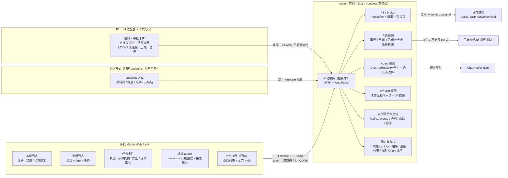

# taomni 移动端 P0：远程实例控制面 详细设计

> 本文档按仓库 `.agents/skills/feature-design` 的模板与工作流编制：决策 `DEC-*`、验收 `AC-*`、任务 `TASK-*`、验证 `V-*` 全程串联。设计状态不代表已经实现或验证；所有验证条目在设计阶段均为待执行。

## 1. 设计摘要与范围

- 类型：新功能（新增移动控制面 + 实例端移动服务）
- 文档位置：`docs-feature/mobile-remote-p0-design.md`
- 设计状态：**部分可实施**（DEC-01～DEC-04、DEC-08～DEC-12 已定或可由 agent 自决，P0 核心任务可开始；剩余待决只影响 IM 的微信落地方式与 diff 数据源细节，不阻塞 P0 核心，见 §10；修订记录见 §1 末。另有一次 Review 修订，见紧随其后的“Review 修订记录”，原有 DEC/AC/TASK/V 编号全部保留、未新增、未重编号）
- 来源：用户需求（2026-10-25 讨论）：移动端开发，主要连接远程 PC 上运行的 taomni 实例并管理多个远程实例；也要能连部署在云上的 taomni；重点是远程执行情况的方便交互（正在执行的终端如何回显到手机并同步操作，但不要重到屏幕共享的程度）；App 还是 Mobile Web 待定；远程一般无公网 IP，是否借助飞书、微信，参考 ZCode（https://github.com/zai-org/ZCode.git）。同日用户在讨论中点选“按这条路线写一份 P0 移动端设计文档”，即接受 §4 的推荐路线（模型 B + Mobile Web 先行 + PTY 共享 + 隧道/组网到达 + IM 只做侧通道）。同日用户随后给出 5 条决策（见修订记录），本设计按这 5 条修订，原 DEC-02、DEC-05、DEC-06、DEC-07 的结论以修订版为准，ID 保留不变。
- 修订记录（2026-10-25，用户 5 条决策）：① 手机主场景定为输入命令、发提示词、看结果、做审批，一般不改代码，但要能看文件、看 diff，交互要方便（快捷键、文本输入）且实时；② 中继与外网访问由用户自行解决，设计中不考虑、不选型、不写厂商步骤；③ 飞书/微信定位为通知与审批入口、可直接发命令、非实时看部分结果与文件；④ 现阶段不考虑上架 App，只做 Mobile Web；⑤ PC 端或云上实例可以开着桌面，也可以 headless 运行。修订影响：P0 新增只读文件查看与 diff 查看；IM 从“仅通知卡片”升级为第二客户端面（P1 适配器，见 DEC-07 与 TASK-07）；headless 从 P1 延期改为与桌面模式同契约的双运行模式（见 DEC-06）；原生壳与上架从 P2 计划改为暂不考虑，不列入本设计后续阶段。同日用户确认分期：IM 放 P1、headless 证明放 P0，此划分已定。
- Review 修订记录（用户 5 点 Review 意见，本次修订）：① 修复 DEC-09 与 AC-02/AC-10 的 CORS 悖论：多实例切换本质是跨域，`/api/v1/*` 须按 §4.4 的两级 CORS 策略放行（配对端点预检回显、业务端点仅放行已配对 Origin），原“实例自身托管即同源、无跨域”的说法作废；② 修复 §4.4 WS 路由矛盾：`task_status` 与 `file_changed` 从终端 WS 迁到新增的实例级事件流 `WS /api/v1/events`，终端 WS 只留 PTY 相关消息，见 AC-15 与 TASK-01/02/03/04 的修订；③ 补充 TASK-01 Linux Headless 无 GUI 约束：`--headless` 须绕过 `tauri::Builder` 直接跑 Tokio Runtime，核心模块的 `AppHandle` 事件发送须解耦为可替换 Sink，见 DEC-06 与 TASK-01 的修订；④ 收紧 PTY resize 与 Ring Buffer：只读态禁止 resize，resize 仅持有写权时可用且释放/抢回时恢复桌面尺寸，Ring Buffer 在 1000 行之外加总字节上限、单行上限、`\r` 覆盖与 UTF-8 跨 chunk 保护，见 DEC-04/DEC-10 与 TASK-02 的修订；⑤ 修正飞书接入：优先用飞书官方 WebSocket 长连接（实例主动出站），入站 webhook 仅为已有公网 endpoint 时的 fallback，见 DEC-07 与 TASK-07 的修订。本次修订未新增、未重编号任何 DEC/AC/TASK/V；本次修订版推送到 PR #743 后，PR 版与本地版一致。
- 调研基线：taomni main `1e8acfa6`（2026-10-25 本地检出，`git status` 仅有 5 个未跟踪的 UI 设计文件，与本文无关）；工作区无已跟踪未提交变更。本设计不提交、不推送，只落盘为未跟踪文档。
- 平台与运行方式：实例端（server）是 Windows、macOS、Linux 三端可运行的服务，server 代码必须兼容三端构建与运行；它有两种运行模式（DEC-06）：桌面模式（随 Tauri 桌面进程运行）与 headless 模式（不建窗口，只跑核心 + 移动服务），两种模式对外是同一 v1 契约。手机端只做 Mobile Web（PWA），在 Android Chrome / iOS Safari 浏览器里运行；现阶段不考虑上架 App，也不做原生壳（DEC-02 修订版）。
- 本轮真机执行端：Linux（当前环境）；Windows/macOS 实例端与 Android/iOS 手机端均保留真机计划（§9），本轮完成 Linux 实例端验证即可满足本轮真机交付条件，其他端未执行不单独阻塞交付，但不得声称三端均已通过；headless 模式的真机验证与桌面模式分开记录。
- 推荐方案：给每个 taomni 实例加一个**移动服务**（新增的 HTTP + WebSocket 服务，见 §4.1），手机是一个**瘦控制面**：实例列表、会话列表、Agent 任务卡片、终端 attach 视图、只读文件查看与 diff 查看。执行、PTY、Agent 状态全部留在实例端；手机只展示和发指令。实例之间、PC 与云之间不分两套协议，区别只在手机用哪个 endpoint URL 到达它。飞书/微信是第二客户端面（P1 的 IM 适配器，见 DEC-07）：它调同一 v1 API，只做通知、审批、直接发命令与非实时快照查看，不承载实时终端流。

用户问题：人在外面时，想用手机知道家里 PC / 公司 PC / 云主机上的 taomni 在跑什么、卡在哪一步，能看正在执行的终端输出，能接管输入，能停掉或继续一个任务，而不用在手机上复刻整个桌面工作台。完成后的可观察结果：手机打开 Mobile Web，看到多个实例的在线状态，点进一个实例看到它的终端会话和 Agent 任务，点进一个正在跑的终端能看到实时输出并可接管输入，任务卡片上有状态、当前步骤摘要、停止与后续指令入口；任务改了文件时，手机能实时看到改了哪些文件、点开看 diff、点开看文件全文（只读）；PC 关掉移动服务后手机立即不可达，桌面本身不受影响。

本次范围（P0）：实例端移动服务（配对、鉴权、会话视图、PTY broker、Agent 视图、只读文件/diff 视图、桌面与 headless 双运行模式）；Mobile Web PWA（实例注册与切换、会话列表、任务卡片、终端 attach、文件查看、diff 查看、配对扫码/手动输入）；到达方式只抽象 endpoint（用户自行解决中继与外网访问，设计不选型，见 DEC-05 修订版）；多实例管理（注册、切换、吊销）。

本次范围（P1）：飞书/微信 IM 适配器（通知、审批入口、直接发命令、非实时结果与文件快照查看），见 TASK-07；它复用 P0 的 v1 API，不另建协议。

不做（明确排除）：原生 App 壳与应用商店上架（现阶段不考虑，未来如需另行决策）；手机上改代码、保存文件、解决冲突；手机上新建 SSH 连接、SFTP、数据库、RDP/VNC；云实例的开通/计费/多租户；屏幕共享；IM 承载实时终端流。

兼容约束：桌面终端、聊天、会话的现有行为不得改变（AC-12）；移动服务默认关闭，关闭时不监听、不产生新端口、不影响桌面启动；移动服务开启也不改变桌面 UI，除设置页新增“移动服务”入口与已配对设备列表外；headless 模式不依赖任何窗口/WebView 状态。

## 2. 当前实现与功能缺口

| 位置与符号 | 当前行为 / 契约 | 本次影响 | 依据与确定性 |
|---|---|---|---|
| `src-tauri/src/terminal/io_commands.rs` `write_terminal` / `resize_terminal` / `send_terminal_signal` / `close_terminal` | 已有 Local 与 SSH 两种 `ActiveTerminal` 分支的写、改尺寸、发信号、关闭 | 移动服务的 PTY broker 直接复用这套抽象，P0 因此同时覆盖 PC 上的本地终端与 SSH 终端，不用为移动端再写一套 SSH 客户端 | 源码实查（事实） |
| `src-tauri/src/terminal/output.rs` `TerminalOutputSubscribers` / `attach_terminal_output` / `send_terminal_output` | 终端输出通过 Tauri channel 发给桌面 WebView 订阅者；`read_loop_local` 读到数据即 `send_terminal_output`，退出时发 `terminal-exit-{session_id}` | 订阅模型可复用，但传输必须新增：Tauri channel 只到本机 WebView，到不了手机。新增 WS broker 时，输出扇出点应与现有 `send_terminal_output` 同源，避免桌面与手机看到两份不同输出 | 源码实查（事实） |
| `src-tauri/src/terminal/pty.rs` / `pty/lifetime.rs` | `create_pty`、`create_command_pty`、`resize_pty` 等本地 PTY 能力 | P0 不新增 PTY 创建路径（只 attach 已有会话）；移动端“新建终端”如需进入 P1，届时再复用此处 | 源码实查（事实） |
| `src-tauri/src/session/mod.rs` `list_sessions`、`src-tauri/src/session/models.rs` `SessionConfig` / `SessionType` | 会话配置持久化与按组列出 | 移动会话列表的“已保存会话”部分由此派生；“正在运行的终端”部分来自运行中终端注册表，两者是不同来源，视图层要合并而非混淆 | 源码实查（事实） |
| `src-tauri/src/session/resume.rs` run snapshot | Welcome 页的上一轮运行快照：可恢复的会话 tab 集合，含白名单本地终端，不含整个工作区 | 只能证明“桌面重启后恢复 tab”已有快照概念，**不能**直接当作手机断线重连的回放，也不覆盖 Agent 轮次。手机重连回放由新增的 PTY ring buffer 负责（§4.3），不复用该快照表 | 源码实查（事实） |
| `src-tauri/src/chat/run.rs` `ChatRunRegistry` / `ChatRunHandle::stop` | 在途聊天轮次的注册表；`DirectLlm` 用取消令牌，桥接进程用 `stop()` | 手机“停止当前轮次”映射到此处；这是 P0 唯一有把握的 Agent 干预动作。通用“审批”没有对应的统一注册表，见 AC-06 的条件性处理 | 源码实查（事实） |
| `src-tauri/src/agent/`、`src/components/agent/`、`src/components/chat/` | Agent 桥接、工具卡片、确认卡片（如 `WebSearchConfirmCard`、`ActionCard`）散落在各桥接与 UI 处 | TASK-03 必须先盘点桌面已有的确认点，再决定手机能透传哪几个；不得在盘点前承诺“所有审批都能在手机上点” | 源码实查（事实，盘点结果待 TASK-03） |
| `src-tauri/src/lib.rs`、`src-tauri/src/main.rs` | 无对外 HTTP / WebSocket 服务注册 | 移动服务是全新服务层，不是“把 Tauri IPC 暴露出去”。Tauri IPC 保留给桌面 WebView，手机走独立的 HTTP + WS 契约（§4.4） | 源码检索实查（事实） |
| `src-tauri/src/servers/http.rs`、`src-tauri/src/servers/ssh.rs` | 前者是面向用户配置的静态文件 HTTP 服务（可配 CORS、目录浏览、根目录回退）；后者是内置 SSH/SFTP 服务 | **两者都不复用为移动入口**：静态服务的设计目标不是鉴权 API，SSH 服务面向局域网受信场景。移动服务独立成模块、自带鉴权与默认回环绑定（§4.5） | 源码实查（事实） |
| `src/components/terminal/TerminalPanel.tsx`、`src/components/chat/ChatDrawer.tsx`、`src/stores/` | 桌面 SPA：xterm.js 终端、聊天抽屉、Zustand stores，全部依赖 Tauri IPC | 桌面前端不能原样当作手机前端。P0 手机 Web 是独立小应用，只借鉴 xterm 接线方式与任务卡片的信息结构，不直接复用桌面组件与 stores | 源码实查（事实） |
| `vite.config.ts`、`package.json`（`pnpm dev` 浏览器预览） | 浏览器预览用 Tauri stubs，端口见配置 | 预览模式证明“React 前端可在浏览器跑”，但 stubs 不能证明手机能连真实实例。P0 手机 Web 的开发联调必须连真实移动服务（V-04），不能只用 stubs 交差 | 源码实查（事实） |
| ZCode 官方文档（外部事实，2026-10-25 查阅） | 远程开发是桌面连 SSH/WSL/Docker，桌面负责账号与任务入口；Mobile Remote Control 不能新建连接，只能对桌面窗口已注册且断开的工作区触发重连，实际连接仍由桌面完成 | 本设计**不照抄 ZCode 字面模型**：ZCode 的手机是桌面遥控器，本设计的手机是多实例控制面（DEC-01）。抄前者会丢掉“多实例 + 云”这个用户核心诉求 | 文档实查（事实） |
| OpenCode Mobile 文档（外部事实，2026-10-25 查阅） | “OpenCode 跑活，Mobile 只是控制面”；连接方式含局域网地址、扫码配对、Tailscale、Cloudflare Tunnel、反向代理，连接档案可切换 | 本设计的模型 B 与 endpoint 抽象与之同构，但协议、配对与鉴权按 taomni 现状重写，不照搬其 API | 文档实查（事实） |

短板归纳：缺一个对外服务层；缺 PTY 输出的跨进程扇出与回放；缺统一的“实例 → 会话 → 任务”移动视图；缺配对与 per-instance 鉴权。这四点即 P0 要正面解决的，不绕开，也不在 P0 顺带重构桌面终端、聊天或 SSH。

## 3. 验收条件

| ID | 场景与前置条件 | 用户动作或触发 | 必须观察到的结果 | 适用平台 / 边界 |
|---|---|---|---|---|
| AC-01 | 桌面已开启移动服务，手机未配对 | 桌面显示配对码/二维码，手机扫码或手动输入 endpoint + 配对码 | 一次性码单次有效、5 分钟过期，过期或复用均失败；成功后手机拿到 per-instance token，桌面已配对设备列表出现该设备；token 不出现在 URL 里 | 三端实例 + Android/iOS 浏览器 |
| AC-02 | 手机已配对两个实例（一台 PC、一台云主机 endpoint）；PWA 外壳由实例 A 托管 | 在实例列表切换到实例 B；在一个实例的桌面吊销该设备 | 切换后会话列表、任务状态立即属于新实例，旧实例 WS 断开；被吊销后该实例全部 API 返回鉴权失败，手机显示“已被实例吊销”，不自动用旧 token 重试；从 A 的 Origin 向 B 发 API 请求时，B 按 §4.4 两级 CORS 策略放行（已配对 Origin 预检通过、业务请求带 Authorization 头可读），未配对 Origin 的预检不通过、浏览器不发出业务请求；吊销设备时其 Origin 同步从 B 的放行清单中删除 | 三端实例 + 手机浏览器；云实例与 PC 实例同一协议；多实例切换本质是跨域，原“同源即无跨域”的说法作废（Review 修订） |
| AC-03 | PC 上某终端正在输出（如长命令、Agent 日志） | 手机打开该终端 attach 视图 | 先看到最近输出的尾部（§4.3 的行尾回放），随后实时输出与桌面同一 PTY 一致，不另开新 shell；退出视图再进入，仍是同一会话 | 本地终端与 SSH 终端均适用 |
| AC-04 | 桌面与手机同时看着同一终端 | 手机默认只读；只读态下尝试改终端尺寸；手机点“接管输入”并改尺寸；桌面随后敲键盘或改尺寸 | 只读时手机键盘不向 PTY 写，resize 请求亦被服务端拒绝（回 `not_holder`，不转发给 PTY）；接管后手机输入到达 PTY，resize 仅在持有写权时生效且受上下限钳制（见 §4.3）；桌面一输入即抢回写权，手机收到写权丢失提示并回到只读，同时 PTY 尺寸恢复为桌面最后一次尺寸（不得把桌面终端长期挤窄，AC-12）；Agent 正在执行时接管前有“输入可能打断执行”的提示 | 三端实例 + 手机浏览器 |
| AC-05 | 某 Agent 线程正在跑一轮 | 手机打开任务卡片，点“停止”；再发一条后续指令 | 停止映射到 `ChatRunRegistry` 的取消/进程停止，任务状态变为已停止；后续指令作为新一轮发出，不篡改已停止轮次的历史 | 三端实例；停止语义以 TASK-03 盘点为准 |
| AC-06 | 桌面已有确认点（如 TASK-03 盘点出的工具/搜索确认） | 手机在任务卡片上看到待确认项并点同意/拒绝 | 仅当盘点确认该确认点可透传时才出现按钮，决定回传到同一确认点；盘点确认不可透传的确认点，手机只显示“需在桌面确认”，不提供假按钮 | 条件性：以 TASK-03 盘点结论为准，不可透传则本条降级为提示 |
| AC-07 | 实例可通过用户自备的两种 endpoint 到达（如局域网地址与用户自建的隧道/组网域名） | 手机两次分别用两个 endpoint URL 配对同一实例 | 两次都只填 endpoint URL + 配对码即通，客户端代码无厂商分支；设计不提供、不选型、不配置中继与外网访问（用户自行解决，DEC-05 修订版） | 三端实例；到达方式的可达性本身不在本设计验收内，只验收“给定可达 endpoint 时能通” |
| AC-08 | 手机断网后恢复，或 WS 断开后重连 | 重连同一终端 attach 视图；重连实例级事件流 | 终端流按序列号续接，不重复输出已收到的行；重连后先补行尾回放再接实时流；事件流按事件序列号续接，超出事件缓冲时服务端回 `resync`，手机改用 REST 重拉会话/任务/改动列表，不丢已收状态；重连期间手机显示“重连中”，不把旧输出清空 | 手机浏览器；弱网为必测场景 |
| AC-09 | 移动服务关闭，或实例下线；实例以桌面模式或 headless 模式运行 | 手机打开实例/会话；同一实例先以桌面模式、再以 headless 模式提供服务 | 移动服务关闭时实例端不监听新连接；手机显示实例离线与上次在线时间，不自动删除注册信息；重新开启并配对（或 token 未吊销时重连）后恢复；两种运行模式下手机看到的实例信息、会话列表、终端与任务能力一致（`health` 返回 `run_mode` 仅作展示，不作客户端分支） | 三端实例；两种模式分开验证 |
| AC-10 | 安全基线：未配对请求、过期 token、跨实例 token、未配对 Origin | 直接调 API、复用另一实例 token、暴力猜配对码、从未配对 Origin 发跨域请求 | 全部 API（含 WS 升级）先鉴权后执行业务；配对接口限流并记失败日志；token 只以哈希存于实例端，手机端 PWA 存于浏览器存储（此为现阶段已知短板，须在 UI 与文档中明示；现阶段不做原生壳，故不承诺 Keychain/Keystore）；CORS 按 §4.4 两级策略：响应头不出现 `*`，不设 `Access-Control-Allow-Credentials: true`（token 走 Authorization 头而非 Cookie，无 ambient 凭据可被跨站利用），业务端点仅回显已配对 Origin，WS 握手同样校验 Origin；不得复用 `servers/http.rs` 的 `Access-Control-Allow-Origin: *` 做法 | 三端实例；安全回归见 V-06 |
| AC-11 | 手机消费慢、网络抖动 | 终端高速输出时手机后台切前台 | 服务端单连接出队有界，慢消费者不断线即被断开并可按序列号重连恢复，不出现服务端内存无界增长；心跳超时按 §4.4 处理 | 三端实例 |
| AC-12 | 桌面回归：移动服务关与开两种状态 | 正常使用桌面终端、聊天、会话切换、SSH 终端 | 两种状态下桌面行为与改前一致；移动服务开启不新增桌面弹窗、不改变现有会话列表顺序、不占用桌面终端的写权（桌面输入始终可抢回，AC-04） | 三端桌面 |
| AC-13 | PWA 安装与离线外壳 | 手机浏览器“添加到主屏幕”，断网后打开 | 已缓存的外壳可打开并显示实例列表与“离线”提示；实时数据缺失时不展示过期数据当作最新（每块数据标上次更新时间） | Android Chrome / iOS Safari；离线仅指外壳，不承诺离线操作 |
| AC-14 | P0 边界（反向验收） | 在手机上找文件编辑、保存、冲突解决、SFTP、数据库、RDP/VNC、新建 SSH 连接入口 | 均不存在；超出 P0 的入口不得以占位按钮出现；文件查看与 diff 查看是只读的（见 AC-15），不是编辑入口 | 手机浏览器 |
| AC-15 | 任务改了文件，手机正在看该任务；手机只看任务卡片/改动页、未打开任何终端 | 打开任务的“改动”页；任务又改了一个文件；点开一个文件 | 改动列表实时更新（实例级事件流 `WS /api/v1/events` 推送 `file_changed` 后刷新列表，不靠手动刷新、不依赖终端 WS）；不打开终端时任务状态（`task_status`）与改动推送仍能到达；点文件看到只读全文（行号、大文件截断并提示）；点 diff 看到该文件的统一 diff（分 hunk 折叠、超长截断）；文件 API 只允许实例已注册的工作区根目录内的规范化路径，越界、符号链接逃逸均拒绝 | 三端实例；diff 数据源以 TASK-04 盘点为准（git diff 优先，工具改动摘要为 fallback，盘点前不承诺某一数据源） |
| AC-16 | 同一实例以 headless 模式运行（无窗口）；Linux 云主机无 Display | 手机配对、看会话、看终端、停任务、看文件/diff；无 Display 环境下启动 `--headless` | 全部能力与桌面模式一致；headless 进程退出即实例离线，手机不自动改 endpoint；headless 不依赖桌面设置页配对（配对码由命令行/日志输出，TASK-01 定确切方式）；Linux 无 Display 下 `--headless` 不触发 `gtk::init()` panic、不建窗口、不初始化 WebView，移动服务正常响应（该用例须在真正无 Display 的环境验证，在有 Display 的桌面会话里跑过不算通过） | 三端实例；headless 为 P0 运行模式，不是 P1 延期；Linux 无 GUI 约束见 DEC-06 修订 |
| AC-17 | P1：飞书/微信 IM 已绑定实例；实例位于无公网 IP / VPN 组网环境（无入站端口） | 实例任务完成、等审批、掉线时 IM 收到消息；用户在 IM 里发“批准”“发一条后续指令”“看当前任务摘要/某文件” | IM 收到的是状态通知与审批入口卡片（不是实时终端流）；在 IM 里回复批准/拒绝可回传到同一确认点（仅 TASK-03 确认可透传的点）；在 IM 里发的后续指令作为新一轮发出；在 IM 里要结果/文件时返回截断摘要 + 跳回 Mobile Web 的链接，不贴全文终端流；IM 身份须绑定到已配对的白名单用户，未绑定身份的指令一律拒绝；飞书在无入站端口时仍能工作：适配器优先用飞书官方 WebSocket 长连接（实例主动出站），不依赖入站 webhook；入站 webhook 仅为实例已有公网 endpoint 时的 fallback | P1；飞书先行，微信落地方式待决（见 §10）；IM 不替代 Mobile Web 的实时查看 |

## 4. 方案与关键决策

### 4.1 总体结构

关键结构决策：移动服务与核心注册表同属实例进程（桌面模式随桌面进程运行，headless 模式不建窗口只跑核心 + 移动服务），但对外契约独立，且不依赖任何窗口/WebView 状态。这样桌面模式与 headless 模式是同一服务的不同启动方式，不是两套后端；也避免了“手机直连 SSH 再绕回 taomni”的双通道不一致。代价是 TASK-01 必须先划清“核心（终端/任务/文件视图）与 UI（窗口/设置页）”的边界，headless 才能真正跑起来——这是 P0 的一部分，不是可无限延期的 P1（DEC-06 修订版）。另有两个结构修正（Review 修订）：① 多实例切换本质是跨域，PWA 外壳由哪个实例托管只决定初始 Origin，之后向其他实例的请求一律走 §4.4 的 CORS 策略，不得以“同源托管”规避跨域；② 任务/改动/会话事件走实例级事件总线，与 PTY 输出流分离，避免 PTY 高速输出的背压拖垮任务事件，也避免“不开终端就收不到任务推送”的路由矛盾。

### 4.2 用户流程与交互

入口：桌面模式在设置页新增“移动服务”：开关、监听方式、配对码生成、已配对设备列表与吊销；headless 模式的配对码由命令行/日志输出（TASK-01 定确切方式，不依赖设置页）。手机首次打开 Mobile Web：实例列表为空 → “添加实例” → 扫码或手动输入 endpoint + 配对码 → 成功后进入该实例的会话列表。P1 的 IM 入口不在 Mobile Web 内：用户先在实例端绑定 IM 身份（白名单用户），再在飞书/微信里与机器人对话。

主流程状态表：

| 当前状态 | 动作或事件 | 前置条件 | 下一状态与可见反馈 | 失败 / 取消处理 |
|---|---|---|---|---|
| 实例列表 | 点实例 | 已配对、token 未吊销 | 进入会话列表，WS/HTTP 连通性指示 | 离线：显示上次在线时间与重试，不删注册 |
| 会话列表 | 点终端会话 | 该终端仍在运行中注册表里 | 终端 attach：先行尾回放，再实时流 | 会话已退出：显示已退出与最后输出尾部，不自动新建 |
| 终端 attach（只读） | 点“接管输入” | 无其他写权持有者或桌面未输入 | 获得写权，键盘条出现（Tab/Esc/Ctrl-C/Ctrl-L/历史/粘贴） | 桌面输入抢回：立即回只读并提示 |
| 终端 attach（只读） | 尝试改终端尺寸 | 未持有写权 | 尺寸不变，服务端回 `not_holder` 并提示“只读态不能改尺寸” | 不转发给 PTY，不影响桌面终端尺寸 |
| 任务卡片（运行中，未打开终端） | 任务状态变化 / 文件改动 | 已连实例级事件流 | 任务卡片与改动列表经 `/api/v1/events` 实时更新，无需打开终端 | 事件流断开：按事件序列号续接或 `resync` 后 REST 重拉 |
| 任务卡片（运行中） | 点“停止” | 该轮次在 `ChatRunRegistry` 中 | 状态变为已停止 | 已自然结束：按钮变灰，不发重复取消 |
| 任务卡片（待确认） | 点同意/拒绝 | TASK-03 确认该确认点可透传 | 决定回传，卡片状态更新 | 不可透传：只显示“需在桌面确认” |
| 任务卡片（有改动） | 点“改动”/点文件/点 diff | 任务已产生文件改动 | 改动列表实时更新；文件只读全文；diff 分 hunk 折叠 | 大文件/超长 diff：截断并提示，不整页卡死；越界路径：拒绝并提示 |
| 任意实时视图 | WS 断开 | 网络恢复 | 重连中提示 → 按序列号续接 | 多次重连失败：停在可重试的错误态，不丢已收输出 |
| P1：IM 对话 | 发“批准”“继续做 X”“看当前任务/某文件” | IM 身份已绑定白名单 | 通知卡片、审批回传、后续指令发出、截断摘要 + 回 Mobile Web 链接 | 未绑定身份：拒绝；要实时终端流：只给链接，不在 IM 里推流 |

手机键盘与版式：竖屏以任务卡片为主、终端为辅；横屏可全屏终端。终端视图除系统键盘外常驻常用键条，粘贴为显式操作（不自动把剪贴板内容发往 PTY）。长输出默认折叠为摘要行，点“展开日志”才进终端视图，避免任务列表被刷屏。

输入要分两个通道，不得混用：① 终端通道：PTY 输入（命令、Ctrl-C 等），走接管写权；② Agent 通道：提示词输入（多行编辑器、历史、常用指令模板、发送后清空），走 `message` 接口，不经过 PTY。两个通道在 UI 上分开：终端视图的键条只影响 PTY，任务卡片的编辑器只发提示词。快捷操作：常用键条（Tab/Esc/Ctrl-C/Ctrl-L/上下历史/粘贴）、任务卡片快捷按钮（批准/拒绝/停止/继续）、改动列表直达文件与 diff。实时性定义：终端输出由终端 WS 推送，任务状态、改动列表、会话变化由实例级事件流 `/api/v1/events` 推送，均不靠定时轮询刷新；IM 通道明确是非实时的，只做快照与指令，不承诺实时流。

### 4.3 数据流、状态与生命周期

权威状态在实例端，不在手机：终端 PTY 状态、任务在途状态、配对设备清单均以实例端为准；手机只缓存实例注册信息（endpoint、标签、上次在线）与当前视图的已收输出。手机切后台、关页面、换实例都不改变实例端的执行。

PTY broker（拟新增，见 §5）：每个运行中终端一个 ring buffer，只存内存，不落盘。回放语义定为**行尾回放 + 实时流**（DEC-04）：buffer 按行切分，保留最近 1000 行（含 ANSI 转义，由手机 xterm 渲染），并同时受以下边界约束，任一先到即淘汰最旧行：① 总字节上限 512 KiB（按 UTF-8 解码后文本计）；② 单行上限 16 KiB，超长行截断并在行尾加截断标记，不得让一行无限增长撑爆内存；③ `\r` 覆盖语义：不带 `\n` 的 `\r` 视为改写当前行（如进度条），不产生新行，否则进度条会以每刷新一行淹没 ring buffer；④ UTF-8 跨 chunk 保护：PTY 输出是字节流，服务端须用增量 UTF-8 解码器持有未完成的尾字节，直到序列完整再成行，不得对每个 chunk 单独 `from_utf8_lossy`（否则拆在多字节字符中间的 chunk 会被误写成替换字符）。attach 时先发这 1000 行以内的尾部，再发带单调序列号的实时增量。不断言“完整虚拟屏快照”，因为 P0 不在服务端引入 VT 屏幕解析器；桌面与手机同步的保证是“同一 PTY + 同一输出流”，不是“同一像素屏”。

写权锁：每终端一个写权持有者，取值 `desktop | mobile:<deviceId> | none`，默认 `desktop` 语义下的手机只读（即手机初始为 `none`，需显式接管）。桌面输入事件到达即抢回（实现上：桌面写路径在接管期间仍可写，broker 在桌面写时把手机写权置为 `none` 并推送 `control-lost` 事件）。手机写权在显式释放、WS 断开、终端退出时自动释放。Agent 执行期间的手机输入与桌面输入走同一 PTY，不做内容过滤，但接管前必须有打断提示（AC-04）。

resize 权限（DEC-10 的一部分，与写权同一把锁）：手机只读态（未持有写权）下，resize 请求一律被服务端拒绝（回 `not_holder`），不得转发给 `resize_terminal`，否则手机在小屏上的一次 resize 会把桌面终端列宽挤窄，违反 AC-12 的桌面回归。持有写权时 resize 才生效，且受钳制（cols 20～300、rows 10～100，超出钳制，尺寸不变时不转发以免抖动）。服务端另行记录桌面最后一次尺寸：桌面经现有 `resize_terminal` 改尺寸时更新该值；手机释放写权或被桌面抢回时，服务端把 PTY 尺寸恢复为桌面尺寸（恢复失败时记日志、不阻塞写权释放）。SSH 终端同理，走 `resize_terminal` 的 SSH 分支（`window_change`），不另开通道。

会话视图派生规则（P0 不新开持久化表）：运行中终端来自终端注册表；已保存会话来自 `list_sessions`；Agent 任务状态来自线程记录 + `ChatRunRegistry`（在途才有“运行中”，其余按线程最后状态展示）。若 TASK-02/03 盘点发现某字段无法派生（如线程最后状态字段缺失），允许在该任务内补一个只读派生字段，但不得为手机单独复制一份会话 DB。

文件/diff 视图（P0 只读）：改动列表来自任务的工具调用摘要与工作区变更（数据源以 TASK-04 盘点为准，git diff 优先、工具改动摘要为 fallback）；文件全文来自实例磁盘，但只允许已注册工作区根目录内的路径：先规范化（含符号链接解析），再校验仍在根内，越界一律拒绝，不只做字符串前缀判断（这是对既有 SFTP 沙箱仅 lexical 边界的显式收紧，移动文件 API 不得复用其宽松实现）。文件内容不落手机端缓存以外的持久化，大文件截断；diff 按 hunk 折叠，超长截断。文件改动事件经实例级事件流 `WS /api/v1/events` 推送 `file_changed { task_id, path, change_kind }`（不是终端 WS），手机收到后拉取列表与 diff，不轮询；任务状态 `task_status` 与会话变化亦同理走事件流，见 §4.4。

生命周期与资源：WS 连接断开即释放该连接的订阅与写权；ring buffer 随终端退出释放；配对设备吊销即吊销 token，后续 WS 握手失败；移动服务关闭时先断开全部手机 WS 再停止监听，桌面终端不受影响。

### 4.4 接口与共享契约（拟新增，v1）

所有接口先鉴权后执行业务；WS 升级时同样鉴权（`Authorization: Bearer <token>` 头；浏览器 WS 无法自定义头时，用一次性的短效 WS 票据换取，票据由已鉴权的 HTTP 接口签发、单次有效、60 秒过期，禁止把长期 token 放进 URL 查询串）。

跨域策略（Review 修订，DEC-09 的配套契约，原“同源托管即无跨域”说法作废）：PWA 外壳由哪个实例托管只决定它首次加载的 Origin；用户在实例列表里切到另一实例时，浏览器向该实例的 `/api/v1/*` 请求就是跨域请求（Origin 为前一实例的域名/地址），不做 CORS 会直接被浏览器拦在预检阶段，切换实例的功能本身不可用。因此 `/api/v1/*` 必须显式支持跨域，且按两级策略执行，不得只写“同源”规避：
- 两级放行。① 配对端点 `POST /api/v1/pair` 的预检（OPTIONS）：回显请求 Origin（`Access-Control-Allow-Origin: <Origin>`，`Vary: Origin`）。配对前服务端尚不知道该 Origin 是否可信，但预检本身不放行任何业务：真正的配对仍须一次性码 + 限流，恶意站点即使通过预检也拿不到码、拿不到 token。② 其他业务端点（含 WS 票据签发）的预检与实际响应：仅当请求 Origin 在该实例的“已配对 Origin 清单”中时才回显该 Origin，否则不回显 CORS 头，浏览器即不发出/不读取业务请求。清单在配对成功时记录（记录配对时请求 Origin 与 device_id 的对应关系，一个设备可有多个 Origin，如局域网地址与隧道域名），设备吊销时同步删除该设备的 Origin，清单随设备清单一并持久化。
- 响应头固定集（两级均适用）：`Access-Control-Allow-Methods: GET, POST, OPTIONS`；`Access-Control-Allow-Headers: Authorization, Content-Type`（必须含 Authorization，否则带 Bearer 头的请求在预检即被拦）；`Access-Control-Max-Age: 86400`；`Access-Control-Allow-Credentials: false`（恒为 false，不设为 true）。禁止出现 `Access-Control-Allow-Origin: *`，也不得复用 `servers/http.rs` 静态服务的 `*` 做法；禁止把 token 放进 Cookie（本设计 token 只走 Authorization 头，无 ambient 凭据可被跨站请求利用，CORS 回显因此不构成越权：没有 token 的跨域请求仍会在业务层被鉴权拒绝，CORS 只决定浏览器能否读取响应，不决定服务端是否执行）。
- WS 握手：WebSocket 不受 CORS 预检约束，但服务端须在握手时同样校验 Origin（仅允许已配对 Origin 清单中的值）+ 票据，二者缺一即拒绝升级；票据本身只能经已通过 CORS 与鉴权的 HTTP 接口签发，因此“先 HTTP 配对/签票、后 WS 握手校验 Origin”是同一条信任链，不存在 WS 绕过 CORS 的旁路。
- 静态资源 `/`：外壳文件本身不跨域读取其他实例的静态资源，PWA 外壳始终只从当前打开的实例加载；切换实例时客户端不跨域加载对方外壳，只跨域调对方 API（按上两级策略），因此不需要为静态资源开 CORS。

| 类型 / 名称 | 调用方 → 实现方 | 输入及序列化 | 输出 / 错误 / 事件 | 兼容规则 |
|---|---|---|---|---|
| `GET /api/v1/health` | 手机 → 移动服务 | 无（可不鉴权，仅返回服务版本与是否需配对） | `{ service: "taomni-mobile", version: "1", pairing_required: bool }` | 只读，不泄露实例名与会话 |
| `POST /api/v1/pair` | 手机 → 移动服务 | `{ endpoint_label, pairing_code }`（HTTPS 下传输） | 成功 `{ device_id, token }`（token 仅此次返回）；失败 `{ error: "invalid_or_expired_code" \| "rate_limited" }` | 一次性码单次有效、5 分钟过期；限流并记失败 |
| `GET /api/v1/sessions` | 手机 → 移动服务 | Bearer token | `{ sessions: [{ id, kind: "terminal" \| "agent", title, status, last_activity_at, summary }] }` | 派生视图，字段只增不改语义；v1 内不删除字段 |
| `GET /api/v1/sessions/{id}` | 手机 → 移动服务 | Bearer token | 会话详情：终端为 cwd/类型/状态；Agent 为线程、当前步骤摘要、工具调用摘要（工具名 + 目标路径 + 状态，不含文件全文） | 同上 |
| `POST /api/v1/sessions/{id}/stop` | 手机 → 移动服务 | Bearer token | 终端：按 `send_terminal_signal` 语义处理（TASK-02 定信号，默认不直接杀进程）；Agent 轮次：`ChatRunRegistry` 停止 | 幂等：已停止再调返回已停止，不报错为失败 |
| `POST /api/v1/sessions/{id}/message` | 手机 → 移动服务 | `{ text }` | 作为该线程的新一轮发出 | 不篡改历史轮次 |
| `POST /api/v1/tasks/{id}/confirmations/{cid}` | 手机 → 移动服务 | `{ decision: "approve" \| "reject" }` | 仅 TASK-03 确认可透传的确认点可用 | 不可透传时返回 `not_supported_on_mobile`，手机按 AC-06 展示 |
| `GET /api/v1/tasks/{id}/changes` | 手机 → 移动服务 | Bearer token | `{ changes: [{ path, change_kind, diff_available }] }`，只含路径与状态，不含全文 | 路径须在工作区根内；越界返回拒绝 |
| `GET /api/v1/files?path=...` | 手机 → 移动服务 | Bearer token + 规范化路径（查询串只传路径，不传 token） | 只读全文（截断标记 `{ truncated: bool }`）；大文件只返回前 N 行并提示 | 越界、符号链接逃逸、二进制文件均拒绝或转摘要，TASK-04 定确切规则 |
| `GET /api/v1/tasks/{id}/changes/{path}/diff` | 手机 → 移动服务 | Bearer token | 统一 diff（分 hunk，超长截断） | 数据源以 TASK-04 盘点为准；无 diff 时返回 `diff_unavailable` 而非空 diff |
| `WS /api/v1/terminals/{id}/stream` | 手机 ↔ 移动服务 | 握手票据 + Origin 校验（见上跨域策略）；客户端消息见下 | 服务端消息见下；错误 `{ type: "error", code }` 后关闭 | 序列号单调递增，断线可续接；本连接只承载 PTY 相关消息，不承载任务/改动事件 |
| `WS /api/v1/events`（拟新增，实例级事件流） | 手机 ↔ 移动服务 | 握手票据 + Origin 校验；客户端消息见下 | 服务端消息见下；错误 `{ type: "error", code }` 后关闭 | 每实例一连接，事件序列号单调递增；断线可按事件序列号续接，超出缓冲时回 `resync` |
| `POST /api/v1/im/webhook`（P1，fallback，拟新增） | 飞书/微信平台 → IM 适配器 | 平台签名 + 白名单用户身份 | 适配器内部调同一 v1 API（通知、审批、发命令、快照查询），回复为截断摘要 + Mobile Web 链接 | 仅当实例已有公网 endpoint 时可用；未绑定身份、签名失败一律拒绝；IM 通道不提供实时终端流；微信落地方式待决（见 §10）；飞书优先走 WebSocket 长连接，见 DEC-07 修订 |

WS 消息（JSON，输出数据用 base64，避免控制字符破坏帧解析）：

- 终端流，服务端 → 手机：`{ type: "replay", lines: [...] }`、`{ type: "output", seq, data_b64 }`、`{ type: "control", holder }`、`{ type: "control-lost", reason: "desktop_input" }`、`{ type: "exit", code }`、`{ type: "heartbeat" }`。原版本里放在终端流的 `file_changed` 与 `task_status` 已迁出（Review 修订），终端流不再发这两类消息，否则“只看任务卡片/改动页、不打开终端”时手机收不到推送。
- 终端流，手机 → 服务端：`{ type: "input", data_b64 }`（仅持有写权时生效，否则服务端丢弃并回 `not_holder`）、`{ type: "resize", cols, rows }`（仅持有写权时生效，否则回 `not_holder` 并拒绝，不转发给 PTY，见 §4.3）、`{ type: "take-control" }`、`{ type: "release-control" }`、`{ type: "resume", after_seq }`、`{ type: "heartbeat-ack" }`。
- 事件流，服务端 → 手机：`{ type: "hello", instance_id, run_mode, event_seq }`、`{ type: "task_status", task_id, status, summary }`、`{ type: "file_changed", task_id, path, change_kind }`、`{ type: "session_changed", session_id, change_kind }`、`{ type: "resync" }`、`{ type: "heartbeat" }`。手机收到 `task_status`/`file_changed` 后拉取任务/改动列表（REST），事件本身不贴终端流与文件全文。
- 事件流，手机 → 服务端：`{ type: "resume", after_seq }`、`{ type: "heartbeat-ack" }`。事件流不做主题订阅过滤（P0 全量推送、客户端按 task_id 过滤），避免订阅协议与服务端过滤状态再引入一层不一致。
- 分离理由（不得把事件流与终端流合并为单连接多路复用）：PTY 输出是高速、大体积流，任务/改动事件是低频、关键流；同一出队会让 PTY 背压拖垮任务事件的时效，同一序列号也会让两类续接互相干扰。两条连接各有独立出队与序列号，任务事件不受 PTY 洪流影响。
- 事件缓冲与续接：服务端为事件流保留最近 200 条事件（内存，不落盘）；`resume` 的 `after_seq` 在缓冲内即重发缺失事件，超出缓冲即回 `resync`，手机改用 REST 重拉会话/任务/改动列表，不谎称已同步。
- 背压：单连接出队有界（终端流建议 512 条，TASK-02 可按实测调整并在文档中回填最终值；事件流建议 200 条，与缓冲同量级）；超限即断开该连接，手机按序列号重连，不由服务端无界缓存。
- 心跳：两条流均适用：服务端 30 秒无业务消息即发 heartbeat，手机 90 秒未收到任何帧即判定断线并重连；重连退避为 1s / 2s / 5s 上限 30s，不无限高频重试。

手机静态资源：移动服务在 `/` 提供 Mobile Web 静态文件（PWA 外壳），由实例自身托管、无额外托管；但这不等于“与全部实例同源”：外壳只从当前实例加载，向其他实例调 API 时一律走上两级 CORS 策略（见 DEC-09 修订）。构建时把手机 Web 构建产物拷入实例资源目录（§5），不由桌面 WebView 的 asset 协议提供。

### 4.5 三端兼容与相关存储、故障边界

- 实例端三端：移动服务只用 Tokio + 标准网络与同步原语，不引入平台专属依赖；配对、token 哈希、ring buffer、WS 均与平台无关。Windows/macOS/Linux 的差异只在桌面设置页入口，不在协议层；中继与外网访问由用户自备，不在本设计内。
- 实例端双模式：桌面模式与 headless 模式共享核心与 v1 契约，区别只在启动方式（建窗口 vs 不建窗口）与配对码输出方式（设置页 vs 命令行/日志）。TASK-01 必须证明核心不依赖窗口/WebView 状态，否则 headless 模式不得宣布完成。Linux 无 GUI 约束（Review 修订，DEC-06 的一部分）：`--headless` 模式不得调用 `tauri::Builder`（现有 `lib.rs` 的 `run()` 在 Linux 下走 Builder → `gtk::init()`，无 Display 的云主机上会 panic，headless 若复用该路径即是假 headless）；须在 `main.rs` 的命令行分发处（已有 `--screenshot-scroll-input` 等绕过 `run()` 的先例）在进 `taomni_lib::run()` 之前拦截 `--headless`，直接构建 Tokio Runtime、只初始化核心（DB、会话/终端注册表、移动服务）与事件 Sink，不初始化 GTK、WebView、窗口与桌面插件。核心模块现有的 `AppHandle` 事件发送（桌面终端退出 `terminal-exit-*`、SSH 认证提示、聊天流事件等）在移动服务路径上须解耦为可替换的 `EventSink` trait：桌面模式用 `AppHandle` 适配器（行为不变），headless 模式用转发到移动事件流 `/api/v1/events` / 日志的适配器；TASK-01 须先盘点 `AppHandle` 使用点并分类（移动路径必需 → 改 Sink，桌面专属 → headless 路径不得调用），不得用静默丢弃关键事件的空实现冒充解耦。
- 手机端：只做 Mobile Web，不做原生壳与上架；P0 只要求现代移动浏览器（Android Chrome、iOS Safari），不要求原生能力；iOS PWA 的推送与后台限制是已知短板，P0 不承诺后台推送，系统级推送改由 P1 的 IM 通知覆盖（IM 本身不依赖 PWA 推送）。
- 存储：实例端新增的持久化只有已配对设备清单（device_id、token 哈希、创建时间、最后使用时间）与已配对 Origin 清单（device_id、Origin，吊销时同步删除），与现有 vault/会话 DB 分离存放，删除该文件即等价于吊销全部设备；手机端实例注册信息存于浏览器存储，P0 明示其安全性低于原生 Keychain/Keystore。
- 故障边界：移动服务 panic/异常不得拖垮桌面进程（服务任务独立，失败只影响手机连接并记日志）；隧道断开时实例端不自动改监听地址，手机侧只显示离线；配对码暴力猜测触发限流后，桌面设置页须可见失败计数。
- 网络规范（仓库 `AGENTS.md` 要求）：移动服务不设“失败静默直连”；代理配置如适用则显形失败，不绕过已配置代理。P0 的 tunnel/组网本身由用户在本机配置，taomni 只消费 endpoint URL，不代用户改系统代理。

### 决策记录

| DEC ID / 问题 | 可行选项、影响与代价 | 结论或待决推荐及理由 | 状态 | 决策来源 | 关联 AC / TASK / V |
|---|---|---|---|---|---|
| DEC-01 手机是桌面遥控器，还是多实例控制面 | A 遥控器：改动小，但 PC 关桌面即断、多实例与云难覆盖；B 控制面：每实例一个 server，手机瘦客户端，一套协议管 PC 与云，改动大但符合用户原诉求 | 选 B | 用户已定（2026-10-25 讨论 + 点选按路线出设计） | AC-02/AC-03/AC-07，TASK-01～04 |
| DEC-02 P0 做 App 还是 Mobile Web | App：推送、安全存储、后台更好，但要过商店、双端壳、构建链重；Mobile Web PWA：最快验证协议与交互，一套代码双端，短板是 iOS 推送/后台/存储 | 只做 Mobile Web PWA；现阶段不考虑上架 App，不做原生壳，未来如需另行决策（原“原生壳归 P2”的说法以本次修订为准作废） | 用户已定（2026-10-25 第 4 条决策） | AC-13，TASK-04 |
| DEC-03 终端同步用屏幕共享还是 PTY 共享 | 屏幕共享（RDP/VNC）：像素级一致但带宽与触摸成本高、弱网差；PTY 共享：字节流轻、与桌面同一会话、手机键盘可直接写 PTY | 选 PTY 共享，明确不做屏幕共享 | 用户已定路线（同上） | AC-03/AC-04，TASK-02 |
| DEC-04 回放语义：完整虚拟屏快照，还是行尾 + 实时流 | 完整快照：视觉最一致，但服务端需 VT 屏幕解析器，P0 成本高；行尾 + 实时流：实现简单，手机任务场景够用，代价是中途 attach 看不到已滚出 1000 行的历史与精确光标屏 | 选行尾（1000 行）+ 实时流；完整快照列为未来可选项（不在 P0/P1 内）。Review 修订：行数不是唯一边界，须同时满足总字节上限 512 KiB、单行上限 16 KiB（超长截断）、`\r` 改写当前行（进度条不产生新行）、增量 UTF-8 解码（跨 chunk 多字节字符不被误写成替换字符），见 §4.3 | agent 自决（P0 范围内） | AC-03/AC-08，TASK-02，V-03 |
| DEC-05 无公网 IP 与外网访问由谁解决 | A 设计内选型并写厂商步骤：会把中继运维、TLS、域名信任写进 taomni 设计，范围膨胀；B 用户自行解决，设计只要求“给定可达 endpoint 时能通” | 选 B：设计不考虑、不选型、不写中继与外网访问步骤；客户端只认 endpoint URL，实例端不内置中继客户端 | 用户已定（2026-10-25 第 2 条决策） | AC-07，TASK-01，V-05 |
| DEC-06 实例端是否要求桌面开着 | A 仅桌面模式：P0 可行，共享注册表，代价是云上无 GUI 时难部署；B 仅 headless：云友好，但桌面用户失去设置页配对；C 双模式同契约：同一服务两种启动方式，核心须与窗口解耦，TASK-01 工作量大于 A 但一次到位 | 选 C：桌面模式与 headless 模式均为 P0 运行模式，对外同一 v1 契约；原“P0 要求桌面在运行、headless 归 P1”的说法以本次修订为准作废。Review 修订（Linux 无 GUI 约束）：`--headless` 须绕过 `tauri::Builder` 直接跑 Tokio Runtime（现有 `run()` 走 Builder 会在 Linux 无 Display 时触发 `gtk::init()` panic），核心模块的 `AppHandle` 事件发送须解耦为可替换 Sink（桌面用 AppHandle 适配器，headless 转发到移动事件流/日志），见 §4.5 | 用户已定（2026-10-25 第 5 条决策） | AC-09/AC-16，TASK-01，V-05/V-07 |
| DEC-07 飞书/微信是什么角色 | A 主通道：IM 承载实时终端流，延迟/限流/第三方可见面均不达标；B 仅通知卡片：信息量不足，用户仍需回 Mobile Web 做所有事；C 第二客户端面：通知 + 审批入口 + 直接发命令 + 非实时结果/文件快照，实时流仍只在 Mobile Web | 选 C，归 P1：IM 适配器调同一 v1 API，不另建协议；原“IM 仅通知卡片”的说法以本次修订为准升级为 C；P0 不做 IM 集成。Review 修订（飞书接入方式）：飞书适配器优先用飞书官方 WebSocket 长连接模式（实例主动出站连接飞书平台、同一连接收事件与回消息），而非仅依赖入站 `POST /api/v1/im/webhook`；入站 webhook 仅为实例已有公网 endpoint 时的 fallback。理由：无公网 IP / VPN 组网环境下入站 webhook 不可达，主动出站长连接不要求实例开入站端口、不要求实例自备 TLS 域名，与 DEC-05“中继由用户自备”不冲突（飞书长连接是 IM 传输方式，不是 taomni 实例到达方式） | 用户已定（2026-10-25 第 3 条决策）；微信落地方式待决（见 §10） | AC-17，TASK-07，V-08 |
| DEC-08 配对方式 | 账号密码直连 / SSH 密码复用 / 一次性码 + per-instance token：前两者把长期凭据散到多设备，吊销困难；一次性码 + token 可单设备吊销 | 选一次性码（5 分钟、单次）+ per-instance token + 桌面设备列表吊销 | agent 自决 | AC-01/AC-02/AC-10，TASK-01，V-06 |
| DEC-09 手机 Web 由谁托管 | 单独部署一套 Web 服务：多一套运维与跨域；由实例自身在 `/` 提供：同源、无额外托管、隧道 URL 打开即用 | 选实例自身托管静态 PWA。Review 修订（CORS 悖论修正）：原“同源、无额外托管”只在单实例内成立；多实例切换时，向另一实例调 API 本质是跨域，必须按 §4.4 两级 CORS 策略执行（配对端点预检回显、业务端点仅放行已配对 Origin、Authorization 头放行、恒不设 `Allow-Credentials: true`、不设 `*`、WS 握手同样校验 Origin），不得以“实例自身托管”规避跨域。关联 AC 扩展为 AC-02/AC-07/AC-10/AC-13 | agent 自决 | AC-02/AC-07/AC-10/AC-13，TASK-01/04，V-06 |
| DEC-10 输入写权归属 | 多写者自由写：桌面与手机输入交错难读；单写者 + 桌面抢回：可预测，代价是手机需显式接管 | 选单写者，桌面输入立即抢回，手机断开自动释放。Review 修订：resize 与输入共用同一把写权锁，只读态 resize 一律拒绝（回 `not_holder`，不转发给 PTY），持有写权时 resize 才生效且受钳制，释放/抢回时恢复桌面尺寸，见 §4.3 | agent 自决 | AC-04，TASK-02，V-03 |
| DEC-11 手机能否看文件、看 diff，实时性如何保证 | A 只看任务摘要：实现最轻，但用户无法核对改动；B 只读文件 + diff + WS 实时推送：核对改动够用，代价是文件 API 须做根目录与符号链接校验；C 可编辑：超出用户本轮诉求，且手机编辑冲突成本高 | 选 B：P0 含只读文件查看与 diff 查看，改动列表与任务状态均经实例级事件流 `/api/v1/events` 推送（Review 修订：不再寄生在终端 WS，否则不开终端时收不到推送）；明确不做编辑、保存与冲突解决 | 用户已定（2026-10-25 第 1 条决策） | AC-15，TASK-04，V-04 |
| DEC-12 手机输入分几个通道、快捷操作怎么做 | A 只有一个 PTY 输入框：提示词与 shell 命令混在一起，易误发；B 终端通道（PTY + 键条）与 Agent 通道（多行提示词编辑器 + 历史 + 快捷按钮）分开：UI 稍复杂，但语义清晰、不易误操作 | 选 B：终端键条只影响 PTY，任务编辑器只发提示词；快捷按钮为批准/拒绝/停止/继续，键条为 Tab/Esc/Ctrl-C/Ctrl-L/历史/粘贴 | 用户已定（2026-10-25 第 1 条决策，交互方便部分） | AC-04/AC-05/AC-15，TASK-04，V-04 |

## 5. 改动清单

| 路径 / 模块（标注拟新增） | 具体变更与保持的约束 | 相关 AC | 所属任务 |
|---|---|---|---|
| `src-tauri/src/mobile/mod.rs`（拟新增） | 移动服务模块入口：服务启停、配置、设备清单、路由注册；服务关闭不影响桌面 | AC-01/AC-09/AC-10 | TASK-01 |
| `src-tauri/src/mobile/server.rs`（拟新增） | HTTP + WS 服务：默认绑回环，显式选项才绑局域网；`/api/v1` 路由与静态 PWA 托管；服务任务独立于桌面主流程；双模式启动入口（桌面随进程启动 / headless 独立启动，同一服务）；CORS 两级策略（§4.4）与 WS Origin 校验的统一入口 | AC-02/AC-07/AC-09/AC-10/AC-16 | TASK-01 |
| `src-tauri/src/mobile/auth.rs`、`pairing.rs`（拟新增） | 一次性码生成/过期/单次核销、限流、token 签发与哈希存储、设备列表与吊销、WS 票据签发；配对时记录已配对 Origin 清单，吊销时同步删除；headless 模式配对码输出方式（命令行/日志，不依赖设置页） | AC-01/AC-02/AC-10/AC-16 | TASK-01 |
| `src-tauri/src/mobile/events.rs`（拟新增） | 实例级事件总线：`WS /api/v1/events`，任务/改动/会话事件的发布、事件序列号、最近 200 条缓冲、`resync`；与终端 WS 的出队与序列号分离 | AC-08/AC-15 | TASK-01（骨架）+ TASK-02/03/04（事件发布与消费） |
| `src-tauri/src/mobile/pty_broker.rs`（拟新增） | 每终端 ring buffer（1000 行 + 512 KiB 总字节 + 16 KiB 单行 + `\r` 覆盖 + 增量 UTF-8 解码）、扇出、序列号、背压断开、写权锁（含 resize 权限与桌面尺寸恢复）、桌面写抢回事件；复用 `io_commands.rs` 的写/改尺寸/信号 | AC-03/AC-04/AC-08/AC-11 | TASK-02 |
| `src-tauri/src/mobile/session_view.rs`（拟新增） | 会话列表与详情的派生视图：运行中终端 + `list_sessions` + 线程状态合并；不新开会话 DB 表 | AC-02/AC-05 | TASK-02 |
| `src-tauri/src/mobile/agent_view.rs`（拟新增） | 任务状态、停止映射（`ChatRunRegistry`）、后续指令入口、确认点透传（以 TASK-03 盘点为准） | AC-05/AC-06 | TASK-03 |
| `src-tauri/src/mobile/file_view.rs`（拟新增） | 只读文件/diff 视图：工作区根目录校验（含符号链接解析）、改动列表、文件全文截断、diff 分 hunk；数据源以 TASK-04 盘点为准 | AC-15 | TASK-04 |
| `src-tauri/src/mobile/im_adapter.rs`（拟新增，P1） | 飞书/微信 IM 适配器：飞书优先 WebSocket 长连接（实例主动出站，同一连接收事件与回消息，含重连退避与事件去重），入站 webhook 仅为已有公网 endpoint 时的 fallback；平台签名校验、白名单身份绑定、通知卡片、审批回传、直接发命令、快照查询；内部调同一 v1 API，不另建协议 | AC-17 | TASK-07 |
| `src-tauri/src/lib.rs`、`src-tauri/src/state.rs`、`src-tauri/src/main.rs`（修改） | 仅在移动服务开启时把终端/任务注册表句柄交给 mobile 模块；不改现有命令签名与桌面事件名；headless 启动路径：`main.rs` 拦截 `--headless` 后绕过 `tauri::Builder` 直接跑 Tokio Runtime，只初始化核心 + 移动服务，不初始化 GTK/WebView/窗口；核心 `AppHandle` 事件发送解耦为可替换 `EventSink`（桌面用 AppHandle 适配器，headless 转发到移动事件流/日志） | AC-12/AC-16 | TASK-01 |
| `src/components/settings/`（修改，桌面设置页） | 新增“移动服务”入口：开关、监听方式、配对码、已配对设备与吊销；其余设置页不动；headless 模式无此入口 | AC-01/AC-02 | TASK-01 |
| `mobile-web/`（拟新增，独立小应用） | Vite + React + xterm.js：实例列表、会话列表、任务卡片、终端 attach、文件查看、diff 查看、配对页、PWA manifest 与 Service Worker 外壳缓存；不依赖 Tauri IPC，只调 HTTP/WS；终端通道与 Agent 通道分开（键条 vs 多行提示词编辑器） | AC-02/AC-03/AC-05/AC-13/AC-15 | TASK-04 |
| `src-tauri/resources/mobile-web/`（拟新增，构建产物） | 手机 Web 构建产物拷入处，由移动服务在 `/` 提供；构建脚本负责同步，不手工粘贴产物 | AC-13 | TASK-04 |
| `src-tauri/Cargo.toml`（修改，待 TASK-01 核实） | 按需引入 WS/HTTP 依赖；不得引入桌面已有 RDP/VNC 等重依赖进移动服务；依赖选择以 TASK-01 核实后的 `Cargo.toml` 为准，本文不硬编 crate 名与版本 | AC-10 | TASK-01 |

## 6. 实现任务与交接

### TASK-01 移动服务骨架、配对与鉴权、双运行模式

- 职责与文件范围：`src-tauri/src/mobile/mod.rs`、`server.rs`、`auth.rs`、`pairing.rs`、`events.rs`（事件总线骨架）；`lib.rs`/`state.rs`/`main.rs` 的最小接线；桌面设置页“移动服务”入口；headless 启动路径。
- 输入与必读：本设计 §4.1、§4.4、§4.5；仓库 `AGENTS.md` 网络规范（代理显形失败、不静默直连）与文件体积规则（新文件不超 800 行，超限即拆）。
- 依赖：无前置 TASK；DEC-05、DEC-06 已定（只实现 endpoint 抽象，不实现中继逻辑；双模式同契约）。
- 实施内容：默认回环监听 + 显式局域网选项；`/health`（含 `run_mode`）、`/pair`、静态 PWA 托管；一次性码（5 分钟、单次、限流）、token 签发与哈希存储、设备列表与吊销、WS 票据（单次、60 秒）；CORS 两级策略与 WS Origin 校验（§4.4：配对端点预检回显、业务端点仅放行已配对 Origin、Authorization 头放行、恒不设 `Allow-Credentials: true`、不设 `*`、配对时记录 Origin 清单、吊销时同步删除）；实例级事件总线骨架（`WS /api/v1/events`、事件序列号、200 条缓冲、`resync`，事件发布点由 TASK-02/03/04 接入）；服务启停与桌面进程解耦（服务失败不拖垮桌面）；核心与窗口解耦证明：headless 启动不建窗口、不依赖 WebView 状态，仍能提供会话、终端、任务视图；headless 配对码输出方式（命令行/日志）与桌面设置页配对并列；构建时同步手机 Web 占位页（真实页面由 TASK-04 补齐）。
- Linux Headless 无 GUI 约束（Review 修订，TASK-01 的硬性子项，不得以“桌面会话里跑通 headless”代替）：① `main.rs` 在进 `taomni_lib::run()` 之前拦截 `--headless`（已有 `--screenshot-scroll-input` 等绕过 `run()` 的先例），该分支不得调用 `tauri::Builder::default()`、`.build()`、`.run()`，不得初始化 GTK、WebView、窗口与桌面插件，直接构建 Tokio Runtime 并只初始化核心（DB、会话/终端注册表、移动服务）；② 盘点核心模块的 `AppHandle` 使用点（至少覆盖 `terminal/` 的终端退出/SSH 认证提示与 `chat/` 流事件），分类为移动路径必需与桌面专属：移动路径必需的改走可替换 `EventSink` trait（桌面模式用 AppHandle 适配器、行为不变；headless 模式转发到 `/api/v1/events` 或日志），桌面专属的在 headless 路径不得被调用（编译期或启动期守卫，不得静默丢弃）；③ 证明标准：无 Display 环境（清除 `DISPLAY`，不得用 Xvfb 冒充无 GUI）下 `--headless` 启动不 panic、移动服务正常响应，见 V-07；证明失败时 headless 部分回流，不谎称双模式完成。
- 对应验收：AC-01、AC-02（配对与吊销部分）、AC-07（endpoint 抽象）、AC-09、AC-10、AC-16。
- 验证与完成条件：V-01、V-06；产物为可独立启停的移动服务、设置页入口与 headless 启动路径。
- 并行与集成：TASK-02/03 可在 TASK-01 的路由骨架上并行开发视图层，最终由 TASK-01 负责人集成路由。

### TASK-02 会话视图与 PTY broker

- 职责与文件范围：`src-tauri/src/mobile/pty_broker.rs`、`session_view.rs`；复用 `terminal/io_commands.rs`、`terminal/output.rs` 的输出同源点。
- 输入与必读：本设计 §4.3、§4.4；`terminal/active.rs` 的 Local/SSH 分支；`session/mod.rs` 的 `list_sessions`。
- 依赖：TASK-01 的服务骨架与鉴权；DEC-03、DEC-04、DEC-10 已定。
- 实施内容：每终端 ring buffer（1000 行 + 512 KiB 总字节 + 16 KiB 单行 + `\r` 覆盖 + 增量 UTF-8 解码，见 §4.3）、attach 时行尾回放 + 序列号实时流、扇出、背压断开、心跳与重连续接、写权锁与桌面抢回事件；resize 与输入共用写权锁（只读态 resize 回 `not_holder` 不转发，持有写权时钳制 cols 20～300、rows 10～100，释放/抢回时恢复桌面尺寸，桌面经 `resize_terminal` 的改尺寸须更新桌面尺寸记录）；终端 WS 不再发布 `task_status`/`file_changed`（改由事件流，TASK-01 的事件总线骨架）；会话列表派生（运行中终端 + 已保存会话）；终端退出事件与 buffer 释放；`stop` 的终端语义（TASK 内定信号，默认不直接杀进程，并在 AC 文档中回填）。
- 对应验收：AC-03、AC-04、AC-08、AC-11。
- 验证与完成条件：V-02、V-03；产物为两个 WS 客户端同 attach 一终端的集成证据（见 V-03）。
- 并行与集成：与 TASK-03 并行；共享 `session_view` 的会话 id 命名（终端会话 id 与线程 id 不得混用同一命名空间，前缀区分）。

### TASK-03 Agent 视图：状态、停止、后续指令与确认点盘点

- 职责与文件范围：`src-tauri/src/mobile/agent_view.rs`；盘点范围含 `agent/` 各桥接、`chat/run.rs`、`components/agent/` 与 `components/chat/` 的确认卡片。
- 输入与必读：本设计 §4.3、AC-05、AC-06；`chat/run.rs` 的 `ChatRunRegistry`。
- 依赖：TASK-01 的鉴权；TASK-02 的会话 id 命名。
- 实施内容：先出盘点表（每个桌面确认点：触发位置、可否透传、透传需要的后端钩子、不可透传的理由），再实现任务状态、停止映射与后续指令入口；只有盘点确认可透传的确认点才实现 `confirmations` 接口，其余一律返回 `not_supported_on_mobile`；任务摘要只含工具名、目标路径与状态，不含文件全文；任务状态变化须经 TASK-01 的事件总线发布 `task_status`（事件流 `/api/v1/events`），不得只写 REST 字段而不在事件流发事件，否则手机任务卡片在不开终端时看不到状态变化。
- 对应验收：AC-05、AC-06（条件性）。
- 验证与完成条件：V-02、V-04；产物为盘点表 + 任务卡片 API，盘点表须作为 TASK-03 的交付物回填进本文 §3 的 AC-06 备注（修订保留 AC-06 ID）。
- 并行与集成：盘点结论可能收缩 AC-06，收缩时只改 AC-06 的适用范围，不改其他 AC。

### TASK-04 Mobile Web PWA：实例、会话、任务卡片、终端、文件/diff

- 职责与文件范围：`mobile-web/` 独立应用；`src-tauri/src/mobile/file_view.rs`；`src-tauri/resources/mobile-web/` 构建产物同步；PWA manifest 与 Service Worker。
- 输入与必读：本设计 §4.2、§4.4；桌面 `TerminalPanel.tsx` 的 xterm 接线方式（仅借鉴，不直接复用组件）。
- 依赖：TASK-01 的 API 与配对、TASK-02 的 WS 协议、TASK-03 的任务 API；DEC-02、DEC-09、DEC-11、DEC-12 已定。
- 实施内容：先盘点 diff 数据源（git diff 优先、工具改动摘要为 fallback，盘点结论回填 AC-15 备注）；再实现实例列表（注册/切换/离线提示/吊销提示）、会话列表、任务卡片（状态/步骤摘要/停止/后续指令/确认按钮仅当后端支持时出现）、终端 attach（xterm.js、行尾回放区 + 实时区、常用键条、接管/释放、重连提示）、文件查看（只读、行号、截断提示）、diff 查看（改动列表实时更新、分 hunk 折叠、截断提示）、配对页（扫码与手动输入）、PWA 外壳缓存与离线提示、每块数据标上次更新时间；终端通道与 Agent 通道分开：终端键条只写 PTY，任务编辑器（多行、历史、常用指令模板）只发提示词；多实例切换须走跨域：外壳 Origin 与目标实例不同时，API 请求带 Authorization 头并依赖 §4.4 两级 CORS（客户端不得因 CORS 失败而降级为同源假设或把 token 放进 URL/静态资源请求）；任务卡片与改动列表订阅事件流 `/api/v1/events`（不依赖终端 WS），只读态 resize 按钮置灰（服务端仍以 `not_holder` 为准，UI 置灰只是提示，不替代服务端校验）。
- 对应验收：AC-02、AC-03、AC-05、AC-13、AC-14、AC-15。
- 验证与完成条件：V-04、V-05；产物为可在手机浏览器打开的 PWA（先连本地实例，再连用户自备的第二个 endpoint）。
- 并行与集成：UI 文案与状态名须与 §4.2 状态表一致；新增的移动端字符串不混入桌面 i18n 体系（P0 独立）。

### TASK-05 安全加固与桌面回归

- 职责与文件范围：mobile 模块全量 + 桌面设置页 + 移动服务启停路径；不改桌面终端/聊天核心逻辑。
- 输入与必读：本设计 §4.5、AC-10、AC-12；仓库 `AGENTS.md` 的代理与下载规范中“显形失败、不静默直连”的原则。
- 依赖：TASK-01～04 全部完成。
- 实施内容：鉴权全覆盖复查（含 WS 升级与静态资源外的全部 API）、配对限流实测、token 哈希与吊销复查、CORS 默认收紧复查（两级策略逐项：配对端点预检、业务端点已配对 Origin 清单、Authorization 头放行、`Allow-Credentials: false`、无 `*`、吊销同步删 Origin、WS Origin 校验、不得复用 `servers/http.rs` 的 `*`）、日志脱敏复查（终端输出与 token 不进日志）、移动服务关闭时的桌面回归、服务异常时的桌面不受影响验证。
- 对应验收：AC-10、AC-12。
- 验证与完成条件：V-06、V-07；产物为安全复查清单（逐项通过/失败，不可用“已检查”代替结果）。
- 并行与集成：本任务为集成门禁，AC-10/AC-12 未通过前不得宣布 P0 完成。

### TASK-06 真机与集成验证收口

- 职责与文件范围：§8、§9 的全部验证执行与证据回填；不新增产品功能。
- 输入与必读：本设计 §7、§8、§9；`qa-ui-auto-tests/README.md`（如需 UI 自动化对接）。
- 依赖：TASK-01～05 全部完成（TASK-07 的 P1 验证另行收口，不阻塞 P0）。
- 实施内容：按 §9 在 Linux 实例端（桌面模式与 headless 模式分开）+ Android/iOS 浏览器上执行主流程、断线重连、双实例切换、第二个 endpoint、安全基线、文件/diff 查看；回填 §9 的验收追踪表（通过/失败/未验证逐端记录）；失败项回流到对应 TASK，不得在文档中把失败写成通过。
- 对应验收：P0 全部 AC 的真机部分（AC-01～AC-16，不含 P1 的 AC-17）。
- 验证与完成条件：V-05、V-07；产物为 §9 回填后的证据表。
- 并行与集成：本任务为 P0 收口任务，不与其他 P0 TASK 并行宣布完成。

### TASK-07（P1）飞书/微信 IM 适配器

- 职责与文件范围：`src-tauri/src/mobile/im_adapter.rs`；IM 身份绑定与白名单管理（实例端配置，不进 Mobile Web）。
- 输入与必读：本设计 §4.4 的 IM 契约（飞书 WebSocket 长连接优先、入站 webhook 仅 fallback）、AC-17、DEC-07 修订版；TASK-03 的确认点盘点（IM 审批只能复用已确认可透传的点）。
- 依赖：TASK-01～04 的 v1 API 全部完成；飞书先行，微信落地方式待决（见 §10），微信部分不得在待决解除前宣布完成。
- 实施内容：飞书应用/bot 接入，优先用飞书官方 WebSocket 长连接模式：实例主动出站建立长连接（不要求实例有公网 IP、入站端口或自备 TLS 域名），同一连接接收平台事件与回发消息，含断线重连退避、心跳、事件去重（按平台事件 id，重复事件不重复发通知/不重复执行审批）；入站 `POST /api/v1/im/webhook` 仅为实例已有公网 endpoint 时的 fallback（平台签名校验仍必做）；白名单身份绑定、通知触发（任务完成、等审批、实例掉线）、审批卡片回传、直接发命令（后续指令、状态查询）、快照查询（任务摘要、文件/diff 截断摘要 + Mobile Web 链接）；IM 回复一律截断，不贴实时终端流与文件全文；未绑定身份、签名失败一律拒绝并记日志；IM 通道不设独立的终端输入路径（PTY 输入仍只在 Mobile Web）；飞书凭据（应用 id/密钥等）只存实例端、不进 Mobile Web 与日志，传输方式以 TASK-07 执行时的飞书官方文档为准，本文不写死具体 endpoint/字段名。
- 对应验收：AC-17。
- 验证与完成条件：V-08；产物为飞书端到端记录（通知、审批、发命令、快照各至少一次真实记录）与微信落地决策（做/不做/换企业微信或服务号方案）。
- 并行与集成：本任务在 P0 之后启动；IM 适配器不得修改 v1 API 语义，如需新字段走 v1 兼容扩展（只增不改）。

## 7. 自动化测试计划

| V ID | AC / 用途 | 层级与文件 / case（标注拟新增） | 前置数据与操作 | 核心断言 | 命令、工作目录与前置依赖 | 改前依据 / 改后结果 |
|---|---|---|---|---|---|---|
| V-01 | AC-01/AC-10 / 配对与鉴权 | Rust unit（拟新增 `src-tauri/src/mobile/auth.rs`、`pairing.rs` 内联测试） | 生成一次性码、过期码、复用码、错误 token | 过期/复用/错误 token 均失败；成功 token 仅返回一次且实例端只存哈希；限流触发后后续请求被拒 | `src-tauri/`：`cargo test --lib mobile` | 待执行 |
| V-02 | AC-02/AC-05 / 会话与任务视图 | Rust unit + 集成（拟新增 mobile session/agent 测试） | 构造运行中终端、已保存会话、在途与已结束线程 | 列表合并无 id 冲突；停止映射到取消/进程停止；已停止再调幂等 | `src-tauri/`：`cargo test --lib mobile`，集成按 `src-tauri/tests/README.md` | 待执行 |
| V-03 | AC-03/AC-04/AC-08/AC-11 / PTY broker | Rust 集成 + WS 客户端脚本（拟新增） | 同一终端挂两个 WS 客户端、高速输出、断线重连、只读态 resize、进度条 `\r` 输出、拆在 UTF-8 多字节字符中间的 chunk、超长行与超 ring 总量输出 | 两客户端输出一致且为同一 PTY；写权单持有、桌面写抢回；只读态 resize 回 `not_holder` 且桌面尺寸不变，释放/抢回后恢复桌面尺寸；进度条不产生新行、不淹没 ring buffer；UTF-8 拆 chunk 后字符完整无替换字符；超 1000 行/512 KiB/16 KiB 单行时按边界淘汰/截断；重连按 `after_seq` 续接不重复；慢消费者被有界断开 | `src-tauri/`：`cargo test --test integration mobile`（以实际集成套件为准，TASK-02 回填确切过滤条件） | 待执行 |
| V-04 | AC-03/AC-05/AC-13/AC-14/AC-15 / 手机 Web | Vitest（拟新增 `mobile-web/` 测试）+ 浏览器联调（连真实移动服务，不只 stubs） | 实例/会话/任务/文件/diff fixture、事件流回放与 `file_changed`/`task_status` fixture、不打开终端的任务卡片/改动页 | 实例切换不串数据；任务卡片状态与后端一致；不打开终端时任务状态与改动仍经事件流到达；PTY 高速输出不拖垮事件流时效；文件/diff 只读、越界拒绝、大文件截断；P0 边界入口（编辑/保存）不存在；离线显示上次更新时间而非假装最新 | 仓库根目录：`pnpm test <mobile-web 相关测试文件>`（实现后回填确切文件）；`pnpm dev` 仅作开发联调，不作通过证据 | 待执行 |
| V-05 | AC-07/AC-16 / 到达方式与双模式 | 手工 + 脚本（拟新增联调记录） | 同一实例的两个用户自备 endpoint；桌面模式与 headless 模式各一次 | 两 endpoint 下配对、会话、终端均通，客户端无厂商分支；两种模式能力一致 | 以 §9 真机步骤为准 | 待执行 |
| V-06 | AC-02/AC-10 / 安全基线与 CORS | Rust 集成 + 手工（拟新增） | 未鉴权请求、跨实例 token、暴力配对、WS 直连；已配对 Origin 与未配对 Origin 的跨域预检与业务请求；吊销后 Origin | 全部被拒且记日志；静态资源外无未鉴权业务接口；已配对 Origin 预检通过且 Authorization 头可读，未配对 Origin 预检不通过；响应头无 `*`、`Allow-Credentials` 恒为 false、WS 握手 Origin 校验同样生效；吊销后该 Origin 不再放行 | 同 V-01/V-03 的命令，另加手工 curl/WS 记录 | 待执行 |
| V-07 | AC-12/AC-16 / 桌面回归与 headless | 现有桌面测试 + 真机 smoke | 移动服务关/开两种状态下的桌面终端、聊天、SSH 会话；headless 启动与退出；Linux 无 Display 环境（清除 `DISPLAY`，不依赖 Xvfb）下的 `--headless` 启动 | 桌面行为与改前一致；移动服务异常不影响桌面；headless 无窗口仍能提供全部 P0 能力；无 Display 下 `--headless` 不 panic、不初始化 GTK/WebView、移动服务正常响应；在有 Display 的桌面会话里跑通 headless 不计为本项通过 | 仓库根目录：`pnpm test <受影响桌面测试文件>`；`src-tauri/`：`cargo test --lib`（相关模块过滤由 TASK-05 回填） | 待执行；改前基线为 TASK-05 执行时的桌面行为记录 |
| V-08 | AC-17 / P1 IM 适配器 | 手工端到端（飞书真实账号与测试群/应用） | 任务完成、等审批、掉线、发命令、查快照；实例无入站端口（关闭入站、仅出站）下的飞书通知与审批；飞书长连接断开重连 | 通知与审批卡片到达；审批回传到同一确认点；发命令作为新一轮；快照截断 + Mobile Web 链接；未绑定身份被拒；无入站端口时飞书仍经 WebSocket 长连接工作，断线重连后不重复执行审批/不重复发通知 | 以 TASK-07 的飞书记录为准；微信部分单独记录，不与飞书结果混写 | 待执行（P1） |

受影响回归：桌面终端输出、聊天轮次、会话列表、SSH 终端、设置页。新增功能通过但上述任一回归未修复，不得交付为完成。浏览器 stubs、mock WS、合成 fixture 均不能替代 V-03/V-05/V-06 的真实服务证据。

## 8. 真机验证手册

### 环境与准备

- 实例端：Linux（本轮执行端，x86_64，当前环境）、Windows、macOS（保留计划）；桌面模式与 headless 模式分开验证。被测构建为 `pnpm tauri dev` 开发运行或打包应用（二者取其一并在证据中注明，不得混写），headless 模式注明启动命令。测试用独立 app-data 与测试工作区，不清空开发者配置；凭据只引用环境变量名，不写入文档。
- 手机端：Android Chrome、iOS Safari 各至少一台真实设备（非模拟器结论）；两个用户自备 endpoint 各至少验证一次（到达方式由用户自备，不在本设计内配置）；双实例验证需一台 PC 实例 + 一个云主机 endpoint（或第二个 PC 实例模拟云 endpoint，证据中注明是模拟还是真实云）。
- 就绪检查：实例端移动服务已开启并生成配对码；第二个 endpoint 已可从手机网络到达；测试终端为可控的长输出命令（如持续打印的脚本），测试 Agent 线程为可停止的长轮次且会改一个测试文件。

### V-05/V-07 真机步骤（主流程，待执行）

- 对应验收：AC-01～AC-05、AC-07～AC-10、AC-12、AC-15、AC-16。
- 执行前状态：实例已开启移动服务；手机未配对；实例上有一个正在输出的终端与一个在途 Agent 轮次。
- 操作与逐步预期：生成配对码（桌面设置页或 headless 命令行/日志）→ 手机扫码配对成功，设备列表出现该设备 → 会话列表看到终端与任务 → 打开终端，先见行尾回放后见实时输出，与桌面一致 → 手机接管输入并输入一条无害命令（如 `echo mobile-takeover`），桌面可见该输出 → 桌面敲键盘，手机回只读并提示 → 任务卡片点停止，轮次停止 → 任务改动列表出现测试文件，点开看只读全文与 diff → 在任务卡片编辑器发一条后续提示词，作为新一轮发出（不经过 PTY）→ 切到第二实例，会话列表随之切换 → 关 Wi-Fi 再恢复，终端按序列号续接 → 同一实例改以另一运行模式（桌面 ↔ headless）重跑主流程，能力一致。
- 故障与恢复：配对码过期重生成；token 吊销后手机显示吊销态；endpoint 断开后手机显示离线与上次在线时间；移动服务关闭后桌面终端与聊天仍正常；文件越界请求被拒。
- 证据：配对与切换的录屏或截图、终端一致性的对照截图（桌面与手机同一时刻）、文件/diff 查看截图、WS 重连日志摘要、测试实例 endpoint 类型（局域网/用户自备隧道/云）与运行模式、设备型号/OS/浏览器版本。
- 清理：吊销测试设备、删除测试实例注册、关闭移动服务、清理测试终端与测试线程、还原测试文件改动。
- 状态：待执行；Windows/macOS 实例端与 iOS Safari 未执行前均记为未验证，不继承 Linux/Android 结果；P1 的 IM 验证（V-08）另行记录，不混入 P0 真机结论。

## 9. 验收追踪与交付条件

| AC | 方案位置 | 开发任务 | 验证项与平台 | 所需证据 / 实际证据链接 | 当前缺口 |
|---|---|---|---|---|---|
| AC-01 | §4.4、DEC-08 | TASK-01 | V-01、真机 | 配对成功/过期/复用记录 | 未实现、待执行 |
| AC-02 | §4.1、§4.4（CORS 两级策略） | TASK-01、TASK-04 | V-02、V-04、V-06、真机 | 双实例切换与吊销记录，含已配对/未配对 Origin 的 CORS 预检记录 | 未实现、待执行 |
| AC-03 | §4.3 | TASK-02、TASK-04 | V-03、V-04、真机 | 桌面与手机输出对照 | 未实现、待执行 |
| AC-04 | §4.3、DEC-10 | TASK-02 | V-03、真机 | 接管与桌面抢回记录，含只读态 resize 拒绝与桌面尺寸恢复记录 | 未实现、待执行 |
| AC-05 | §4.4 | TASK-03 | V-02、真机 | 停止与后续指令记录 | 未实现、待执行 |
| AC-06 | §4.4、TASK-03 盘点 | TASK-03 | V-02 | 盘点表（可透传/不可透传清单） | 盘点未做，条件性 |
| AC-07 | §4.1、DEC-05 | TASK-01、TASK-05（真机） | V-05、真机 | 局域网与隧道双 URL 记录 | 未实现、待执行 |
| AC-08 | §4.3、§4.4（终端流 + 事件流） | TASK-01、TASK-02 | V-03、真机 | 断线重连续接记录，含事件流 `resync` 记录 | 未实现、待执行 |
| AC-09 | §4.1、§4.5 | TASK-01 | V-01、真机 | 服务关闭与离线记录 | 未实现、待执行 |
| AC-10 | §4.4、§4.5（CORS 两级策略） | TASK-01、TASK-05 | V-01、V-06 | 安全复查清单，含 CORS 与 WS Origin 校验记录 | 未实现、待执行 |
| AC-11 | §4.4 | TASK-02 | V-03 | 背压与心跳记录 | 未实现、待执行 |
| AC-12 | §4.5 | TASK-05 | V-07、真机 | 桌面回归记录 | 未实现、待执行 |
| AC-13 | §4.2、§4.4 | TASK-04 | V-04、真机 | PWA 安装与离线外壳记录 | 未实现、待执行 |
| AC-14 | §1、§4.2 | TASK-04 | V-04 | P0 边界入口缺失检查（编辑/保存不存在） | 未实现、待执行 |
| AC-15 | §4.3、§4.4、DEC-11（事件流） | TASK-01、TASK-04 | V-04、真机 | 文件/diff 只读与实时更新记录，含不开终端时事件流到达记录 | 未实现、待执行；diff 数据源待 TASK-04 盘点 |
| AC-16 | §4.1、§4.5、DEC-06（Linux 无 GUI 约束） | TASK-01 | V-05、V-07、真机 | 桌面与 headless 双模式记录，含无 Display 下 `--headless` 启动记录 | 未实现、待执行 |
| AC-17 | §4.4、DEC-07（飞书 WS 长连接优先） | TASK-07（P1） | V-08 | 飞书端到端记录（含无入站端口下的 WS 长连接记录）；微信单独记录 | 未实现、待执行（P1，不阻塞 P0） |

本轮交付条件（P0）：三端代码兼容检查（移动服务无平台专属依赖）+ 本轮必要自动化（V-01～V-05、V-06、V-07）+ Linux 实例端真机验证通过（桌面模式与 headless 模式分开），且没有已知代码不兼容。其他端未执行保留未验证与后续计划，不单独阻塞本轮交付；但只有三端实例与 Android/iOS 均有实际通过证据时，才能报告“多端真机验证通过”。P1 的 AC-17 不计入 P0 交付条件。

## 10. 风险、未决项与回退

| 项目 | 影响与依据 | 建议 / 缓解 / 最小验证 | 阻塞的具体任务 | 解除条件 |
|---|---|---|---|---|
| 手机主场景已定（2026-10-25 第 1 条）：不改代码，但看文件、看 diff、实时 | 若把“看文件”做成编辑器，范围会膨胀；若 diff 数据源选错，改动列表会与桌面 git 状态不一致 | P0 按只读文件 + diff + WS 实时收敛，不做编辑；TASK-04 先盘点 diff 数据源再实现 | 不阻塞 TASK-01～03；TASK-04 的 diff 实现等盘点 | TASK-04 盘点表交付 |
| 中继与外网访问已定（2026-10-25 第 2 条）：用户自行解决，设计不考虑 | 若设计里残留厂商步骤或中继客户端，会与用户决策冲突并扩大范围 | 本设计只验收“给定可达 endpoint 时能通”，不写厂商步骤、不内置中继客户端；中继断开只表现为实例离线 | 不阻塞任何 TASK | 无（已定；后续如需官方推荐另行决策） |
| IM 定位已定、微信落地待决（2026-10-25 第 3 条，DEC-07） | 飞书有应用/bot 与事件订阅的可行路径；个人微信无官方 Bot API，企业微信/服务号/小程序路径各异，工作量与合规不同；IM 若承载实时流会失真且不安全 | P1 先做飞书，调同一 v1 API，只做通知、审批、直接发命令、快照查看；飞书优先用官方 WebSocket 长连接（实例主动出站），入站 webhook 仅为已有公网 endpoint 时的 fallback；微信在 TASK-07 内单独决策（做/不做/换企业微信或服务号方案），解除前不得宣布微信完成 | 不阻塞 P0；阻塞 TASK-07 的微信部分 | TASK-07 的微信落地决策 |
| 上架 App 已定（2026-10-25 第 4 条）：现阶段不考虑 | 若 P0 预设商店包名、签名或原生壳依赖，会白做工作 | 只做 Mobile Web，不预设商店信息；未来如需上架另行决策，不在本设计内留 P2 壳计划 | 不阻塞任何 TASK | 无（已定；未来另行决策） |
| 双运行模式已定（2026-10-25 第 5 条，DEC-06）：桌面开着或 headless 均可 | 核心若仍依赖窗口/WebView 状态，headless 会是假 headless；云上无 GUI 时桌面模式不可用；Linux 下 `tauri::Builder` 会触发 `gtk::init()`，无 Display 时 panic | TASK-01 必须划清核心与 UI 边界并证明 headless 可跑全部 P0 能力；`--headless` 须绕过 Builder 直接跑 Tokio Runtime，`AppHandle` 事件发送解耦为可替换 Sink；证明须在真正无 Display 环境下做，在有 Display 的桌面会话里跑通不算通过；证明失败时 headless 部分回流，不谎称双模式完成 | TASK-01 的 headless 证明；不阻塞桌面模式先行 | TASK-01 的 headless 证明记录 |
| 多实例 CORS 配错（Review 修订，DEC-09/AC-02/AC-10） | 若业务端点误设 `*` 或 `Allow-Credentials: true`，或误以为同源托管即无跨域，切换实例时会被浏览器拦住或放宽到不安全；若 Origin 清单与设备清单不同步，吊销后仍可跨域读接口 | 按 §4.4 两级策略实现与复查（TASK-01 实现、TASK-05 复查、V-06 逐项断言）；吊销即删 Origin，清单与设备清单同一持久化来源 | TASK-01、TASK-05；不阻塞 P0 核心先行，但 CORS 未通过不得宣布 AC-02/AC-10 完成 | V-06 的 CORS 断言全部通过 |
| PWA token 存储安全性（AC-10 已明示） | 浏览器存储弱于 Keychain/Keystore，设备丢失或 XSS 面扩大时 token 风险高于原生 | 现阶段不做原生壳，故在 UI 与文档中明示该短板；token 设有效期与吊销入口；未来如需原生壳再重审生命周期 | 不阻塞 P0；影响未来安全设计 | 未来原生壳决策时重审 |
| endpoint 的 TLS 与域名信任（用户自备中继的前提） | 互联网到达时若 endpoint 无 TLS，token 与终端输出明文传输；本设计不替用户配 TLS | 配对页明示：互联网到达须用用户自备的带 TLS endpoint，局域网直连仅限受信局域网；TASK-05 复查文案与默认绑定 | TASK-01（配对页文案）、TASK-05（复查） | TASK-05 复查时复核 |
| Agent 确认点盘点可能收缩 AC-06 | 若桌面确认点多为进程内回调而无统一钩子，手机审批面会小于预期 | TASK-03 先盘点后实现，不可透传的一律提示而非假按钮 | TASK-03 的确认接口部分 | TASK-03 盘点表交付 |

回退：关闭移动服务即回退——服务停止监听、断开全部手机 WS、吊销可通过删除设备清单文件完成；桌面终端、聊天、会话数据不受影响。P0 未引入会话 DB 迁移，代码回退无数据回退问题；唯一新增持久化（设备清单）删除即等价于吊销全部设备。

现在可开始的任务：TASK-01（含 headless 证明）、TASK-02、TASK-03（盘点先行）、TASK-04（以前三者的契约为准，diff 数据源等盘点）。必须等待的任务：TASK-07 的微信部分（落地方式待决；飞书部分在 P0 之后启动）；原生壳与上架（现阶段不考虑，不列入等待清单，未来另行决策）；中继厂商选型（已由用户决策为自行解决，不再等待）。

## 附录：实施交接说明（仅设计，不含实现）

本附录只为把背景说清楚，供接手实施的其他 agent 直接使用；本设计本身不包含任何实现代码，设计作者不实施。

- 基线与位置：仓库为 engcapa/taomni，设计时本地基线为 main `1e8acfa6`（2026-10-25）；本文档位于 `docs-feature/mobile-remote-p0-design.md`。PR #743 的分支为 `docs/mobile-remote-p0-design`（首提交 `363bbf9d`，基分支为 PR 时的 origin/main `73e1f6cf`），本次 Review 修订版推送到同一 PR 后，PR 版与本地版一致；实施前仍须以远端分支最新提交为准，不得按旧提交硬套。实施前请先核对当前 main 是否已前进：若已前进，须把 §2 的代码锚点（终端、会话、Agent、服务模块）在新基线上重钉一遍，锚点变了以新基线为准，不得按旧行号硬套。
- 分支与提交规则：main 受 ruleset 分支保护，管理员也不能直推，所有改动须走分支 + PR（零审批 PR 可由用户合并）。实施 agent 不得尝试向 main 直推，不得以“本地编不过靠 CI 验证”为由跳过本地编译与测试（见仓库与工作区 AGENTS.md 的推送前检查：TS `tsc`、Rust `cargo check`、相关单测，缺系统依赖先装依赖）。
- 必须先读的规则：仓库 `AGENTS.md`（文件体积：新文件不超 800 行；网络规范：代理失败显形、不静默直连；测试与提交规范）与本设计 §4 的 DEC 表。DEC/AC/TASK/V 的 ID 全程稳定：修订保留原 ID 并写清变更原因，不得重编号、不得把待决写成已定、不得把盘点未做写成已盘点。
- 已定的背景（实施不得推翻，除非用户另行指示）：模型 B 多实例控制面；只做 Mobile Web，不上架、不做原生壳；PTY 共享而非屏幕共享；手机不改代码，只读文件/diff；中继与外网访问由用户自行解决，设计内不选型；IM 为 P1 第二客户端面（飞书先行，微信待决），不承载实时终端流；桌面与 headless 双模式同契约，均为 P0，IM 放 P1、headless 证明放 P0 的分期已由用户确认。
- 待实施 agent 先做的两件事：① TASK-03 的确认点盘点与 TASK-04 的 diff 数据源盘点，盘点结论回填 AC-06/AC-15，不得在盘点前承诺审批与 diff 的完整覆盖；② TASK-01 的核心与窗口解耦证明，证明失败时 headless 部分回流，不得谎称双模式完成。
- 不做的清单（实施时不得顺带加入）：文件编辑/保存/冲突解决、SFTP、数据库、RDP/VNC、新建 SSH 连接、屏幕共享、中继客户端、原生壳、上架、P0 阶段的 IM 集成。
- 验收口径：§7 的 V 项与 §9 的真机步骤是验收依据，浏览器 stubs、mock WS、合成 fixture 不能替代真实服务证据；所有验证在设计阶段均为待执行，实施完成前不得把设计状态说成已实现或已验证。
