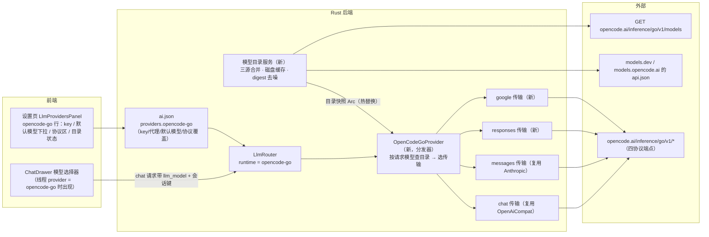

# OpenCode Go Provider 接入 详细设计

> 本文档按仓库 `.agents/skills/feature-design` 的模板与工作流编制：决策 `DEC-*`、验收 `AC-*`、任务 `TASK-*`、验证 `V-*` 全程串联。开发任务的展开版见 [opencode-go-provider/development-tasks.md](opencode-go-provider/development-tasks.md)（ID 与本文一致）。独立项 S1（全 provider 模型检视）另见 [model-inspector-design.md](model-inspector-design.md)。

## 1. 设计摘要与范围

- 类型：新功能（新增 LLM provider + 模型目录子系统 + 会话级模型选择）
- 文档位置：`docs-feature/opencode-go-provider-design.md`
- 设计状态：**可实施**（DEC-01～DEC-08 均已定案；DEC-09 为不阻塞的待决项）
- 来源：用户需求（2026-10-15）——在 taomni AI Chat 中加入对 OpenCode Go provider 的支持，参考 Go 官方文档对模型接口类型的描述与 opencode 开源 v2 源码的模型更新机制；决策轮次为同日两轮（先推荐 D1–D7，后用户逐项定案并修订 D3/D6、补充 D4/D5）
- 调研基线：taomni main `6ca83889`（v0.4.38，PR #717），工作区无已跟踪未提交变更；另有 5 个未跟踪设计文件（workspace-first 系列）与本文档，与本功能无关、不受影响
- 平台与运行方式：Windows、macOS、Linux 三端 Tauri 桌面应用，代码必须兼容三端构建与运行
- 本轮真机执行端：Linux（当前环境）；三端均保留真机计划（§8），本轮完成 Linux 端验证即可满足本轮真机交付条件，其他端未执行不单独阻塞交付
- 推荐方案：在既有 provider 骨架上加三件新东西——一个**三源合并的模型目录服务**（§4.2）、一个**按模型分发四种协议的 provider**（§4.3）、一条**请求级模型覆盖通道**（线程 `llm_model` + `ChatRequest` 新字段，§4.5）。provider 条目仍是一个，key/代理/vault/多 key 轮换全走现有路。

用户问题：OpenCode Go 是订阅制聚合网关（Go $10/月、Go Plus $40/月），一个 API key 聚合 30+ 编码模型，但同一网关下不同模型走不同接口协议，且模型清单变化频繁。用户需要在 taomni AI Chat 里用上它，且新模型上线/老模型下线时不必等 taomni 发版。完成后的可观察结果：设置页出现 OpenCode Go 条目，填 key 即可用；聊天线程内可切换全部在售模型（含四种协议），每模型的协议由在线目录自动维护、也可人工修正；断网时目录回退到缓存/内置快照不丢模型。

本次范围：Go provider 本体（目录、传输、分发、配置、UI、连接测试）、会话级模型选择、全 provider 模型检视中的 Go 部分接口（检视本体为独立项 S1，DEC-06）。不做：订阅购买与账户管理（OpenCode Console 完成）、用量/余额查询、把 Go 接入 ASR、其他 provider 的模型选择 UX 改造（归 S1）。

兼容约束：现有 7 个 provider 的配置、请求体、路由、fallback 与分组行为不得改变（AC-13）；老 `ai.json` 零迁移可读（AC-01）；`full_local_mode` / `fully_disabled` 两道既有策略门对新功能同样生效（AC-12）。

## 2. 当前实现与功能缺口

### 2.1 现有调用链与对接点（基线实查）

| 位置与符号 | 当前行为 / 契约 | 本次影响 | 依据与确定性 |
|---|---|---|---|
| `src-tauri/src/ai/config.rs` `LlmConfig` / `LlmProviderConfig` | 配置持久化于 `~/.config/taomni/ai.json`；每 provider 字段：base_url、api_key/api_keys（多 key）、model（**单模型字符串**）、runtime、capabilities、image/video_model、proxy 三件套 | 新增条目沿用全部字段；`model` 语义扩展为「默认模型」；新增可选字段 `protocol_overrides` | 源码实查（事实） |
| `src-tauri/src/ai/config.rs` `LlmConfig::default()` / `ensure_default_providers()` | 内置 7 条（deepseek/agnes/glm/siliconflow/groq/local/anthropic）；normalize 时仅 agnes 走 `or_insert` 补齐 | 新增 `opencode-go` 条目并加入 ensure 补齐（老配置升级自动出现） | 源码实查（事实） |
| `src/stores/aiStore.ts` `DEFAULT_CONFIG` / `normalizeAiConfig()` | 前端镜像默认配置（**缺 anthropic 条目，以 Rust 为准**）；normalize 同样只补 agnes | 同步加 go 条目与补齐逻辑；新增 catalog store | 源码实查（事实） |
| `src/stubs/tauri-core.ts` `get_ai_config` | 浏览器开发模式的配置桩 | 加 go 条目 + 新增 `get_opencode_go_catalog` 桩 | 源码实查（事实） |
| `src-tauri/src/llm/router.rs` `build_router_with_proxy_db` | 按 runtime 分派：`openai-compat/llama-server/ollama` → OpenAiCompat、`anthropic` → Anthropic，其余跳过；每 key 一个 variant 包 `KeyRotatingLlm`；vault 未解锁的 key 跳过并标记 unresolved | 加 `opencode-go` 分支构造分发器；目录 Arc 需跨 key variant 共享 | 源码实查（事实） |
| `src-tauri/src/llm/openai_compat.rs` / `anthropic.rs` | chat 与 messages 两种传输齐备（非流/流式 SSE/工具调用） | chat/messages 直接复用（需加可选 `extra_headers` 注入口）；**responses 与 google 两种传输缺失，拟新增** | 源码实查（事实） |
| `src-tauri/src/llm/mod.rs` `ChatRequest` | 字段仅 messages/max_tokens/temperature/stream——**无模型、无会话字段**；流式事件 `ChatStreamEvent::{Token, End, Error}` 无工具增量 | 加可选 `model_override`、`session_key`（§4.5）；其余 provider 忽略 | 源码实查（事实） |
| `src-tauri/src/chat/mod.rs` + `chat/store.rs` | 线程以 `ai_chat_threads.provider_id` 钉 provider，调度直取 `llm.provider(id)`；已有 `cc_model` 列 + `chat_set_thread_cc_model` 专供桥 provider 的线程级模型 | Go 的线程级模型**新开 `llm_model` 列**，不复用 cc_model（避免桥进程回收逻辑误触） | 源码实查（事实） |
| `src-tauri/src/ai/commands.rs` `test_llm_connection` | 按 runtime 二分（anthropic / 其余走 openai-compat），用 provider.model 发 pong 测试 | 加 go 分支：经分发器以默认模型协议测试（§4.3） | 源码实查（事实） |
| `src/components/settings/LlmProvidersPanel.tsx` | 标签/备注按 id 硬编码表；行展开含 key 列表、model 纯文本输入、capabilities、base_url、代理、测试按钮；无 runtime 选择器 | 加 go 标签/备注；go 行 model 改目录下拉 + 协议区 + 目录状态行（§4.4） | 源码实查（事实） |
| `src-tauri/src/ai/network_policy.rs` | full_local 下 router 跳过非本地 runtime | go 为云端 runtime 天然被跳过；目录拉取亦须过同一道门（§4.2） | 源码实查（事实） |
| 全仓检索 | **没有任何调用 provider `/models` 端点的先例**；`opencode` 字样仅见于既有调研文档（Zen 相关），无 Go 代码 | 目录服务是全新组件；无既有行为可复用其端点逻辑 | 检索实查（事实） |

短板归纳：单模型假设贯穿配置/测试/路由/UI；缺 responses、google 两传输；缺模型目录概念。这三点即本设计要正面解决的，不绕开、也不顺带重构其他 provider。

### 2.2 外部事实（2026-10-15 实测，证据存 `~/workspace/taomni-research/opencode-go/`）

**Go 的接口类型（官方文档 Endpoints 表）**：32 个模型分四种协议——`chat`（OpenAI Chat Completions，`@ai-sdk/openai-compatible`）19 个；`messages`（Anthropic Messages，`@ai-sdk/anthropic`）6 个；`responses`（OpenAI Responses，`@ai-sdk/openai`）6 个；`google`（Gemini generateContent，端点 `/v1/models/<id>`，`@ai-sdk/google`）1 个。统一 base 为 `https://opencode.ai/inference/go/v1`（与 models.dev 中该 provider 的 `api` 字段一致）。逐模型对照见附录 A。

**三源对账（同日拉取，两两不一致，目录合并的依据）**：

| 数据源 | 模型数 | 角色 |
|---|---|---|
| Go 文档 Endpoints 表 | 32 | 协议的最权威来源（人工维护） |
| 实时 `GET /inference/go/v1/models`（无鉴权实测 200） | 37 | 可用性的最权威来源；但只有 id，无协议/元数据 |
| models.dev `opencode-go` 条目 | 38 | 协议覆盖（逐模型 `provider.npm`）与元数据的最权威来源 |

差异要点：实时比文档多 5 个（`glm-5.1`、`minimax-m2.5`、`omen-alpha`、`qwen3.6-plus`、`qwen3.7-max`），其中前 3 个在 models.dev 中不存在（无协议无元数据）；models.dev 比实时多 4 个已下线残留（均标 deprecated）；`kimi-k2.6` 在 models.dev 标 deprecated 却同时在文档与实时清单中在售。models.dev 的 npm 覆盖与文档端点表在 32 个共有模型上一一吻合。

**opencode v2 的更新机制**（`anomalyco/opencode` 分支 `v2` @ `46172108`，`packages/core/src/models-dev.ts`、`plugin/models-dev.ts`、`aisdk-native.ts`）：目录源为单一 JSON（`models.opencode.ai/api.json`，与 models.dev 字节一致）；接口类型编码在 provider 级 `npm` 默认 + 模型级 `provider.{npm,api,shape}` 覆盖里，包名映射到协议实现（openai-compatible→chat、anthropic→messages、openai→responses、google→Gemini，其鉴权头 `x-goog-api-key` 见 `packages/ai/src/providers/google.ts`）；更新靠「仓库内置快照（发版脚本刷新）兜底 + 在线拉取 + 本地缓存带 SHA-256 digest、5 分钟 TTL 刷新、内容不变则跳过写缓存/失效/事件、变化则发 Refreshed 事件热重建」；加载优先级为文件覆盖 > 缓存 > 快照 > 网络。**不照抄的一点**：其目录插件按 `status == deprecated` 硬过滤模型，按上文实测会误删在售的 kimi-k2.6（DEC-05）。

**官方对客户端的要求**（Go 文档）：只发送典型编码 agent 流量（有滥用监控）；用自己的 User-Agent 标识而非通用 HTTP 库名；每会话发送稳定 `x-opencode-session` 头。另隐私表显示 Gemini 4 Argon 与 Muse Spark 两个 Contributor 模型的提示/补全可能用于训练——UI 须徽标提示（AC-06）。

## 3. 验收条件

| ID | 场景与前置条件 | 用户动作或触发 | 必须观察到的结果 | 适用平台 / 边界 |
|---|---|---|---|---|
| AC-01 | 老版本 `ai.json`（无 go 条目、无 `protocol_overrides`） | 升级启动并打开设置页 | 出现 OpenCode Go 条目，默认模型 `deepseek-v4.1-flash`；原有 provider、任务路由、分组原样保留 | 三端；兼容（保留+新增） |
| AC-02 | 已填入有效 Go key | 在 go 行点保存，再点测试连接 | ai.json 中该 key 仅以 `vault:<id>` 引用保存；测试以默认模型的协议（chat）发出并返回成功与延迟；重启应用后仍可用 | 三端 |
| AC-03 | 线程 provider = opencode-go，模型 = deepseek-v4.1-flash（chat 组） | 连续多轮对话 + 一次 agent 工具调用 + 流式一轮 | 非流、流式、工具调用均成功；回复含 usage；同线程上下文连续 | 三端；需真实 key（V-07） |
| AC-04 | 同上，模型切至 minimax-m3（messages 组） | 同 AC-03 的动作组合 | 同上（走 `/v1/messages`） | 三端；需真实 key |
| AC-05 | 同上，模型切至 grok-4.7（responses 组） | 同 AC-03 的动作组合 | 同上（走 `/v1/responses`，流式以 completed 事件正常收尾） | 三端；需真实 key |
| AC-06 | 同上，模型切至 gemini-4-argon-contributor（google 组） | 打开模型选择器并完成一轮对话/流式/工具调用 | 选择器中该模型带「可能用于训练」徽标；对话链路同 AC-03 | 三端；需真实 key |
| AC-07 | 两个 go 线程 A、B | 在 A 中把模型由默认切至 kimi-k3，重启应用 | A 后续请求用 kimi-k3，B 不受影响仍用其钉住/默认模型；重启后 A 的钉住保持（`llm_model` 落盘） | 三端 |
| AC-08 | 目录已缓存；上游清单发生变化（以测试 fixture 模拟新增/下线，或真实变化） | 触发任一刷新时机（启动、打开设置/选择器且缓存过期、手动刷新、模型不存在报错） | 目录更新为新清单且应用无需发版；内容未变化时 digest 相同、不替换目录、不产生 UI 抖动 | 三端 |
| AC-09 | 断网环境 | 冷启动应用并打开模型选择器；再点手动刷新 | 有缓存用缓存、无缓存用内置快照，模型与协议不丢失；手动刷新失败时保留旧目录并显示失败状态与时间 | 三端 |
| AC-10 | 目录含未分类模型（如 omen-alpha）与已分类模型 | 在设置页协议区把任一已分类模型的协议改掉并对话，再恢复自动 | 未分类模型在选择器显示并带「未分类」徽标、默认走 chat；改协议后请求改走新协议端点；恢复自动后回到目录协议；覆盖对**全部**模型可用 | 三端 |
| AC-11 | 线程钉住的模型已从实时清单下线 | 在该线程发送消息 | 收到网关错误原文（含模型不存在语义）并触发一次目录强制刷新；**不**自动切换到其他模型 | 三端 |
| AC-12 | `full_local_mode` 开启（或 `fully_disabled` 开启） | 打开聊天 provider 列表与设置页 go 行 | go 不出现在聊天可选列表；目录刷新被禁用且不发出任何网络请求 | 三端；策略门（保留行为扩展） |
| AC-13 | 既有 provider（deepseek / anthropic / local 各一）与既有 fallback、分组配置 | 聊天、流式、工具调用、连接测试、分组轮换各走一遍 | 行为与改前基线一致；其请求体不含新字段（`model_override`/`session_key` 为空时序列化无痕） | 三端；**保留行为回归** |
| AC-14 | 本地假网关（测试用 HTTP 服务）记录请求头 | 以 go 发送两线程各两轮请求 | 每请求带 `User-Agent: taomni/<版本>`；同线程两轮 `x-opencode-session` 相同、异线程不同；值为线程 id 哈希而非原始 id | 自动化（V-04） |

## 4. 方案与关键决策

### 4.1 总体结构

### 4.2 模型目录服务（及时更新的核心）

新模块 `src-tauri/src/llm/opencode_go/catalog.rs`。三源合并规则：

| 源 | 内容 | 角色 | 拉取方式 |
|---|---|---|---|
| S1 实时清单 | `GET {base_url}/models` 的 id 集 | **可用性真相**：不在 S1 的不展示（离线回退除外） | 在线拉取（实测无鉴权可拉；带 key 亦可，防未来收紧） |
| S2 models.dev | `GET https://models.opencode.ai/api.json` 中 `opencode-go` 子树 | **协议与元数据真相**：npm 覆盖、limit、cost、modalities、reasoning_options、status、interleaved | 在线拉取（全量 5.66MB 仅内存取子树，落盘只存抽取结果 ~39KB） |
| S3 内置快照 | 资源文件 `src-tauri/resources/opencode-go-catalog.snapshot.json`（子树抽取 + 文档种子校准） | **离线下限**：首启/断网/双源失败时用；兼作种子校验 | 随应用打包，发版时脚本刷新（§4.2 末） |

合并算法：`available = S1 成功 ? S1.ids : (缓存 ids ?? S3.ids)`（S1 失败不清空）；逐 id 取 `meta = S2 ?? S3`；`protocol = 种子表[id] ?? npm 映射(meta.provider.npm ?? S2.provider.npm) ?? chat`；status 仅作徽标不参与过滤（DEC-05）；meta 为空或协议来自默认值 → 「未分类」徽标；用户覆盖层最后叠加且作用于全部模型（DEC-04）。结果与缓存 digest（合并后规范化 JSON 的 SHA-256）相同则不替换、不通知 UI。

协议映射表（固定四行，即「包名 → 本地传输」）：`@ai-sdk/openai-compatible` → chat（复用 OpenAiCompat）；`@ai-sdk/anthropic` → messages（复用 Anthropic）；`@ai-sdk/openai` → responses（新建）；`@ai-sdk/google` → google（新建）。附带：模型条目 `provider.api` 若出现则覆盖该模型 base；`provider.shape`（responses/completions）若出现于 openai 包模型则按 shape 定协议（本期 Go 实测均无此字段，为留路规则）。

种子表：`scripts/opencode-go-protocol-seed.json`（附录 A 的机器可读版，id → 协议 + 核对日期），优先级最高（唯一人工审定来源）；与 npm 映射冲突时以种子为准并日志告警。

快照生成：脚本 `scripts/update-opencode-go-snapshot.mjs` 拉 api.json 抽子树、与种子表做一致性断言与 diff 报告、输出快照文件；发版清单加此步；快照过期不阻断发版（在线刷新会补），CI 只校验快照可解析且种子 id 不冲突。

缓存与刷新：落盘 `~/.config/taomni/opencode-go-catalog.json`（`{fetched_at, digest, models}`），**不进 ai.json**；内存形态 `Arc<RwLock<Arc<Catalog>>>`，刷新成功且 digest 变才换指针，分发器每请求读当前指针（热更新，不重建 router）。刷新触发：① 启动后异步刷一次（不阻塞启动）；② 打开设置 go 行/聊天选择器且缓存年龄 > 阈值（DEC-09，暂定 6 小时）时后台刷；③ 设置页手动刷新（状态可见：进行中/成功时间/失败原因）；④ 请求报模型不存在时对该请求强制刷一次并重试至多一次。失败保留 last-good。拉取走该 provider 的代理配置（`resolve_provider_proxy_url`)；full_local/fully_disabled 时只读缓存/快照不发网；代理解析失败显形报错不静默直连（仓库 AGENTS.md 网络规范；现有传输的「记日志后直连」差异不在本期回改范围，仅登记）。S1/S2 请求带 `User-Agent: taomni/<版本>`。

目录条目结构 `GoModelEntry`：id、name、protocol、protocol_source（Seed/ModelsDev/Default/UserOverride）、context_limit、output_limit、cost{input,output,cache_read,cache_write}、input_modalities、tool_call（缺省 true）、reasoning、interleaved_field、status、training_use（§2.2 隐私例外）。

### 4.3 分发器与四种传输

新模块 `src-tauri/src/llm/opencode_go/{mod.rs, responses.rs, google.rs}`，`llm/mod.rs` 注册，`router.rs` 加 runtime 分支。

分发器 `OpenCodeGoProvider` 实现现有 `Llm` trait：构造入参为 provider_id、base_url、api_key（单 key 一份；多 key 由 router 的 `KeyRotatingLlm` 在外层包多份，共享同一目录 Arc 与覆盖表）、默认模型、代理 URL、目录句柄、覆盖表。每请求以 `model_override ?? 默认模型` 查目录得协议，取对应传输（懒建缓存）透传 chat/chat_with_tools/chat_stream。目录查不到该模型时不拦截：按 chat 发出、让网关错误原文返回并触发强制刷新（AC-11）。`supports_tools()` 按条目 `tool_call`，未知时 true。`model()` 返回默认模型。

公共注入（构造各传输时统一）：`User-Agent: taomni/<版本>`（reqwest `ClientBuilder::user_agent`）；会话头 `x-opencode-session: <session_key>`（来自请求，缺省用实例级随机 id 保进程内稳定）；超时沿用各传输现状（chat 30s、messages 60s、responses/google 定 60s）。

鉴权头按协议（沿用各 SDK 惯例；⚠ 三项未经真连验证，列入 §8 的 V-07 验证矩阵，验证不过只在分发器加头适配层、不动传输本体）：chat 与 responses 用 `Authorization: Bearer`（responses 待验 ⚠）；messages 用 `x-api-key` + `anthropic-version: 2023-06-01` ⚠；google 用 `x-goog-api-key` ⚠（依据 v2 源码 google.ts）。

chat / messages：直接复用现有两传输，base 固定为 go 的 base_url（路径拼接与现实现一致）；唯一改动是给两个 provider 各加可选 `extra_headers` 构造参数（默认空，老调用点零影响）以注入 UA 与会话头。覆盖文档 32 模型中的 25 个。

responses（新 `OpenAiResponsesProvider`，端点 `POST {base}/responses`）：系统提示 → 顶层 `instructions`；输入 → `input[]` 条目（消息条目 content 为 `input_text/output_text` parts、图片 `input_image` data URL、工具调用 `{type: function_call, call_id, name, arguments(字符串)}`、工具结果 `{type: function_call_output, call_id, output}`）；工具声明为扁平 `{type: function, name, description, parameters, strict: false}`；非流响应解析 `output[]`（message 条目的 `output_text` 拼正文、function_call 条目收为工具调用）；usage 为 `input_tokens/output_tokens/total_tokens` 映射进 `TokenUsage`；流式按 JSON 内 `type` 判别事件（`response.output_text.delta` → Token、`response.function_call_arguments.delta` 仅累积不外发（与现有流式口径一致）、`response.completed` → End 带 usage、`response.failed/incomplete` → Error）；**不用** `previous_response_id` 等有状态特性，每请求自带完整历史；`max_tokens → max_output_tokens`。映射函数做纯函数以便单测（仿 `openai_request_body` 组织）。

google（新 `GoogleGeminiProvider`）：端点 `POST {base}/models/{model}:generateContent`，流式 `POST {base}/models/{model}:streamGenerateContent?alt=sse`；系统提示 → `systemInstruction`；消息 → `contents[]`（assistant 角色名 `model`），parts 为 text/inlineData/functionCall/functionResponse；工具 → `tools:[{functionDeclarations}]`；参数 → `generationConfig{maxOutputTokens, temperature}`；响应取 `candidates[0].content.parts`，usage 取 `usageMetadata{promptTokenCount, candidatesTokenCount, totalTokenCount}`；SSE 每事件为一完整响应分片，取 text 增量。

连接测试：`test_llm_connection` 加 go 分支，用分发器（默认模型 + 其协议）发 pong——验证的是「key + 默认模型协议 + 鉴权头」整链。

错误呈现：沿用 `LlmError::Provider{status, message}` 透传网关原文；401/403 追加可操作提示（检查 key 与订阅，Console 链接文案由前端渲染）；模型不存在触发 §4.2 刷新规则 ④；额度耗尽不本地预判，原文呈现。

### 4.4 用户流程与交互

入口不变：设置页 `LlmProvidersPanel` 的 provider 列表新增一行、ChatDrawer 的 provider 选择新增一项。不新增页面、不改布局结构；模型选择器**复用 ChatDrawer 现有 cc/codex 模型选择的形态与位置**（仅目标 provider 不同），故本功能不另制原型图稿（依据 skill 的原型规则：不改变结构/流程、沿用既有交互形态时不强制整套原型；该判断记录于 DEC-02）。

设置页 go 行展开区自上而下：API key 列表（现有组件）→ 默认模型下拉（可搜索、按协议分组、每项标协议与上下文如 `DeepSeek V4.1 Flash · chat · 1M`；目录为空时回退文本输入）→ 目录状态行（`模型目录：37 个 · 更新于 14:32（在线）` + 刷新按钮，来源三态：在线/缓存/内置快照）→ 协议区（默认折叠，见下）→ capabilities（固定 chat，其余灰置）→ base_url → 代理三件套 → 测试连接。

协议区（DEC-04）：列出**全部**目录模型，每行 = 模型名 + 协议下拉（chat/messages/responses/google）+ 来源小字（种子/models.dev/默认/手工）；下拉默认选中合并出的协议；改动即写 `protocol_overrides` 并对后续请求生效，行尾「恢复自动」。

聊天模型选择器：仅线程 provider = opencode-go 时出现；列表与设置页同一目录 store；顶部搜索；每项显示名 + 协议徽标 + 上下文；底部一行目录年龄，过旧点击即刷新；已钉模型若已不在目录则置顶显示并标「已下线?」，不自动切换（AC-11）。

模型徽标（选择器与设置页一致）：「未分类」（协议为默认猜测）、「已弃用」（status=deprecated 但仍在实时清单，文案中性）、「可能用于训练」（DEC 无关，来自 §2.2 隐私事实，条目 `training_use`）。

状态流转（目录与选择器）：

| 当前状态 | 动作或事件 | 前置条件 | 下一状态与可见反馈 | 失败 / 取消处理 |
|---|---|---|---|---|
| 无缓存无快照（理论态） | 打开选择器 | — | 显示快照目录 + 「目录可能不完整」 | 在线刷新成功后自动替换 |
| 目录已加载（缓存/快照） | 打开设置/选择器且年龄 > 阈值 | 非 full_local | 后台刷新，列表不阻塞；成功换新目录 | 失败保留旧目录，状态行显示失败原因 |
| 任意 | 点「刷新目录」 | 非 full_local | 按钮转圈 → 成功显示新时间与来源 | 失败显示原因，旧目录保留 |
| 线程已钉模型 | 目录刷新且该模型下线 | — | 已钉行置顶标「已下线?」，当前选择不变 | 用户手动改选才解除 |
| full_local 开启 | 打开设置 go 行 | — | 刷新按钮禁用并注明原因；目录只读本地 | 关闭 full_local 后恢复 |

空态：未填 key 时 provider 行与其它云端 provider 一致（可选中、调用时报 key 类错误），目录仍可浏览（目录拉取不依赖 key）。

### 4.5 数据流、状态与生命周期

- 权威状态：provider 配置在 `ai.json`（经现有保存链，key 进 vault）；目录是**派生数据**，落盘于独立缓存文件、内存中以 Arc 快照热替换，不进配置保存链；线程模型在 `ai_chat_threads.llm_model`（SQLite，随线程生命周期）。
- `ChatRequest` 新增两字段（§5 契约表）：`model_override`（仅聊天调度在线程有 `llm_model` 时写入）、`session_key`（聊天调度恒写 `sha256(thread_id)` 前 32 位十六进制；其余调用方不写）。非流 `chat_send` 与流式 `chat_stream` 两处调度都要写（`src-tauri/src/chat/mod.rs`）。
- 目录服务的刷新任务由应用级持有（随 `AppState` 初始化），不随 UI 组件挂载/卸载取消；同一时刻只允许一个刷新在途（去重），后来触发合并到在途任务。
- 协议覆盖的生效路径：保存配置时 router 按现有机制重建，分发器构造时读入覆盖表快照；目录热替换不重建 router。

### 决策记录

| DEC ID / 问题 | 可行选项、影响与代价 | 结论或待决推荐及理由 | 状态 | 决策来源 | 关联 AC / TASK / V |
|---|---|---|---|---|---|
| DEC-01 provider 形态 | A 单条目+分发 runtime；B 每模型一个条目（37+ 行污染设置与路由表） | A：聚合网关的 key/代理/能力是共享的，差异只在协议分发 | 用户已定 | 用户 2026-10-15 定案（原 D1） | AC-01/02，TASK-02/05 |
| DEC-02 模型选择 UX | A 会话级选择器（线程钉住）+设置页默认；B 仅设置页单模型（装不下多模型场景） | A；选择器复用 ChatDrawer 现有 cc/codex 模型选择形态，不另制原型、不改布局结构 | 用户已定 | 用户 2026-10-15 定案（原 D2） | AC-07，TASK-06 |
| DEC-03 P0 协议范围 | A 四协议同批；B google 延后（少 1 模型但分两批验收） | A：用户明确 google 也需要支持，原推荐的延后拆分取消 | 用户已定（修订） | 用户 2026-10-15 定案（原 D3，修订助手原推荐） | AC-03～06，TASK-04，V-07 |
| DEC-04 协议可改范围 | A 仅未分类可改；B 全部模型带出协议且可改 | B：目录协议可能与网关实际不符，修正通道须全量可用 | 用户已定（补充） | 用户 2026-10-15 定案（原 D4，含用户补充） | AC-10，TASK-06 |
| DEC-05 deprecated 处理 | A 按 models.dev status 硬过滤（opencode v2 本体做法，会误删在售 kimi-k2.6）；B 以实时清单为准、status 只作徽标 | B：以 2026-10-15 三源实测为据 | 用户已定 | 用户 2026-10-15 定案（原 D5） | AC-08/10，TASK-03 |
| DEC-06 模型检视的归属 | A 塞进 Go 功能；B 单独立项覆盖全部 provider | B：用户补充要求所有已做 provider 都支持 settings 模型检查，独立设计与排期（model-inspector-design.md） | 用户已定（补充） | 用户 2026-10-15 定案（原 D5 补充） | 独立项 S1；本文 AC 不含检视本体 |
| DEC-07 默认模型 | A kimi-k2.7-code（助手原推荐）；B deepseek-v4.1-flash | B：用户指定；chat 协议、1M 上下文、$80 月度额度档为各模型最高档之一 | 用户已定（修订） | 用户 2026-10-15 定案（原 D6，修订助手原推荐） | AC-01/02，TASK-02 |
| DEC-08 目录更新机制 | A 硬编码清单随发版；B 三源合并 + 内置快照 + 在线刷新（仿 opencode v2 models-dev） | B：A 无法满足「新模型不发版可用」 | 用户已定 | 用户 2026-10-15 定案（原 D7） | AC-08/09，TASK-03 |
| DEC-09 目录自动刷新年龄阈值 | 1 小时 / 6 小时 / 24 小时（可调常量） | 推荐 6 小时：桌面端「打开即新鲜」的体感与请求量平衡；仅影响一个常量，不阻塞任何任务开始，实施中先按 6 小时落地 | 待用户决策 | 助手推荐，用户本轮未置评；已向用户提出（2026-10-15 交付说明中列明） | TASK-03（常量）、AC-08（触发条件表述为「缓存过期」） |
| DEC-10 请求级模型通道 | A 每模型注册一个 router provider；B `ChatRequest` 加可选字段 + 分发器内选模型 | B：A 会让路由表与分组/回退语义膨胀且与 DEC-01 冲突；B 对既有 provider 零行为变化（AC-13 兜底） | agent 自决 | 代码依据：router 以 provider id 为键、线程已钉 provider id（§2.1） | AC-07/13，TASK-02/05 |
| DEC-11 线程模型存储 | A 复用 `cc_model` 列；B 新开 `llm_model` 列 | B：cc_model 的写入路径伴随桥进程回收逻辑，复用会误触；新列迁移沿用既有 ALTER TABLE 写法 | agent 自决 | 代码依据：`chat/store.rs` cc_model 迁移与 `chat/mod.rs` 回收调用点 | AC-07，TASK-02 |

### 接口与共享契约

| 类型 / 名称（现有或拟新增） | 调用方 → 实现方 | 输入及序列化 | 输出 / 错误 / 事件 | 兼容规则 |
|---|---|---|---|---|
| `ChatRequest.model_override: Option<String>`（拟新增） | 聊天调度/各调用方 → 各 `Llm` 实现 | serde default None；Some 时为模型 id 原文 | 仅 go 分发器消费；其余实现忽略 | 老调用方不设即 None，行为不变（AC-13） |
| `ChatRequest.session_key: Option<String>`（拟新增） | 聊天调度 → go 分发器 | serde default None；聊天路径恒写 sha256(thread_id) 前 32 hex | go 传输用作 `x-opencode-session` 头值 | 同上 |
| `LlmProviderConfig.protocol_overrides: HashMap<String,String>`（拟新增） | 前端设置 → `ai/config.rs` | serde default 空表、空时不序列化；值域 chat/messages/responses/google | 分发器构造时读入 | 老 ai.json 无此字段可读；老版本读新文件时忽略未知字段（serde 既有行为） |
| IPC `get_opencode_go_catalog(force_refresh: bool)`（拟新增） | 前端（设置页/选择器/S1 检视）→ Rust 目录服务 | bool | `GoCatalogDto{ models: GoModelEntry[], fetched_at, source: live/cache/snapshot, last_error?: string }`；错误以状态字段呈现，不整体 Err（保证 UI 有 last-good 可画） | 新命令，无既有调用方 |
| IPC `chat_set_thread_llm_model(thread_id, model?)`（拟新增） | ChatDrawer 选择器 → `chat/store.rs` | thread id + Option（None 清除钉住） | 落盘 `llm_model` 列；下一次请求生效，无进程回收 | 与 `chat_set_thread_cc_model` 并列互不影响 |
| 线程字段 `llm_model`（TS/Rust 线程结构拟新增） | store → 前端线程列表 | 可空字符串 | 选择器回显当前钉住 | 老数据为 NULL 即未钉住 |
| 目录缓存文件 `opencode-go-catalog.json`（拟新增） | 目录服务自有 | `{fetched_at, digest, models}` | 损坏时忽略并回退快照（不报错阻断启动） | 非用户配置，不进 vault/保存链 |
| 快照资源 `src-tauri/resources/opencode-go-catalog.snapshot.json` + 种子 `scripts/opencode-go-protocol-seed.json`（拟新增） | 打包/脚本 → 目录服务 | JSON | 见 §4.2 | 发版脚本刷新（TASK-03） |

### 三端兼容与相关存储、故障边界

- 本功能全部走 HTTPS + 纯数据处理，无平台专有 API、无条件编译新增；路径一律经现有 `resolved_config_dir()` 口径拼接（目录缓存与 ai.json 同目录），不硬编码分隔符。
- WebView 差异：前端仅用现有组件与下拉/折叠模式，无新浏览器 API；三端可构建由 TASK-08 的兼容检查与各端构建兜底。
- 存储迁移：`ai_chat_threads` 加列沿用既有 `ALTER TABLE ... ADD COLUMN` 惯例（失败忽略=已存在）；`ai.json` 新字段 serde default 兼容；目录缓存文件损坏自愈（回退快照）。
- 故障边界：目录三源全失败 → 快照兜底 + 状态呈现；网关错误 → 原文透传；vault 锁定 → 沿用现有 unresolved/`VAULT_LOCKED` 语义（分发器同其它 provider）。
- 浏览器 stub：`get_ai_config` 加 go 条目、`get_opencode_go_catalog` 返回与快照同构的固定样本；stub 只能证明 UI 链路，真实目录拉取与网关协议必须原生验证（§8）。

---

## 5. 改动清单

| 路径 / 模块（标注拟新增） | 具体变更与保持的约束 | 相关 AC | 所属任务 |
|---|---|---|---|
| `src-tauri/src/ai/config.rs` | default 加 go 条目（DEC-07 默认模型）；`ensure_default_providers` 加 go 的 or_insert；`LlmProviderConfig` 加 `protocol_overrides`（serde default） | AC-01/02/10 | TASK-02 |
| `src-tauri/src/llm/mod.rs` | `ChatRequest` 加 `model_override`/`session_key` 两可选字段（含构造点清点与 Default 兼容处理）；注册 `pub mod opencode_go` | AC-07/13/14 | TASK-02 |
| `src-tauri/src/chat/store.rs` | `ai_chat_threads` 加 `llm_model` 列（既有 ALTER 惯例）+ 读写函数 | AC-07 | TASK-02 |
| `src-tauri/src/chat/mod.rs` | 新命令 `chat_set_thread_llm_model` 注册；`chat_send`/`chat_stream` 两处组请求时写 model_override 与 session_key | AC-07/14 | TASK-02 |
| `src/stores/aiStore.ts` | `LlmProviderConfig` 加 `protocol_overrides?`；DEFAULT_CONFIG 与 normalize 补 go 条目；新增 catalog store（条目/fetched_at/source/刷新动作） | AC-01/08 | TASK-02/06 |
| `src/stores/chatStore.ts` 及线程类型 | 线程加 `llm_model`；选择器调用新命令 | AC-07 | TASK-02/06 |
| `src/stubs/tauri-core.ts` | `get_ai_config` 加 go 条目；`get_opencode_go_catalog`、`chat_set_thread_llm_model` 加桩 | AC-01（浏览器层） | TASK-02 |
| `src-tauri/src/llm/opencode_go/catalog.rs`（拟新增） | 目录服务：三源拉取/合并/digest/缓存读写/刷新触发与去重；`GoModelEntry` 与 DTO | AC-08/09/10/12 | TASK-03 |
| `src-tauri/resources/opencode-go-catalog.snapshot.json`（拟新增） | 内置快照（脚本生成，提交入库） | AC-09 | TASK-03 |
| `scripts/update-opencode-go-snapshot.mjs` + `scripts/opencode-go-protocol-seed.json`（拟新增） | 快照生成脚本与人工种子表（附录 A 机器版） | AC-08/09 | TASK-03 |
| `src-tauri/src/ai/commands.rs`（或新 `opencode_go/commands.rs`） | 新命令 `get_opencode_go_catalog`；`test_llm_connection` 加 go 分支 | AC-02/08 | TASK-03/05 |
| `src-tauri/src/llm/openai_compat.rs` / `anthropic.rs` | 各加可选 `extra_headers` 构造参数（默认空）；**请求体与解析逻辑零改动** | AC-13/14 | TASK-04 |
| `src-tauri/src/llm/opencode_go/responses.rs`（拟新增） | Responses 传输：请求/响应/流式映射（纯函数 + Llm 实现） | AC-05/14 | TASK-04 |
| `src-tauri/src/llm/opencode_go/google.rs`（拟新增） | Gemini 传输：generateContent/streamGenerateContent 映射 | AC-06/14 | TASK-04 |
| `src-tauri/src/llm/opencode_go/mod.rs`（拟新增） | 分发器 OpenCodeGoProvider（§4.3） | AC-03～06/11 | TASK-05 |
| `src-tauri/src/llm/router.rs` | runtime 集合加 `opencode-go` 分支（共享目录 Arc 与覆盖表）；其余分支不动 | AC-12/13 | TASK-05 |
| `src/components/settings/LlmProvidersPanel.tsx` | 标签/备注加 go；go 行：默认模型下拉、目录状态行、协议区（全量可改）、训练徽标 | AC-01/08/10 | TASK-06 |
| `src/components/chat/ChatDrawer.tsx` | go 线程模型选择器（复用 cc 选择器形态）：搜索、徽标、已下线置顶、目录年龄行 | AC-06/07/11 | TASK-06 |
| `src/lib/i18n/*`（按现状定位词条文件） | 新增 `aiSettings.*` / 选择器文案 key（中英双份） | AC-01/06 | TASK-06 |
| Rust 单测（各新模块内 `#[cfg(test)]`）+ 前端 `*.test.ts(x)`（拟新增） | §7 的 V-01～V-05 对应测试 | 全部 | TASK-07 |
| `qa-ui-auto-tests/cases/TC-AI-005-*.testcase.yaml`（拟新增）+ `qa-ui-auto-tests/ci/policy.yaml` | browser 主流程 case（设置配置 go + 聊天切模型，stub 目录）；同步 CI policy | AC-01/07（浏览器层） | TASK-07 |
| `qa-ui-auto-report/opencode-go-provider/`（证据目录） | 真机与自动化证据汇总（脱敏） | 全部 | TASK-09 |

## 6. 实现任务与交接

任务的完整执行步骤、迭代命令与产物要求见 [development-tasks.md](opencode-go-provider/development-tasks.md)；本节为契约层摘要（目标、文件职责、依赖、完成条件），两者 ID 一致、冲突时以本文的行为与契约为准。

### TASK-01 基线与契约冻结
- 职责：改前基线（既有 provider 代表性行为、ChatRequest 全部构造点清点）、三源真实快照固化为测试 fixture、保留行为清单。
- 依赖：无。完成条件：基线结果与 fixture 落盘（待执行项如实标待执行，不冒充已测）。

### TASK-02 配置与数据模型
- 职责：§5 中 config/ChatRequest/store/chat 命令/TS 类型/stub 的兼容改造（DEC-01/07/10/11）。
- 依赖：TASK-01 的构造点清点。完成条件：老配置与老线程数据可读可用（AC-01/07 的存储层）、`cargo check` 与 `tsc` 通过、既有相关单测不回归。

### TASK-03 模型目录服务
- 职责：catalog.rs、快照与种子、快照脚本、目录 IPC 命令（§4.2）。
- 依赖：TASK-02 的 DTO 约定；DEC-09 未定不阻塞（阈值先按 6 小时常量）。完成条件：V-01 通过；断网/损坏缓存回退路径有测试。

### TASK-04 协议传输补齐
- 职责：两现有传输的 `extra_headers` 注入口、responses 与 google 两新传输（§4.3）。
- 依赖：TASK-02 的 ChatRequest 字段。完成条件：V-02、V-04（本地假网关部分）通过；既有传输回归测试不变（AC-13）。

### TASK-05 分发器与路由接入
- 职责：OpenCodeGoProvider、router 分支、test_llm_connection go 分支、错误触发刷新接线。
- 依赖：TASK-03、TASK-04。完成条件：V-03 通过；AC-11/12 的后端行为成立。

### TASK-06 前端设置与聊天选择器
- 职责：LlmProvidersPanel go 行（下拉/状态行/协议区）、ChatDrawer 选择器、catalog store、i18n。
- 依赖：TASK-02（类型/stub）、TASK-03（目录命令）、TASK-05（可真连）。完成条件：V-05、V-06 的 UI 断言成立。

### TASK-07 自动化测试与 QA 用例
- 职责：补齐 V-01～V-06 未落地的测试、TC-AI-005 case 与 CI policy 同步、testid 目录维护（新控件按 qa-ui-auto 规范登记或标注拟新增）。
- 依赖：TASK-03～06 的实现稳定。完成条件：所选测试在当前源码上实际执行并记录选中/跳过计数。

### TASK-08 集成回归与三端兼容
- 职责：AC-13 保留行为回归集（消费者追踪：ChatRequest 全部构造点、两传输的全部现有调用方、router 分组/回退）、三端代码兼容检查（条件编译/路径/依赖审查 + 当前环境可跑的构建与测试）。
- 依赖：TASK-07。完成条件：回归集通过或失败项已定位修复；已知不兼容为零。

### TASK-09 真机验证与交付记录
- 职责：§8 手册执行（Linux 当前端真连矩阵 + 离线/重启）、证据回填、Win/mac 接续清单、PR 说明。
- 依赖：TASK-08；真实 Go 订阅 key（环境变量/安全渠道提供，不入库）。完成条件：V-07/V-08 在 Linux 端通过并留证据；其他端标未验证。

可开始：TASK-01 立即可开始；TASK-02 随其后。必须等待：TASK-05 等 TASK-03/04 的契约稳定；TASK-09 的真连部分等 key 就绪（无 key 时先做离线/假网关部分并如实标注）。

## 7. 自动化测试计划

验证选择口径（按 qa-ui-auto 的高效验证原则）：迭代期用最窄的单测/组件测试；代码稳定后集中跑相关完整文件与一次浏览器主流程；原生真机只证明浏览器证明不了的边界（真实网关协议、真实目录拉取、落盘与重启语义），不给每个任务机械分配全套。

| V ID | AC / 用途 | 层级与文件 / case（标注拟新增） | 前置数据与操作 | 核心断言 | 命令、工作目录与前置依赖 | 改前依据 / 改后结果 |
|---|---|---|---|---|---|---|
| V-01 | AC-08/09/10 目录合并与回退 | Rust unit：`opencode_go/catalog.rs` 内测试（拟新增） | TASK-01 固化的三源真实快照 fixture（2026-10-15） | kimi-k2.6 在列且仅标 deprecated 徽标；omen-alpha 在列、标未分类、协议 chat；deepseek-v4-flash（S2 独有）不在列；种子优先于 npm、用户覆盖优先于种子；同 digest 二次刷新不替换；S1 失败不清空；缓存损坏回退快照 | `src-tauri/` 下 `cargo test --lib opencode_go` | 无改前对应物（新组件）/ 待执行 |
| V-02 | AC-05/06 协议映射 | Rust unit：`responses.rs`、`google.rs` 内测试（拟新增） | 录制的请求/响应/SSE fixture（按 §4.3 映射表构造） | 请求体形态（instructions/扁平工具/function_call_output；systemInstruction/functionDeclarations）；非流解析（含 function_call、usage 映射）；流式 delta→completed/failed 序列 | `src-tauri/` 下 `cargo test --lib opencode_go` | 同上 / 待执行 |
| V-03 | AC-01/02/12 配置与路由 | Rust unit：`ai/config.rs`、router 既有测试区扩展（拟新增） | 老格式 ai.json 样本（无 go、无 overrides） | 加载后自动补 go 条目且默认模型正确；新字段序列化不污染老字段；runtime=opencode-go 注册成功；vault 锁定时 unresolved；full_local 下被跳过 | `src-tauri/` 下 `cargo test --lib ai`、`cargo test --lib llm`（过滤名以实现为准） | 既有 config 测试为基线 / 待执行 |
| V-04 | AC-03/11/13/14 分发与保留 | Rust unit/integration：分发器测试 + 本地假网关（拟新增） | 本地 HTTP 服务录请求；假传输注入 | 按目录协议选传输；未知模型回落 chat 不拦截；请求带 UA 与稳定会话头（同线程同值异线程异值，AC-14）；**既有 provider 请求体不含新字段语义变化**（AC-13） | `src-tauri/` 下 `cargo test --lib opencode_go` | 既有 openai_compat/anthropic 测试为保留基线 / 待执行 |
| V-05 | AC-01/06/07/10 前端行为 | Vitest：`aiStore.test.ts` 扩展、`LlmProvidersPanel` 与 `ChatDrawer` 相关测试（拟新增/扩展） | stub 目录数据（快照同构样本） | normalize 补 go 条目；go 行渲染下拉/状态行/协议区且改协议写 overrides；选择器仅 go 线程出现；已下线钉住模型置顶标注；训练徽标出现于 google/muse 条目 | 仓库根 `pnpm exec vitest run <相关文件>`（稳定后跑完整相关文件并记录选中数） | 既有 aiStore/ChatDrawer 测试为基线 / 待执行 |
| V-06 | AC-01/07 浏览器主流程 | browser QA：`TC-AI-005-opencode-go-provider.testcase.yaml`（拟新增，covers 拟挂 F-AI-2.4 相邻条目，实现时按 feature-list 去重确认）；回归复跑 `TC-AI-001` | browser 模式 + stub（reset_db fixture） | 设置页出现 go 行、可开协议区；聊天切到 go 后选择器出现并可切模型；TC-AI-001 原断言全过（保留行为） | 按 qa-ui-auto runner 既有入口执行所选 case；同步 `qa-ui-auto-tests/ci/policy.yaml`（TASK-07） | TC-AI-001 为既有 case / 待执行 |
| V-09 | AC-13 保留行为回归集 | Vitest + Rust 既有测试的受影响子集 | TASK-01 基线清单 | deepseek/anthropic/local 的既有单测、fallback 与分组既有测试全过；失败项须证明为改前既有（对照基线）或当场修复 | 仓库根与 `src-tauri/` 按 TASK-08 清单执行 | TASK-01 记录 / 待执行 |
| V-10 | 三端代码兼容 | 审查 + 当前环境构建 | 受影响的条件编译/路径/依赖清单 | 无新增平台 API 与硬编码路径；Linux 端 `cargo check` + `pnpm build` 通过；Win/mac 以审查结论 + §8 计划留待真机 | 仓库根 `pnpm build`；`src-tauri/` `cargo check` | — / 待执行 |

（V-07、V-08 为真机项，见 §8；编号在 §9 追踪表中统一引用。层级说明：V-01～V-05 证明逻辑与契约，V-06 证明浏览器可见链路（stub 边界），真实网关与落盘语义只能由 §8 证明，不以 stub 结果替代。）

## 8. 真机验证手册

### 环境与准备

- 被测应用：当前源码的原生构建（`pnpm tauri build --no-bundle` 产物或 `pnpm tauri dev`，以 TASK-09 执行时仓库 runbook 为准并记录构建标识）；使用隔离的 app-data/测试配置目录，不动开发者日常配置；测试 key 经安全渠道提供、仅以环境变量名引用（如 `TAOMNI_TEST_OPENCODE_GO_KEY`），不写入文档/仓库/证据。
- 就绪检查：订阅状态在 OpenCode Console 确认为 Go/Go Plus 有效；本机可达 `opencode.ai` 与 `models.opencode.ai`（如需代理，用应用内该 provider 的代理配置，不绕过审批/代理策略）。
- 当前运行端：**Linux**（本轮执行 V-07、V-08）。Windows、macOS 保留下列同等步骤，本轮未执行标「未验证」，不阻塞本轮交付，但不得声称三端已实测。

### V-07 真实网关四协议矩阵（Linux，当前端执行）

- 对应验收：AC-02～AC-06、AC-14（真实链路侧）
- 执行前状态：隔离配置中仅填入 go key，其余保持默认；目录为在线刷新后状态。
- 操作与逐步预期：
  1. 设置页测试连接 → 成功且延迟合理（默认模型 chat 组链路通，AC-02）；
  2. 新建 go 线程，用默认模型 deepseek-v4.1-flash 完成多轮对话、一次工具调用、一轮流式（AC-03）；
  3. 线程内依次切换 minimax-m3（AC-04）、grok-4.7（AC-05）、gemini-4-argon-contributor（AC-06，注意选择器训练徽标），每组重复「多轮 + 工具 + 流式」最小组合；
  4. 任选一模型同线程连发三轮，观察无会话相关异常（AC-14 的真实侧旁证；头值断言在 V-04）。
- 故障与恢复：任一组鉴权头被网关拒绝（401/403 指向头问题）→ 按 §4.3 只在分发器加该协议头适配后重测该组，记录适配内容；不得以「换个模型能通」跳过该组。
- 证据：每组保留脱敏截图（线程 + 模型名 + 回复）、应用日志中 provider/model 行、失败时的原始错误文本；存 `qa-ui-auto-report/opencode-go-provider/`。
- 清理：删除测试线程与隔离配置目录；key 不留存于证据。
- 状态：待执行（缺 key 时整项标「环境阻塞：无订阅 key」，不以 stub 结果充数）。

### V-08 离线、重启与钉住持久化（Linux，当前端执行）

- 对应验收：AC-07、AC-09、AC-11（真实侧）
- 步骤：在线状态下在线程 A 钉住 kimi-k3 → 退出应用 → 断网 → 冷启动：选择器应显示缓存目录、A 仍钉住 kimi-k3（AC-07/09）；手动刷新应失败但保留旧目录并显示失败状态（AC-09）；恢复网络后刷新成功、目录时间更新。若恰逢真实模型下线则顺带记录 AC-11 表现，无下线事件时 AC-11 以 V-01/V-04 的模拟证据为准并在此注明。
- 证据：各阶段截图 + 缓存文件时间戳记录。状态：待执行。

### Windows / macOS 接续计划（本轮未验证）

- 同 V-07/V-08 步骤，分别在 Windows（WebView2）与 macOS（WKWebView，架构分别记录）原生构建上执行；重点复核：下拉/选择器在各 WebView 的渲染与焦点、配置文件路径（各端 config 目录口径）、流式长连接稳定性。
- 接续条件：对应平台设备/构建环境就绪 + 同一订阅 key；结果回填 §9 后才可声称该端通过。

## 9. 验收追踪与交付条件

| AC | 方案位置 | 开发任务 | 验证项与平台 | 所需证据 / 实际证据链接 | 当前缺口 |
|---|---|---|---|---|---|
| AC-01 | §4.5、§5 | TASK-02 | V-03、V-05、V-06（Linux 浏览器层） | 本地单测；[本轮记录](opencode-go-provider/delivery-notes.md) | 开发完成；browser 未执行 |
| AC-02 | §4.3 | TASK-02/05 | V-03、V-07（Linux 真机） | 同上；真机证据未生成 | 开发完成；真连未执行 |
| AC-03 | §4.3 | TASK-04/05 | V-04、V-07 | 四协议假网关单测；真机未执行 | 开发完成；真连未执行 |
| AC-04 | §4.3 | TASK-04/05 | V-04、V-07 | messages 假网关请求检查；真机未执行 | 开发完成；真实鉴权未验证 |
| AC-05 | §4.3 | TASK-04 | V-02、V-07 | 映射单测；真机未执行 | 开发完成；真连未执行 |
| AC-06 | §4.3/§4.4 | TASK-04/06 | V-02、V-05、V-07 | 单测与 UI 用例文档；截图未生成 | 开发完成；browser/native 未执行 |
| AC-07 | §4.5 | TASK-02/06 | V-05、V-08 | SQLite store 单测；真机未执行 | 开发完成；IPC 持久化待真机 |
| AC-08 | §4.2 | TASK-03 | V-01、V-06 | 目录局部单测；browser 未执行 | 开发完成；UI 未执行 |
| AC-09 | §4.2 | TASK-03 | V-01、V-08 | 回退路径单测；真机未执行 | 开发完成；断网重启待真机 |
| AC-10 | §4.2/§4.4 | TASK-03/06 | V-01、V-05 | 目录与组件单测 | 局部单测通过；browser 未执行 |
| AC-11 | §4.3 | TASK-05 | V-04、V-08（旁证） | 假网关 404/仅刷新单测 | 局部单测通过；真机未执行 |
| AC-12 | §4.2 | TASK-03/05 | V-03 | 目录网络策略单测；IPC 未执行 | 局部单测通过；原生网络未验证 |
| AC-13 | §4.3/§4.5 | TASK-04/08 | V-04、V-09 | 局部旧传输与前端回归单测 | 局部单测通过；全量回归未执行 |
| AC-14 | §4.3/§4.5 | TASK-02/04 | V-04、V-07（旁证） | 假网关会话 hash/请求头单测 | 局部单测通过；真连未执行 |

原方案的完整交付条件仍是三端兼容检查（V-10）、所选自动化（V-01～V-06、V-09）和 Linux 真机（V-07、V-08）通过；依本轮用户测试范围限制，browser/native 不执行，因此**尚未达到该验收条件**。Windows/macOS 真机也未验证。当前本地单元测试作用范围与整包 Rust 编译受系统库阻断的详情见[交付记录](opencode-go-provider/delivery-notes.md)，不得以该局部证据代替 `cargo check`、真连或全量回归。

## 10. 风险、未决项与回退

| 项目 | 影响与依据 | 建议 / 缓解 / 最小验证 | 阻塞的具体任务 | 解除条件 |
|---|---|---|---|---|
| R1 网关鉴权头未真连验证（messages/responses/google 三组） | 三组协议可能整组 401；依据为 SDK 惯例与 v2 源码，未持 key 实测 | V-07 逐组验证；不过则只在分发器加头适配层重测 | TASK-09 的该组验收（不阻塞开发） | 取得订阅 key 完成 V-07 |
| R2 上游数据源再变（端点曾由 zen 迁至 inference） | 目录源或路径失效 | base_url 可改且 S1 与推理同源；S2 地址集中为目录服务单一常量 | 不阻塞 | 变更时改常量/配置并刷新快照 |
| R3 models.dev 与网关状态长期不一致 | 徽标与实际可用性不符（已知 kimi-k2.6 类） | DEC-05 口径呈现差异不删行；种子在发版刷新时人工复核（脚本给 diff） | 不阻塞 | 持续项，无解除点 |
| R4 新增第 5 种协议包 | 未识别 npm 的新模型协议错误 | 映射表加一行 + 新传输；未识别时按 chat + 未分类呈现，不崩（V-01 覆盖） | 不阻塞 | 出现时立项 |
| R5 Go 流量监控对非编码流量的容忍度未知 | 账号风险 | 定位控制：不设为全应用默认、不用于 ASR/搜索；设置页备注如实说明 | 不阻塞 | 持续项 |
| DEC-09 刷新阈值待决 | 仅目录自动刷新的年龄常量 | 先按 6 小时实现为单一常量，改动成本一行 | 不阻塞（TASK-03 按推荐值先行） | 用户确认阈值或实施后反馈 |

回退边界：本功能全部为新增条目/新增可选字段/新增文件，回退 = 移除 go 条目与新模块、还原两传输的 `extra_headers` 参数（默认空、本就无行为变化）；数据侧 `protocol_overrides` 与 `llm_model` 列保留无害（老代码忽略未知字段/列），目录缓存文件可直接删除；无破坏性迁移。

现在可开始的任务：TASK-01、TASK-02（随后 TASK-03/04 并行面）。必须等待的：TASK-09 的真连部分等待订阅 key；其余无待决阻塞（DEC-09 不阻塞）。

## 附录 A：模型 → 协议对照（Go 文档 Endpoints 表转录，2026-10-15；即种子表内容）

| 协议 | 模型 id |
|---|---|
| responses（`@ai-sdk/openai`） | grok-4.7、grok-4.6、gpt-6-luna、gpt-5.6-luna、muse-spark-1.3-contributor、muse-spark-1.2-contributor |
| messages（`@ai-sdk/anthropic`） | claude-haiku-5-5、minimax-m3、minimax-m2.7、qwen3.8-max、qwen3.8-flash、qwen3.7-plus |
| google（`@ai-sdk/google`） | gemini-4-argon-contributor |
| chat（`@ai-sdk/openai-compatible`，默认） | glm-5.3-flash、glm-5.3、glm-5.2、kimi-k3、kimi-k2.7-code、kimi-k2.6、longcat-2.0、longcat-2.5-preview-free、deepseek-v4.1-flash、deepseek-v4-pro、mimo-v2.6-flash、mimo-v2.6-pro、mimo-v2.5、mimo-v2.5-pro、hy4-preview、hy3、space-bunny、step-5-preview-free、cat-jam-free |

种子表外、运行时可能出现的模型（2026-10-15 实测）：glm-5.1、minimax-m2.5、omen-alpha（无上游元数据 → 默认 chat + 未分类徽标）、qwen3.6-plus、qwen3.7-max（有 models.dev 元数据但无 npm 覆盖 → 默认 chat；status=deprecated 仅作徽标）。

## 附录 B：来源

- Go 文档（订阅、端点表、客户端要求、隐私表）：https://opencode.ai/v2/docs/console/go/
- 模型实时清单：`GET https://opencode.ai/inference/go/v1/models`（2026-10-15 快照存 `~/workspace/taomni-research/opencode-go/go-v1-models-live-2026-10-15.json`）
- models.dev 目录（`opencode-go` 抽取存同目录 `modelsdev-opencode-go-extract-2026-10-15.json`）：https://models.dev/api.json
- opencode v2 源码（`anomalyco/opencode` 分支 `v2` @ `46172108`，提交日期 2026-10-10）：`packages/core/src/models-dev.ts`、`packages/core/src/plugin/models-dev.ts`、`packages/core/src/aisdk-native.ts`、`packages/ai/src/providers/google.ts`（前两份存同上调研目录）
- 本设计的前身文档（同名文件旧版，2026-10-15 首版与定案版）已由本文按 feature-design 模板整合替代，决策与实测内容全部保留并转入 DEC/AC 体系。
