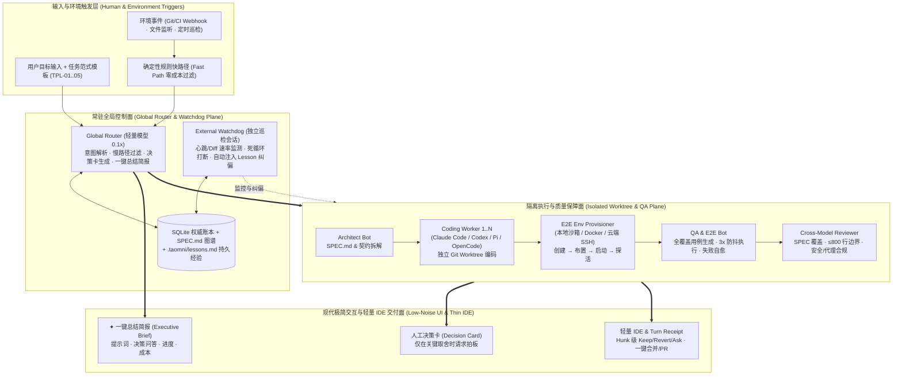
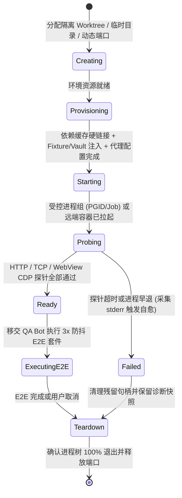

# Taomni Super-Agents（自治多 Agent 研发编排、质量门禁与轻量 IDE 工作台）详细设计

- **类型**：现有能力扩展与新一代架构升级（基于当前分支 `feat/development-orchestrator` 的 `F-ORCH-1` 多 Agent 编排与 `Code Workspace` 能力）
- **文档位置**：`docs-feature/super-agents-design-agy-gemini-argon.md`
- **交互原型位置**：`docs-feature/super-agents-proto-agy-gemini-argon.html`
- **设计状态**：可实施（全部关键决策 `DEC-01..03` 已收敛锁定，工作包 `TASK-01..05` 均无未决阻塞）
- **调研基线**：分支 `feat/development-orchestrator`，提交 `3562fd0bf`（2026-11-06），已核对 `src/components/agents/`、`src/stores/orchestrationStore.ts`、`src-tauri/src/orchestration/`、`src/components/workspace/` 与 `src-tauri/src/workspace_execution.rs`
- **平台与运行方式**：Windows、macOS、Linux 三端 Tauri 2 桌面应用，所有后端进程组管理、Git Worktree 隔离、E2E 环境生命周期与前端视图均兼容三端构建与运行；浏览器（`pnpm dev`）提供确定性 stub 用于快速 UI 迭代
- **本轮真机执行端**：Linux（当前运行环境 `linux-x64`）；Windows 与 macOS 保留完整真机验证计划与条件编译保障，不因单机环境缺失阻塞本轮设计交付
- **推荐方案**：在保留当前分支 `OrchestrationRuntime`（SQLite 事务账本、乐观锁 `revision`、冻结 Git Worktree、六大 CLI Harness 与三大 API 协议、三模式代理与成本系数）的基础上，融合 **DeepSeek Super-agent**（Router/Worker/Watchdog 三层解耦 + 环境 Trigger 两级过滤 + 投机执行）、**AWS Kiro Crew**（跨重启持久检查点 + `.taomni/lessons.md` 持久经验与可合成 Skills + 角色化 Bots）与 **IntelliJ ThinkRail**（薄宿主轻量 IDE + `SPEC.md` 真相图谱 + Turn Receipt 审查优先与 Hunk 级 Keep/Revert/Ask），并新增**面向生产交付的五大任务范式模板**、**本地/云端 E2E 环境全生命周期管理器（创建/布置/启动/检测）**、**全覆盖稳定 E2E 自动生成与 3x 防抖执行引擎**，以及**极简低噪决策流 + 一键全局总结简报（Executive Brief）**。

---

## 1. 各家标杆架构取长补短与融合蓝图

| 维度 | AWS Kiro Crew | IntelliJ ThinkRail | DeepSeek Super-agent | 当前分支 (`feat/development-orchestrator`) | **Taomni Super-Agents 融合方案** |
|---|---|---|---|---|---|
| **核心定位** | 自托管多 Agent 持久工程团队编排层 | 围绕 `pi` 的薄壳轻量 Agentic IDE | 注意力解放型 Router/Worker + 事件驱动自治系统 | 具备账本、Worktree 与多 Harness 的安全编排器 | **面向生产级软件交付的自治多 Agent 研发与质量工作台** |
| **会话与记忆** | 磁盘检查点断点续跑（10h+）；纠正沉淀为 Durable Lesson / Markdown Skill | `SPEC.md` 图谱作为跨会话唯一真相（Specs as Ground Truth） | 会话成底层细节；存算分离落库；链式召回 | SQLite 8 表事务存储 + 单次显式 `partial` 文档恢复 | **SQLite 阶段检查点续跑 + `SPEC.md` 双向追溯图谱 + `.taomni/lessons.md` 持久经验自动注入** |
| **并发与隔离** | `spawn run` 派生隔离上下文并行 Subagent，汇总回主会话 | 每个任务独占 Git Worktree，绝不污染主工作树 | 常驻轻量 Router + 隔离重型 Worker Team + 外部 Watchdog | `worktree::prepare` 冻结 HEAD + 1..4 并发槽位锁 | **Router（轻量交互）+ 并行 Worktree Sub-Workers（编码/测试）+ 独立 Watchdog（巡检纠偏）** |
| **IDE 与审查体验** | 偏 CLI / Dashboard 治理，缺少深度代码与 Diff 锚定交互 | 薄壳 Monaco + Turn Receipt 收据 + Hunk 级 Keep/Revert/Ask | Web 面板仅展示需人工处理的 Ticket，无内置 IDE | 右侧 `TaskInspector` 仅支持只读源码预览与文本制品展示 | **复用 Taomni 轻量 `WorkspaceCodeEditor`/`WorkspaceGitManager`，内嵌 Hunk 级审查与 Worktree 终端** |
| **交互信噪比** | 全程暴露工具调用、日志与审批流，信息密度高但易过载 | 强调“审查优先于翻聊天记录考古” | 异步 ReAct + 低打扰输出（IM <100 词），仅在有价值时交付 | `AgentConversation` 仍按事件流展示状态与原始制品列表 | **默认静默过程噪音（折叠思考/工具流），主屏仅输出：人工决策卡、阶段里程碑、交付收据 + 一键全局总结简报** |
| **质量与生产环境** | Task Runner 支持跑测试与失败重试，无专门环境编排器 | 可将失败 CI 交给 Agent，无内置 E2E 环境管理 | 原型未验证代码质量（实验用耗时工具替代） | 严禁 Worker 自行装依赖或声称未执行测试通过，缺自动化 E2E 闭环 | **内置本地/云端 E2E 环境生命周期引擎（创建/布置/启动/探活）+ 全覆盖 E2E 自动生成（3x 防抖）+ 异构模型四维 Review** |
| **成本与模型路由** | 依赖底层 CLI 配置 | 完全交给 `pi` 管理 token 与成本 | Router 用轻量模型、Worker 用最强模型 | `AgentSettings` 支持 `planning/review/worker` 角色与 `costCoefficient` | **扩展为 6 角色适用任务分类矩阵 + 单任务成本预算熔断 + 实时节流对比账单** |



---

## 2. 当前实现与功能缺口

| 位置与符号 | 当前行为 / 契约（事实依据） | 本次缺口与演进影响 | 依据与确定性 |
|---|---|---|---|
| `src-tauri/src/orchestration/core/model.rs` (`AgentSettings`, `AgentResource`, `AgentRun`, `AgentIntent`) | 已实现 `planning_resource_id`、`review_resource_id`、`worker_resource_ids`、6 种 Worker Harness（`claude_code`/`codex`/`pi`/`opencode`/`deepseek`/`zcode`）、`cost_coefficient`、`proxy_mode`（`app`/`custom`/`none`）及 `Develop`/`Plan`/`Review` 三种单一意图。 | **扩展**：缺少任务范式模板（`TaskArchetype`）、Router/QA/Watchdog 角色路由、适用任务标签（`suitability_tags`）、预算上限（`max_budget_usd`）、结构化决策卡（`DecisionItem`）与 E2E 环境配置模型。 | 源码实测（L13-L249） |
| `src-tauri/src/orchestration/core/service.rs` & `store.rs` (`OrchestrationRuntime`, `Store`) | 已实现基于 SQLite WAL 的 8 张核心表（`runs`, `tasks`, `attempts`, `artifacts`, `events`, `context_bundles`, `inference_packs`, `request_ledger`）、文件锁 `.owner.lock`、并发槽位索赔与崩溃后 `interrupted` 标记。 | **扩展**：当前仅支持 `Plan/Review` 的单次 `partial` 文档恢复，不支持长任务 DAG 节点级检查点续跑（Checkpoint Resume）、持久经验库（`.taomni/lessons.md`）管理与外部 Watchdog 巡检状态持久化。 | 源码实测（`service.rs` L80-L258, `store.rs` L16-L212） |
| `src-tauri/src/orchestration/execution/worker.rs` & `worktree.rs` | 已实现 `freeze_revision` 冻结 Git 基线、`git worktree add --detach` 创建隔离目录、进程组清理（`unix_group.rs`/`windows_job.rs`）及单 Worker 执行返回一份 Markdown 摘要。 | **扩展**：目前每次仅派发单个 Worker，且禁止依赖安装与测试执行；需支持多子任务 DAG 并行 Worktree 派发、受控 E2E 测试沙箱执行、Hunk 级 Diff 计算与候选合并工作流。 | 源码实测（`worker.rs` L10-L189, `worktree.rs` L9-L106） |
| `src-tauri/src/workspace_execution.rs` (`workspace_execution_model`, `RunConfiguration`, `ToolProbe`) | 已实现多语言（Rust/Node/Python/Go/JVM/CMake/.NET/Swift）构建目标、运行配置与工具探针的自动发现。 | **复用与桥接**：可作为本地 E2E 环境管理器（`EnvRunner`）探测项目构建与启动命令的底层引擎，补齐环境创建、端口分配、数据布置与 HTTP/TCP/WebView 探活闭环。 | 源码实测（L53-L444） |
| `src/components/agents/AgentsPlatformView.tsx` & `orchestration/AgentConversation.tsx` | 已实现左栏任务列表、中部对话流、底部 `AgentComposer` 与右侧 `TaskInspector`（只读 Context 与文本 Artifact）。 | **重构升级**：当前交互仍偏向单轮生成展示，缺少五大开发任务模板选择器、低噪决策卡、阶段进度条、`✦ 一键总结简报`、E2E 环境控制台，以及结合 `WorkspaceCodeEditor`/`WorkspaceGitManager` 的 Hunk 级审查轻量 IDE。 | 源码实测（`AgentsPlatformView.tsx` L21-L209） |

---

## 3. 验收条件（Acceptance Criteria）

| ID | 场景与前置条件 | 用户动作或触发 | 必须观察到的结果 | 适用平台 / 边界 |
|---|---|---|---|---|
| **AC-01** | **五大生产任务范式模板驱动**：已绑定有效 Git 工作区且共享配置已就绪 | 在新建任务面板选择任一范式模板（`TPL-01 0→1无设计`、`TPL-02 0→1有设计`、`TPL-03 大库Bug修复`、`TPL-04 存量重构`、`TPL-05 E2E质量加固`）并提交目标 | 系统按模板生成对应的阶段 DAG（含 SPEC 锁定、并行编码、E2E 环境布置、自动化 E2E 验证、交叉审查）；`TPL-03` 强制先执行失败复现（Red）再放行修复编码（Green）；`TPL-04` 强制执行单文件 `≤800` 行边界检查 | 三端通用 |
| **AC-02** | **Router / Worker / Watchdog 三层自治编排与断点续跑**：长任务包含多个并行或串行 DAG 节点 | 启动任务并在编码或测试阶段模拟单个 Worker 异常退出或重启应用 | 1) 已完成节点通过 SQLite 与 Worktree 检查点（`CP-*`）保留，绝不重跑已通过节点；2) 外部 Watchdog 检测到 Worker 连续 3 次卡在同一错误或超时，自动注入 `.taomni/lessons.md` 纠偏或升级为人工决策卡；3) 用户点击“从检查点恢复”仅重跑未完成节点 | 三端通用（原生进程组验证） |
| **AC-03** | **极简低噪交互与结构化决策卡**：任务处于规划、编码或测试运行中 | 观察主会话流并响应弹出的 `DecisionCard` | 1) 主视图默认不输出“思考中…”、文件读取或中间编译输出，仅展示顶部 5 阶段进度横幅、关键决策卡、阶段里程碑与最终交付收据；2) 决策卡清晰列出备选方案、影响代价与推荐项；3) 勾选“沉淀为持久经验”确认后，规则写入 `.taomni/lessons.md` 并在后续 Context 编译中自动生效 | 三端通用 |
| **AC-04** | **一键全局总结简报（Executive Brief）**：任务存在多轮提示词、人工决策与阶段产出 | 点击顶栏或任务卡上的 `✦ 一键总结简报` 按钮 | 立即弹出结构化简报面板，分栏清晰展示：① 用户原始与追加提示词、② 人工决策问答录（问题/所选方案/理由/关联经验）、③ DAG 开发进度与代码统计、④ E2E 门禁与 Review 结论、⑤ 真实 Token 与成本账单；支持一键复制为完整 Markdown | 三端通用 |
| **AC-05** | **本地与云端 E2E 环境全生命周期管理（创建/布置/启动/检测）**：任务进入质量验证阶段或用户在环境中心手动触发 | 选择目标环境类型（`本地隔离 Worktree 沙箱`、`本地 Docker Compose` 或 `远端 SSH 测试机`）并启动环境 | 1) 依次完成四阶段状态流转与耗时统计：`创建 (Create)`（分配隔离目录与空闲端口）→ `布置 (Provision)`（复用依赖缓存、注入测试 Fixture 与 Vault 凭据、应用 `app/custom/none` 代理）→ `启动 (Start)`（受控进程组/容器/SSH 隧道拉起）→ `检测 (Probe)`（HTTP/TCP/CDP 探针通过）；2) 任务结束或取消时自动回收端口与受控进程树，零残留进程 | 三端通用（Linux/macOS PGID，Windows Job Object） |
| **AC-06** | **全覆盖稳定 E2E 自动生成、3x 防抖执行与闭环自愈**：`SPEC.md` 已定义验收条件且 E2E 环境已探活就绪 | QA Bot 执行自动用例生成与验证流水线 | 1) 每个 `AC-*` 自动映射生成至少 1 条可执行 E2E 用例（含正向、边界、异常恢复及 `crash-regression` 的 `assert_no_runtime_errors`）；2) 新增用例连续执行 `N=3` 次全部通过才判定为稳定（Anti-Flake）；3) 用例失败时自动采集日志/DOM 摘要交由 Worker 闭环修复，禁止将未执行或跳过（skip）的测试标为通过 | 三端通用 |
| **AC-07** | **异构模型四维 Review 与轻量 IDE Hunk 级审查收据**：编码与 E2E 验证已完成（含常规任务与后台 `speculative` 投机执行任务） | 切换至“轻量 IDE 与变更收据”视图，执行 Hunk 级 `Keep / Revert / Ask Agent` 或点击合并 | 1) 独立 Review 资源完成四维审计（SPEC 覆盖率、单文件 ≤800 行边界、Vault/代理合规、防退化回归）；2) 展示 Turn Receipt（变更文件数、`+added −removed`、E2E 通过率、SHA-256）；3) 支持对单个 Diff Hunk 保留、回退或发起锚定行级追问；4) 投机任务仅在本地 E2E 100% 通过后于工作台推送交付收据卡片，未经用户显式点击确认，隔离 Worktree 绝不自动合并至主工作区或自动推送远端分支（`DEC-03`） | 三端通用 |
| **AC-08** | **任务适用分类与成本精算治理**：打开共享路由与成本配置对话框 | 为不同角色配置 API Provider 或 CLI Harness、适用任务标签、成本系数、单任务预算上限与代理模式 | 1) 乐观锁 `revision` 保护配置保存，运行中任务保持各自 `settingsSnapshot` 不被篡改；2) 实时核算成本，当预测或实际消耗达预算上限的 80%/100% 时触发预警或暂停等待确认；3) 严格执行 `app / custom / none` 代理模式，`none` 模式强制绕过系统环境变量，配置代理失败时显式报错不静默直连 | 三端通用 |

---

## 4. 方案与关键决策

### 4.1 关键设计决策记录（`DEC-*`）

| DEC ID / 问题 | 可行选项、影响与代价 | 结论或待决推荐及理由 | 状态 | 决策来源 | 关联 AC / TASK / V |
|---|---|---|---|---|---|
| **DEC-01**：多 Agent 交互流的信息密度与默认呈现方式 | **选项 A（推荐）**：极简决策优先流（默认静默折叠所有中间思考、文件读取与工具调用，主屏仅呈现决策卡、阶段进度条、里程碑与交付收据；右上角提供 `✦ 一键总结简报`，底部留按需展开的底层轨迹抽屉）。<br>**选项 B**：传统全量流式聊天（实时滚动输出每个 Sub-Agent 的思考与代码片段）。<br>**选项 C**：纯看板卡片（完全移除对话流，仅保留状态列）。 | **选用选项 A**。直接响应用户“减少无必要过程输出、仅输出决策/重要进展/结果，并提供一键总结按钮”的核心诉求，兼顾日常零噪音拍板与排障时的可观测性。 | 用户已定 | 用户需求明确指定 | AC-03, AC-04 / TASK-03 / V-03 |
| **DEC-02**：内置轻量 IDE 与既有 `Code Workspace` 的融合边界 | **选项 A（推荐）**：ThinkRail 式薄宿主审查工作台（在 Super-Agents 内直接复用 `WorkspaceCodeEditor` 与 Diff Hunk 审查组件展示当前 Worktree 的变更文件、`SPEC.md` 图谱与隔离终端；需要重度全局重构或调试时一键挂载到完整 `Code Workspace` 标签页）。<br>**选项 B**：在编排视图中完整复制一套独立 IDE 状态机。<br>**选项 C**：仅提供外部编辑器跳转，无内联代码与 Hunk 审查。 | **选用选项 A**。符合 `AGENTS.md` 单一职责与代码复用原则，既实现高效现代的 Hunk 级 `Keep/Revert/Ask` 审查体验，又避免重复维护第二套编辑器宿主状态。 | agent 自决 | 基于现有 `WorkspaceFileSurface` 与 ThinkRail 架构依据 | AC-07 / TASK-05 / V-05 |
| **DEC-03**：环境事件触发（Trigger）与后台投机执行（Speculative Mode）的默认安全边界 | **选项 A（推荐）**：三级准入模式（默认 `interactive` 需人工确认计划；开启 `speculative` 投机模式时，仅允许在只读主库 + 隔离 Worktree + 本地沙箱中后台尝试复现与修复，**只有当 E2E 100% 验证通过才在本地工作台向用户推送交付收据卡片**，由人工点击确认后才合并或推送远端分支，绝不自动 Merge/Push；`observe` 模式仅记录分析）。<br>**选项 B**：本地 E2E 与独立 Review 100% 通过后，自动推送至远端 `agent/<run_id>` 候选分支并创建 Draft PR。<br>**选项 C**：禁用一切后台环境事件触发。 | **选用选项 A**。投机任务验证通过后仅在本地工作台推送交付收据卡片，未经人工显式确认绝不自动合并或对外发起网络推送，兼顾主动排障效率与生产代码库绝对安全。 | 用户已定 | 用户答复确认选用推荐方案 A（2026-11-06，基于原型 `super-agents-proto-agy-gemini-argon.html` 评审确认） | AC-02, AC-07 / TASK-02, TASK-05 / V-02, V-05 |

### 4.2 原型与示意图交接说明

- **当前有效高保真原型**：[`docs-feature/super-agents-proto-agy-gemini-argon.html`](./super-agents-proto-agy-gemini-argon.html)（支持 1440×900 桌面标准尺寸与 1024×768 紧凑尺寸，内置深浅色主题切换）。
- **原型覆盖的核心交互状态**：
  1. **视图 1（决策与进展流）**：展示 5 阶段进度横幅、静默折叠提示（`已静默折叠 146 条过程日志`）、5 大任务范式模板选择器（`TPL-01..05`）、可交互拍板的 `DEC-02` 人工决策卡（含沉淀 `.taomni/lessons.md` 复选框）、阶段里程碑汇报与最终生产交付收据。
  2. **视图 2（多 Agent 编排 & SPEC）**：展示 Router / 4 并行 Worktree Bots / 外部 Watchdog 三层拓扑、检查点断点续跑模拟、`.taomni/specs/*.spec.md` 双向追溯图谱与持久经验库。
  3. **视图 3（E2E 环境与质量门禁）**：展示本地隔离沙箱 / Docker Compose / 远端 SSH 三种环境的 `创建 → 布置 → 启动 → 检测` 四步状态机、实时健康探针表、12 条自动生成 E2E 用例（含 3x 防抖指示器）与异构模型四维审查报告。
  4. **视图 4（轻量 IDE 与变更收据）**：展示 Worktree 变更文件树、Hunk 级 `✓ Keep` / `↺ Revert` / `💬 Ask Agent`（行内锚定追问输入框）、隔离 Worktree 终端输出与一键合并收据。
  5. **全局弹窗**：`✦ 一键总结简报 (Executive Brief)`（支持一键复制 Markdown）与 `⚙ 路由、适用任务与成本配置 (SharedAgentSettings v2)`。

---

### 4.3 核心子系统详细设计

#### 4.3.1 任务范式模板引擎（Task Archetype Templates）

为支撑从“一句话模糊需求”到“既有大库复杂排障”的不同生产交付目标，系统在 `src-tauri/src/orchestration/core/archetypes.rs` 中内置 5 类标准范式，并支持读取工作区 `.taomni/templates/*.md` 自定义扩展：

| 模板 ID | 名称 | 适用场景 | 编排 DAG 阶段流水线（强制门禁） | 默认角色调配策略 |
|---|---|---|---|---|
| `tpl_01_zero_to_one_raw` | **0→1 有需求无设计** | 仅有业务想法或粗略 PRD，尚无技术方案与接口定义 | `1. 需求澄清决策 (Router)` → `2. SPEC.md 与契约生成 (Architect)` → `3. 架构确认门禁` → `4. 并行 Worktree 编码 (Workers)` → `5. E2E 环境布置与用例生成 (Env+QA)` → `6. 3x E2E 执行与自愈` → `7. 四维 Review 收据` | Router + Architect(强推理) + 多 Worker + QA + Reviewer |
| `tpl_02_zero_to_one_spec` | **0→1 有需求有设计** | 已提供 `docs-feature/*.md` 或详细接口设计 | `1. 解析设计提取 AC 矩阵与共享契约` → `2. Worktree DAG 并行实现` → `3. E2E 环境启动与全覆盖验证` → `4. 交叉 Review 与收据` | 跳过冗余澄清，直接按 `TASK-*` 拓扑派发并行 Worker |
| `tpl_03_legacy_bugfix` | **既有大库 Bug 修复** | 生产故障、Issue 缺陷、偶发竞态或 Crash 回归修复 | `1. 故障复现定位与最小失败用例编写 (QA Bot 必须先跑出 Red)` → `2. 根因分析与外科手术式修复 (Worker 跑出 Green)` → `3. 相邻模块回归 + crash-regression 全量套件执行` → `4. 根因沉淀至 .taomni/lessons.md` | 强制 **Red-Green-Regression** 门禁，未复现前禁止盲目改业务代码 |
| `tpl_04_refactor_split` | **存量系统重构与拆解** | 超大文件拆分（`>800` 行）、架构解耦、IDE 对齐重构 | `1. 改前基线测试与公共契约快照` → `2. 按 200–500 行边界规划模块拆分图` → `3. 分步拆分并逐包执行 Vitest/Cargo 与 check:refactor` → `4. 端到端零退化验证` | 强制集成 `pnpm check:refactor`（800 行硬红线与循环依赖检查） |
| `tpl_05_qa_hardening` | **E2E 质量加固专项** | 存量功能补齐自动化测试、消除 Flaky 用例、发布前门禁验证 | `1. 扫描未覆盖用户路径与 feature-list.md` → `2. 布置隔离 E2E 环境` → `3. 自动合成 YAML/Playwright 用例` → `4. 连续 3 轮防抖执行与证据归档` | 仅赋予测试目录与 Fixture 写权限，锁定生产业务源码只读 |

#### 4.3.2 极简低噪交互、人工决策卡与一键总结简报（Low-Noise & Executive Brief）

1. **事件分级与默认静默过滤（Event Visibility Tiering）**：
   - 后端 `AgentEvent` 新增字段 `visibility: EventVisibility`：
     - `Primary`（主屏直出）：用户目标提交、`DecisionRequired`（人工决策卡）、`StageMilestone`（5 大阶段里程碑完成）、`WatchdogEscalation`（看门狗升级告警）、`DeliveryReceipt`（最终生产交付收据）。
     - `Diagnostic`（默认静默折叠）：Worker 内部思考片段、单次文件读取、中间编译输出、常规重试日志。此类事件仅写入 `state.sqlite3` 与 `worker-state/<run_id>/trace.ndjson`，前端顶部横幅仅显示计数器 `🔇 已静默折叠 N 条过程日志`，点击“查看底层轨迹”才按需懒加载。
2. **结构化人工决策卡（`DecisionCard`）**：
   - 当 Architect、Worker 或 QA Bot 遇到需求歧义、安全/体验权衡或预算阈值时，向 SQLite `decisions` 表插入一条 `pending` 记录并将任务置为 `awaiting_decision`（非阻塞子任务可继续并行推进）。
   - 每张决策卡包含：`id`（如 `DEC-02`）、`title`、`context_evidence`（触发该决策的代码/测试证据）、`options`（2–3 个结构化选项，含优缺点、安全影响、预计额外耗时与推荐标记）、`persist_as_lesson`（默认勾选，确认后由 Router 提炼为一行精炼规则追加至 `<project>/.taomni/lessons.md`）。
3. **一键全局总结简报（`ExecutiveBrief`）**：
   - 顶栏常驻 `✦ 一键总结简报` 按钮（快捷键 `Cmd/Ctrl + Shift + B`）。
   - 点击后由后端 `orchestration_compile_brief(run_id)` 从 SQLite 权威表确定性聚合（无需额外消耗 LLM 推理等待，毫秒级响应），输出 5 大结构化板块：
     - **板块 1：用户提示词轨迹**：初始 Goal、所选范式模板、历次追加约束及绑定的 Context 文件 SHA-256。
     - **板块 2：人工决策问答录**：所有 `DEC-*` 的问题、备选对比、用户最终拍板答案及生成的持久经验 ID。
     - **板块 3：开发进度与 DAG 矩阵**：5 大阶段完成度、各并行 Worker 的 Worktree 分支、文件行数合规性（`≤800 行`）与检查点状态。
     - **板块 4：E2E 环境与质量门禁证据**：环境类型、探活耗时、E2E 用例通过率（`X/X · 3x 防抖通过`）、Crash 回归结果与异构模型 Review 评分。
     - **板块 5：成本与资源账单**：各角色模型/Harness 调用次数、输入/输出 Token、按 `costCoefficient` 折算的 USD 成本及相比全量旗舰模型的节省比例。

#### 4.3.3 本地与云端 E2E 环境全生命周期管理（`EnvRunner`）

在 `src-tauri/src/orchestration/env_runner/` 新增独立模块，负责 E2E 验证环境的**创建（Create）→ 布置（Provision）→ 启动（Start）→ 检测（Probe）→ 销毁（Teardown）**：



- **三种环境供给器（Provisioner Providers）**：
  1. **`LocalWorktreeSandbox`（默认，零外部容器依赖）**：
     - **创建**：在 `<appDataDir>/orchestration/envs/<run_id>` 创建独立 `TAOMNI_APP_DATA_DIR` 与临时 SQLite/目录，动态分配不冲突的 `127.0.0.1` 高位空闲端口。
     - **布置**：复用 `workspace_execution::detect_execution_model` 识别构建/运行目标；通过硬链接/符号链接共享主仓 `node_modules` 与 Cargo `target` 缓存（避免每次耗时重装）；从 `state.vault` 解析测试专用 `vault:` 凭据注入临时环境变量；严格按照 `proxy_mode`（`app`/`custom`/`none`）配置网络隔离。
     - **启动**：使用 `execution::process::configure`（Unix 独立 `process_group(0)`，Windows `windows_job::attach`）拉起被测前后端实例及所需本地 Mock 服务。
     - **检测**：支持 `HttpGet`（状态码与响应体断言）、`TcpConnect`、`StdoutRegex`（匹配监听就绪日志）及 `WebViewCdpReady` 四类探针，全部在超时阈值内通过后标记 `Ready`。
  2. **`LocalContainerStack`（Docker / Podman Compose）**：
     - 针对需要真实 PostgreSQL / MySQL / Redis / Kafka 等多服务依赖的项目，根据工作区 `.taomni/e2e-compose.yml` 或自动合成的隔离栈配置，以 `--project-name taomni-e2e-<run_id>` 启动隔离容器网络，并通过 `docker compose ps --format json` 与端口探针执行健康检测，任务结束后执行 `down -v` 彻底清理。
  3. **`RemoteCloudSshEnv`（云端 / 远端测试机 BYOM）**：
     - 复用 Taomni 成熟的原生 SSH/SFTP 会话基础设施（`src-tauri/src/terminal/ssh/` 与 `agent/tools/sftp_runbook.rs`），将隔离 Worktree 的增量变更归档同步至用户指定的远端测试主机或云端 Ephemeral Runner，在远端受控目录执行构建、启动与探活，并通过 SSH 本地端口转发（Local Port Forwarding）供本地 E2E Runner 或远端无头浏览器执行全量验证。

#### 4.3.4 全覆盖稳定 E2E 自动生成、3x 防抖执行与四维质量 Review

1. **全覆盖 E2E 自动合成器（`src-tauri/src/orchestration/qa/synthesizer.rs`）**：
   - 输入：`SPEC.md` 中的 `AC-*` 列表、代码变更 Diff AST/符号表、现有 `qa-ui-auto-tests/feature-list.md` 控件字典。
   - 生成约束：
     - 每条 `AC-*` 必须覆盖 **Happy Path（主流程）** + **Boundary/Edge（边界输入）** + **Failure/Recovery（异常与恢复）**。
     - 涉及 UI 变更时，自动在组件补齐稳定的 `data-testid` 并同步生成符合 `qa-ui-auto-tests` 规范的 `TC-XXX-<slug>.testcase.yaml` 或 Playwright/Vitest 脚本，强制包含 `assert_no_runtime_errors` 断言（验证零未捕获异常、零未处理 Promise 拒绝、零 React 根错误）。
     - 严禁生成含固定 `sleep` 的脆弱等待，一律使用基于状态/选择器/网络空闲的确定性等待。
2. **3x 连续防抖门禁（Anti-Flakiness Gate）**：
   - 新生成的 E2E 用例在 `Ready` 环境中自动连续执行 `anti_flake_runs` 次（默认 `3` 次）。
   - 仅当 `3/3` 全部通过且每次断言与副作用（如磁盘 SHA-256、SQLite 行状态）一致时，才标记该用例为 `Stable & Passed`。若出现 `1/3` 或 `2/3` 偶发失败，直接归类为 `Flaky` 并交由 QA Bot 修复竞态条件，绝不带病放行。
3. **异构模型四维生产审查（4-Pillar Production Review）**：
   - 强制选用与编码 Worker 不同的模型提供方（`review_resource_id`）执行独立审计，输出结构化 `ReviewVerdict`：
     - **Pillar 1（规格覆盖）**：核对 `SPEC.md` 所有 `AC-*` 是否均有真实执行的 `PASS` 证据文件（核验 `qa-ui-auto-report/<run_id>/manifest.json` 哈希，杜绝模型口头声称测试通过）。
     - **Pillar 2（架构与文件大小边界）**：调用 `pnpm check:refactor` 等效规则扫描所有新增/修改源码，确保新模块 `≤800` 行（推荐 `200–500` 行）、无循环依赖、无越权修改仓库级指令文件。
     - **Pillar 3（安全、脱敏与代理契约）**：扫描 Diff 确认无硬编码密钥（必须走 `vault:`）、外部请求已接入 `app/custom/none` 代理模式、无高危未转义 Shell 拼接。
     - **Pillar 4（既有行为防退化）**：确认受影响模块的既有单测与 `crash-regression` 套件全部通过。

---

### 4.4 数据流、状态机与接口共享契约

#### 4.4.1 核心数据结构扩展（Rust `src-tauri/src/orchestration/core/model.rs` ↔ TS `src/lib/ipc/orchestration.ts`）

在保持现有字段 100% 向后兼容（通过 `#[serde(default)]`）的前提下扩展契约：

```rust
#[derive(Debug, Clone, Serialize, Deserialize, PartialEq, Eq)]
#[serde(rename_all = "snake_case")]
pub enum TaskArchetype {
    ZeroToOneRaw,      // TPL-01: 0->1 有需求无设计
    ZeroToOneSpec,     // TPL-02: 0->1 有需求有设计
    LegacyBugfix,      // TPL-03: 既有大库 Bug 修复
    RefactorSplit,     // TPL-04: 存量系统重构与拆解
    QaHardening,       // TPL-05: E2E 质量加固专项
}

#[derive(Debug, Clone, Serialize, Deserialize, PartialEq, Eq)]
#[serde(rename_all = "snake_case")]
pub enum TriggerMode {
    Interactive,       // 默认：仅关键决策与交付收据打扰
    Speculative,       // 投机执行：后台隔离复现与修复，验证通过才汇报
    Observe,           // 观察模式：仅分析记录，不改代码
}

#[derive(Debug, Clone, Serialize, Deserialize, PartialEq, Eq)]
#[serde(rename_all = "snake_case")]
pub enum E2eEnvKind {
    LocalWorktree,     // 本地隔离 Worktree + 独立端口沙箱
    DockerCompose,     // 本地容器栈
    RemoteSsh,         // 远端/云端 SSH 测试机 (BYOM)
}

#[derive(Debug, Clone, Serialize, Deserialize, PartialEq, Eq)]
#[serde(rename_all = "snake_case")]
pub enum EnvLifecycleState {
    Idle,
    Creating,
    Provisioning,
    Starting,
    Probing,
    Ready,
    Failed,
    Teardown,
}

#[derive(Debug, Clone, Serialize, Deserialize)]
#[serde(rename_all = "camelCase")]
pub struct DecisionOption {
    pub code: String,              // "A" | "B" | "C"
    pub title: String,
    pub summary: String,
    pub trade_off: String,
    pub recommended: bool,
}

#[derive(Debug, Clone, Serialize, Deserialize)]
#[serde(rename_all = "camelCase")]
pub struct AgentDecision {
    pub id: String,                // "DEC-01"
    pub run_id: String,
    pub title: String,
    pub rationale: String,
    pub options: Vec<DecisionOption>,
    pub selected_code: Option<String>,
    pub custom_note: Option<String>,
    pub persist_as_lesson: bool,
    pub status: String,            // "pending" | "resolved"
    pub created_at: u64,
    pub resolved_at: Option<u64>,
}

#[derive(Debug, Clone, Serialize, Deserialize)]
#[serde(rename_all = "camelCase")]
pub struct E2eEnvironmentStatus {
    pub env_id: String,
    pub kind: E2eEnvKind,
    pub state: EnvLifecycleState,
    pub endpoints: Vec<String>,
    pub probe_latency_ms: Option<u64>,
    pub anti_flake_runs: u32,
    pub passed_cases: u32,
    pub total_cases: u32,
    pub crash_regression_passed: bool,
    pub diagnostic: Option<String>,
}

#[derive(Debug, Clone, Serialize, Deserialize)]
#[serde(rename_all = "camelCase")]
pub struct ExecutiveBrief {
    pub run_id: String,
    pub archetype: TaskArchetype,
    pub prompts: Vec<String>,
    pub decisions: Vec<AgentDecision>,
    pub completed_stages: u32,
    pub total_stages: u32,
    pub files_changed: u32,
    pub lines_added: u32,
    pub lines_removed: u32,
    pub max_file_lines: u32,
    pub e2e_status: E2eEnvironmentStatus,
    pub review_score: Option<u32>,
    pub total_cost_usd: f64,
    pub budget_usd: f64,
    pub markdown_report: String,
}
```

#### 4.4.2 新增与扩展 Tauri IPC 命令表

| 命令名称（现有或拟新增） | 调用方 → 实现方 | 输入参数 | 输出 / 错误语义 | 兼容规则 |
|---|---|---|---|---|
| `orchestration_create_run`（扩展） | `orchestrationStore.submit` → `orchestration::commands` | `submission: AgentSubmission`（含可选 `archetype`, `triggerMode`, `envKind`） | `Result<AgentRun, String>` | 缺省时回退 `ZeroToOneRaw` + `Interactive` + `LocalWorktree`，既有测试零破坏 |
| `orchestration_resolve_decision`（拟新增） | `DecisionCard` → `orchestration::commands` | `runId: String, decisionId: String, selectedCode: String, customNote: Option<String>, persistLesson: bool, expectedRevision: u64` | `Result<AgentRun, String>`（自动更新决策状态、写入 `.taomni/lessons.md` 并唤醒挂起的阶段） | 乐观锁校验 `expectedRevision` |
| `orchestration_compile_brief`（拟新增） | `ExecutiveBriefModal` → `orchestration::brief` | `runId: String` | `Result<ExecutiveBrief, String>` | 纯只读聚合，不改变 `run.revision` |
| `orchestration_env_control`（拟新增） | `EnvProvisionerPanel` → `orchestration::env_runner` | `runId: String, action: "provision" \| "probe" \| "teardown", envKind: E2eEnvKind` | `Result<E2eEnvironmentStatus, String>` | 遵循三端进程组/容器/SSH 清理契约 |
| `orchestration_hunk_action`（拟新增） | `TurnReviewWorkbench` → `orchestration::execution::worktree` | `runId: String, filePath: String, hunkIndex: u32, action: "keep" \| "revert" \| "ask", comment: Option<String>` | `Result<AgentRun, String>` | 仅作用于隔离 Worktree，绝不触碰主工作区 |

---

### 4.5 三端兼容、外部网络代理与故障恢复边界

1. **三端进程与沙箱兼容（Windows / macOS / Linux）**：
   - **Linux / macOS**：沿用并扩展 `src-tauri/src/orchestration/execution/unix_group.rs`，所有 Worker 与本地 E2E 被测服务均在独立进程组（`process_group(0)`）中启动；停止或卸载环境时并发执行 `kill(-pgid, SIGTERM/SIGKILL)` 与 Leader `wait()`，确保无孤儿进程。
   - **Windows**：沿用 `src-tauri/src/orchestration/execution/windows_job.rs`，将 Worker 与本地 E2E 服务绑定至带 `JOB_OBJECT_LIMIT_KILL_ON_JOB_CLOSE` 的 Windows Job Object，防止子进程（如 `node.exe`、编译守护进程）泄漏文件锁导致 Worktree 无法清理。
2. **外部网络与三模式代理强约束（遵循 `AGENTS.md` External Network Access 规范）**：
   - 所有模型 API 请求、CLI Worker 环境变量（`worker_environment.rs`）及云端 E2E 环境连接均统一支持 `app`（默认复用全局设置代理）、`custom`（独立持久化代理，凭据存 `vault:`）与 `none`（显式调用 `reqwest::ClientBuilder::no_proxy()` 并清空子进程 `HTTP_PROXY`/`HTTPS_PROXY`/`ALL_PROXY`）。
   - 配置代理连接失败时直接返回明确错误码（如 `PROXY_CONNECT_FAILED`），**严禁静默回退直连**。
3. **SQLite 迁移与回退边界**：
   - `src-tauri/src/orchestration/core/store.rs` 的 `user_version` 从 `1` 平滑升级至 `2`（保留现有 8 张表结构不变，通过 `CREATE TABLE IF NOT EXISTS decisions(...)`、`checkpoints(...)`、`env_runs(...)` 扩展，或在 `runs.data` JSON 演进中提供 `#[serde(default)]` 无损读取）。

---

## 5. 改动清单（遵循 200–500 / 800 行源码边界规范）

所有新增与拆分模块严格控制在 **200–500 行**（硬上限 800 行），通过 `pnpm check:refactor` 门禁：

| 路径 / 模块（标注拟新增或扩展） | 具体变更与保持的职责边界 | 预计行数 | 相关 AC | 所属任务 |
|---|---|---|---|---|
| `src-tauri/src/orchestration/core/model.rs`（扩展） | 扩展 `TaskArchetype`, `AgentDecision`, `E2eEnvironmentStatus`, `ExecutiveBrief` 及角色适用标签与预算字段，保持 `#[serde(default)]` 兼容 | ~380 行 | AC-01, AC-03, AC-08 | TASK-01 |
| `src-tauri/src/orchestration/core/archetypes.rs`（拟新增） | 定义五大生产任务范式模板（`TPL-01..05`）的阶段 DAG 生成器、Red-Green 门禁规则与 `.taomni/templates/*.md` 解析器 | ~290 行 | AC-01 | TASK-01 |
| `src-tauri/src/orchestration/core/lessons.rs`（拟新增） | 管理 `.taomni/lessons.md` 与 `.taomni/skills/*.md` 的读取、去重写入、脱敏校验与 Context 自动注入 | ~240 行 | AC-02, AC-03 | TASK-02 |
| `src-tauri/src/orchestration/core/watchdog.rs`（拟新增） | 独立外部 Watchdog 巡检逻辑：监测活跃 Worker 心跳、Diff 停滞与重复报错，触发自动纠偏或升级为 `AgentDecision` | ~310 行 | AC-02 | TASK-02 |
| `src-tauri/src/orchestration/core/brief.rs`（拟新增） | 从 SQLite 账本与 Worktree 统计确定性编译 `ExecutiveBrief`（提示词、决策问答、进度、E2E、成本 Markdown） | ~260 行 | AC-04 | TASK-03 |
| `src-tauri/src/orchestration/env_runner/mod.rs`（拟新增） | E2E 环境生命周期状态机（`Create -> Provision -> Start -> Probe -> Teardown`）与端口/进程树治理 | ~390 行 | AC-05 | TASK-04 |
| `src-tauri/src/orchestration/env_runner/probes.rs`（拟新增） | 实现 HTTP、TCP、Stdout 正则与 WebView CDP 四类健康探针及超时熔断 | ~250 行 | AC-05 | TASK-04 |
| `src-tauri/src/orchestration/qa/synthesizer.rs`（拟新增） | 基于 `SPEC.md` 自动生成 E2E 用例、驱动 3x 连续防抖执行并校验 `assert_no_runtime_errors` 与四维 Review | ~360 行 | AC-06, AC-07 | TASK-04 |
| `src/components/agents/orchestration/DecisionStreamView.tsx`（拟新增） | 极简决策优先主视图：5 阶段进度横幅、模板选择器、`DecisionCard`、阶段里程碑、交付收据与静默轨迹抽屉 | ~340 行 | AC-01, AC-03 | TASK-03 |
| `src/components/agents/orchestration/ExecutiveBriefModal.tsx`（拟新增） | `✦ 一键总结简报` 弹窗组件与 Markdown 导出/复制能力 | ~230 行 | AC-04 | TASK-03 |
| `src/components/agents/orchestration/EnvAndQaCenter.tsx`（拟新增） | 本地/容器/云端 E2E 环境生命周期控制台、探针表、3x 防抖用例矩阵与四维 Review 面板 | ~350 行 | AC-05, AC-06 | TASK-04 |
| `src/components/agents/orchestration/TurnReviewIdePane.tsx`（拟新增） | 薄宿主轻量 IDE 与审查面板：复用 `WorkspaceCodeEditor`，支持 Hunk 级 `Keep/Revert/Ask`、Worktree 终端与 `SPEC.md` 图谱 | ~380 行 | AC-07 | TASK-05 |
| `src/components/agents/AgentsPlatformView.tsx`（扩展） | 保持薄壳组合职责（<260 行），挂载顶部 4 视图切换条、成本胶囊与 `✦ 一键总结简报` 入口 | ~250 行 | AC-03, AC-04, AC-07 | TASK-03, TASK-05 |

---

## 6. 实现任务与交接（Work Packages）

### TASK-01：任务范式模板、分级成本路由与共享契约扩展
- **职责与文件范围**：`src-tauri/src/orchestration/core/model.rs`、`src-tauri/src/orchestration/core/archetypes.rs`（新增）、`src/lib/ipc/orchestration.ts`、`src/components/agents/orchestration/SharedAgentSettings.tsx`
- **输入与必读**：本设计 `4.3.1`、`4.4.1`；现有 `model.rs` 与 `SharedAgentSettings.tsx`
- **依赖**：无前置阻塞，**可立即开始**
- **实施内容**：
  1. 在 `AgentSettings` 中扩展 Router / Architect / Worker / QA / Reviewer / Watchdog 角色绑定、适用任务分类标签（`suitability_tags`）与单任务预算上限 `max_budget_usd`。
  2. 实现 `TaskArchetype`（`TPL-01..05`）的阶段 DAG 生成器与模板校验规则。
  3. 保持现有 `orchestration_get_settings` / `orchestration_save_settings` 乐观锁与三模式代理验证完全兼容。
- **对应验收**：AC-01, AC-08
- **验证与完成条件**：运行 `V-01`（Rust 单测与前端设置契约单测）全部通过，且 `pnpm check:refactor` 0 告警。

### TASK-02：Router/Worker/Watchdog 编排内核、阶段检查点与 `.taomni/lessons.md` 持久经验
- **职责与文件范围**：`src-tauri/src/orchestration/core/service.rs`、`src-tauri/src/orchestration/core/store.rs`、`src-tauri/src/orchestration/core/lessons.rs`（新增）、`src-tauri/src/orchestration/core/watchdog.rs`（新增）、`src-tauri/src/orchestration/context/mod.rs`
- **输入与必读**：本设计 `1`、`4.3.2`；现有 `lifecycle.rs`、`store.rs`
- **依赖**：依赖 `TASK-01` 的数据模型；关联 `DEC-03`（用户已定选用方案 A：投机任务验证通过后仅在本地推送收据卡片，不自动推送远端分支）
- **实施内容**：
  1. 为 DAG 子任务增加磁盘与 Worktree 检查点（`checkpoint_commit_sha`），支持中断后仅重跑未完成节点。
  2. 实现 `.taomni/lessons.md` 的读取、脱敏追加与 `context::compile` 自动装配。
  3. 实现独立 `watchdog` 巡检任务，检测 Worker 连续失败或超时并自动注入关联 Lesson 或生成 `AgentDecision`；对 `Speculative` 模式任务严格限制在本地隔离 Worktree + 本地沙箱内运行，仅当 E2E 100% 通过时发布 `DeliveryReceipt`。
- **对应验收**：AC-02, AC-03, AC-07
- **验证与完成条件**：运行 `V-02` 验证检查点续跑不重复派发已完成节点，且经验规则自动注入 Context。

### TASK-03：极简低噪决策流 UI 与 `✦ 一键总结简报 (Executive Brief)`
- **职责与文件范围**：`src-tauri/src/orchestration/core/brief.rs`（新增）、`src/components/agents/orchestration/DecisionStreamView.tsx`（新增）、`src/components/agents/orchestration/ExecutiveBriefModal.tsx`（新增）、`src/components/agents/AgentsPlatformView.tsx`、`src/stores/orchestrationStore.ts`
- **输入与必读**：本设计 `4.3.2` 及高保真原型 `docs-feature/super-agents-proto-agy-gemini-argon.html`
- **依赖**：依赖 `TASK-01` 契约，可与 `TASK-02` 并行推进
- **实施内容**：
  1. 实现事件分级过滤（默认折叠 `Diagnostic` 过程输出，仅展示进度横幅、决策卡、里程碑与交付收据）。
  2. 实现 `DecisionCard` 选项拍板与沉淀经验交互。
  3. 实现 `orchestration_compile_brief` 与 `ExecutiveBriefModal`，一键汇总用户提示词、决策答案、开发进度、E2E 结果与成本账单。
- **对应验收**：AC-03, AC-04
- **验证与完成条件**：运行 `V-03`（Vitest 组件测试与浏览器 UI 用例）验证过程噪音默认隐藏、决策拍板状态流转与一键总结复制。

### TASK-04：本地/云端 E2E 环境生命周期管理器与 3x 防抖自动化测试引擎
- **职责与文件范围**：`src-tauri/src/orchestration/env_runner/mod.rs`（新增）、`src-tauri/src/orchestration/env_runner/probes.rs`（新增）、`src-tauri/src/orchestration/qa/synthesizer.rs`（新增）、`src/components/agents/orchestration/EnvAndQaCenter.tsx`（新增）
- **输入与必读**：本设计 `4.3.3`、`4.3.4`；现有 `src-tauri/src/workspace_execution.rs`、`src-tauri/src/orchestration/execution/process.rs`
- **依赖**：依赖 `TASK-01`、`TASK-02`
- **实施内容**：
  1. 实现 `LocalWorktreeSandbox`、`LocalContainerStack` 与 `RemoteCloudSshEnv` 的 `创建 → 布置 → 启动 → 检测 → 销毁` 闭环。
  2. 实现从 `SPEC.md` 到 E2E 用例的合成器、连续 3 轮防抖执行器（Anti-Flake）及异构模型四维 Review 门禁。
- **对应验收**：AC-05, AC-06, AC-07
- **验证与完成条件**：运行 `V-04` 验证本地沙箱在受控进程组中拉起、探针就绪、执行 3x 用例并在退出后 100% 释放端口与进程。

### TASK-05：薄宿主轻量 IDE、Hunk 级审查收据与全局集成回归
- **职责与文件范围**：`src/components/agents/orchestration/TurnReviewIdePane.tsx`（新增）、`src-tauri/src/orchestration/execution/worktree.rs`（扩展 Hunk 操作）、`qa-ui-auto-tests/feature-list.md`
- **输入与必读**：本设计 `4.2`、`4.3.4`；现有 `src/components/workspace/WorkspaceFileSurface.tsx`、`WorkspaceGitManager.tsx`
- **依赖**：依赖 `TASK-03`、`TASK-04`
- **实施内容**：
  1. 在 Super-Agents 第 4 视图中复用 `WorkspaceCodeEditor` 展示隔离 Worktree 代码、`SPEC.md` 双向图谱与 Hunk 级 `Keep / Revert / Ask Agent` 行内锚定追问。
  2. 完成三端兼容编译检查、既有 `TC-ORCH-*` 与 `crash-regression` 套件回归及当前运行端（Linux）真机验证。
- **对应验收**：AC-07, 全部保留回归行为
- **验证与完成条件**：完成 `V-05`、`V-06` 真机验证并回填证据。

---

## 7. 自动化测试计划（Verification Matrix）

| V ID | AC / 用途（目标变化或保留行为） | 层级与文件 / case（标注拟新增） | 前置数据与操作 | 核心断言 | 命令、工作目录与前置依赖 | 改前依据 / 改后结果 |
|---|---|---|---|---|---|---|
| **V-01** | AC-01, AC-08 / 范式模板、分级成本与代理契约 | Rust Unit：`src-tauri/src/orchestration/core/tests.rs`；Vitest：`src/components/agents/orchestration/__tests__/settings.test.tsx` | 构造 `TPL-01..05` 提交及含不同 `costCoefficient`、`maxBudgetUsd`、`proxyMode` 的配置 | 5 类模板生成正确的阶段 DAG；`TPL-03` 强制包含前置复现节点；乐观锁拒绝过期 `revision`；代理配置校验严格生效 | 根目录：`pnpm exec vitest run src/components/agents/orchestration/__tests__/settings.test.tsx`<br>`src-tauri/`：`cargo test --lib orchestration::core` | 已有 `settings.test.tsx` 基线通过 / 待执行 |
| **V-02** | AC-02 / 检查点断点续跑、Watchdog 纠偏与持久经验 | Rust Unit & Integration：`src-tauri/src/orchestration/core/lifecycle_tests.rs` | 模拟 4 节点 DAG 在第 3 节点中断后调用恢复；模拟同一错误连续出现 3 次 | 已完成的 `CP-01/02` 零重跑；Watchdog 自动生成 `AgentDecision` 或注入 `.taomni/lessons.md`；`request_ledger` 精确计数 | `src-tauri/`：`cargo test --lib orchestration::core::lifecycle` | 已有 `lifecycle_tests.rs` 基线通过 / 待执行 |
| **V-03** | AC-03, AC-04 / 极简低噪决策流与一键全局总结简报 | Vitest：`src/components/agents/orchestration/__tests__/decisionBrief.test.tsx`（拟新增） | 注入含 50 条 `Diagnostic` 事件与 2 条 `Decision` 的 Run，点击决策确认与 `✦ 一键总结简报` | 主屏不渲染 `Diagnostic` 噪音文本，仅显示折叠计数；确认决策后状态更新且写入经验；简报弹窗完整包含提示词、决策问答、进度、E2E 与成本 Markdown | 根目录：`pnpm exec vitest run src/components/agents/orchestration/__tests__/decisionBrief.test.tsx` | 拟新增 / 待执行 |
| **V-04** | AC-05, AC-06 / E2E 环境创建/布置/启动/探活与 3x 防抖执行 | Rust Integration：`src-tauri/src/orchestration/env_runner/tests.rs`（拟新增） | 启动本地隔离沙箱，运行探活探针与 3x 防抖测试器，随后触发取消/销毁 | 四阶段状态依次流转至 `Ready`；探针返回 200 OK；偶发失败用例被识别为 `Flaky` 拦截；销毁后进程组与端口 100% 释放 | `src-tauri/`：`cargo test --lib orchestration::env_runner` | 拟新增 / 待执行 |
| **V-05** | AC-07 + 既有保留行为 / Hunk 审查、Worktree 隔离与 `crash-regression` | Browser & Native UI：`TC-ORCH-001`、`TC-ORCH-SUPER-007`（拟新增）及 `crash-regression` 标签套件 | 切换 4 大视图、执行 Hunk `Keep/Revert/Ask`、折叠/重开面板并检查主工作区 `git status` | 主工作区保持 clean（改动仅在隔离 Worktree）；`assert_no_runtime_errors` 零异常；既有 `TC-ORCH-001..006` 与 `TC-WS-038/039` 不退化 | 根目录：`pnpm check:refactor && pnpm build` | 既有 `TC-ORCH-001` 基线 / 待执行 |

---

## 8. 真机验证手册（Native Desktop Verification）

### 8.1 三端环境准备与当前端识别

- **当前自动识别运行端**：**Linux (`linux-x64`)** — 本轮实施完成后在当前 Linux 桌面环境执行完整原生 WebView + Rust 后端 + 真实 Git Worktree + 本地隔离 E2E 沙箱验证。
- **Windows (`windows-x64` WebView2)** 与 **macOS (`darwin-arm64/x64` WKWebView)**：本轮通过 `cargo check` 条件编译审查与 CI 矩阵保障代码兼容性，真机实测保留在多平台发布门禁接续执行。
- **隔离测试资源准备（Linux Bash，仓库根目录）**：
  ```bash
  export TAOMNI_TEST_ROOT="$(mktemp -d /tmp/taomni-super-agents-XXXXXX)"
  export TAOMNI_APP_DATA_DIR="$TAOMNI_TEST_ROOT/app-data"
  mkdir -p "$TAOMNI_TEST_ROOT/sample-repo"
  git -C "$TAOMNI_TEST_ROOT/sample-repo" init
  echo "# Sample Repo" > "$TAOMNI_TEST_ROOT/sample-repo/README.md"
  git -C "$TAOMNI_TEST_ROOT/sample-repo" add . && git -C "$TAOMNI_TEST_ROOT/sample-repo" commit -m "init baseline"
  ```

### 8.2 V-06：Linux 原生桌面端到端真机验证步骤

- **对应验收**：AC-01, AC-02, AC-03, AC-04, AC-05, AC-06, AC-07, AC-08
- **执行前状态**：使用独立 `TAOMNI_APP_DATA_DIR` 启动 `pnpm tauri dev`（或 QA Release 二进制），绑定 `$TAOMNI_TEST_ROOT/sample-repo`。
- **操作与逐步预期**：
  1. **配置角色路由与成本预算**：打开 `⚙ 路由与成本策略`，配置 Router（API）、Worker（CLI Harness）与 Reviewer，设置预算上限 `$2.00` 与 `proxyMode = none`，保存后确认 `profiles.json` 的 `revision` 递增。
  2. **按范式模板发起任务**：点击 `+ 新建生产级交付任务`，选择 `TPL-01 (0→1 有需求无设计)` 与 `本地隔离 Worktree 沙箱` 并提交目标。
  3. **核验极简低噪流与人工决策拍板**：观察主视图仅显示 5 阶段进度条与 `DecisionCard`（无刷屏过程日志）；在决策卡选择方案 A 并勾选“沉淀为持久经验”，确认 `$TAOMNI_TEST_ROOT/sample-repo/.taomni/lessons.md` 落盘生成。
  4. **核验本地 E2E 环境四步生命周期与 3x 防抖**：切换至“3. E2E 环境与质量门禁”视图，观察 `创建 → 布置 → 启动 → 检测` 全部变绿，3x 防抖用例全部 PASS。
  5. **核验一键全局总结简报与 Hunk 审查**：点击顶栏 `✦ 一键总结简报`，验证提示词、决策答案、开发进度、E2E 结果与成本账单准确无误；切换至“4. 轻量 IDE 与变更收据”视图执行 Hunk `Keep/Revert`，确认在未点击合并前 `$TAOMNI_TEST_ROOT/sample-repo` 主工作树 `git status --porcelain` 为空。
- **清理步骤**：
  ```bash
  rm -rf "$TAOMNI_TEST_ROOT"
  ```
- **状态**：待执行（当前处于详细设计与高保真原型交付阶段）。

---

## 9. 验收追踪与交付条件

| AC | 方案位置 | 开发任务 | 验证项与平台 | 所需证据 / 实际证据链接 | 当前状态 |
|---|---|---|---|---|---|
| **AC-01** | `4.3.1` 任务范式模板 | TASK-01 | V-01, V-06 (Linux Native) | 原型 [`super-agents-proto-agy-gemini-argon.html`](./super-agents-proto-agy-gemini-argon.html) 模板网格；待补实现后单测日志 | 设计与原型已交付 / 待编码 |
| **AC-02** | `1`, `4.3.2` 三层架构与续跑 | TASK-02 | V-02, V-06 (Linux Native) | 原型视图 2 DAG 与检查点展示；待补 SQLite 账本与续跑测试证据 | 设计与原型已交付 / 待编码 |
| **AC-03** | `4.3.2` 极简低噪与决策卡 | TASK-02, TASK-03 | V-03, V-06 (Linux Native) | 原型视图 1 `DecisionCard` 与静默折叠条；待补 Vitest 与真机截图 | 设计与原型已交付 / 待编码 |
| **AC-04** | `4.3.2` 一键总结简报 | TASK-03 | V-03, V-06 (Linux Native) | 原型 `✦ 一键总结简报` 弹窗与 Markdown 导出；待补测试证据 | 设计与原型已交付 / 待编码 |
| **AC-05** | `4.3.3` 本地/云端 E2E 环境管理 | TASK-04 | V-04, V-06 (Linux Native) | 原型视图 3 四步生命周期与探针面板；待补进程组/端口清理证据 | 设计与原型已交付 / 待编码 |
| **AC-06** | `4.3.4` 全覆盖 E2E 与 3x 防抖 | TASK-04 | V-04, V-06 (Linux Native) | 原型视图 3 3x 防抖用例矩阵；待补 `qa-ui-auto-report` 证据 | 设计与原型已交付 / 待编码 |
| **AC-07** | `4.3.4`, `4.2` 轻量 IDE 与四维审查 | TASK-04, TASK-05 | V-05, V-06 (Linux Native) | 原型视图 4 Hunk `Keep/Revert/Ask` 与 Turn Receipt；待补真机验证 | 设计与原型已交付 / 待编码 |
| **AC-08** | `4.4.1`, `4.5` 适用分类与成本治理 | TASK-01 | V-01, V-06 (Linux Native) | 原型 `⚙ 路由与成本策略` 弹窗；待补代理严格模式测试日志 | 设计与原型已交付 / 待编码 |

---

## 10. 风险、未决项与回退

当前全部架构与交互决策（`DEC-01..03`）均已收敛确认，**无未决阻塞项**。所有工作包（`TASK-01..05`）均可按依赖拓扑直接推进：

| 工程风险项目 | 影响与依据 | 缓解与回退边界 | 关联任务与验证 |
|---|---|---|---|
| **E2E 环境磁盘与缓存体积膨胀风险** | 多个并发 Worktree 若各自全量复制 `node_modules` 或 Rust `target` 会迅速耗尽磁盘 | 在 `EnvRunner::Provision` 阶段强制采用 Copy-on-Write / 硬链接缓存池与 `CARGO_TARGET_DIR` 共享只读增量层，并在任务完成或取消后自动回收非活跃沙箱 | `TASK-04` / `V-04` |
| **SQLite 账本结构与配置演进回退边界** | 新增 `TaskArchetype`、`AgentDecision` 与检查点字段需兼容旧版 `state.sqlite3` 与 `profiles.json` | 所有新增序列化字段均标记 `#[serde(default)]`；回退代码时主工作区零污染，隔离 Worktree 与 `envs/<run_id>` 目录可独立清理 | `TASK-01`, `TASK-02` / `V-01`, `V-02` |
