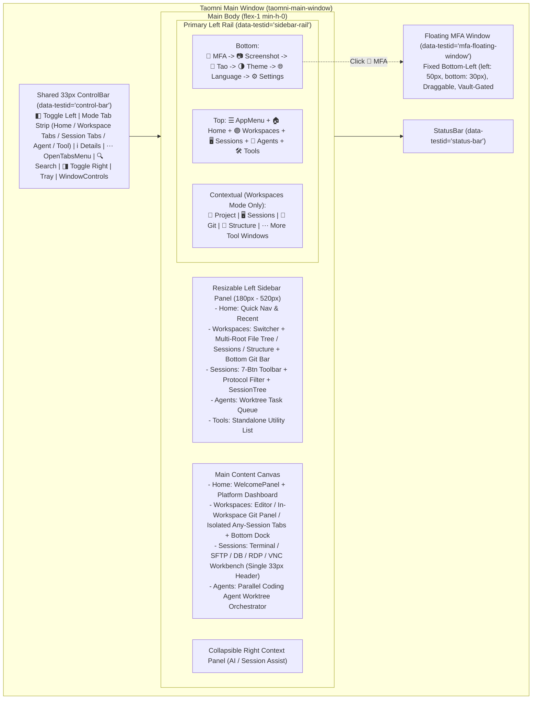
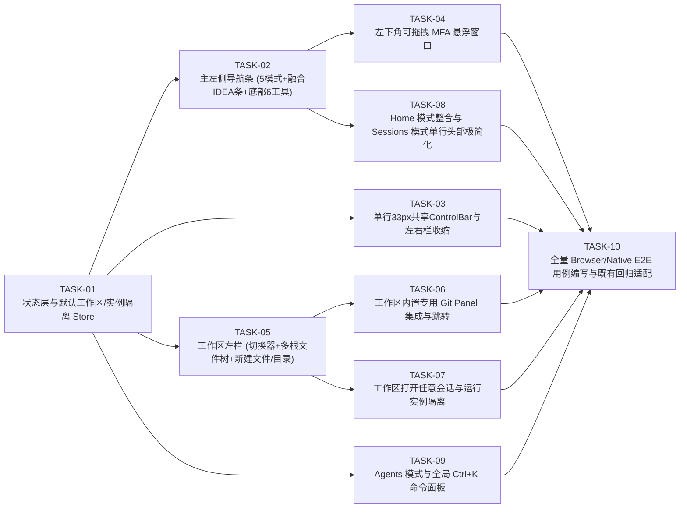

# Taomni Workspace-First & One-System 平台级 UI/交互重构详细设计说明书（Multi-Agent 开发与测试交接版 v6.1）

> **原型交互基准文件**：[`docs-feature/workspace-platform-redesign-prototype.html`](./workspace-platform-redesign-prototype.html)
> **测试用例与回归规范文件**：[`docs-feature/workspace-platform-redesign-testcases.md`](./workspace-platform-redesign-testcases.md)
> **自动化 E2E 用例目录**：`qa-ui-auto-tests/cases/TC-WS-001*.testcase.yaml` ~ `TC-WS-012*.testcase.yaml`

---

## 当前实现范围补充（2026-10-25）

用户确认 Agents / Crew 暂时仅保留入口按钮，点击显示“开发中”，保留当前视图；本文后续完整 Worktree 编排方案属于后续设计，不作为本次交付的已实现能力。原型对齐以全高 42px 图标栏、260px 初始侧栏、6px 分隔条、独立圆角框架、画布内 33px 工具栏、默认全宽 Home 为准，保留主分支已有菜单、导入导出、启动、会话与工具能力。

本轮补充确认：全局及 Sessions 均提供覆盖画布的实时大预览（Ctrl/Cmd+Shift+E），可切换当前视图/全部范围并点击卡片激活已有标签；文件读取当前缓冲区，终端读取已有运行实例的输出，不因预览启动新连接。Sessions 移除 Welcome 标签及画布欢迎页，右上角小预览按钮移除；逐标签悬停详情和 Ctrl/Cmd+Shift+H 保留。Tao 贴边悬浮条移除，聊天/便签/通知通过主导航入口访问。各模式的右侧操作按原型排列：Home 导航、Sessions 广播与布局预设、Workspaces 布局预设与底栏、Tools 返回工作区，再接搜索/大预览/右栏；语音从更多菜单访问。

模式与工作区切换仅隐藏运行实例，继续保留 PTY、文档文本及撤销历史。关闭标签才释放对应实例；全局 Sessions 与工作区实例彼此隔离。右侧上下文栏支持键盘/指针调宽及持久化，MFA 浮窗宽度为 280px。

新增验收：`TC-WS-016` 验证紧凑 Home、导入入口、右栏调整、窄窗口与启动导航；`TC-WS-017` 验证工作区/模式切换后未保存文档、撤销重做及保存重载。`TC-WS-011` 改为多入口开发中提示和真实全局搜索。`TC-WS-012/015` 验证离开工作区时隐藏 PTY、返回后保留输出并继续执行命令。单元回归 `WorkspaceEditorLifecycle.test.tsx` 覆盖 StrictMode 异步加载、编辑器实例保持及保存期间继续编辑的 dirty 状态。

控件覆盖基线仅调整 `F-WS-6` 中已明确暂缓的 Agents 编排控件（16→7 个必需控件、14→5 个已覆盖控件），其他功能基线不变；新增入口和保留能力继续执行真实回归，未通过的运行原样保留。

截图及本机运行证据保留在 `qa-ui-auto-report/_local/workspace-visual/` 与 `qa-ui-auto-report/workspace-browser/`；执行结果以本轮最终报告和 GitHub workflow receipts 为准。

## 1. 设计概述

- **标题**：Taomni Workspace-First & One-System 平台级 UI 与交互架构重构（v6.1 用户确认版）
- **设计类型**：`feature-design`（面向多 Coding Agent 协同开发、单元测试与 Browser/Native 全量回归验证的详细设计文档）
- **需求摘要**：
  1. **消除多余顶栏高度占用，主 Panel 共享单行 33px 工具栏**：取消独立顶栏行，将左/右栏收缩按钮（`◧` / `◨`）、当前模式 Tab 条、`ℹ️` 标签页预览（`Ctrl+Shift+H`）、`⋯` 已打开标签过滤菜单（`OpenTabsMenu`）、`🔍` 全局搜索（`Ctrl+K`）及窗口控制按钮统一收敛在 33px 单行 `ControlBar` 中，垂直高度占用与 `main` 完全一致。
  2. **左侧主导航条（Primary Rail）顶部模式与上下文工具条融合**：
     - 顶部提供 `☰` 应用主菜单 + 5 个一级模式切换：`🏠 Home`（移至与 Workspaces 并列第 1 个，复用并升级原 `WelcomePanel`）、`🟣 Workspaces`、`🖥️ Sessions`、`🤖 Agents`、`🛠️ Tools`。
     - **IDEA 式左侧工具窗口条融合**：当切换到 `Workspaces` 模式时，不在工作区内部并列渲染第二条竖向条，而是直接在窗口左侧主导航条 `Tools` 下方通过分割线融合展示工作区专属工具按钮：`📁 Project`、`🖥️ Sessions`、`🌿 Git`、`🧭 Structure` 以及保留完整溢出菜单的 `⋯ More Tool Windows`（含 `Terminal`、`Problems`、`Run/Debug`、`Find`、`Bookmarks`、`TODO`、`Services`、`Database`、`Show Tool Window Names`、`Move to...`）。切换到非 `Workspaces` 模式时该上下文区自动隐藏。
  3. **左侧主导航条底部全局工具与左下角悬浮 MFA 窗口**：
     - 底部自上而下依次排列：`🔐 MFA`、`📷 截图 (Screenshot)`、`💬 聊天 (Tao)`、`🌗 主题切换 (Theme)`、`🌐 语言切换 (Language)`、`⚙️ 设置 (Settings)`。
     - 点击 `🔐 MFA` 在窗口**左下角**（紧邻左侧栏 MFA 按钮右侧，`left: 50px; bottom: 30px`）弹出可拖拽悬浮验证器窗口（支持搜索、30s 倒计时环、单击复制 6 位 TOTP 验证码、置顶及展开完整管理），无需切换当前工作区或终端页面。
  4. **工作区（Workspaces）极简化、文件管理 + 内置独立 Git Panel + 打开任意会话 + 多根目录管理**：
     - 左侧栏顶部放置简洁易用的**工作区切换器（Workspace Switcher）**，无用户自建工作区时自动提供不可删除的 `Default Workspace (默认工作区)`。
     - 删除原左栏冗余的 `[📁 文件管理 | 🌿 Git 面板]` 切换行与右上角冗余的 `🌿 Git` 按钮；Git 通过主左侧栏 `🌿 Git` 工具按钮、左栏底部 Git 状态栏、编辑器工具栏 `🌿 在 Git 面板对比` 或工作区 `GIT` 标签页一键直达，且 100% 保留 `main` 分支 `GitPanelView.tsx` 与 `WorkspaceGitManagerView.tsx` 的全部功能并增强 AI Commit 与 Worktree 联动。
     - 工作区文件树头部与右键菜单支持**新建文件（`Alt+Insert`）**、**新建目录**、**添加外部文件夹到工作区（Multi-Root 目录支持）**及系统拖拽导入。
     - 工作区支持**方便地打开全局任意会话**（通过工作区 Tab 栏 `+` 菜单、`Ctrl+Alt+O` 打开任意会话弹窗、或主左侧栏 `🖥️ Sessions` 工具窗口），不仅限于已关联会话；已关联会话作为“★ 本工作区常用”置顶快捷入口；**工作区内打开的会话运行实例与 `Sessions` 全局模式下的运行实例完全隔离、互不干扰**。
  5. **会话总览（Sessions）单行极简头部与 100% `main` 功能保留**：
     - 删除顶部快速连接栏与终端次级面包屑工具条，将垂直空间完全还给终端与远端桌面。
     - 左栏 100% 保留 `SessionTree.tsx` 的目录树结构、7 个工具按钮、分类/收藏过滤、搜索框、多选与完整右键菜单；顶栏右侧 100% 保留 `main` 的 `ℹ️` 标签卡片预览（`Ctrl+Shift+H`）与 `⋯` 已打开标签目录分组/模糊搜索过滤菜单（`OpenTabsMenu`）。
- **设计基线**：`feat/workspace-platform-redesign` 分支提交 `dcf471bc`（基于 `main` 分支演进）。
- **涉及端**：前端（`src/` React 19 + TypeScript + Zustand）为主，后端（`src-tauri/src/`）复用现有存储、Git、PTY、SSH/SFTP/RDP/VNC/DB 及截图/MFA IPC，仅在 Workspace 多根目录与 Agent Worktree 元数据持久化上做向后兼容扩展。
- **目标平台**：Windows（WebView2）、macOS（WKWebView）、Linux（WebKitGTK）。

---

### ⚠️ 核心铁律（所有 Coding Agent 执行任何任务前必须遵守）

> **[!IMPORTANT] 铁律声明：本次重构严格限定为 UI 布局与交互重构，严禁随意删除 `main` 分支已有功能！**
> 1. **100% 功能保留原则**：`main` 分支现有的全部业务能力、协议连接（SSH / Local PTY / SFTP / Telnet / Serial / RDP / VNC / Database / Redis / HBase / HTTP / Object Storage / Mail）、全部右键上下文菜单（SessionTree 目录与会话右键菜单、TabBar 标签右键菜单、Terminal 右键菜单、SFTP 本地/远端右键菜单、CodeWorkspace 文件树与编辑器右键菜单、Git 变更文件与提交历史右键菜单、左侧导航条 `Show Tool Window Names` 右键菜单）、全部快捷键、导入导出（JSON / CSV / MobaXterm / OpenSSH / HTML）、分屏（Split View）、多端群发（MultiExec）、标签页分离（Detach Tab to Window）、Vault 密码库门禁等**必须 100% 保留，未经用户明确书面确认，任何 Agent 不得删减、弱化或跳过任何一项已有功能**。
> 2. **已由用户明确确认移除/收敛的冗余 UI 元素（仅限以下 4 项）**：
>    - 移除原型早期版本中多出的独立顶栏行及右上角无用的 3 个彩色圆点装饰；
>    - 移除工作区左栏顶部冗余的 `[📁 文件管理 | 🌿 Git 面板]` 切换按钮行（截图标识 `1`）；
>    - 移除工作区右上角冗余的 `🌿 Git` 按钮（截图标识 `3`）；
>    - 移除原型早期在 `Sessions` 模式下新增的快速连接芯片栏与终端内部次级面包屑栏（注：`main` 原有的可通过 `View -> Quick Connect Toolbar` 切换的 `QuickConnect` 组件仍按 `main` 逻辑保留支持，默认隐藏）。
> 3. **800 行源码红线**：遵循仓库 `AGENTS.md` 规范，所有新增或拆分后的源码文件必须控制在 **200–500 行**（绝对上限 **800 行**），每个任务完成后必须通过 `pnpm check:refactor` 校验。

---

### 三端兼容性评估（Windows / macOS / Linux）

| 维度 | Windows (WebView2) | macOS (WKWebView) | Linux (WebKitGTK) | 统一兼容设计 |
| :--- | :--- | :--- | :--- | :--- |
| **无边框窗口顶栏拖拽与控制按钮** | 右侧渲染自定义最小化/最大化/关闭按钮（`WindowControls`） | 左侧预留 `76px` 原生红绿灯区域（`MAC_TRAFFIC_LIGHT_INSET`），使用原生应用菜单 | 右侧渲染自定义最小化/最大化/关闭按钮；X11/Wayland 依赖 `startWindowDrag` | 复用 `ControlBar.tsx` 现有的 `IS_MAC` 判断、`WindowDragHandle`（高度 `<= 32px`）与 `WindowControls`，保证 `TC-100` 与 `TC-MAIN-RAIL-03` 原生拖拽通过 |
| **左侧栏可拖拽调宽与持久化** | Pointer Events 标准拖拽 | Pointer Events 标准拖拽 | WebKitGTK 分隔条需固定 6px 命中区防止侵入终端滚动条 | 复用 `MainLayoutView.tsx` 的 `PanelGroup` + `PanelResizeHandle`（`[data-testid="main-sidebar-resize-handle"]`）及自定义像素拖拽宽度持久化 |
| **左下角 MFA 悬浮窗口** | 视口内 `fixed` 定位悬浮层 | 视口内 `fixed` 定位悬浮层 | WebKitGTK 下避免跨原生子窗口遮挡，采用主 WebView 内高优先级 Portal 层（`z-index: 950`） | 默认定位 `left: 50px; bottom: 30px;`，拖拽时做视口边界夹紧（Clamp），支持 `Esc` 关闭与 Vault 解锁门禁联动 |
| **快捷键与修饰键** | `Ctrl+B`、`Ctrl+K`、`Ctrl+Shift+H`、`Alt+Insert` | `Cmd+B`、`Cmd+K`、`Cmd+Shift+H`、`Cmd+N` | `Ctrl+B`、`Ctrl+K`、`Ctrl+Shift+H`、`Alt+Insert` | 统一通过 `isModKey` / `keymap` 分发，保持三端快捷键无冲突 |

---

## 2. 现状与差距分析

### 2.1 现有实现（`main` 分支真实代码锚点）

1. **主窗口壳层与顶栏**：
   - `src/layouts/main/MainLayoutView.tsx`（379 行）：渲染 `ControlBar`、可选 `QuickConnect`、`PanelGroup`（含 `expanded-sidebar-panel` / `collapsed-sidebar-rail`、`main-sidebar-resize-handle`、`TabContentRouter`）以及 `StatusBar`。
   - `src/components/tabbar/ControlBar.tsx`（345 行）：高度 `32px`（`h-8`），包含 `app-main-menu`（`☰`）、`WindowDragHandle`、`TabBar`、`UpdateHint`、`tab-action-slot`、`tab-details-hover`（`ℹ️`）、`TabMore`（`⋯` -> `OpenTabsMenu`）、`ScreenshotMenuButton`、`TitleBarTrayControls`、`WindowControls`。
   - `src/components/window/TitleBarTrayControls.tsx`（337 行）：放置在顶栏右侧，包含 `tab-split-view`、`tab-multiexec-toggle`、`PttButton`、`LanguageSwitcher`（`[data-testid="language-switcher"]`）和 `theme-cycle`（`[data-testid="theme-cycle"]`）。
2. **左侧栏与导航条**：
   - `src/components/sidebar/Sidebar.tsx`（384 行）：左侧 `sidebar-rail` 顶部仅渲染 `sessions` 与 `tools` 两个按钮（`side-tab-sessions`、`side-tab-tools`），底部仅渲染 `ribbon-settings`。当 `compact`（折叠）且打开 `CodeWorkspace` 时，通过 `useMainRailHostStore` 将 `code-workspace-tool-rail-left` Portal 到 `sidebar-tool-window-rail` 中。
   - `src/components/sidebar/SessionTree.tsx`（399 行）：实现了完整的会话目录树、分组过滤、右键菜单、拖拽移动、内联重命名。
3. **欢迎页 / Home、代码工作区、Git 与 MFA**：
   - `src/components/welcome/WelcomePanel.tsx`：作为 `welcome` 类型 Tab 渲染在 `TabBar` 中，包含最近打开会话、最近工作区、本地终端启动器、新建会话、导入 OpenSSH 配置等。
   - `src/components/editor/CodeWorkspaceTab.tsx`（152 行）及 `src/components/editor/workspace/`：作为 `Tools` 菜单下的单一 Tab 打开；当主侧边栏展开时，主侧边栏显示 `SessionTree`，而 `CodeWorkspaceTab` 内部又显示一条左侧 IDEA 工具条，造成双左栏并列与认知负担。
   - `src/components/git/GitPanelView.tsx` 与 `src/components/git/WorkspaceGitManagerView.tsx`：拥有完整的 6 大标签页（`Changes | Log | Branches | Tags | Stash | Settings`）、`RepoSelector`、`BranchBadge`、`Remote`、`Fetch/Pull/Push`、Rebase/Merge 冲突横幅、`Tree/Flat` 切换、`Amend`、`Side-by-Side / Unified DiffViewer`。
   - `src/components/mfa/MfaTab.tsx`：目前仅能通过 `Tools -> MFA` 打开为全屏独立 Tab（`[data-testid="mfa-tab"]`），当用户在 SSH 终端或浏览器中输入动态口令时，切换 Tab 会遮挡当前终端。

### 2.2 现有实现的局限与重构目标差距

| 痛点领域 | `main` 现状 | v6.1 重构目标 |
| :--- | :--- | :--- |
| **一级信息架构** | 仅 `Sessions` 和 `Tools` 两个侧栏入口，`CodeWorkspace` 与 `Git` 藏在 `Tools` 二级列表中；`Welcome` 作为普通 Tab 混在终端标签中 | 升级为 `🏠 Home`、`🟣 Workspaces`、`🖥️ Sessions`、`🤖 Agents`、`🛠️ Tools` 5 大一级模式，`Home` 移至与 `Workspaces` 并列第 1 位 |
| **左侧工具按钮条并列问题** | 当主侧栏展开时，窗口左侧主导航条与 `CodeWorkspace` 内部的 IDEA 工具条并列出现两条竖栏 | 切换到 `Workspaces` 模式时，IDEA 工具窗口按钮（`Project / Sessions / Git / Structure / ⋯`）直接融合进主左侧导航条中部，永远只有一条主导航条 |
| **工作区与会话隔离/打通** | `CodeWorkspace` 内部难以直接打开任意 SSH/DB/RDP/VNC 会话；全局 TabBar 混放代码与所有会话 | 工作区支持打开任意全局会话（`+` 菜单 / `Ctrl+Alt+O` / 左栏 `Sessions` 工具窗口），且工作区内打开的会话实例与 `Sessions` 模式下的运行实例完全独立 |
| **工作区多目录与文件创建** | 添加外部目录与新建文件/目录入口不够直观 | 工作区左栏文件树工具栏与右键菜单直接提供“新建文件 / 新建目录 / 添加文件夹到工作区（Multi-Root）” |
| **左下角高频工具与悬浮 MFA** | 截图与语言切换占用了右上角顶栏空间；MFA 必须切全屏 Tab 查看验证码 | 左侧栏底部集成 `MFA -> 截图 -> 聊天 -> 主题 -> 语言 -> 设置`；点击 MFA 在左下角弹出可拖拽悬浮验证器窗口（同时保留 `Tools -> MFA` 全屏 Tab 兼容） |

---

## 3. 验收标准（Acceptance Criteria）

### 3.1 目标变更验收标准

- **`AC-01`（零额外顶栏 & 33px 单行共享主工具栏）**：主窗口顶部仅保留单行 `33px`（`h-8`）的 `ControlBar`（`[data-testid="control-bar"]`），无额外顶栏行、无右上角 3 色装饰圆点；主工具栏最左侧提供左栏收缩/展开按钮（`[data-testid="toggle-left-sidebar"]`，`Ctrl+B`），中间为当前模式的标签栏（`[data-testid="tab-bar"]`），右侧依次为标签动作槽位、`[data-testid="tab-details-hover"]`（`ℹ️`）、`[data-testid="tab-more"]`（`⋯`）、`[data-testid="global-search-trigger"]`（`🔍 Ctrl+K`）、`[data-testid="toggle-right-sidebar"]`（`◨`）、`[data-testid="titlebar-tray"]`（保留分屏/群发/语音按钮）及窗口控制按钮。
- **`AC-02`（左侧主导航条顶部 5 大一级模式 & Home 并列第一）**：左侧主导航条（`[data-testid="sidebar-rail"]`）顶部为 `[data-testid="app-main-menu"]`（非 macOS），其下依次为 5 个一级模式按钮：`[data-testid="nav-mode-home"]`（`🏠 Home`，第 1 位）、`[data-testid="nav-mode-workspaces"]`（`🟣 Workspaces`，同时兼容别名 `side-tab-workspaces`）、`[data-testid="side-tab-sessions"]`（`🖥️ Sessions`）、`[data-testid="nav-mode-agents"]`（`🤖 Agents`）、`[data-testid="side-tab-tools"]`（`🛠️ Tools`）。点击 `Home` 展示原 `WelcomePanel` 全部能力与平台概览卡片，且不占用 `Sessions` 终端标签栏宽度。
- **`AC-03`（Workspaces 模式下 IDEA 工具窗口融合至主左侧导航条）**：当且仅当处于 `Workspaces` 模式时，左侧主导航条在 `side-tab-tools` 下方渲染分割线与上下文工具窗口区（`[data-testid="workspace-merged-tool-rail"]`，兼容 `[data-testid="code-workspace-tool-rail-left"]`），包含：`📁 Project`（`[data-testid="code-workspace-tool-rail-project"]`）、`🖥️ Sessions`（`[data-testid="code-workspace-tool-rail-sessions"]`）、`🌿 Git`（`[data-testid="code-workspace-tool-rail-git"]`，带变更数徽标）、`🧭 Structure`（`[data-testid="code-workspace-tool-rail-structure"]`）以及 `⋯` 溢出菜单按钮（`[data-testid="code-workspace-bottom-tab-overflow"]`）。点击 `⋯` 弹出包含 `Terminal (Alt+F12)`、`Problems (Alt+6)`、`Run / Debug (Alt+4)`、`Find`、`Bookmarks`、`TODO`、`Services`、`Database`、`Show Tool Window Names`、`Move to...` 的完整菜单。工作区左栏与主编辑区之间**绝不出现第二条竖向工具按钮条**。
- **`AC-04`（左侧主导航条底部 6 工具排列 & 左下角 MFA 悬浮窗）**：左侧主导航条底部自上而下依次渲染：
  1. `[data-testid="rail-mfa-button"]`（`🔐 MFA`）
  2. `[data-testid="system-screenshot"]` + `[data-testid="system-screenshot-delay-toggle"]`（`📷 截图`，从右上角移至聊天上方）
  3. `[data-testid="rail-chat-button"]`（`💬 聊天 Tao`）
  4. `[data-testid="theme-cycle"]`（`🌗 主题切换`）
  5. `[data-testid="language-switcher"]`（`🌐 语言切换`，位于主题切换正下方）
  6. `[data-testid="ribbon-settings"]`（`⚙️ 设置`）
  点击 `rail-mfa-button` 在窗口**左下角**（默认 `left: 50px; bottom: 30px;`）打开/关闭可拖拽悬浮窗口 `[data-testid="mfa-floating-window"]`，支持搜索过滤、30 秒 TOTP 倒计时、一键复制验证码、置顶切换及展开全屏 MFA 管理页。
- **`AC-05`（左栏无级拖拽调宽 + 默认工作区保底 + 工作区切换器在左栏）**：主左栏支持通过 `[data-testid="main-sidebar-resize-handle"]` 在 `180px`–`520px`（或 `15%`–`40%`）间拖拽调宽并持久化到 `localStorage`；工作区切换器（`[data-testid="workspace-switcher"]`）位于 `Workspaces` 左栏顶部，当用户未创建自定义工作区时，系统自动初始化且始终保留不可删除的 `Default Workspace (默认工作区)`。
- **`AC-06`（工作区极简化与内置独立 Git Panel 对齐增强）**：工作区左栏已移除顶部 `[📁 文件管理 | 🌿 Git 面板]` 按钮行（原标识 `1`），工作区右上角已移除 `🌿 Git` 按钮（原标识 `3`）；通过主左侧栏 `🌿 Git` 按钮、左栏底部 Git 状态栏（`[data-testid="workspace-sidebar-git-bar"]`）、文件编辑器工具栏 `[data-testid="editor-open-git-diff"]`（`🌿 在 Git 面板对比`）或工作区 `GIT` 标签页，均可在工作区主面板切换至专用 Git Panel，且完整具备 `main` 分支 `GitPanelView` / `WorkspaceGitManagerView` 的 6 大标签页、多仓切换、Fetch/Pull/Push、Stash、Tags、Rebase/Conflict 横幅、Tree/Flat、Amend、AI 生成 Commit Message、Side-by-Side / Unified Diff 对比能力。
- **`AC-07`（工作区内方便地打开全局任意会话 & 运行实例隔离）**：在 `Workspaces` 模式下，用户可通过：
  1. 工作区标签栏 `+` 按钮下拉菜单（`[data-testid="workspace-open-session-menu"]`）；
  2. 快捷键 `Ctrl+Alt+O` 或菜单打开的“打开任意会话”弹窗（`[data-testid="workspace-session-picker-modal"]`，支持按协议/关键字过滤全部全局会话，并提供“同时关联到本工作区常用”复选框）；
  3. 主左侧栏 `🖥️ Sessions` 工具窗口（展示“★ 本工作区常用关联会话”与“🌐 全部全局会话目录树”）；
  直接在当前工作区打开任意类型的会话（SSH、Local Terminal、Database、SFTP、RDP、VNC 等）。**工作区内打开的会话 Tab 实例（`workspaceOpenTabs[workspaceId]`）与 `Sessions` 全局模式下打开的会话 Tab 实例（`tabs`）完全隔离，互不共享运行态、互不干扰关闭与重连**。
- **`AC-08`（工作区多根目录管理与新建文件/目录）**：工作区文件树顶部工具栏与目录右键菜单均提供 `[data-testid="workspace-new-file"]`（新建文件 `Alt+Insert`）、`[data-testid="workspace-new-folder"]`（新建目录）、`[data-testid="workspace-add-folder"]`（添加外部文件夹到工作区 Multi-Root）及“从工作区移除目录（不删磁盘文件）”，支持同时挂载并展开多个本地目录。
- **`AC-09`（Sessions 模式单行头部化简与全量过滤保留）**：`Sessions` 模式下不显示多余的快速链接芯片行和终端次级面包屑栏，主面板共享单行 33px 工具栏；左栏 100% 保留 `SessionTree`（含 7 个操作图标、协议/收藏过滤芯片、搜索框、文件夹树、拖拽与完整右键菜单），顶栏右侧 100% 保留 `ℹ️`（`[data-testid="tab-details-hover"]`）悬浮卡片与 `⋯`（`[data-testid="tab-more"]` -> `[data-testid="open-tabs-menu"]`）按目录分组过滤和搜索已打开会话标签。

### 3.2 保持不变的既有验收基线（Regression Baseline）

- **`AC-10`（100% 右键菜单保留）**：`app-main-menu` 主菜单、`SessionTree` 文件夹与会话右键菜单、`TabBar` 标签右键菜单、`Terminal` 右键菜单、`SFTP` 双栏右键菜单、`CodeWorkspace` 文件树与 Monaco 编辑器右键菜单、`Git` 面板右键菜单、左侧导航条 `sidebar-rail-menu-show-names` 右键菜单的所有菜单项、`data-testid` 和行为保持 100% 可用。
- **`AC-11`（100% 既有 `data-testid` 与键盘可访问性兼容）**：既有自动化用例依赖的核心选择器（`[data-testid="control-bar"]`、`[data-testid="window-drag-handle"]`、`[data-testid="sidebar"]`、`[data-testid="expanded-sidebar-panel"]`、`[data-testid="collapsed-sidebar-rail"]`、`[data-testid="main-sidebar-resize-handle"]`、`[data-testid="session-tree"]`、`[data-testid="welcome-panel"]`、`[data-testid="status-bar"]`、`[data-testid="theme-cycle"]`、`[data-testid="language-switcher"]`、`[data-testid="system-screenshot"]`、`[data-testid="ribbon-settings"]`）全部保留或提供精确 DOM 兼容，确保既有 E2E 用例零破坏过渡。

---

## 4. 详细设计与技术决策

### 4.1 架构总览



### 4.2 关键设计决策记录（`DEC-*`）

#### `DEC-01`：单行 33px 共享主工具栏与零额外顶栏设计
- **状态**：`用户已定`
- **裁决**：彻底取消独立顶栏行，复用并扩展 `src/components/tabbar/ControlBar.tsx`（高度 `32px/33px`），在其左侧增加左栏折叠/展开按钮 `[data-testid="toggle-left-sidebar"]`（快捷键 `Ctrl+B`），中间根据当前激活的一级模式渲染对应的标签栏（`Workspaces` 模式下渲染当前工作区的打开标签；`Sessions` / `Home` / `Tools` 模式下渲染会话工作台标签），右侧增加全局搜索按钮 `[data-testid="global-search-trigger"]`（`Ctrl+K`）与右栏折叠按钮 `[data-testid="toggle-right-sidebar"]`，同时完整保留 `tab-details-hover`（`ℹ️`）与 `tab-more`（`⋯` `OpenTabsMenu`）。删除右上角无意义的 3 色圆点。

#### `DEC-02`：左侧主导航条顶部一级模式（Home 第 1）与 IDEA 式工具窗口条单轨融合
- **状态**：`用户已定`
- **裁决**：
  1. `🏠 Home` 从顶栏移入左侧主导航条第 1 位（`[data-testid="nav-mode-home"]`），紧接着是 `🟣 Workspaces`（`[data-testid="nav-mode-workspaces"]`）、`🖥️ Sessions`（`[data-testid="side-tab-sessions"]`）、`🤖 Agents`（`[data-testid="nav-mode-agents"]`）、`🛠️ Tools`（`[data-testid="side-tab-tools"]`）。
  2. **解决原 Code Workspace 左栏与主窗口左栏并列问题**：当切换到 `Workspaces` 模式时，不再在工作区内部渲染第二条竖向工具条，而是直接在主窗口左侧导航条 `Tools` 下方展示分割线与工作区工具窗口按钮：`📁 Project`、`🖥️ Sessions`、`🌿 Git`、`🧭 Structure`、`⋯ More Tool Windows`。
  3. 点击 `📁 Project` / `🖥️ Sessions` / `🧭 Structure` 直接切换工作区左栏面板内容（再次点击同一激活按钮则收起工作区左栏）；点击 `🌿 Git` 直接在工作区主面板激活内置 Git Panel；点击 `⋯` 弹出包含 `Terminal`、`Problems`、`Run/Debug`、`Find`、`Bookmarks`、`TODO`、`Services`、`Database`、`Show Tool Window Names`、`Move to...` 的完整 IDEA 溢出菜单。

#### `DEC-03`：左侧主导航条底部 6 工具布局与左下角可拖拽 MFA 悬浮窗
- **状态**：`用户已定`
- **裁决**：
  1. 将原位于顶栏右上角的 `📷 截图 (ScreenshotMenuButton)` 和 `🌐 语言切换 (LanguageSwitcher)` 移至左侧主导航条底部；将 `🔐 MFA` 也放入左侧主导航条底部。
  2. 底部自上而下固定顺序为：`🔐 MFA` -> `📷 截图` -> `💬 聊天 (Tao)` -> `🌗 主题切换` -> `🌐 语言切换` -> `⚙️ 设置`。
  3. 点击 `🔐 MFA` 按钮（`[data-testid="rail-mfa-button"]`）时，在主窗口**左下角**（默认坐标 `left: 50px; bottom: 30px;`）弹出可拖拽的悬浮窗口 `[data-testid="mfa-floating-window"]`。悬浮窗复用 `src/components/mfa/` 现有的 Vault 门禁与 TOTP/HOTP 生成逻辑，支持搜索、30s 动态进度环、单击复制口令、窗口置顶以及“展开完整管理页”（切换到 `mfa` Tab，确保 `TC-MFA-001` 等全部既有 MFA 用例 100% 兼容）。

#### `DEC-04`：工作区内部布局极简化、内置 Git Panel 对齐增强、打开任意会话与实例隔离
- **状态**：`用户已定`
- **裁决**：
  1. **工作区切换器与默认工作区**：位于工作区左栏第 1 行（`[data-testid="workspace-switcher"]`）。若持久化的工作区列表为空，自动创建不可删除的 `Default Workspace (默认工作区)`（`id: "default-workspace"`）。
  2. **删除冗余 Git 入口行与右上角 Git 按钮**：删除左栏原 `[📁 文件管理 | 🌿 Git 面板]` 切换行与右上角 `🌿 Git` 按钮；Git 通过主左侧栏 `🌿 Git` 按钮、左栏底部 Git 状态栏、编辑器工具栏 `🌿 在 Git 面板对比` 按钮或工作区 `GIT` 标签页进入。
  3. **多根目录文件管理与新建文件/目录**：工作区默认左栏为类 IDEA 风格的多根文件管理树（支持代码工作区与普通文件目录），工具栏与文件夹右键菜单直接支持 `新建文件 (Alt+Insert)`、`新建目录`、`添加文件夹到工作区 (Multi-Root)`。
  4. **工作区打开任意会话 & 运行实例隔离**：
     - 用户在工作区可通过 Tab 栏 `+` 菜单、`Ctrl+Alt+O` 会话选择器或左栏 `🖥️ Sessions` 工具窗口直接打开全局任意会话（SSH、Local PTY、DB、SFTP、RDP、VNC 等），不局限于已关联会话；已关联会话置顶显示为“★ 本工作区常用”。
     - **实例隔离契约**：工作区内打开的会话 Tab 存储在 `workspaceStore` 的 `openTabsByWorkspace[workspaceId]` 中，拥有独立的 `runtimeTabId`（如 `ws:${workspaceId}:sess:${sessionId}:${uuid}`），与 `Sessions` 全局模式的 `appStore.tabs` 完全独立，互不共享打开状态、终端缓冲区或关闭动作。

#### `DEC-05`：`Sessions` 模式单行头部极简化与 `main` 过滤能力 100% 保留
- **状态**：`用户已定`
- **裁决**：删除 `Sessions` 模式下的快速连接芯片行与终端内部次级面包屑栏，让终端垂直高度最大化；左栏 100% 保留 `SessionTree.tsx` 的全部目录树、7 按钮工具栏、分类过滤与右键菜单；顶栏右侧 100% 保留 `ℹ️`（`tab-details-hover`）与 `⋯`（`OpenTabsMenu` 目录分组过滤 + 搜索过滤）。

---

### 4.3 核心状态模型与数据结构设计

#### 4.3.1 一级导航模式与 UI 壳层状态（`src/stores/appStore.ts` 扩展）

```typescript
/** 一级主导航模式（保留 "sessions" | "tools" 兼容，新增 "home" | "workspaces" | "agents"） */
export type PrimaryNavMode = "home" | "workspaces" | "sessions" | "agents" | "tools";

/** 向后兼容原有 SideTab 类型 */
export type SideTab = PrimaryNavMode;

export interface FloatingMfaWindowState {
  open: boolean;
  pinned: boolean;
  /** 默认左下角位置：{ left: 50, bottom: 30 } */
  position: { left: number; bottom: number };
  searchQuery: string;
}
```

#### 4.3.2 工作区多根目录与隔离会话实例模型（`src/stores/workspacePlatformStore.ts` 新增）

```typescript
export interface WorkspaceRootFolder {
  id: string;
  name: string;
  path: string;
  addedAt: number;
}

export type WorkspaceTabKind =
  | "file"          // 代码/文档编辑器 Tab
  | "git"           // 工作区内置专用 Git Panel Tab
  | "terminal"      // 工作区独立打开的 SSH / Local PTY / Telnet / Serial 实例
  | "sftp"          // 工作区独立打开的 SFTP 实例
  | "database"      // 工作区独立打开的 Database / Redis / HBase 实例
  | "rdp"           // 工作区独立打开的 RDP 实例
  | "vnc";          // 工作区独立打开的 VNC 实例

export interface WorkspaceIsolatedTab {
  /** 唯一运行实例 ID，格式：`ws:${workspaceId}:${kind}:${uuid}`，与 appStore.tabs 完全隔离 */
  id: string;
  workspaceId: string;
  kind: WorkspaceTabKind;
  title: string;
  closable: boolean;
  /** 当 kind === "file" 时的文件路径与关联目录根 ID */
  filePath?: string;
  rootFolderId?: string;
  /** 当 kind 为会话类型时的源 SessionConfig ID（可为任意全局会话 ID，不限于 pinnedSessionIds） */
  sessionId?: string;
  protocol?: string;
}

export interface PlatformWorkspace {
  id: string;
  name: string;
  description: string;
  /** 默认工作区 isDefault === true，不可删除 */
  isDefault: boolean;
  /** 支持挂载多个本地文件夹（Multi-Root） */
  rootFolders: WorkspaceRootFolder[];
  /** 用户标记为“★ 本工作区常用”的全局 Session ID 列表（仅作快捷置顶，不限制打开其他全局会话） */
  pinnedSessionIds: string[];
  /** 当前工作区左侧激活的工具窗口：project | sessions | structure */
  activeLeftToolWindow: "project" | "sessions" | "structure";
  /** 当前工作区底部停靠栏状态 */
  bottomDock: {
    open: boolean;
    activeTool: "terminal" | "problems" | "run" | "find" | "bookmarks" | "todo" | "services" | "database";
    heightPx: number;
  };
  /** 当前工作区独立打开的 Tab 实例列表（与 Sessions 全局模式完全隔离） */
  openTabs: WorkspaceIsolatedTab[];
  activeTabId: string;
}
```

---

### 4.4 `data-testid` 契约与向后兼容映射表

为保证所有新增 `TC-WS-*` 用例与既有 `TC-*` 用例稳定运行，所有组件必须严格实现以下 `data-testid` 契约：

| 区域 | `data-testid` | 说明与向后兼容策略 |
| :--- | :--- | :--- |
| **共享主工具栏 (`ControlBar`)** | `control-bar` | 主窗口唯一顶栏容器（高度 32–33px，`h-8`） |
| | `app-main-menu` | 左上角 `☰` 应用主菜单按钮（完整保留 `Sessions / View / Tools / Settings / Help`） |
| | `toggle-left-sidebar` | 主工具栏左侧 `◧` 左栏收缩/展开按钮（`Ctrl+B`） |
| | `window-drag-handle` | 顶栏窗口拖拽抓手（高度 `<= 32px`） |
| | `tab-bar` | 当前激活模式的标签栏容器 |
| | `tab-details-hover` | `ℹ️` 标签详情预览按钮（`Ctrl+Shift+H`） |
| | `tab-more` / `open-tabs-menu` | `⋯` 已打开标签目录分组过滤与模糊搜索菜单 |
| | `global-search-trigger` | `🔍` 全局搜索触发按钮（`Ctrl+K`） |
| | `toggle-right-sidebar` | 主工具栏右侧 `◨` 右栏收缩/展开按钮 |
| | `titlebar-tray` | 顶栏托盘容器（保留 `tab-split-view`、`tab-multiexec-toggle`、`PttButton`） |
| **左侧主导航条 (`SidebarRail`)** | `sidebar-rail` | 窗口最左侧常驻主导航条 |
| | `nav-mode-home` | `🏠 Home` 模式按钮（第 1 位） |
| | `nav-mode-workspaces` | `🟣 Workspaces` 模式按钮（第 2 位） |
| | `side-tab-sessions` | `🖥️ Sessions` 模式按钮（第 3 位，100% 兼容既有 `TC-MAIN-RAIL-*`） |
| | `nav-mode-agents` | `🤖 Agents` 模式按钮（第 4 位） |
| | `side-tab-tools` | `🛠️ Tools` 模式按钮（第 5 位，100% 兼容既有 `TC-MAIN-RAIL-*`） |
| **Workspaces 融合工具窗口条** | `code-workspace-tool-rail-left` | 在 `Workspaces` 模式下直接渲染在 `sidebar-rail` 中部（不再在工作区内渲染第二条竖条） |
| | `code-workspace-tool-rail-project` | `📁 Project` 文件树工具窗口按钮 |
| | `code-workspace-tool-rail-sessions` | `🖥️ Sessions` 工作区会话工具窗口按钮 |
| | `code-workspace-tool-rail-git` | `🌿 Git` 工具窗口按钮（点击直接打开工作区专用 Git Panel） |
| | `code-workspace-tool-rail-structure` | `🧭 Structure` 结构视图工具窗口按钮 |
| | `code-workspace-bottom-tab-overflow` | `⋯ More Tool Windows` 溢出菜单按钮（含 `Show Tool Window Names` 等全部菜单项） |
| **左侧主导航条底部 6 工具** | `rail-mfa-button` | 底部第 1 个：`🔐 MFA` 悬浮窗开关按钮（截图上方） |
| | `system-screenshot` / `system-screenshot-delay-toggle` | 底部第 2 个：`📷 截图` 与延时菜单按钮（保留原 `ScreenshotMenuButton` 全部 `data-testid`） |
| | `rail-chat-button` | 底部第 3 个：`💬 聊天 (Tao)` 开关按钮 |
| | `theme-cycle` | 底部第 4 个：`🌗 主题切换` 按钮（保留 `aria-label="Cycle application theme"`，兼容 `TC-015`） |
| | `language-switcher` | 底部第 5 个：`🌐 语言切换` 按钮（主题切换下方，保留 `language-option-en` / `language-option-zh-CN`，兼容 `TC-auto-F-I18n-1`） |
| | `ribbon-settings` | 底部第 6 个：`⚙️ 设置` 按钮（兼容 `TC-MAIN-RAIL-01`） |
| **左下角 MFA 悬浮窗口** | `mfa-floating-window` | 左下角可拖拽 MFA 悬浮窗口容器（`left: 50px; bottom: 30px;`） |
| | `mfa-floating-drag-handle` | MFA 悬浮窗口顶部拖拽栏 |
| | `mfa-floating-search` | MFA 悬浮窗内搜索输入框 |
| | `mfa-floating-pin` | MFA 悬浮窗置顶按钮 |
| | `mfa-floating-expand-tab` | 展开为全屏 MFA 标签页按钮 |
| | `mfa-floating-close` | 关闭 MFA 悬浮窗按钮 |
| **Workspaces 内部关键控件** | `workspace-switcher` | 工作区左栏顶部的工作区下拉切换器 |
| | `workspace-switcher-menu` | 工作区切换下拉菜单（含 `Default Workspace` 与 `+ 新建工作区`） |
| | `workspace-new-file` | 工作区新建文件按钮（`Alt+Insert`） |
| | `workspace-new-folder` | 工作区新建目录按钮 |
| | `workspace-add-folder` | 添加外部文件夹到工作区（Multi-Root）按钮 |
| | `workspace-sidebar-git-bar` | 工作区左栏底部常驻 Git 分支与变更数状态条（点击跳转 Git Panel） |
| | `editor-open-git-diff` | 文件编辑器右上角 `🌿 在 Git 面板对比` 按钮 |
| | `workspace-open-session-plus` | 工作区标签栏 `+` 打开任意会话/文件下拉按钮 |
| | `workspace-session-picker-modal` | 工作区打开全局任意会话弹窗（`Ctrl+Alt+O`） |

---

## 5. 代码变更文件清单与行数预算（严格遵守 800 行红线）

> 每个新增或修改文件的目标物理行数均控制在 **150–450 行**之间，严禁出现超过 800 行的文件。

| 文件路径 | 操作 | 预估行数 | 职责边界说明 |
| :--- | :--- | :--- | :--- |
| `src/stores/appStore.ts` | 修改 | ~320 行 | 扩展 `PrimaryNavMode`（`home \| workspaces \| sessions \| agents \| tools`）、左右侧栏收缩状态、左下角 `floatingMfa` 状态 |
| `src/stores/workspacePlatformStore.ts` | 新增 | ~340 行 | 管理 `PlatformWorkspace` 列表、不可删除的 `Default Workspace` 初始化、多根目录（`rootFolders`）、工作区独立会话标签（`openTabs`）及 `localStorage` 持久化 |
| `src/components/sidebar/Sidebar.tsx` | 修改 | ~310 行 | 重构左侧栏容器：组合 `PrimaryNavigationRail` 与各模式左栏内容（`HomeSidebar` / `WorkspaceSidebar` / `SessionTree` / `AgentsSidebar` / `ToolsPanel`） |
| `src/components/sidebar/PrimaryNavigationRail.tsx` | 新增 | ~280 行 | 独立封装左侧主导航条：顶部 5 模式（Home 第 1）、中部 `Workspaces` 融合 IDEA 工具窗口按钮（含 `⋯` 菜单）、底部 6 工具（`MFA -> 截图 -> 聊天 -> 主题 -> 语言 -> 设置`） |
| `src/components/mfa/MfaFloatingWindow.tsx` | 新增 | ~260 行 | 左下角（`left: 50px; bottom: 30px;`）可拖拽 MFA 悬浮验证器窗口，复用 Vault 门禁与 TOTP 列表、搜索、倒计时复制 |
| `src/components/tabbar/ControlBar.tsx` | 修改 | ~340 行 | 整合单行 33px 共享主工具栏：新增左侧 `◧`（`toggle-left-sidebar`）、按模式路由中间 Tab 条、右侧 `🔍`（`global-search-trigger`）与 `◨`（`toggle-right-sidebar`），保留全部主菜单与 `OpenTabsMenu` |
| `src/components/window/TitleBarTrayControls.tsx` | 修改 | ~240 行 | 将 `LanguageSwitcher` 与 `theme-cycle` 移交 `PrimaryNavigationRail` 底部渲染，保留顶栏托盘容器 `[data-testid="titlebar-tray"]` 内的分屏、多端群发与语音按钮 |
| `src/components/workspace/WorkspaceSidebar.tsx` | 新增 | ~320 行 | 工作区左栏：顶部 `WorkspaceSwitcher`、工具栏（新建文件/新建目录/添加文件夹）、多根文件管理树/`Sessions` 面板/`Structure` 面板切换、底部常驻 Git 状态条 |
| `src/components/workspace/WorkspaceMainPanel.tsx` | 新增 | ~350 行 | 工作区主画布：路由工作区内的文件编辑器（`CodeWorkspaceTab` 核心）、内置专用 Git Panel（复用 `WorkspaceGitManagerView` / `GitPanelView`）、以及工作区独立打开的任意会话实例，配合底部可折叠 IDEA 停靠窗（Terminal/Problems/Run） |
| `src/components/workspace/WorkspaceSessionPickerModal.tsx` | 新增 | ~220 行 | 工作区打开全局任意会话的选择器弹窗（`Ctrl+Alt+O`）及新建文件/新建目录/挂载多根目录弹窗 |
| `src/components/agents/AgentsPlatformView.tsx` | 新增 | ~290 行 | `🤖 Agents` 一级模式视图：Git Worktree 并行任务队列、读写边界策略与 Diff 审阅合并面板 |
| `src/layouts/main/MainLayoutView.tsx` | 修改 | ~370 行 | 挂载单行 `ControlBar`、可无级拖拽调宽的 `Sidebar`、按一级模式切换的主内容区及左下角 `MfaFloatingWindow` |

---

## 6. 多 Coding Agent 任务拆分与开发交接计划（`TASK-01` ~ `TASK-10`）

> **[!IMPORTANT] 多 Coding Agent 协作执行规范**
> 1. 以下 10 个任务按职责边界与文件所有权正交拆分，支持分配给不同的 Coding Agent（如 Claude Code、Codex、OpenCode、Cursor 等）按依赖图并行或流水线开发。
> 2. **每个 Agent 领取任务时的第一铁律**：**本次重构主要是 UI 布局与交互重构，`main` 分支中已有的功能（包括所有右键菜单、快捷键、会话过滤、导入导出、协议连接、Git 6 大面板、IDEA 工具窗口菜单等）必须 100% 保留，未经用户确认绝不能删除！**
> 3. 每个任务交付前必须运行：① 该任务的 Vitest 单元测试；② `pnpm check:refactor`（验证 800 行限制与模块边界）；③ 对应的 Browser/Native 自动化用例（见第 7 节与 `docs-feature/workspace-platform-redesign-testcases.md`）。



---

### `TASK-01`：平台状态层演进、默认工作区保底与工作区会话实例隔离 Store

- **负责模块与文件所有权**：
  - 修改：`src/stores/appStore.ts`
  - 新增：`src/stores/workspacePlatformStore.ts`
  - 新增单测：`src/stores/__tests__/workspacePlatformStore.test.ts`
- **依赖任务**：无（基础底座任务，可最先启动）
- **⚠️ 强制 `main` 功能保留清单**：
  - 保留 `appStore.ts` 现有的全部 `tabs`、`activeTabId`、`sidebarCollapsed`、`sidebarCollapsedByGroup`、`terminalSplitLayout`、`multiExecSelectedTabIds`、`chatDrawerOpen` 等全部字段与方法签名，确保既有组件零编译错误。
- **详细开发要求**：
  1. 在 `appStore.ts` 中扩展 `activeSideTab` 支持 `"home" | "workspaces" | "sessions" | "agents" | "tools"`，新增 `rightSidebarCollapsed`、`toggleRightSidebar` 以及 `floatingMfa`（`open`, `pinned`, `position: { left: 50, bottom: 30 }`, `searchQuery`）状态。
  2. 创建 `workspacePlatformStore.ts`：
     - 当 `localStorage`（键名 `taomni.platformWorkspaces.v1`）为空或损坏时，自动生成 `Default Workspace (默认工作区)`（`id: "default-workspace"`, `isDefault: true`），并在 `deleteWorkspace(id)` 中强制拦截对 `isDefault === true` 工作区的删除操作。
     - 实现多根目录管理：`addRootFolder(workspaceId, folder)`、`removeRootFolder(workspaceId, rootId)`、在指定目录下创建文件/文件夹的树节点更新与后端 FS IPC 调用封装。
     - 实现**工作区独立会话 Tab 管理**：`openSessionInWorkspace(workspaceId, sessionConfig, options?: { pinToWorkspace?: boolean })`，生成的 `WorkspaceIsolatedTab.id` 使用 `ws:${workspaceId}:sess:${sessionConfig.id}:${nanoid(6)}` 格式，**绝不写入 `appStore.tabs`**，实现工作区打开的会话实例与 `Sessions` 模式下的会话实例 100% 隔离。
- **单元测试要求（Vitest）**：
  - 验证空存储启动时自动创建 `Default Workspace` 且 `deleteWorkspace("default-workspace")` 被拒绝；
  - 验证多根目录增删与持久化恢复；
  - 验证在工作区打开任意全局会话时，仅更新 `workspace.openTabs`，`appStore.getState().tabs` 长度与状态完全不受影响。

---

### `TASK-02`：左侧主导航条重构（Home 并列第 1 + Workspaces 融合 IDEA 工具条 + 底部 6 工具）

- **负责模块与文件所有权**：
  - 新增：`src/components/sidebar/PrimaryNavigationRail.tsx`
  - 修改：`src/components/sidebar/Sidebar.tsx`、`src/components/window/TitleBarTrayControls.tsx`
  - 新增单测：`src/components/sidebar/__tests__/PrimaryNavigationRail.test.tsx`
- **依赖任务**：`TASK-01`
- **⚠️ 强制 `main` 功能保留清单**：
  - 100% 保留右键点击左侧主导航条弹出 `Show Tool Window Names`（`[data-testid="sidebar-rail-menu-show-names"]`）切换横排文字名称/纯图标模式的能力（对应 `TC-MAIN-RAIL-01`、`TC-MAIN-RAIL-02`）。
  - 100% 保留 `ScreenshotMenuButton` 的全部延时截图（3s/5s/10s）、当前窗口截图（`system-screenshot-current-window`）、截图收藏夹（`system-screenshot-favorites`）菜单与快捷键（对应 `TC-104`、`TC-SHOT-*`）。
  - 100% 保留 `LanguageSwitcher` 的中英文切换与 `localStorage.taomni.locale.v1` 持久化（对应 `TC-auto-F-I18n-1`）。
  - 100% 保留 `theme-cycle` 的 `Light -> Dark -> System` 循环切换与 `aria-label="Cycle application theme"`（对应 `TC-015`）。
- **详细开发要求**：
  1. 顶部模式区：依次渲染 `[data-testid="nav-mode-home"]`（`🏠 Home`，第 1 位）、`[data-testid="nav-mode-workspaces"]`（`🟣 Workspaces`）、`[data-testid="side-tab-sessions"]`（`🖥️ Sessions`）、`[data-testid="nav-mode-agents"]`（`🤖 Agents`）、`[data-testid="side-tab-tools"]`（`🛠️ Tools`）。
  2. 中部 `Workspaces` 专属融合 IDEA 工具窗口区：
     - 当 `activeSideTab === "workspaces"` 时，在 `side-tab-tools` 下方渲染分割线与 `[data-testid="code-workspace-tool-rail-left"]` 容器，内含：`📁 Project`（`code-workspace-tool-rail-project`）、`🖥️ Sessions`（`code-workspace-tool-rail-sessions`）、`🌿 Git`（`code-workspace-tool-rail-git`）、`🧭 Structure`（`code-workspace-tool-rail-structure`）和 `⋯`（`code-workspace-bottom-tab-overflow`）。
     - 点击 `⋯` 弹出完整 IDEA 工具窗口菜单：`Terminal (Alt+F12)`、`Problems (Alt+6)`、`Run / Debug (Alt+4)`、`Find`、`Bookmarks`、`TODO`、`Services`、`Database`、分割线、`Show Tool Window Names`、`Move to...`。
     - 当切换到 `Home` / `Sessions` / `Agents` / `Tools` 时，中部工作区专属工具按钮隐藏。
  3. 底部全局工具区（自上而下严格顺序）：
     - `🔐 MFA`（`[data-testid="rail-mfa-button"]`，位于截图正上方）
     - `📷 截图`（复用 `ScreenshotMenuButton`，菜单弹出方向适配左下角向上/向右展开，避免超出屏幕底部）
     - `💬 聊天`（`[data-testid="rail-chat-button"]`，切换 `ChatDrawer`）
     - `🌗 主题切换`（`[data-testid="theme-cycle"]`）
     - `🌐 语言切换`（`[data-testid="language-switcher"]`，位于主题切换正下方，菜单向右上方弹出）
     - `⚙️ 设置`（`[data-testid="ribbon-settings"]`）
- **单元测试要求（Vitest）**：
  - 验证顶部 5 个按钮顺序与底部 6 个按钮顺序完全符合规范；
  - 验证切换到 `Workspaces` 时融合 IDEA 工具按钮与 `⋯` 菜单可见，切换到 `Sessions` 时隐藏；
  - 验证右键 `Show Tool Window Names` 双向切换及 `theme-cycle`、`language-switcher` 点击行为。

---

### `TASK-03`：单行 33px 共享主工具栏（`ControlBar`）与左栏可拖拽调宽整合

- **负责模块与文件所有权**：
  - 修改：`src/components/tabbar/ControlBar.tsx`、`src/layouts/main/MainLayoutView.tsx`
  - 新增单测：`src/components/tabbar/__tests__/ControlBarSharedToolbar.test.tsx`
- **依赖任务**：`TASK-01`
- **⚠️ 强制 `main` 功能保留清单**：
  - 100% 保留 `app-main-menu`（`☰`）下的所有菜单项与子菜单（新建本地终端、新建远端会话、新建 SFTP、Sessions 导入导出 JSON/MobaXterm/CSV/OpenSSH/HTML、View 菜单、Tools 菜单、XServer 开关、Settings、Help、Exit）。
  - 100% 保留 `TabBar` 标签右键菜单（重命名、复制、关闭、关闭其他、关闭右侧、分离到独立窗口等）。
  - 100% 保留 `tab-details-hover`（`ℹ️` `Ctrl+Shift+H`）与 `tab-more`（`⋯` `OpenTabsMenu` 目录分组过滤与搜索）。
  - 100% 保留 `WindowDragHandle`（高度 `<= 32px`）与 `WindowControls`（`window-min`、`window-max`、`window-close`）。
- **详细开发要求**：
  1. 确保整个窗口顶部只有这一行 `32px/33px` 的 `ControlBar`，无任何额外顶栏行，无右上角 3 色圆点。
  2. 在 `ControlBar` 左侧（`app-main-menu` 右侧）渲染左栏收缩/展开按钮 `[data-testid="toggle-left-sidebar"]`（`◧`，快捷键 `Ctrl+B`）。
  3. 在 `ControlBar` 中间区域：当 `activeSideTab === "workspaces"` 时渲染当前激活工作区的独立标签条（包含文件 Tab、`GIT` Tab、工作区内打开的会话 Tab 以及 `+` 打开任意会话/新建文件按钮）；在其他模式下渲染原有的 `TabBar`。
  4. 在 `ControlBar` 右侧（`tab-more` 右侧）渲染 `[data-testid="global-search-trigger"]`（`🔍 Ctrl+K`）与 `[data-testid="toggle-right-sidebar"]`（`◨`）。
  5. 在 `MainLayoutView.tsx` 中确保左栏 `Panel` 支持拖拽 `[data-testid="main-sidebar-resize-handle"]` 无级调整宽度并持久化。
- **单元测试要求（Vitest）**：
  - 验证 `ControlBar` 单行高度契约、左右栏收缩按钮点击触发 store 更新；
  - 验证 `Workspaces` 模式与 `Sessions` 模式下中间 Tab 条自动切换且互不污染；
  - 验证 `app-main-menu` 与 `OpenTabsMenu` 的所有原有功能正常。

---

### `TASK-04`：左下角可拖拽 MFA 悬浮验证器窗口（`MfaFloatingWindow`）

- **负责模块与文件所有权**：
  - 新增：`src/components/mfa/MfaFloatingWindow.tsx`
  - 修改：`src/components/mfa/MfaTab.tsx`（提取可复用的列表项与倒计时 Hook，保持 `MfaTab` 全屏标签页 100% 兼容）
  - 新增单测：`src/components/mfa/__tests__/MfaFloatingWindow.test.tsx`
- **依赖任务**：`TASK-02`
- **⚠️ 强制 `main` 功能保留清单**：
  - 100% 保留 `Tools -> MFA` 打开全屏 `[data-testid="mfa-tab"]` 的能力，以及 `Vault` 未初始化/未解锁时的 `vault-setup-dialog` / `vault-gate-placeholder` 门禁逻辑（确保 `TC-MFA-001` ~ `TC-MFA-108` 全部通过）。
- **详细开发要求**：
  1. 点击左侧主导航条底部 `[data-testid="rail-mfa-button"]`（位于截图按钮上方）时，切换 `floatingMfa.open`。
  2. 当 `floatingMfa.open === true` 时，在主窗口渲染 `[data-testid="mfa-floating-window"]`，默认定位在**左下角** `style={{ position: "fixed", left: "50px", bottom: "30px", width: "310px", zIndex: 950 }}`（正对左侧导航条 MFA 图标右上方）。
  3. 支持通过顶部标题栏 `[data-testid="mfa-floating-drag-handle"]` 自由拖拽位置，并对窗口边界进行 Clamp 防止拖出视口外。
  4. 若 Vault 处于锁定或未初始化状态，悬浮窗内展示紧凑版解锁/初始化入口；解锁后展示搜索框（`[data-testid="mfa-floating-search"]`）、TOTP/HOTP 令牌列表、30 秒动态倒计时环、单击卡片一键复制 6 位验证码到剪贴板并弹出 Toast 反馈。
  5. 悬浮窗头部提供置顶开关（`[data-testid="mfa-floating-pin"]`）、展开到全屏 MFA 标签页按钮（`[data-testid="mfa-floating-expand-tab"]`）、`+` 添加密钥按钮及关闭按钮（`[data-testid="mfa-floating-close"]`）。
- **单元测试要求（Vitest）**：
  - 验证点击 `rail-mfa-button` 打开悬浮窗且默认样式为 `left: 50px; bottom: 30px;`；
  - 验证拖拽更新坐标、搜索过滤令牌、点击卡片复制验证码到剪贴板；
  - 验证点击“展开”打开全屏 `mfa-tab` 并关闭悬浮窗。

---

### `TASK-05`：工作区左栏重构（左栏工作区切换器 + 多根文件管理树 + 新建文件/目录）

- **负责模块与文件所有权**：
  - 新增：`src/components/workspace/WorkspaceSidebar.tsx`
  - 新增：`src/components/workspace/WorkspaceSwitcher.tsx`
  - 新增：`src/components/workspace/WorkspaceFsModals.tsx`（新建文件、新建目录、添加外部文件夹到工作区弹窗）
  - 新增单测：`src/components/workspace/__tests__/WorkspaceSidebar.test.tsx`
- **依赖任务**：`TASK-01`
- **⚠️ 强制 `main` 功能保留清单**：
  - 100% 保留现有 `CodeWorkspace` 文件树（`ProjectTreePane`）的全部右键菜单项（打开、新建、重命名 `F2`、删除 `Delete`、复制路径、在终端中打开、Git 操作等）与键盘导航（上下方向键、回车打开、折叠展开）。
- **详细开发要求**：
  1. **工作区切换器位于工作区左栏顶部**：渲染 `[data-testid="workspace-switcher"]`，显示当前工作区名称、根目录数与关联会话数；点击展开下拉列表（始终包含带 `DEFAULT` 徽标的 `Default Workspace (默认工作区)`、用户自定义工作区列表，以及底部的 `+ 新建工作区...` 和 `+ 添加文件夹到当前工作区...`）。
  2. **确认删除冗余行**：工作区左栏绝不渲染 `[📁 文件管理 | 🌿 Git 面板]` 切换按钮行（用户明确要求删除的标识 `1`）。
  3. **多根文件管理树与快捷创建工具栏**：
     - 当 `activeLeftToolWindow === "project"` 时，左栏子头部右侧提供 4 个快捷图标按钮：`[data-testid="workspace-new-file"]`（`📄+` 新建文件 `Alt+Insert`）、`[data-testid="workspace-new-folder"]`（`📁+` 新建目录）、`[data-testid="workspace-add-folder"]`（`📂+` 添加外部文件夹到工作区 Multi-Root）、`🔄` 刷新文件树。
     - 支持在文件树任意目录节点右键执行：`📄 新建文件 (New File...)`、`📁 新建目录 (New Folder...)`、`📂 添加外部目录到工作区...`、`🖥️ 在此目录打开本地终端`、`🌿 在内置 Git 面板查看此文件历史`、`✏️ 重命名 (F2)`、`🗑️ 删除 (Delete)`。
  4. **左栏底部常驻 Git 状态条**：在工作区左栏最底部渲染单行 28px 的 `[data-testid="workspace-sidebar-git-bar"]`，展示当前仓库分支名、变更文件数徽标与 `点击打开 Git 面板 ➔`，作为进入内置 Git Panel 的快捷入口（标识 `2`）。
- **单元测试要求（Vitest）**：
  - 验证 `WorkspaceSwitcher` 切换工作区、新建工作区及 `Default Workspace` 存在性；
  - 验证新建文件、新建目录、添加多根目录（Multi-Root）在文件树中立即生效；
  - 验证工作区左栏不存在已废弃的 `[文件管理 | Git 面板]` 按钮行。

---

### `TASK-06`：工作区内置专用 Git Panel 深度整合与一键跳转（对齐 `main` 全部 Git 能力 + 增强）

- **负责模块与文件所有权**：
  - 修改：`src/components/git/WorkspaceGitManagerView.tsx`、`src/components/git/GitPanelView.tsx`
  - 修改：`src/components/workspace/WorkspaceMainPanel.tsx`（Git Panel 路由与编辑器联动部分）
  - 新增单测：`src/components/workspace/__tests__/WorkspaceGitIntegration.test.tsx`
- **依赖任务**：`TASK-05`
- **⚠️ 强制 `main` 功能保留清单**：
  - 100% 保留 `main` 分支 `GitPanelView.tsx` 与 `WorkspaceGitManagerView.tsx` 的全部 UI 与功能：
    - 顶栏：`RepoSelector`（多仓库切换 + 变更徽标）、`BranchBadge`（当前分支 + 快捷切分支下拉 + Ahead/Behind 计数）、`Remote` 选择器、`Fetch`、`Pull`、`Push`、`More (⋯)`、`Refresh`；
    - 条件横幅：Rebase / Merge / Cherry-Pick 冲突状态提示横幅及 `Continue / Skip / Abort` 按钮；
    - 6 大子标签页：`Changes (变更)`、`Log (日志)`、`Branches (分支)`、`Tags (标签)`、`Stash (贮藏)`、`Settings (设置)`；
    - `Changes` 左栏：`Tree / Flat` 视图切换、Stage All / Unstage All / Discard、Commit Message 输入框、`Amend` 复选框、`Commit` 与 `Commit & Push ▲` 按钮；
    - `Changes` 右栏：`Side-by-Side (并排)` / `Unified (统一)` DiffViewer 及 Hunk 级 Stage/Revert。
- **详细开发要求**：
  1. **确认删除右上角冗余 Git 按钮**：确保顶栏右上角不出现冗余的 `🌿 Git` 按钮（标识 `3`）。
  2. **打通 4 条工作区内快速跳转到内置 Git Panel 的路径**：
     - 路径 A：点击主左侧导航条融合工具区的 `🌿 Git` 按钮（`[data-testid="code-workspace-tool-rail-git"]`）；
     - 路径 B：点击工作区左栏底部常驻 Git 状态条（`[data-testid="workspace-sidebar-git-bar"]`，标识 `2`）；
     - 路径 C：点击文件编辑器右上角工具栏的 `[data-testid="editor-open-git-diff"]`（`🌿 在 Git 面板对比`，标识 `4`），自动切换到内置 Git Panel 并定位到当前文件的 Diff；
     - 路径 D：点击工作区顶栏 Tab 条中的 `🌿 Git (仓库名)` 标签页。
  3. **新增增强能力**：在 Commit 区提供 `✨ AI 生成 Commit Message` 按钮（调用现有 AI 服务根据 Staged Diff 生成 Conventional Commit 信息）以及在 `Branches` 页展示关联的 Agent Worktree 分支状态。
- **单元测试要求（Vitest）**：
  - 验证全部 4 条跳转路径均能在工作区主面板激活内置 Git Panel；
  - 验证 Git Panel 的 6 大标签页、Tree/Flat 切换、Amend、Side-by-Side/Unified Diff 切换全部正常工作。

---

### `TASK-07`：工作区内打开全局任意会话与会话运行实例隔离实现

- **负责模块与文件所有权**：
  - 新增：`src/components/workspace/WorkspaceSessionPickerModal.tsx`
  - 修改：`src/components/workspace/WorkspaceMainPanel.tsx`、`src/components/workspace/WorkspaceSidebar.tsx`
  - 新增单测：`src/components/workspace/__tests__/WorkspaceIsolatedSessions.test.tsx`
- **依赖任务**：`TASK-01`、`TASK-05`
- **⚠️ 强制 `main` 功能保留清单**：
  - 在工作区内打开的 SSH / Local PTY / SFTP / Database / RDP / VNC 标签页，其内部渲染完全复用现有的 `TerminalPane`、`SftpBrowser`、`DatabaseWorkspace`、`RdpViewport`、`VncViewport`，100% 保留各会话内部的右键菜单、工具栏、分屏与快捷键。
- **详细开发要求**：
  1. **打通 3 条在工作区内打开全局任意会话的入口**：
     - 入口 1（工作区 Tab 栏 `+` 按钮菜单 `[data-testid="workspace-open-session-plus"]`）：点击 `+` 弹出快捷菜单，包含 `💻 新建本地终端`、`🌐 打开任意会话 (SSH / DB / SFTP / RDP / VNC)...`、本工作区常用关联会话列表、以及全部全局会话列表，点击即在当前工作区打开新 Tab。
     - 入口 2（全局会话选择器弹窗 `[data-testid="workspace-session-picker-modal"]`，快捷键 `Ctrl+Alt+O`）：支持关键字搜索、按协议过滤（`All / SSH / DB / SFTP / Desktop`），列出 `sessionStore.sessions` 中的**全部全局会话**（无论是否关联到当前工作区），底部提供 `☑️ 同时将该会话添加到本工作区“常用关联”` 复选框。
     - 入口 3（主左侧栏 `🖥️ Sessions` 工具窗口 `code-workspace-tool-rail-sessions`）：点击后在工作区左栏展示上下分区的会话面板——上方为 `★ 本工作区常用关联会话`，下方为完整的 `🌐 全部全局会话目录树`（带协议过滤与搜索），单击任意会话立即在当前工作区打开独立 Tab 实例。
  2. **严格运行实例隔离**：
     - 在工作区打开某个会话（例如 `prod-api-01`）并在 `Sessions` 模式也打开同一个会话配置（`prod-api-01`）时，两者拥有各自独立的 `tabId` 与后端 `sessionId / ptyId` 连接生命周期；在工作区关闭该 Tab 绝不关闭 `Sessions` 模式下的对应 Tab，反之亦然。
- **单元测试要求（Vitest）**：
  - 验证从未关联到当前工作区的全局会话可在工作区内通过 `+` 菜单、`Ctrl+Alt+O` 弹窗、左栏 `Sessions` 工具窗口打开；
  - 验证同一 `SessionConfig` 在 `Workspaces` 与 `Sessions` 模式下各自打开时，实例 ID、连接状态与关闭操作完全独立。

---

### `TASK-08`：`Home` 模式整合与 `Sessions` 模式单行头部极简化（保留全部 `main` 过滤与右键菜单）

- **负责模块与文件所有权**：
  - 修改：`src/components/welcome/WelcomePanel.tsx`
  - 修改：`src/layouts/main/TabContentRouter.tsx`、`src/components/sidebar/SessionTree.tsx`（仅做样式与容器适配，严禁删减功能）
  - 新增单测：`src/components/welcome/__tests__/HomeModeWelcomePanel.test.tsx`
- **依赖任务**：`TASK-02`、`TASK-03`
- **⚠️ 强制 `main` 功能保留清单**：
  - **Welcome / Home 保留项**：100% 保留 `[data-testid="welcome-panel"]`、`[data-testid="welcome-open-local-terminal"]`、`Start local terminal`、`New session`、`Import OpenSSH config`、最近打开会话列表与恢复横幅（`welcomeRestore`）、最近代码工作区列表、版本号页脚（`welcome-version`、`welcome-version-footer`），确保 `TC-001`、`TC-038`、`TC-041`、`TC-055`、`TC-062`、`TC-WELCOME-RS-*` 100% 通过！
  - **Sessions 模式保留项**：
    1. 左栏 100% 保留 `Sidebar.tsx` 的 7 个工具栏图标按钮（`session-new`、`session-edit`、`session-duplicate`、`session-delete`、刷新、收藏、`session-search`）、协议/收藏分类过滤芯片、以及 `SessionTree.tsx` 的目录树拖拽（`TC-036`、`TC-053`）与完整右键菜单（`TC-013`）。
    2. 顶栏 100% 保留 `tab-details-hover`（`ℹ️` `Ctrl+Shift+H` 标签详情卡片预览，`TC-auto-F1-5`）与 `tab-more`（`⋯` `OpenTabsMenu` 按目录分组芯片过滤 + 模糊搜索已打开标签 + `open-tabs-detach-active` 分离窗口）。
- **详细开发要求**：
  1. 当用户点击左侧主导航条第 1 个按钮 `🏠 Home`（`[data-testid="nav-mode-home"]`）或当前无打开会话标签时，主区域展示 `WelcomePanel`（增强工作区快捷入口卡片与最近会话卡片）。
  2. 在 `Sessions` 模式下，确认主区域仅使用顶部的 33px 单行 `ControlBar`，不渲染多余的快速链接栏或终端次级面包屑头，将垂直空间完全释放给终端画布。
- **单元测试要求（Vitest）**：
  - 验证 `Home` 模式下 `welcome-panel` 所有既有测试锚点与快捷动作可用；
  - 验证 `Sessions` 模式下 `SessionTree` 搜索/过滤/右键菜单与 `OpenTabsMenu` 目录过滤正常。

---

### `TASK-09`：`Agents` 一级模式（Git Worktree 并行编排）与全局 `Ctrl+K` 搜索面板

- **负责模块与文件所有权**：
  - 新增：`src/components/agents/AgentsPlatformView.tsx`
  - 新增：`src/components/search/GlobalCommandModal.tsx`
  - 新增单测：`src/components/agents/__tests__/AgentsPlatformView.test.tsx`
- **依赖任务**：`TASK-01`
- **⚠️ 强制 `main` 功能保留清单**：
  - 保留现有的 `CcAgentBridge`、`ChatDrawer`、`TaoRibbon` 及 CodeWorkspace 内部的 `SearchEverywherePopup`（`Double Shift`）全部能力。
- **详细开发要求**：
  1. 实现 `🤖 Agents` 模式视图（`[data-testid="agents-platform-view"]`）：左侧展示 Agent 任务列表（支持 `+ 派发新任务`），主区域展示每个 Coding Agent 绑定的独立 Git Worktree 路径、分支、权限沙箱策略（允许工作区文件读写、禁止未授权生产 SSH 执行）、实时工具调用流，以及右上角 `🌿 在工作区 Git 面板审阅 Diff` 联动按钮（点击直接跳转到 `Workspaces` 的内置 Git Panel 查看该 Worktree 的变更）。
  2. 实现 `[data-testid="global-search-modal"]`（点击顶栏 `🔍` 或按 `Ctrl+K` 呼出）：支持跨工作区、文件、Git 分支、全局会话（区分“在工作区打开独立实例”与“在 Sessions 模式打开”）、左下角 MFA 悬浮窗及系统设置进行即时模糊检索与回车跳转。
- **单元测试要求（Vitest）**：
  - 验证 `AgentsPlatformView` 渲染、派发新 Worktree 任务及点击“在 Git 面板审阅 Diff”跳转到目标工作区 Git Panel；
  - 验证 `Ctrl+K` 搜索框过滤工作区、会话与工具动作。

---

### `TASK-10`：全量 Browser / Native 自动化测试用例编写与既有受影响用例回归适配

- **负责模块与文件所有权**：
  - 新增用例：`qa-ui-auto-tests/cases/TC-WS-001*.testcase.yaml` ~ `TC-WS-012*.testcase.yaml`
  - 更新目录索引：`qa-ui-auto-tests/feature-list.md`
  - 按需适配既有受影响用例（详见 [`docs-feature/workspace-platform-redesign-testcases.md`](./workspace-platform-redesign-testcases.md) 第三部分）
- **依赖任务**：`TASK-01` ~ `TASK-09`
- **详细开发要求**：
  1. 严格遵循 `.agents/skills/qa-ui-auto/SKILL.md` 与 `references/authoring.md` 规范，确保所有新增的 `TC-WS-001` ~ `TC-WS-012` 包含完整的 `verification.requirements`、`verification.visual`、`verification.native` 字段，并通过 `PYTHONPATH=.agents/skills/qa-ui-auto/scripts python3 -m qa_ui_auto contracts --cases docs-feature/testcases --gate
PYTHONPATH=.agents/skills/qa-ui-auto/scripts python3 -m qa_ui_auto.lint --cases docs-feature/testcases --skip-features --skip-orphans` 审计。
  2. 在 Browser 模式与 Linux/Windows/macOS Native 模式下执行全量新增用例与受影响回归用例集，确保 100% 通过。

---

## 7. 自动化验证矩阵（`#test-cases`）

> 完整的单元测试代码规范、新增 YAML 用例步骤与既有受影响用例逐条修改指南见专册文档：
> 👉 **[`docs-feature/workspace-platform-redesign-testcases.md`](./workspace-platform-redesign-testcases.md)**

| 验证 ID | 关联 AC | 关联任务 | 验证层级 | 自动化用例 ID / 测试文件 | 验证目标摘要 |
| :--- | :--- | :--- | :--- | :--- | :--- |
| **`V-01`** | `AC-01` | `TASK-03` | Unit + Browser + Native | `TC-WS-001` / `ControlBarSharedToolbar.test.tsx` | 验证单行 33px 共享主工具栏无额外顶栏行、无右上角 3 色圆点，左右栏收缩按钮（`◧`/`◨`）与 `Ctrl+B` 正常工作 |
| **`V-02`** | `AC-02` | `TASK-02` | Unit + Browser + Native | `TC-WS-002` / `PrimaryNavigationRail.test.tsx` | 验证左侧主导航条顶部 5 大模式按钮（`Home` 第 1、`Workspaces` 第 2、`Sessions` 第 3、`Agents` 第 4、`Tools` 第 5）顺序与切换 |
| **`V-03`** | `AC-03` | `TASK-02` | Unit + Browser + Native | `TC-WS-003` / `PrimaryNavigationRail.test.tsx` | 验证切换到 `Workspaces` 时 IDEA 工具窗口按钮（`Project / Sessions / Git / Structure / ⋯`）融合进主左侧栏，无第二条并列竖栏，`⋯` 菜单完整保留 |
| **`V-04`** | `AC-04` | `TASK-02`, `TASK-04` | Unit + Browser + Native | `TC-WS-004` / `MfaFloatingWindow.test.tsx` | 验证主左侧栏底部 6 工具顺序（`MFA -> 截图 -> 聊天 -> 主题 -> 语言 -> 设置`），点击 MFA 在左下角（`left:50px, bottom:30px`）弹出可拖拽悬浮验证器并支持复制与 Vault 门禁 |
| **`V-05`** | `AC-05` | `TASK-01`, `TASK-05` | Unit + Browser + Native | `TC-WS-005` / `workspacePlatformStore.test.ts` | 验证左栏无级拖拽调宽与持久化、工作区切换器位于工作区左栏顶部、无自定义工作区时 `Default Workspace` 自动保底且不可删除 |
| **`V-06`** | `AC-06` | `TASK-06` | Unit + Browser + Native | `TC-WS-006` / `WorkspaceGitIntegration.test.tsx` | 验证工作区已移除冗余 Git 按钮行（标识 `1`）与右上角 Git 按钮（标识 `3`），通过 4 条路径跳转内置 Git Panel 且具备 `main` 全部 6 大标签页与 Diff 能力 |
| **`V-07`** | `AC-07` | `TASK-07` | Unit + Browser + Native | `TC-WS-007` / `WorkspaceIsolatedSessions.test.tsx` | 验证工作区内通过 `+` 菜单、`Ctrl+Alt+O` 弹窗、左栏 `Sessions` 工具窗口打开全局任意会话，且与 `Sessions` 模式的会话运行实例 100% 隔离 |
| **`V-08`** | `AC-08` | `TASK-05` | Unit + Browser + Native | `TC-WS-008` / `WorkspaceSidebar.test.tsx` | 验证工作区文件树新建文件（`Alt+Insert`）、新建目录、添加外部文件夹到工作区（Multi-Root）及目录右键菜单 |
| **`V-09`** | `AC-09`, `AC-10` | `TASK-08` | Browser + Native | `TC-WS-009` | 验证 `Sessions` 模式单行头部极简化，左栏 `SessionTree` 7 按钮/分类过滤/目录树/右键菜单与顶栏 `ℹ️`、`⋯` `OpenTabsMenu` 100% 保留 |
| **`V-10`** | `AC-10` | `TASK-03`, `TASK-05`, `TASK-08` | Browser + Native | `TC-WS-010` | 全量右键上下文菜单专项回归（主菜单、左侧导航条 Show Names、SessionTree、TabBar、Workspace 文件树、Git 面板右键菜单） |
| **`V-11`** | `AC-01`..`AC-09` | `TASK-09` | Unit + Browser | `TC-WS-011` / `AgentsPlatformView.test.tsx` | 验证 Agents / Crew 开发中提示与 `Ctrl+K` 全局命令面板搜索 |
| **`V-12`** | `AC-01`..`AC-11` | `TASK-10` | Native (Linux / Windows / macOS) | `TC-WS-012` | 原生桌面 WebView 窗口拖拽、左下角 MFA 悬浮窗剪贴板写入、工作区本地 PTY 启动与多根目录原生文件读写验证 |
| **`V-13`** | `AC-11` | `TASK-10` | Browser + Native | 既有受影响用例集（`TC-001`, `TC-013`..`TC-015`, `TC-034`..`TC-065`, `TC-100`, `TC-104`, `TC-MAIN-RAIL-01..04`, `TC-IDE-PARITY-027-01..03`, `TC-MFA-001..108`, `TC-auto-F-I18n-1`） | 验证全部既有回归用例 100% 通过，无任何功能回退或未授权删减 |

---

## 8. 三平台原生与回归验证执行手册（Runbook）

### 8.1 静态门禁与单元测试（所有平台必跑）
```bash
# 1. 检查 800 行源码红线、模块边界与循环依赖
pnpm check:refactor

# 2. TypeScript 严格类型检查与前端生产构建
pnpm build

# 3. 运行全部前端单元测试（含新增 TASK-01 ~ TASK-09 单测）
pnpm test

# 4. 运行 Rust 后端单元与集成测试
cargo test --manifest-path src-tauri/Cargo.toml --lib
```

### 8.2 Browser 自动化验证（快速迭代与全量 E2E）
```bash
# 1. 审计所有新增与修改的 YAML 测试用例契约
PYTHONPATH=.agents/skills/qa-ui-auto/scripts python3 -m qa_ui_auto contracts --cases docs-feature/testcases --gate
PYTHONPATH=.agents/skills/qa-ui-auto/scripts python3 -m qa_ui_auto.lint --cases docs-feature/testcases --skip-features --skip-orphans

# 2. 运行新增的 Workspace-First 平台重构专项用例集 (TC-WS-001 ~ TC-WS-011)
PYTHONPATH=.agents/skills/qa-ui-auto/scripts python3 -m qa_ui_auto run --mode browser \
  --case TC-WS-001 --case TC-WS-002 --case TC-WS-003 --case TC-WS-004 \
  --case TC-WS-005 --case TC-WS-006 --case TC-WS-007 --case TC-WS-008 \
  --case TC-WS-009 --case TC-WS-010 --case TC-WS-011

# 3. 运行受影响的既有核心回归套件
PYTHONPATH=.agents/skills/qa-ui-auto/scripts python3 -m qa_ui_auto run --mode browser \
  --case TC-001 --case TC-013 --case TC-014 --case TC-015 \
  --case TC-034 --case TC-035 --case TC-036 --case TC-038 \
  --case TC-041 --case TC-042 --case TC-053 --case TC-054 \
  --case TC-055 --case TC-062 --case TC-064 --case TC-065 \
  --case TC-100 --case TC-104 --case TC-MAIN-RAIL-01 --case TC-MAIN-RAIL-02 \
  --case TC-IDE-PARITY-027-01 --case TC-MFA-001 --case TC-auto-F-I18n-1 \
  --case TC-auto-F1-5
```

### 8.3 Native 桌面端验证（Linux WebKitGTK / Windows WebView2 / macOS WKWebView）
```bash
# 使用隔离环境在真实打包桌面应用中运行 Native 用例（严禁残留后台进程）
PYTHONPATH=.agents/skills/qa-ui-auto/scripts python3 -m qa_ui_auto run --mode native --isolated \
  --case TC-WS-001 --case TC-WS-003 --case TC-WS-004 --case TC-WS-007 \
  --case TC-WS-012 --case TC-MAIN-RAIL-01 --case TC-MAIN-RAIL-03 \
  --case TC-IDE-PARITY-027-03 --case TC-MFA-101 --case TC-MFA-104
```

---

## 9. 需求—设计—任务—测试全链路追溯表

| 用户确认需求项 | 设计章节 & 决策 ID | 验收标准 ID | 开发任务 ID | 单元测试文件 | Browser / Native E2E 用例 |
| :--- | :--- | :--- | :--- | :--- | :--- |
| 左边栏可无级调整大小并记住宽度 | §4.2 `DEC-01`, §4.3 | `AC-05` | `TASK-01`, `TASK-03` | `ControlBarSharedToolbar.test.tsx` | `TC-WS-005`, `TC-001`, `TC-MAIN-RAIL-04` |
| 左边栏全部 Session 保持目录树、工具按钮、右键菜单、分类过滤 | §4.2 `DEC-05` | `AC-09`, `AC-10` | `TASK-08` | `HomeModeWelcomePanel.test.tsx` | `TC-WS-009`, `TC-WS-010`, `TC-013`, `TC-036`, `TC-053` |
| 工作区切换从顶部移到工作区左栏，无工作区时有默认工作区 | §4.2 `DEC-04`, §4.3.2 | `AC-05` | `TASK-01`, `TASK-05` | `workspacePlatformStore.test.ts` | `TC-WS-005` |
| 删除左栏 `[文件管理\|Git]` 行（标识 1）与右上角 Git 按钮（标识 3），Git 在工作区内置专用 Panel 快速跳转且包含 `main` 全部功能 | §4.2 `DEC-04` | `AC-06` | `TASK-05`, `TASK-06` | `WorkspaceGitIntegration.test.tsx` | `TC-WS-006`, `TC-GIT-DIFF-01` |
| Welcome 改为 Home 并移至与 Workspaces 并列第 1 个 | §4.2 `DEC-02` | `AC-02` | `TASK-02`, `TASK-08` | `PrimaryNavigationRail.test.tsx` | `TC-WS-002`, `TC-001`, `TC-038`, `TC-041` |
| 消除多余顶栏高度、删除右上角 3 色圆点，主 Panel 共享单行工具栏含左右收缩按钮 | §4.2 `DEC-01` | `AC-01` | `TASK-03` | `ControlBarSharedToolbar.test.tsx` | `TC-WS-001`, `TC-100` |
| `Sessions` Tab 头部简化、删除快速链接，保留 `main` 过滤等全部功能 | §4.2 `DEC-05` | `AC-09`, `AC-10` | `TASK-03`, `TASK-08` | `ControlBarSharedToolbar.test.tsx` | `TC-WS-009`, `TC-auto-F1-5`, `TC-014`, `TC-042` |
| 语言切换放左边栏主题切换下方；截图移到左边栏聊天上方；MFA 放截图上方，点击在左下角弹出悬浮窗 | §4.2 `DEC-03` | `AC-04` | `TASK-02`, `TASK-04` | `MfaFloatingWindow.test.tsx` | `TC-WS-004`, `TC-015`, `TC-104`, `TC-MFA-001`, `TC-auto-F-I18n-1` |
| 工作区中方便打开各类全局 Session（不限于已关联），且工作区 Session 实例与全局 Sessions 隔离 | §4.2 `DEC-04`, §4.3.2 | `AC-07` | `TASK-01`, `TASK-07` | `WorkspaceIsolatedSessions.test.tsx` | `TC-WS-007` |
| 工作区中方便添加新文件、新目录与多根目录；IDEA 式左侧工具条融合到窗口主左侧栏并保留 `⋯` 菜单 | §4.2 `DEC-02`, `DEC-04` | `AC-03`, `AC-08` | `TASK-02`, `TASK-05` | `PrimaryNavigationRail.test.tsx`, `WorkspaceSidebar.test.tsx` | `TC-WS-003`, `TC-WS-008`, `TC-IDE-PARITY-027-01` |

---

## 10. 风险控制与分步回退策略

1. **既有测试选择器兼容风险**：
   - **对策**：通过第 4.4 节的 `data-testid` 严格保留策略（如 `theme-cycle`、`language-switcher`、`system-screenshot`、`ribbon-settings`、`side-tab-sessions`、`side-tab-tools`、`code-workspace-tool-rail-left`、`welcome-panel`、`control-bar` 全部保留原名），使 95% 以上的既有测试用例无需修改选择器即可直接通过。
2. **大文件超 800 行风险**：
   - **对策**：按第 5 节的文件拆分表将 `PrimaryNavigationRail.tsx`、`MfaFloatingWindow.tsx`、`WorkspaceSidebar.tsx`、`WorkspaceMainPanel.tsx`、`WorkspaceSessionPickerModal.tsx` 独立成单一职责模块，每个文件控制在 220–370 行，并在每个 `TASK-*` 完成时强制执行 `pnpm check:refactor`。
3. **误删 `main` 原有功能风险**：
   - **对策**：每个 `TASK-*` 均设有“⚠️ 强制 `main` 功能保留清单”，且 `TC-WS-010` 专门对所有右键上下文菜单、导入导出和快捷键进行逐项断言；任何导致既有功能缺失的改动均无法通过回归门禁。


## 9. 手测反馈补充：统一过滤与工作区恢复

Sessions 的协议分类整合到已有 `…` 打开标签菜单，与搜索、目录多选共用入口。默认标签栏不增加独立过滤按钮；启用过滤时保留可清除的状态提示。大预览选择同分区标签只切换活动实例，保持左栏当前展开/收缩状态；跨分区卡片继续路由到所属分区。`TC-WS-027/028` 验证统一入口与大量标签，`TC-WS-019/027` 验证预览选择对侧栏状态和运行实例的保持。

工作区持久化已打开文件、会话配置 ID、协议、标签顺序、名称和当前标签。再次打开时使用各协议现有组件恢复独立运行实例；SSH/SFTP/RDP 缺少凭据时显示标准认证，Vault 锁定时先解锁，凭据不写入工作区记录。配置列表未就绪或配置被删除时保留标签并显示等待/错误和重试入口，不降级启动本地终端。LocalShell 保留其可执行文件和参数；额外的 Mail、Proxy、对象存储与 Browser 类型保留各自协议视图。Browser 恢复后由用户主动打开系统浏览器。

未保存的普通文件草稿通过独立恢复记录保存内容及原始磁盘 hash；重新打开不覆盖草稿，保存时仍检查外部修改。文件或根目录无法打开时保留可读草稿并禁用直接覆盖保存；恢复记录写入失败会提示用户。关闭的标签不在后续启动时重新打开。生产模块按协议视图、认证生命周期和草稿持久化职责拆分，新增模块均小于 800 行。

`TC-WS-029` 从真实 UI 打开混合协议和文件，验证重新加载后标签顺序、活动项、未保存草稿、关闭排除和删除配置；`TC-WS-030` 使用原生目录选择器、Vault 保存凭据及两次真正 QA 进程重启，验证 SSH/SFTP 重连、本地 PTY、原始磁盘 hash、外部修改冲突和关闭标签不恢复；`TC-WS-031` 验证额外协议视图与工作区所有权。浏览器协议视图与状态验证不代替原生连接、磁盘和冷启动证据。


广播手测反馈：每个终端标签的选择框移到标签内部，避免角标被单行标签栏裁剪；广播条的计数入口提供可搜索的目标列表，列出所有运行终端，包括当前过滤器隐藏的标签。锁定分屏输入给出状态说明。`TC-WS-032` 验证单选、多选、隐藏目标、无匹配恢复与共享 Chat；`TC-WS-033` 通过三个真实 PTY 验证 Alpha/Gamma 收到命令，未选择的 Beta 在后续 barrier 前没有该命令输出。

Sessions 的终端标签顶部与临时工具栏不再增加 Chat 入口，统一通过主导航条左下角 Chat 打开当前会话原有线程。IDE 工具分组使用加大的间距、2px 分隔线和本地化 tooltip，不再显示 IDE 文本。既有 Chat 回归用例改用共享入口，保留附件、模型、线程、位置和隐藏/重新打开断言。

### 9.1 工作区共享编辑器和普通文件浏览

添加任意目录后使用同一个 Code Workspace 文件树、编辑器和 LSP 生命周期。代码、文档、图片、表格、音视频和压缩包使用不同类型图标；目录展开、树形项目视图、原有源码 Project Files 视图和新增 All Files 视图共存。搜索按钮展开临时过滤器，不常驻占用一行。All Files 支持跨目录过滤，并保留右键菜单、已有复制粘贴、系统默认程序打开和在文件管理器中显示父目录。文件系统操作继续使用既有 IPC 和错误反馈；二进制或不适合文本编辑的文件可交给系统默认程序。

空工作区同样保留完整共享文件区和真实工具窗口，不另建降级文件树；初始不挂载目录，系统目录选择器默认定位 `$HOME`，取消不改变工作区。常用会话在尚未打开文件时默认收起。Detailed List 提供名称、大小、类型、修改时间列，自然名称排序、升降序及目录优先偏好在重开后恢复；Packages 和 Appearance → Flatten Packages 按源码根分别平铺包，避免合并 main/test 下的同名包。列表保留横向滚动，窄侧栏仍能访问全部列。

添加目录立即显示可用的文件区，新增根自动展开且不展开用户已收起的旧根。目录读取、递归索引、Git 仓库发现和 LSP 可执行程序/扩展探测在原生后台任务运行；文档恢复不等待语言服务初始化。延迟返回继续遵循已有实例与文档所有权，不能激活之前的文件或工作区。`TC-WS-040/041` 覆盖空文件区、单一菜单/运行时、列表排序和包平铺；`TC-WS-042/043` 通过真实系统选择器、磁盘读写和被 gate 暂停 initialize 的 stdio 语言服务验证原生边界。

文件树展示拆分为树体、平铺展示、元数据、排序偏好和工具控件；原生目录命令从文件修改命令中提取，分别维护扫描与变更职责。提取保留 IPC 名称和成功数据结构，原生目录/编码/Git 回归测试继续调用实际命令。

工作区文件上方保留一个“在 Git 中比较”按钮，移除同栏重复的仓库面板按钮；完整仓库能力仍通过主窗口左侧 Git 入口访问。`TC-WS-036/037` 分别覆盖浏览器和原生的混合文件发现、递归搜索、文本文件复制、编辑保存与重复 Git 入口回归；原生场景额外检查磁盘上的原文件和副本。

共享编辑器隐藏时，Project 工具窗口仍可显示在主左栏；其右键菜单通过 Portal 显示，不能留在隐藏的编辑器画布中。未关闭文件的文档和撤销账本由 buffer 生命周期保留，独立于分屏或标签切换产生的短暂 view 卸载；关闭 buffer 和最后一个 view 后释放文档、历史及订阅，实际 view 的租约观测计数保持原义。工作区快速卸载重挂时，旧实例延迟清理不得删除新实例已接管的状态。

`TC-WS-034` 验证 Settings 字体、字号、代码字体和主题同步；`TC-WS-035` 在原生应用添加目录并通过真实语言服务验证编辑器能力。`WorkspaceEditorLifecycle`、`WorkspaceSidebar` 和 `WorkspaceGitIntegration` 的挂载测试使用真实共享编辑器，只替代文件系统或服务边界，验证草稿恢复、读取失败保护、保存期间继续输入、分屏撤销、工具窗口入口和状态释放。

### 9.2 共享编辑器边界与本地验证

Git 仓库发现跟随工作区的活动状态，即使尚未打开文件或正在显示 Git 标签也继续工作。保存按钮显式使用编辑器命令上下文，避免点击工具栏后丢失焦点而不执行保存。浏览器 Git fixture 同时支持工作区父目录、单仓库目录及路径探测；浏览器结果只证明渲染和路由，真实 Git 读写仍由 native 用例检查。

QA 的冷启动步骤只关闭当前运行拥有的原生会话和驱动，保留其隔离数据目录。Linux 使用独立进程组释放驱动及适配器，并在重启前等待两个端口真正释放；生命周期、超时和不影响其他监听器的约束由独立工具测试保护。

2026-10-25 本地验证使用最多两个 UI worker：核心 browser 37/37、核心 Linux native 30/30 全部通过，无跳过。另有 7 条主窗口与恢复 native 保留用例通过；其中 `TC-IDE-PARITY-027-03` 保留 Home 入口、Project 显隐、名称偏好、180–500px 宽度、跨分区隔离及重载恢复，定位更新为共享编辑器和默认展开的侧栏。原生验证使用 `com.taomni.app.qa` 独立二进制、私有桌面及可丢弃目录；不复用生产配置。
