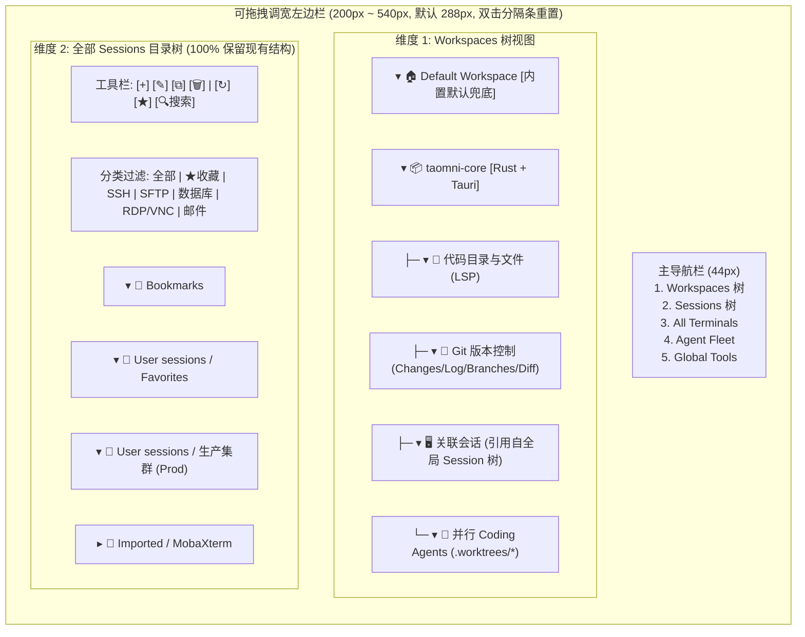

# Taomni 工作区优先与 One-System 多 Agent 平台 UI/交互重构设计（v2）

- **状态**：Phase 1（v2 迭代）— 已按最新 5 项反馈更新**左边栏拖拽调宽、完整保留全部 Session 目录树/工具按钮/右键菜单/分类过滤、树状 Workspace 导航与内置默认工作区 (`Default Workspace`)、以及工作区内 Code 与 Git 全量功能对齐**。
- **交互原型文件**：[workspace-platform-redesign-prototype.html](file:///data-raw-ssd/code-src/person/taomni/docs-feature/workspace-platform-redesign-prototype.html)

---

## 1. 本次 v2 重点对齐的 5 项核心演进

| 序号 | 核心要求 | 设计与原型落地方案 |
| :--- | :--- | :--- |
| **1** | **左边栏支持拖拽调整大小** | • 在左边栏 (`navigator-panel`) 右缘提供独立的 **`ew-resize` 拖拽分隔条**（宽度范围 `200px ~ 540px`，默认 `288px`，支持**双击分隔条一键重置为默认宽度**，并在顶栏与底部状态栏实时回显宽度并持久化至 `localStorage`）。 • 同时为**右侧伴随坞 (`ew-resize`)** 与 **Code 底部工具坞 (`ns-resize`)** 配备同款拖拽调宽/调高能力，采用单一宽度状态源避免旧分支的面板归零 bug。 |
| **2** | **左边栏「全部 Session」保持现有目录树结构、工具按钮、右键菜单、分类过滤** | • **100% 保留 [Sidebar.tsx](file:///data-raw-ssd/code-src/person/taomni/src/components/sidebar/Sidebar.tsx) 与 [SessionTree.tsx](file:///data-raw-ssd/code-src/person/taomni/src/components/sidebar/SessionTree.tsx) 的全部能力**：   1. **顶部 7 按钮工具栏 + 搜索框**：新建 (`+`)、编辑 (`✎`)、克隆 (`⧉`)、删除 (`🗑`)、分隔线、刷新 (`↻`)、收藏 (`★`)、实时搜索框 (`session-search`)。   2. **分类/协议过滤条**：`全部` \| `★ 收藏` \| `SSH` \| `SFTP` \| `数据库` \| `RDP/VNC` \| `邮件`。   3. **多级目录树 (`group_path`)**：完整保留 `Bookmarks`、`User sessions / Favorites`、自定义多级目录、`Imported / MobaXterm` 等层级与拖拽移动。   4. **完整右键菜单**：文件夹右键保留新建会话/子目录、重命名/删除、创建桌面快捷方式、导入（Taomni / MobaXterm / Xshell / Tabby / WindTerm / Navicat / DBeaver / SecureCRT / Termius / iTerm2 / CSV）、导出（JSON / Moba / CSV / HTML）、批量连接目录下全部会话，并新增**「将目录关联到工作区」**；会话右键保留连接、复制命令、编辑、克隆、移动目录、终端主题配色、删除，并新增**「关联到工作区 / 右侧分屏连接」**。 |
| **3** | **左边栏 Workspace 采用树状展示，且内置「默认工作区 (`Default Workspace`)」** | • **内置 `Default Workspace (默认工作区)` 兜底机制**：系统永久内置 `id: "ws-default"` 的默认工作区。当用户首次启动或未创建任何自定义工作区时（原型中可点击 `🏠 演示:仅默认工作区` 按钮一键体验），所有临时打开的文件、代码目录、SSH/SFTP/DB 会话与笔记自动归入 `Default Workspace`，零配置即可使用。 • **四级树状结构 (`Workspace Tree`)**：每个工作区节点可展开为：`📁 代码目录与文件`、`🌿 Git 版本控制 (Changes / Log / Branches / Diff)`、`🖥️ 关联会话`、`🤖 并行 Coding Agents`、`📬 邮件与笔记`，支持树节点过滤与右键菜单。 |
| **4** | **工作区内部 Code 与 Git 与当前全量功能 100% 对齐，不删减功能但优化布局与交互** | • **Code Workspace 全量保留并合理布局**：完整保留 [WorkspaceToolbar.tsx](file:///data-raw-ssd/code-src/person/taomni/src/components/editor/workspace/views/WorkspaceToolbar.tsx)（SDK/Project Facts 徽章、Build `Ctrl+F9`、Run 配置下拉、Run `Shift+F10`、Debug `Shift+F9`、Search Everywhere、行内 Git Blame、LSP Inlay Hints、软换行、列选择、编辑器内分屏与同步滚动、右侧 Structure/Outline/Docs 面板）以及 [BottomDock.tsx](file:///data-raw-ssd/code-src/person/taomni/src/components/editor/workspace/panels/BottomDock.tsx) 的 **全部 13 个底部工具窗**（`Problems` / `Terminal` / `Git` / `Find in Files` / `Structural Search` / `Run` / `Debug` / `Build` / `Tests` / `Coverage` / `References` / `Hierarchy` / `Analysis` / `TODO & Bookmarks`）。 • **Git 全量保留并三处联动**：完整保留 [WorkspaceGitManagerView.tsx](file:///data-raw-ssd/code-src/person/taomni/src/components/git/workspace/WorkspaceGitManagerView.tsx) 的多仓作用域选择 (`RepoSelector`)、远端选择、`Fetch / Pull / Push`、目录树/扁平切换、勾选暂存、目标分支选择、`Commit / Commit & Push`、`Commit Log` 分支拓扑图、`Branches & Worktrees`、`Stash & Tags`、以及 `Side-by-Side / Unified DiffViewer` 与 `F4` 跳转源码。 |

---

## 2. 左边栏双核心树模型与可调宽交互设计

### 2.1 默认工作区 (`Default Workspace`) 生命周期与自动升降级规则

1. **零配置开箱即用**：
   - 应用初始化时，`workspaceStore` 确保 `ws-default`（`Default Workspace / 默认工作区`）始终存在且不可被彻底删除（只可清空其内部临时绑定）。
   - 当用户没有创建任何自定义工作区时，顶栏工作区胶囊显示 `Default Workspace (默认)`，用户在全局 `Sessions` 树双击连接的任何 SSH/SFTP/DB 会话，或通过菜单打开的任何代码目录/Git 仓库，均在 `Default Workspace` 内打开并呈现在左侧工作区树中。
2. **一键升级为命名工作区 (`Promote to Named Workspace`)**：
   - 当用户在 `Default Workspace` 中积累了代码目录与关联会话后，可右键 `Default Workspace` 节点选择 **「保存/另存为正式工作区 (Save as Custom Workspace...)」**，无缝沉淀为独立项目工作区。

---

## 3. 工作区内部 Code 与 Git 全量功能对齐与合理化布局

为确保重构后**不减少任何现有 Code Workspace 与 Git 能力**，同时解决原有界面按钮拥挤和层级重复的问题，采用以下布局与交互整合方案：

### 3.1 Code Workspace 功能对齐矩阵（零删减 + 层次理顺）

| 既有功能模块（源码定位） | 保留的全部功能明细 | 新版合理化布局位置与交互方式 |
| :--- | :--- | :--- |
| **工程与文件树管理** (`CodeWorkspaceTab.tsx`) | 多根目录 (`roots[]`)、零散文件 (`looseFiles[]`)、刷新树、新建/重命名/删除文件 | 直接融合进左侧 **`Workspaces 树 -> 📁 代码目录与文件`** 子树中（无需在编辑器左侧再套第二层重复文件树侧栏），单击打开文件，右键呼出编辑器分屏/Git Blame/查找引用菜单。 |
| **顶部构建/运行/调试工具栏** (`WorkspaceToolbar.tsx`) | • SDK 状态与 `ProjectFactsStatusBadge` • `Build Project (Ctrl+F9)` • `Active Run Configuration` 下拉选择 • `Run (Shift+F10)` / `Debug (Shift+F9)` • `Search Everywhere (Double Shift)` | 作为 `Code` 画布内部的单行紧凑上下文顶栏 (`34px`)，左侧显示工程语言环境徽章与 Git 分支胶囊，右侧集中放置 `🔨 Build` + `运行配置下拉` + `▶ Run` + `🐞 Debug`。 |
| **编辑器高级辅助与内部分屏** (`editorGroupView.tsx` + `WorkspaceToolbar.tsx`) | • 行号断点点击切换 (`useBreakpointControls`) • 行内 Git Blame (`inlineBlameEnabled`) • LSP `Inlay Hints` 开关 • 软换行 (`Soft Wrap`)、列选择 (`Column Selection`)、字号缩放 • 编辑器内垂直/水平分屏 (`splitEditor`) 与同步滚动 (`syncSplitScroll`) • 右侧 `Structure / Outline / Documentation` 面板 | • 常用开关（`Blame`、`Inlay`、`◫ 编辑器分屏`、`Structure`）直接置于 Code 顶栏右侧，低频项（缩放、列选择、Tab 策略）收纳于 `⋮` 菜单。 • 编辑器文件子标签栏 (`code-editor-subtabs`) 右侧内嵌面包屑 (`Breadcrumbs`)。 |
| **底部 13 个 IDEA 对齐工具窗** (`BottomDock.tsx` + `createWorkspaceDockContents.tsx`) | 1. `Problems`（含 Quick Fix `Alt+Enter`） 2. `Terminal`（工作区终端） 3. `Git`（内嵌版本控制） 4. `Find in Files`（含替换预览 `ReplacePreviewDialog`） 5. `Structural Search`（结构化搜索） 6. `Run`（运行输出） 7. `Debug`（断点/帧/变量） 8. `Build`（构建日志） 9. `Tests`（测试结果树） 10. `Coverage`（覆盖率） 11. `References`（查找引用 Usages） 12. `Hierarchy`（调用/类型层级） 13. `Analysis`（代码检查） 14. `TODO & Bookmarks` | • 位于 Code 画布底部，支持**顶部 `ns-resize` 分隔条自由拖拽高度**。 • 继续使用 `KeepAliveToolPanel` 保活机制，切换 Tab 不丢失终端会话、测试树与搜索结果。 |

### 3.2 Git 版本控制功能对齐矩阵（零删减 + 三处联动）

| 既有功能模块（源码定位） | 保留的全部功能明细 | 新版合理化布局位置与交互方式 |
| :--- | :--- | :--- |
| **多仓库与 Worktree 作用域管理** (`WorkspaceGitManagerView.tsx` + `RepoSelector.tsx`) | • 作用域切换：`All Repositories` / `Single Repo` / `Custom` / **新增 `Agent Worktrees (.worktrees/*)`** • 远端选择 (`origin`)、领先/落后计数 (`↑ahead ↓behind`) • 批量 `Fetch`、`Pull`、`Push`、`Refresh` | 在 `Git` 画布顶栏左起第一顺位展示 `RepoSelector` 下拉框与远端同步状态，右侧直接提供 `Fetch` / `↓ Pull` / `↑ Push` 按钮。 |
| **本地变更与提交工作流** (`WorkspaceChangesView.tsx` + `ChangesTree.tsx`) | • **目录树模式 (`treeMode`) vs 扁平列表 (`flat`)** 切换 • 文件级勾选 (`checkedChangeKeys`)、Stage/Unstage、回滚丢弃 (`Rollback`)、暂存 (`Stash`) • **提交目标分支选择 (`targetBranch`)** • 提交信息输入、`Commit` 与 `Commit and Push` | 在左栏 `Workspaces 树 -> 🌿 Git 版本控制 -> 本地变更` 点击即可进入左变更树 + 下方提交框 + 右侧实时 Diff 的双栏高效布局；同时也可在右侧伴随坞 (`Right Context Dock -> Git 变更`) 快速操作。 |
| **提交历史图、分支与标签** (`WorkspaceCommitLog.tsx` + `BranchesView.tsx` + `TagsView.tsx`) | • SVG 分支拓扑图 (`CommitLog`)、按作者/分支/Hash 搜索、Cherry-pick / Revert / Reset • 本地与远端分支检出、新建、合并、Rebase、Worktree 管理 • Stash 列表与 Tags 管理 | 在 Git 顶栏提供清晰的五档视图分段控制器：`本地变更` \| `提交历史图 (Log)` \| `分支/Worktrees` \| `Stash/Tags` \| `并排 Diff`，无需层层翻找菜单。 |
| **专业 Diff 与对比检视器** (`DiffViewer.tsx` + `CompareView.tsx`) | • **并排对比 (`Side-by-Side`) vs 统一视图 (`Unified`)** 一键切换 • 空白字符忽略、行尾符 (`EOL`) 提示、语法高亮 • 一键跳转源码 (`Jump to Source / F4`) | 置于 Git 管理器的右侧主视口，点击左侧任意变更文件或历史提交即时渲染并排或统一 Diff，右上角直接提供 `◫ 并排/统一切换` 与 `跳转源码 (F4)`。 |

---

## 4. 整体四区布局、多 Tab 大预览与 One-System Agent 扩展总结

1. **三段式精简顶栏 + 永久固定 `Welcome`**：
   - 左段固定 `菜单` + `左栏折叠` + `🏠 Welcome` + `当前工作区切换胶囊（含 Default Workspace）`；中段为 `Ctrl+K` 全局搜索；右段收敛为 `Agent 状态胶囊`、`⊞ Tab 大预览`、`截图/MFA 全局浮窗`、`右坞开关`、`主题` 与窗口按钮。
2. **多 Tab 大卡片实时内容预览 (`Ctrl+Shift+O`) + 类型透镜 + 四档智能分屏**：
   - Tab 栏首部提供 `全部 / 代码·Git / 终端·SFTP / 数据库 / Agents / 邮件·笔记` 过滤透镜；
   - 点击 `⊞ 大预览` 展开全画布大卡片实时预览网格（直接看到终端输出、代码片段、Git Diff、SQL 结果、Agent 进度），支持按类型/按工作区/最近关闭恢复分组，以及卡片一键 `◫ 分屏并排`。
3. **One-System 多 Coding Agent 并行协同台**：
   - 支持在同一工作区并行调度 `Claude Code`、`Codex CLI`、`OpenCode ACP`，每个任务自动分配独立 Git Worktree (`.worktrees/*`)，变更直接接入 `WorkspaceGitManager` 统一审阅 Diff 与合并。

---

## 5. 原型体验指南与确认项

请重新打开或刷新浏览器中的 [workspace-platform-redesign-prototype.html](file:///data-raw-ssd/code-src/person/taomni/docs-feature/workspace-platform-redesign-prototype.html) 重点体验以下新增交互：

1. **拖拽调整大小**：拖动左边栏右侧分隔条、右侧伴随坞左侧分隔条、以及 Code 画布内底部工具坞上沿分隔条（双击左边栏分隔条可恢复默认 `288px`）。
2. **工作区树与「默认工作区 (`Default Workspace`)」**：在左栏 `Workspaces` 维度展开多层树节点（代码目录、Git 子项、关联会话、Agent）；点击工具栏上的 `🏠` 按钮或 `演示:仅默认工作区` 胶囊，验证未创建自定义工作区时系统自动回退到 `Default Workspace` 的完整形态；右键任意树节点查看上下文菜单。
3. **完整保留的 `Sessions` 目录树**：点击最左栏第 2 个图标进入 `Sessions` 维度，体验完整的 7 按钮工具栏（新建、编辑、克隆、删除、刷新、收藏、搜索）、协议过滤胶囊、多级目录树（`Bookmarks` / `User sessions / Favorites` / `生产集群` / `Imported / MobaXterm`），以及**在目录或会话上点击鼠标右键**弹出的完整导入/导出/批量连接/移动目录/终端配色/绑定工作区菜单。
4. **Code 与 Git 全量功能交互**：在工作区树点击任意代码文件或 `Code · taomni-core` 标签，体验 `🔨 Build`、`▶ Run`、`🐞 Debug`、行号点击下断点、`Blame` / `Inlay` / `◫ 编辑器分屏` / `Structure` 开关，以及底部 **13 个工具窗**切换；点击 `Git · taomni-core` 标签或左侧 `🌿 Git 版本控制` 子节点，体验多仓选择、`本地变更 / 提交历史图 / 分支 / Stash / 并排 Diff` 切换与勾选提交。

如以上 5 点调整均符合预期，请告知确认，我将立即为您输出**详细设计文档、分阶段实施计划与任务拆解 (`TASK-*`)，以及 Unit / Browser / Native 测试用例 (`TC-*`)**。
