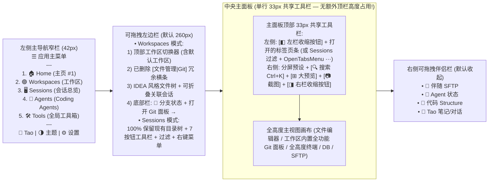

# Taomni 工作区优先 (Workspace-First) 与 One-System 开发者平台 UI/交互重构概要设计 (v4)

> **分支**：`feat/workspace-platform-redesign`  
> **配套高保真可交互单文件 HTML 原型**：[`docs-feature/workspace-platform-redesign-prototype.html`](./workspace-platform-redesign-prototype.html)  
> **设计基线**：基于 `main` 分支真实代码模型（`Workspace`、`SessionTree`、`GitPanelView`、`WelcomePanel`、`Tao`、`GlobalTools`）与配色体系（`src/styles/theme.css`），不依赖旧实验分支实现。

---

## 0. 核心前提声明：纯 UI 与交互重构，100% 既有功能与右键菜单完整保留

> [!IMPORTANT]
> **当前设计的核心定位是 UI 布局、信息层级与高频交互重构，而非功能删减。`main` 分支上已有的全部业务功能、工具栏能力、快捷键、导入/导出能力以及全部右键上下文菜单（Context Menus）在实现时必须 100% 完整支持与对齐！**

具体必须 100% 继承与支持的既有能力清单如下：

| 模块维度 | 必须 100% 完整保留的 `main` 既有能力与交互 | 对应现有源码参照 |
| :--- | :--- | :--- |
| **1. 会话目录树 (`SessionTree`)** | 多级嵌套文件夹、搜索框、协议分类过滤（All / Favorites / SSH / SFTP / DB / RDP / Other）、7 个顶部操作按钮（新建会话、新建文件夹、多格式导入、导出备份、展开/折叠全部、收藏过滤、搜索）、拖拽排序、**目录右键菜单**（新建会话、新建子目录、批量打开目录下全部会话、重命名 `F2`、导出目录、删除）与**会话节点右键菜单**（连接、分屏打开、打开伴随 SFTP、关联到工作区、克隆会话、编辑配置、删除） | `src/components/sidebar/Sidebar.tsx`<br/>`src/components/sidebar/SessionTree.tsx`<br/>`src/components/sidebar/sessionTree/createFolderContextMenu.tsx` |
| **2. 工作区专用 Git 面板 (`GitPanel`)** | 多仓库选择器（`RepoSelector`：All Repositories / 单仓库 / 子模块 / Worktrees）、分支徽章（`BranchBadge`）、变更数统计、`Remote` 选择器、`Fetch` / `Pull` / `Push` / `⋯ 更多操作菜单`（Sync、Checkout、Create Branch、Force Push、Clean）/ `Refresh`、**6 大子视图标签**（`Changes` / `Log` / `Branches` / `Tags` / `Stash` / `Settings`）、冲突/变基状态横幅（`Continue` / `Skip` / `Abort` / `Ours` / `Theirs`）、`Tree/Flat` 切换、勾选暂存/取消暂存/丢弃、`Amend` 勾选、提交框、`Commit` / `Commit & Push`、`DiffViewer`（并排/统一对比、`F4` 跳源文件）及**变更文件右键菜单**与**提交记录右键菜单**（Cherry-pick / Revert / Reset / Create Branch/Tag） | `src/components/git/GitPanel.tsx`<br/>`src/components/git/panel/GitPanelView.tsx`<br/>`src/components/git/workspace/WorkspaceGitManagerView.tsx` |
| **3. 主页 (`Home`，原 `WelcomePanel`)** | 本地终端快速启动卡（`LocalTerminalCard`：Shell 选择器 `zsh/bash/fish/pwsh`、启动终端 `Ctrl+Shift+T`、**以管理员身份运行**、**打开主目录 `~`**）、WSL 终端启动卡（`WslCard`：发行版选择与启动）、新建/导入会话卡（`NewSessionCard`）、局域网传书与邮件快捷卡（`LanChat` / `Mail`）、**恢复上次会话横幅（`RestoreLastSessionRow`）**、底部历史记录面板（`WelcomeHistoryPanel`：最近工作区 / 最近会话 / 本地常用目录、搜索与排序过滤） | `src/components/WelcomePanel.tsx` |
| **4. 工作区文件管理与编辑器 (`Workspace`)** | 类 IntelliJ IDEA 的文件/目录树管理（支持任意文件工作区与代码工作区）、**文件/目录右键菜单**（打开、分屏打开、Git 对比、复制路径、重命名、删除）、编辑器视图模式切换（`Code` / `Inline Diff` / `Split Preview`）、符号大纲（`Structure`）、底部折叠 Dock（`Terminal Alt+F12`、`Problems`、`Run/Debug`、`Git 摘要 Alt+9`、`Global Search`、`Ports`） | `src/components/editor/workspace/views/WorkspaceToolbar.tsx`<br/>`src/components/editor/workspace/views/createWorkspaceDockContents.tsx` |
| **5. 多类型远程会话工作台 (`Sessions`)** | SSH 终端（含多终端广播输入条、伴随 SFTP 自动跟随目录）、SFTP（断点续传、HTTP Range 校验、后台队列）、Database（DBeaver 风格 SQL 编辑器、结果网格、EXPLAIN、DDL）、RDP/VNC（Smart Sizing 自适应缩放、全屏、Ctrl+Alt+Del）、Email、**标签页右键菜单**（向右/向下分屏、关闭当前/其他/右侧标签） | `src/components/terminal/`<br/>`src/components/sftp/`<br/>`src/components/database/`<br/>`src/components/rdp/` |
| **6. 全局独立工具箱与三级网络代理** | 截图与标注（`Ctrl+Alt+A`）、MFA 验证器、网络诊断箱（Ping/MTR/PortScan/Whois）、SSH 隧道管理器、SocksCap、本地服务（HTTP/TFTP/Syslog）、LAN Chat；以及外部网络访问的**三级代理模式**（跟随全局设置默认 `10.1.0.80:3228` / 功能独立持久化代理 / 强制直连 No Proxy 绕过系统环境变量） | `AGENTS.md` External Network Access & Downloads 规范 |

---

## 1. 本轮迭代 (v4) 关键优化对齐清单

针对最新一轮三张截图与反馈意见，v4 原型与设计完成了以下 5 项核心对齐：

1. **Git 回归工作区内部专用面板（不再作为脱离工作区的独立顶层模式），并 100% 对齐 `main` 的 `GitPanelView` + 新增增强功能**：
   - **问题修复**：移除了左侧主导航栏上孤立的顶层 Git 模式，避免查看 Git 时脱离当前工作区上下文。
   - **工作区内快速一跳**：
     - 在**工作区左边栏顶部**提供 `[📁 文件管理 | 🌿 Git 面板 (4)]` 分段切换器；
     - 在**工作区主画布右上角**提供常驻 `🌿 Git (4)` 快速跳转按钮（快捷键 `Ctrl+Shift+G`），同时在工作区标签栏中作为内置专用标签页 `GIT Git (feat/workspace-platform*)` 存在；
     - 在**工作区底部 Dock** 保留 `🌿 Git 摘要 (Alt+9)` 并支持一键展开全尺寸工作区 Git 面板。
   - **功能全量对齐 + 增强**：完整包含 `main` 分支 `GitPanelView.tsx` 与 `WorkspaceGitManagerView.tsx` 的全部能力（多仓库/子模块选择器 `RepoSelector`、分支徽章、远端选择器、`Fetch / Pull / Push / ⋯ 更多操作 / Refresh`、`Changes | Log | Branches | Tags | Stash | Settings` 6 大标签页、Rebase/Merge 冲突处理横幅、`Tree/Flat` 视图切换、暂存/取消暂存/丢弃、`Amend` 勾选、并排/统一 `DiffViewer`、`F4` 跳源文件、文件与提交右键菜单），并新增 **✨ AI 一键生成 Commit Message** 与 **Coding Agent Worktree 分支审查关联**。
2. **`Welcome` 正式更名为 `Home`（`🏠 Home`），完整包含 `WelcomePanel.tsx` 能力与新设计增强**：
   - 窗口左上角常驻入口按钮更名为 **`🏠 Home`**；
   - 主页内部完整包含 `WelcomePanel.tsx` 的全部卡片与历史能力：
     - **恢复上次会话横幅 (`RestoreLastSessionRow`)**：一键恢复上次退出时的工作区与会话标签；
     - **本地终端卡 (`LocalTerminalCard`)**：Shell 选择下拉框（`zsh` / `bash` / `fish` / `pwsh`）、启动按钮（`Ctrl+Shift+T`）、**以管理员身份运行 (`Run as Administrator`)**、**打开主目录 (`Open Home Folder ~`)**；
     - **WSL 终端卡 (`WslCard`)**：WSL 发行版选择与一键连接；
     - **新建/导入远程会话卡 (`NewSessionCard`)**：快速新建会话（`Ctrl+Shift+N`）或从 Xshell / `~/.ssh/config` / DBeaver 导入；
     - **工作区与 Coding Agents 卡**：新建/打开工作区、一键进入工作区 Git 面板或查看并行运行的 Coding Agents；
     - **协作与全局工具卡**：局域网传书（`LAN Chat`）、邮件客户端（`Mail`）、网络诊断箱、MFA；
     - **底部历史与快速访问面板 (`WelcomeHistoryPanel`)**：支持 `最近工作区`、`最近连接会话`、`本地常用目录` 三标签切换与实时搜索过滤。
3. **工作区切换器从顶部标题栏移入工作区左边栏顶部（简洁、易用）**：
   - 从窗口顶部标题栏移除了工作区切换胶囊，使顶部标题栏保持极简（左侧：`☰ 菜单`、`◧ 侧栏开关`、`🏠 Home`；中间：`Ctrl+K` 搜索框；右侧：`Agents 状态`、`⊞ 大预览`、高频工具与主题开关）；
   - 将**工作区切换器 (`Workspace Switcher`)** 安置在**工作区左边栏最顶部**：点击即可下拉切换 `Default Workspace (默认工作区)` 与各自定义工作区，并提供 `+ 新建` 与 `默认工作区演示` 快捷按钮。
4. **`Sessions (会话总览)` 极简单栏头部（删除快速连接栏与冗余状态横条，释放纵向空间）**：
   - **问题修复**：此前 `Sessions` 模式下终端上方堆叠了 3 层横条（快速连接栏 + 标签栏 + 终端面包屑栏），严重挤压了终端纵向显示高度；
   - **极简重构**：彻底**删除了顶部的快速连接/常用收藏栏**，并**删除了单视图下终端上方的重复状态面包屑栏**；
   - 整个 `Sessions` 主画布顶部**仅保留唯一一行 34px 的会话标签与快捷控制栏**（协议过滤胶囊 + 打开的会话标签页 + 右侧紧凑的 `伴随 SFTP` / `广播` / `分屏预设` / `⊞ 大预览`），下方直接进入全高度终端/数据库/SFTP 画布！
5. **工作区关联会话与 `Sessions (会话总览)` 实例完全隔离（各自打开各自的）**：
   - 工作区左边栏底部可折叠保留**工作区关联会话链接（`linkedSessionIds`）**，方便在开发时快速连入该项目关联的服务器或数据库；
   - 在工作区中点击关联会话打开的是**该工作区私有的会话运行实例（`ws.openTabs`）**，与 `Sessions (会话总览)` 模式下打开的会话实例（`sessionWorkbench.openTabs`）完全隔离，互不干扰。

---

## 2. 总体界面架构图 (v5 — 零额外顶栏高度、Home 置于左侧主导航第 1 位、极简共享工具栏)



---

## 3. 各核心视图与交互详细规范 (v5 极简对齐版)

### 3.1 零额外顶栏高度：主面板单行 `33px` 共享工具栏（含左右边栏收缩按钮）

- **彻底移除多出的顶部独立标题栏**：与 `main` 分支保持相同的纵向紧凑度，不再在主面板上方额外叠加一行 `36px` 顶栏，并移除了右上角无用的 3 个颜色圆点。
- **左右边栏收缩按钮内置于主面板共享工具栏**：
  - 主面板 `33px` 共享工具栏**最左侧**固定放置 `◧` **左边栏展开/收起按钮 (`Ctrl+B`)**；
  - 主面板 `33px` 共享工具栏**最右侧**固定放置 `◨` **右边栏展开/收起按钮**（以及 `🔍 搜索 Ctrl+K`、`⊞ 大预览`、`📷 截图`）。

### 3.2 `🏠 Home` 主页（移至左侧主导航窄栏第 1 个，与 `Workspaces` 并列）

- **常驻位置**：位于左侧主导航窄栏（`Primary Rail`）顶部主菜单 `☰` 下方的**第 1 个核心入口**（紧邻第 2 个 `Workspaces` 与第 3 个 `Sessions`）。
- **恢复上次会话横幅 (`RestoreLastSessionRow`)**：当检测到上次退出存在未恢复的工作区或远程会话时，在顶部展示一键恢复横幅（`[一键恢复 (Restore)]` / `[忽略]`）。
- **5 大快速启动卡片（100% 对齐 `WelcomePanel.tsx`）**：
  1. **本地终端卡 (`LocalTerminalCard`)**：提供 Shell 选择器（`zsh` / `bash` / `fish` / `pwsh`）、`▶ 启动 (Ctrl+Shift+T)`、**`🛡️ 管理员运行`** 与 **`📂 打开 ~ 目录`**。
  2. **WSL 终端卡 (`WslCard`)**：WSL 发行版下拉选择与一键连接。
  3. **新建/导入远程会话卡 (`NewSessionCard`)**：`+ 新建会话配置 (Ctrl+Shift+N)`、`📥 导入` 与 `🌳 打开完整会话目录树`。
  4. **工作区与 Coding Agents 卡**：`+ 新建/打开工作区`、`🌿 Git` 快速入口、以及查看并行运行的 Coding Agents。
  5. **协作与全局工具卡**：`💬 局域网传书 (LAN Chat)`、`✉️ 邮件客户端 (Mail)`、`🛠️ 网络诊断箱` 与 `🔐 MFA 验证器`。
- **底部历史与快速访问面板 (`WelcomeHistoryPanel`)**：提供 **`🟣 最近工作区`**、**`🖥️ 最近连接会话`**、**`📁 本地常用目录`** 三个标签页及实时搜索框。

---

### 3.3 `Workspaces (工作区)`：删繁就简（删除冗余 Git 按钮 `1` 与 `3`，保留 `2` 与 `4` 及 Git 标签页）

1. **左边栏顶部工作区切换器 (`Workspace Switcher`)**：
   - 固定在**工作区左边栏最顶部**，默认内置不可删除的 **`Default Workspace (默认工作区)`**。
2. **删除冗余切换行 `1` 与右上角按钮 `3`**：
   - **已删除 `1`**：移除了工作区左边栏中冗余的 `[📁 文件管理 | 🌿 Git 面板]` 整行切换按钮；工作区左边栏始终纯粹展示 **IDEA 风格文件树 + 底部可折叠的工作区关联会话**。
   - **已删除 `3`**：移除了工作区主画布标签栏右上角重复的 `🌿 Git (4)` 按钮。
3. **保留自然、清晰的 Git 入口（`2`、`4` 与工作区 `GIT` 标签页）**：
   - **入口 `2`（左边栏底栏）**：工作区左边栏底部常驻显示 `🌿 feat/workspace-platform* (4)   打开 Git 面板 →`，点击即可在工作区主画布中激活专用 `GIT` 标签页；
   - **入口 `4`（文件编辑器工具栏）**：在代码/文件编辑器的右上角保留 `🌿 在 Git 面板对比` 按钮；
   - **工作区专用 `GIT` 标签页**：100% 具备 `main` 分支 `GitPanelView.tsx` 的全部能力（多仓库选择器 `RepoSelector`、分支徽章、`Remote` 选择器、`Fetch / Pull / Push / ⋯ 更多操作 / Refresh`、`Changes | Log | Branches | Tags | Stash | Settings` 6 大标签页、Rebase/Merge 冲突处理横幅、`Tree/Flat` 切换、暂存/取消暂存/丢弃、`Amend`、**✨ AI 生成提交信息**、并排/统一 `DiffViewer`、`F4` 跳源文件，以及完整的文件与提交右键菜单）。

---

### 3.4 `Sessions (会话总览)`：完整保留 `main` 的会话目录树与标签过滤 (`OpenTabsMenu ⋯`)

1. **左边栏 100% 保留 `main` 的会话目录树 (`SessionTree.tsx`)**：
   - 完整保留 7 按钮工具栏（新建会话、新建文件夹、多格式导入、导出、全部展开/折叠、收藏筛选、搜索框）、协议分类胶囊（`全部 / SSH / SFTP / DB / RDP / 其他`）、多级嵌套目录树以及完整的**目录与会话节点右键菜单**。
2. **主面板单行 `33px` 共享会话标签栏 + 完整保留 `main` 的标签过滤能力**：
   - 最左侧为 `◧` 左边栏收缩按钮与协议快速过滤胶囊（`全部 / SSH / DB / SFTP / RDP`）；
   - 中间为独立打开的会话标签条（与工作区内部打开的会话实例完全隔离）；
   - 右侧完整保留 `main` 分支 `ControlBar.tsx` 与 `OpenTabsMenu.tsx` 的核心能力：
     - **`ℹ️` 标签详情摘要开关 (`Ctrl+Shift+H`)**：一键在标签页上内联显示主机 IP 与端口详情；
     - **`⋯` 已打开标签按目录组/关键字过滤菜单 (`OpenTabsMenu`)**：点击 `⋯` 可按会话所属目录路径（如 `生产环境集群 / 北京可用区`、`核心数据库与缓存`）或关键字过滤当前标签栏显示的会话标签（隐藏非匹配标签而不关闭连接），并支持一键弹出为独立窗口 (`Detach Tab`)。

---

### 3.4 核心实体数据模型 (TypeScript 接口定义)

```typescript
export interface WorkspaceEntity {
  id: string;                 // 'ws-default' (系统默认工作区) 或自定义工作区 UUID
  name: string;
  isDefault: boolean;         // 默认工作区不可删除
  rootPath: string;           // 工作区本地文件夹根路径 (支持通用文件管理与代码项目)
  gitRepos: string[];         // 工作区内发现的 Git 仓库路径列表
  linkedSessionIds: string[]; // 关联的 SessionTree 配置 ID (仅配置引用)
  openTabs: WorkbenchTab[];   // 该工作区私有的已打开标签实例 (含文件、内置 Git 面板、工作区独立终端实例)
  activeTabId: string;
  sidebarLens: 'files' | 'git';
}

export interface SessionWorkbenchState {
  // 与各工作区 openTabs 完全隔离的「会话总览」独立打开实例列表
  openTabs: WorkbenchTab[];
  activeTabId: string;
  typeFilter: 'all' | 'ssh' | 'db' | 'sftp' | 'rdp';
  broadcastEnabled: boolean;
}
```

---

## 4. 原型交互自检清单 (打开 `docs-feature/workspace-platform-redesign-prototype.html`)

1. **验证 `🏠 Home` 主页（原 Welcome）**：
   - 点击左上角 `🏠 Home` 按钮，查看顶部恢复上次会话横幅、5 大启动卡片（本地终端 Shell 选择 / 管理员运行 / 打开 `~` 目录、WSL 终端、新建/导入会话、工作区与 Agent、局域网传书与邮件）及底部历史记录面板（最近工作区 / 最近会话 / 本地目录）。
2. **验证工作区切换器已移入工作区左边栏**：
   - 切换到左侧主导航第 1 项 `Workspaces`，观察窗口顶部标题栏已无工作区下拉框；工作区左边栏最顶部提供简洁的工作区切换器（支持切换 `Default Workspace` 与自定义工作区、点击 `默认工作区演示`、点击 `+ 新建`）。
3. **验证工作区内置专用 Git 面板（快速跳转 + 全功能对齐 `main`）**：
   - 在工作区左边栏顶部点击 `🌿 Git 面板 (4)`，或点击主画布右上角 `🌿 Git (4)` 按钮（或按 `Ctrl+Shift+G`），立即在当前工作区内切换到专用 Git 面板；
   - 在 Git 面板中点击切换 `Changes`、`Log`、`Branches`、`Tags`、`Stash`、`Settings` 6 个子标签页，点击 `🧪 演示 Rebase/冲突处理条`，点击 `✨ AI 生成提交信息`，切换 `Side-by-Side / Unified` Diff，右键点击变更文件或提交记录验证完整的 Git 右键菜单。
4. **验证 `Sessions (会话总览)` 单栏 34px 极简头部与实例隔离**：
   - 切换到左侧主导航第 2 项 `Sessions`，确认主画布顶部**只有唯一一行 34px 的会话标签栏**（快速连接栏与终端上方冗余横条已删除），且打开的会话实例与工作区中的会话标签完全独立。
5. **验证左右边栏拖拽调宽与全部右键菜单**：
   - 拖拽左边栏或右边栏分割线调整宽度（双击分割线复位）；在工作区文件树、会话目录树文件夹/节点、Git 变更/提交、以及顶部标签页上点击鼠标右键，验证所有上下文菜单完整可用。

---

## 5. v6 增量设计（左栏工具归位、任意会话打开、目录添加、IDEA 工具窗口整合）

> 仍为 **UI 与交互重构**：原有功能、右键菜单、快捷键 100% 保留（见第 0 节）。

### 5.1 左侧主导航底部：全局工具集中，右上角不再放工具
自上而下：`🔐 MFA` → `📷 截图` → `💬 Tao` → `🌗 主题` → `🌐 语言` → `⚙️ 设置`。
- 截图从主面板右上角移到此处（点击弹出：区域 / 窗口 / 全屏 / 延时 / 贴图板，`Ctrl+Alt+A` 不变）。
- **MFA 以悬浮窗口呈现**：可拖动、实时 30s 倒计时、点击卡片复制验证码，不占用主界面，再次点击图标关闭。
- 主面板右侧共享工具栏因此只剩：搜索、大预览、右栏开关。

### 5.2 Workspace 中打开任意会话（不限关联）
- **三个入口**：① 标签栏 `＋` 菜单（收藏会话 + `浏览/搜索全部会话…`，`Ctrl+Alt+O` 选择器）；② IDEA 工具条 `🖥️ Sessions` 面板（完整目录树，点击即在本工作区打开）；③ 工作区文件树下方的关联区。
- **关联降级为「常用」**：Sessions 面板顶部 `★ 本工作区常用`，悬停 ☆/★ 切换关联；关联仅是快捷入口，不影响会话配置，也不限制可打开范围。
- 打开的仍是**工作区私有实例**，与「会话总览」实例互相独立；右键菜单：打开 / 右侧分屏 / 关联 / 编辑 / 克隆。

### 5.3 Workspace 中便捷添加文件与目录
- 文件树工具栏：`新建文件`、`新建目录`、`添加目录到工作区（多根）`、`全部折叠`、过滤框。
- 目录右键：`在此新建文件… (Alt+Insert)` / `在此新建目录…`；标签栏 `＋` 菜单同样提供。
- 新建文件立即打开为标签并标记 `A`；添加根目录支持路径输入与拖拽目录到文件树。

### 5.4 与原 Code Workspace（IDEA）左侧工具窗口条整合（v6.1：并入主导航，不再单独成条）
- **取消独立的 30px 工具条**：它与主导航窄栏并列，形成两条竖条，视觉重复。
- **融合方式**：进入 Workspaces 模式时，主导航窄栏在 5 个模式入口下方出现一组「工作区工具」（分隔线隔开，其它模式自动消失）：

| 按钮 | 行为 |
| :-- | :-- |
| `📁 Project` | 文件树；已激活时再次点击收起左栏（IDEA 行为） |
| `🖥️ Sessions` | 打开任意会话面板 |
| `🌿 Git (变更数)` | 激活工作区 `GIT` 标签（`Ctrl+Shift+G` / `Alt+9`） |
| `🧭 Structure` | 右栏结构大纲 |
| `⋯` | 菜单（保留）：底部窗口 Terminal / Problems / Run / Find，及 Bookmarks / TODO / Services / Database / Git Log、「显示名称」「移动到…」 |

- **底部窗口不再占独立图标**：Terminal / Problems / Run / Find 已是底部 Dock 页签（工具栏 `⬓ 底栏` 开关），`⋯` 菜单只是同一入口的快捷方式，避免重复。
- 竖向高度约 12 + 6 个按钮，小窗口时 `⋯` 之后的工作区工具优先折叠。
- 底部 Dock、右栏及 `toolWindowLayout` 的拖拽/移动/记忆行为保持原实现，默认折叠。

### 5.5 MFA 悬浮窗位置
默认出现在窗口**左下角**（紧邻主导航底部的 MFA 图标上方），可拖动，再次点击图标关闭。
