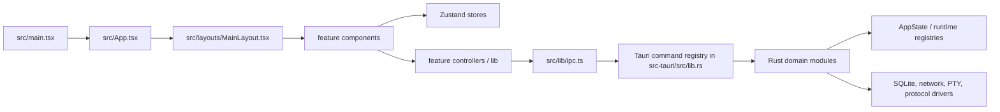

# Taomni 源代码盘点与拆分重构方案

**分析日期**：2026-10-21  
**基线提交**：`f3e375eb`（工作区无未提交修改）  
**分析范围**：Git 跟踪的 `src/`、`src-tauri/src/`、`src-tauri/tests/`、`scripts/`、`src-tauri/proto/`、`src-tauri/thrift/` 和 `src-tauri/build.rs` 中的实现代码、样式与协议 schema。`dist/`、`target/`、`qa-ui-auto-report/`、`src-tauri/vendor/` 和第三方生成物不作为业务重构对象。

本文保留重构前的分析与方案。后续拆分、当前入口规模和实际测试结果见 [P0–P5 实施与验收记录](./refactor-p0-p5-implementation-20261021.md)，当前 3,883 项逐文件清单见 [重构后文件清单](./source-code-inventory-refactor-current.tsv)。持续的文件规模与职责约束已写入仓库根目录 `AGENTS.md`，并由 `pnpm check:refactor` 和构建执行。

## 结论先行

Taomni 的功能覆盖面已经形成完整产品，但代码边界仍按“入口文件 + 逐次追加功能”增长。最需要处理的是四个耦合点：

1. 前端的 `CodeWorkspaceTab`、`MainLayout`、`SessionEditor`、`TerminalPanel` 同时承担 UI、状态、异步流程、持久化、IPC 和协议适配。
2. 后端的 `lib.rs` 直接注册 761 个命令；`lsp.rs`、`mail/mod.rs`、`workspace.rs` 等把命令适配、领域流程、协议实现和存储放在同一文件。
3. `src/lib/ipc.ts` 是跨所有功能的单一 IPC 门面，`src/stubs/tauri-core.ts` 又复制了这套耦合，导致新增命令必须同时改多处。
4. 工作区编辑器已经有大量细分模型和测试，但总控组件及其测试仍是单文件，重构应采用“保留外部 API、内部逐步抽取”的绞杀者路线。

建议把重构目标定为：**UI 只编排视图，feature controller 管理异步用例，domain model 保持纯函数，IPC adapter 只负责 DTO/事件，Rust command 只做边界转换**。先建立边界和回归保护，再按工作区、Shell、邮件/数据库、协议模块依次迁移。

## 1. 规模与现状证据

| 范围 | 文件数 | 行数 | 说明 |
|---|---:|---:|---|
| 前端 `src/` | 1,322 | 450,965 | React/TS、状态、IPC、浏览器 stub、测试 |
| Rust 后端 `src-tauri/src/` | 473 | 284,496 | Tauri 命令、领域服务、协议和平台代码 |
| Rust 集成测试 `src-tauri/tests/` | 21 | 2,946 | 原生/跨模块测试 |
| 工具脚本 `scripts/` | 19 | 1,946 | 构建、QA、性能和发布脚本 |
| 协议 schema/build | 26 | 5,788 | `src-tauri/proto/`、`src-tauri/thrift/`、`src-tauri/build.rs` |
| **合计** | **1,861** | **746,141** | 跟踪的代码类文件 |

生产代码（排除测试与明确生成绑定）为 **1,276 个文件 / 584,330 行**。全量阈值分布如下：

| 行数阈值 | 全量文件数 | 生产文件数 |
|---:|---:|---:|
| ≥ 500 | 351 | 298 |
| ≥ 800 | 195 | 164 |
| ≥ 1,000 | 143 | 119 |
| ≥ 2,000 | 44 | 37 |
| ≥ 5,000 | 11 | 9 |
| ≥ 10,000 | 4 | 2 |

前端有 536 个 `*.test.*` 文件、约 137,937 行测试代码；Rust 单元测试大量以内嵌 `#[cfg(test)]` 方式存在，不能只用文件名统计。当前 `lib.rs` 的 `generate_handler!` 注册 761 个命令，命令按领域的数量为：`screenshot` 75, `mail` 70, `lsp` 61, `git` 48, `database` 44, `lanchat` 44, `sockscap` 35, `agent` 34, `filebrowser` 27, `config` 25, `backup` 24, `objectstorage` 23, `workspace` 22, `session` 20, `terminal` 17, `chat` 17, `notes` 14, `mfa` 14, `servers` 12, `sdk` 11, `tunnel` 11, `ai` 10, `hbase` 9, `vault` 9, `models` 9, `asr` 9, `vnc` 8, `voice` 8, `local_history` 4, `dap` 4, `rdp` 4, `history` 4, `webview_recovery` 3, `dependency_index` 3, `structural_search` 3, `tab` 3, `llm` 3, `proxy` 3, `workspace_tooling` 2, `workspace_search` 2, `java_test` 2, `windowing` 2, `update` 2, `wsl` 1, `test_results` 1, `workspace_execution` 1, `java_debug_adapter` 1, `appearance` 1, `perf` 1。

基线检查：`pnpm exec tsc -b --pretty false` 通过；`cargo fmt --manifest-path src-tauri/Cargo.toml -- --check` 失败，当前基线有 53 个 Rust 文件的格式差异（输出 6,615 行），分析未修改这些文件。

## 2. 运行时结构



### 前端

- 启动链在 `main.tsx`：恢复探测、启动错误边界、Recovery 窗口和正常 `App` 懒加载。
- `App.tsx` 按 Tauri 窗口/URL hash 选择主窗口、分离窗口、截图窗口、Notes、LanChat 和 Recovery；同时安装主题、拖放、SFTP 同步和全局快捷键副作用。
- `MainLayout` 是主壳层，直接持有 Tab 路由、连接/认证/Vault 队列、分屏布局、菜单、事件监听及几乎所有主要 Tab 的渲染入口。
- `components/editor/workspace/` 已经是一个大域：包含布局树、CodeMirror 适配、LSP/DAP、搜索、重构、调试、运行面板、工具窗口和恢复模型；但 `CodeWorkspaceTab` 仍把这些能力串在一个组件生命周期中。
- `stores/` 使用 Zustand；`appStore` 是跨 Tab/UI/终端/布局的全局聚合，其余功能已有一定分域。
- `lib/ipc.ts` 包含终端、Session、Vault、VNC、数据库、HBase、LanChat 等所有 DTO 和调用，导入扇入最高的模块是 `lib/i18n/index.ts`、`lib/editor/lsp.ts`、`lib/ipc.ts`、`types/index.ts`。
- 近似相对导入扇入为：`lib/i18n/index.ts` 210、`lib/editor/lsp.ts` 139、`lib/ipc.ts` 122、`types/index.ts` 111、`stores/appStore.ts` 64、`lib/runtime.ts` 53；这些模块应优先变成稳定的窄契约，避免继续成为跨域依赖中心。

### 后端

- `src-tauri/src/lib.rs` 创建数据库、Vault、AI/LSP/DAP/LanChat 等运行时并集中注册 761 个命令；这是依赖反转和命令分域的首要切入点。
- `AppState` 持有终端、SFTP、传输、隧道、SocksCap、服务器、VNC/RDP、数据库、HBase、对象存储、邮件、Agent、LSP/DAP、SDK、AI、LanChat 等 30 余类运行时，属于应用级服务定位器。
- `mail`、`database`、`backup`、`agent`、`lanchat` 等目录已经有子模块；问题集中在根模块仍包含大量命令和流程。
- `rdp`、`vnc`、`screenshot`、`sockscap` 有协议/平台代码与生命周期编排混合的情况，拆分必须保持线程、取消、恢复和跨平台行为不变。

## 3. 目录级盘点

### 前端目录

| 目录 | 文件数 | 行数 | 判断 |
|---|---:|---:|---|
| `components` | 897 | 344,630 | UI 体量最大；editor 是主风险域 |
| `lib` | 317 | 66,190 | 跨域工具/IPC/模型混合，需按 feature 分包 |
| `stores` | 46 | 16,627 | 全局状态，appStore 需要切片 |
| `stubs` | 29 | 9,816 | 浏览器原生能力模拟，需按域拆分 |
| `layouts` | 2 | 7,279 | 壳层编排，MainLayout 需要降权 |
| `hooks` | 13 | 1,960 | 生命周期/副作用钩子 |
| `types` | 10 | 1,693 | 跨域类型契约 |
| `test` | 3 | 398 | 测试启动和 QA 辅助 |
| `App.tsx` | 1 | 254 | 前端源码 |
| `main.tsx` | 1 | 123 | 前端源码 |
| `zmodem.js.d.ts` | 1 | 42 | 前端源码 |
| `vite-env.d.ts` | 1 | 16 | 前端源码 |

前端组件子域中，`editor` 为 505 个文件/199,799 行，远超其他域；其次是 database 29/17,372、mail 27/13,805、settings 57/13,202、git 26/12,236、terminal 13/11,281。editor 的文件数量说明拆分基础已经存在，优先处理总控而不是继续增加 helper。

### Rust 后端目录

| 目录 | 文件数 | 行数 | 判断 |
|---|---:|---:|---|
| `mail` | 30 | 25,222 | 功能已有子模块，但根 mod.rs 仍是 IMAP/OAuth/SMTP/缓存巨型聚合 |
| `sockscap` | 51 | 24,209 | 平台捕获/代理/恢复/命令生命周期混合 |
| `servers` | 38 | 21,614 | 本地服务器编排与各协议已部分拆分 |
| `agent` | 55 | 21,028 | 多桥接协议、工具和安全策略，边界较多 |
| `hbase` | 14 | 20,878 | Native/Thrift 已分层；Thrift IDL 是生成代码 |
| `screenshot` | 30 | 16,992 | 采集、编辑、OCR、录制、QA 和平台实现并存 |
| `lsp.rs` | 1 | 15,200 | 后端领域模块 |
| `rdp` | 21 | 14,297 | 协议 PDU/传输已分层，session 仍偏大 |
| `vnc` | 17 | 12,387 | RFB、WS、编码、质量和输入需按层隔离 |
| `database` | 14 | 12,208 | 驱动、会话、事务和命令仍由 mod.rs/SQL 聚合 |
| `bin` | 16 | 9,367 | 独立辅助进程/QA 探针，不与主应用重构混做 |
| `lanchat` | 16 | 8,862 | 传输、身份、消息、媒体、文件和服务编排 |
| `backup` | 30 | 8,353 | 模块化较好，优先补 facade/依赖方向 |
| `terminal` | 10 | 7,292 | 终端命令与 PTY/SSH/网络已有拆分 |
| `workspace.rs` | 1 | 5,597 | 后端领域模块 |
| `chat` | 6 | 5,373 | AI 聊天命令、流式和媒体生成聚合 |
| `sdk` | 5 | 5,012 | 探测/解析/运行时已拆分，mod.rs 仍是入口 |
| `workspace_execution.rs` | 1 | 4,695 | 后端领域模块 |
| `objectstorage` | 8 | 4,000 | S3/Azure/transfer 已分域 |
| `llm` | 13 | 3,836 | Provider 和 router 已分层 |
| `session` | 10 | 3,556 | Session CRUD、导入、恢复和模型分层 |
| `git.rs` | 1 | 2,879 | 后端领域模块 |
| `voice` | 7 | 2,651 | 采集/流式/命令/词表已分层 |
| `filebrowser` | 4 | 2,306 | local/SFTP/transfer 已分层 |
| `ai` | 9 | 2,281 | 配置/安全/模型检查器已有分层 |
| `mfa` | 7 | 2,231 | crypto/otp/store/commands 已分层 |
| `asr` | 6 | 2,104 | catalog/manager/models/sensevoice |
| `config` | 2 | 1,682 | 文件/剪贴板命令和平台实现混合 |
| `structural_search.rs` | 1 | 1,655 | 后端领域模块 |
| `notes` | 3 | 1,449 | DB/commands 已拆分 |
| `lib.rs` | 1 | 1,354 | 后端领域模块 |
| `dap.rs` | 1 | 1,233 | 后端领域模块 |
| `vault` | 4 | 1,231 | crypto/db/门面已拆分 |
| `workspace_tooling` | 3 | 1,093 | Gradle/Maven 适配器 |
| `webview_recovery` | 2 | 977 | 恢复状态和生命周期 |
| `tunnel` | 1 | 967 | 后端领域模块 |
| `qa_driver.rs` | 1 | 963 | 后端领域模块 |
| `java_debug_adapter.rs` | 1 | 763 | 后端领域模块 |
| `java_bundles.rs` | 1 | 759 | 后端领域模块 |
| `models` | 4 | 595 | 后端领域模块 |
| `test_results.rs` | 1 | 588 | 后端领域模块 |
| `workspace_search.rs` | 1 | 538 | 后端领域模块 |
| `tab` | 4 | 495 | 后端领域模块 |
| `proxy` | 1 | 474 | 后端领域模块 |
| `local_history.rs` | 1 | 422 | 后端领域模块 |
| `java_test.rs` | 1 | 337 | 后端领域模块 |
| `state.rs` | 1 | 322 | 后端领域模块 |
| `dependency_index.rs` | 1 | 319 | 后端领域模块 |
| `workspace_fs.rs` | 1 | 245 | 后端领域模块 |
| `update.rs` | 1 | 228 | 后端领域模块 |
| `migrate.rs` | 1 | 180 | 后端领域模块 |
| `history.rs` | 1 | 175 | 后端领域模块 |
| `wsl` | 1 | 170 | 后端领域模块 |
| `windowing` | 1 | 161 | 后端领域模块 |
| `module_lock.rs` | 1 | 152 | 后端领域模块 |
| `app_exit.rs` | 1 | 116 | 后端领域模块 |
| `perf.rs` | 1 | 103 | 后端领域模块 |
| `update` | 1 | 102 | 后端领域模块 |
| `qa_driver_pointer.js` | 1 | 82 | 后端领域模块 |
| `qa_driver_keyboard.js` | 1 | 58 | 后端领域模块 |
| `appearance.rs` | 1 | 55 | 后端领域模块 |
| `main.rs` | 1 | 19 | 后端领域模块 |
| `nettools` | 1 | 2 | 后端领域模块 |
| `serial` | 1 | 2 | 后端领域模块 |

协议输入与构建源另外有 26 个文件、5,788 行：`src-tauri/proto/` 24 个 Protobuf schema、`src-tauri/thrift/hbase.thrift` 和 `src-tauri/build.rs`。其中 `Master.proto` 约 1,365 行、`hbase.thrift` 约 1,032 行，应与生成的 `hbase/thrift/idl.rs` 一起纳入 schema 变更流程；`src/index.css` 约 1,937 行，属于样式总入口，应在组件拆分完成后按主题/功能分层。

## 4. 重点文件详细判断与拆分边界

下面按“职责是否可独立测试、是否有稳定输入输出、是否拥有独立生命周期”划分边界。每次拆分都应先保留原文件导出函数，再把实现迁入新模块，最后删除转发代码。

| 文件 | 当前职责/问题 | 建议拆分 | 优先级 |
|---|---|---|---|
| `src/components/editor/CodeWorkspaceTab.tsx` | 23,914 行、约 211 个相对导入。一个组件同时管理工作区实例、布局恢复、文件树、打开/关闭文件、编辑器组、LSP 文档同步、保存事务/冲突、WorkspaceEdit、语义查询、Debug、Git、AI、快捷键、工具窗口和最终渲染；React state/ref/effect 互相驱动，异步结果依赖 workspace identity/revision。 | 抽取 `workspace/types`、`useWorkspaceLifecycle`、`useWorkspaceFiles`、`workspaceSaveController`、`workspaceLspController`、`workspaceNavigationController`、`workspaceCommandController`、`WorkspaceShell`、`WorkspaceEditorSurface`、`WorkspaceToolWindows`；先把纯函数和 controller 移出，再拆 JSX。 | **P0** |
| `src/components/editor/CodeWorkspaceTab.test.tsx` | 15,210 行测试与总控一一对应，测试夹杂渲染、IPC mock、保存竞态、LSP、布局、恢复和导航；单文件失败定位成本高。 | 按 `save-transaction`、`lsp-sync`、`layout-restore`、`navigation-tree`、`workspace-edit`、`render-smoke` 拆分；共享 fixture/clock/IPC harness。 | **P0** |
| `src-tauri/src/lsp.rs` | 15,200 行。进程启动/停止、JSON-RPC framing、请求超时/取消、文档同步、文件监听、诊断、补全/解析、导航/符号/层级、WorkspaceEdit、Java/JDTLS 配置和 source 下载全部共存。 | 拆成 `lsp/transport.rs`、`lsp/session.rs`、`lsp/document_store.rs`、`lsp/watcher.rs`、`lsp/requests/{completion,navigation,symbols,refactor,diagnostics}.rs`、`lsp/java.rs`、`lsp/cache.rs`、`lsp/commands.rs`；命令只调用 manager/service。 | **P0** |
| `src-tauri/src/hbase/thrift/idl.rs` | 14,213 行，协议生成绑定，不属于业务复杂度；手工拆分会在下次 IDL 生成时丢失。 | 保持生成文件；增加 `thrift/service.rs`、`thrift/codec.rs`、`thrift/client.rs` 包装类型和调用，生成过程写入 build/README。 | **P1** |
| `src-tauri/src/mail/mod.rs` | 8,265 行。命令适配、IMAP pool/session、OAuth 浏览器/设备流、同步、MIME/附件、SMTP、邮件缓存 SQLite 和变更操作混合。 | 根模块只保留 DTO/re-export；迁移到 `commands.rs`、`imap/{client,pool,sync,folders,mutations}.rs`、`oauth.rs`、`smtp.rs`、`mime.rs`、`cache.rs`、`errors.rs`，已有 `sync/archive/filters/contacts` 继续作为领域模块。 | **P0** |
| `src/components/mail/MailClientTab.tsx` | 6,946 行。列表/线程/阅读器/文件夹树、轮询、草稿/回复/转发、附件、标签/移动/删除、AI、主题和弹窗同处一个组件。 | 抽取 `mailSelectors`、`useMailMessages`、`useMailFolders`、`useMailComposer`、`useMailMutations`、`MailFolderTree`、`MailThreadList`、`MailReader`、`MailComposer`、`MailDialogs`；UI 只接收 view model。 | **P0** |
| `src/components/session/SessionEditor.tsx` | 5,296 行。表单基础控件、会话类型归一化、SSH/本地/串口/网络/书签/RDP/VNC/数据库/HBase/邮件/对象存储和 Vault 处理都在同一组件。 | 保留 `SessionEditor` shell；按协议拆 `forms/{ssh,local,serial,rdp,vnc,db,hbase,mail,objectStorage}.tsx`，把 `sessionNormalization.ts`、`sessionValidation.ts`、`sessionDefaults.ts` 设为纯模块。 | **P0** |
| `src/layouts/MainLayout.tsx` | 5,205 行、约 98 个相对导入。它同时是窗口事件总线、Tab 状态机、连接队列、认证/Vault 恢复器、菜单安装器、布局持久化器和功能路由。 | 拆 `useMainLayoutController`、`connectionQueue`、`tabRouter`、`windowEventBridge`、`layoutPersistence`、`MainChrome`、`TabContentRouter`；连接队列和窗口事件用显式 service，避免 render effect 互相触发。 | **P0** |
| `src/components/terminal/TerminalPanel.tsx` | 5,150 行。xterm/fit/webgl/search/web-links 生命周期、PTY/SSH 输出、键盘/IME、主题/字体、ZMODEM、AI 重写、截图、文件上传和事件监听混合。 | 抽 `useTerminalSession`、`useTerminalViewport`、`terminalKeyboardPolicy`、`terminalTransport`、`TerminalToolbar`、`TerminalTransferController`、`TerminalAiOverlay`；保留一个轻量视图。 | **P1** |
| `src/components/editor/workspace/CodeMirrorHost.tsx` | 4,719 行。CodeMirror 状态/视图、语言扩展、keymap、搜索、补全、诊断、hover、超链接、coverage/debug gutter、剪贴板和 IME 同处。 | 拆 `createEditorState`、`editorExtensions`、`editorKeymap`、`editorOverlays`、`editorDiagnostics`、`editorCompletionBridge`、`editorSearchBridge`、`useCodeMirrorView`；每个 adapter 接收稳定的 host contract。 | **P1** |
| `src-tauri/src/workspace.rs` | 5,597 行。任务探测、Java 运行目标、文件/目录列表、编码检测、原子写入/哈希冲突、LSP resource operation、Git 根扫描和路径安全混合。 | 拆 `workspace/path_policy.rs`、`workspace/files.rs`、`workspace/encoding.rs`、`workspace/resource_ops.rs`、`workspace/tasks.rs`、`workspace/git_roots.rs`、`workspace/commands.rs`；用 `WorkspacePath`/`WriteIntent` 作为领域值对象。 | **P0** |
| `src-tauri/src/workspace_execution.rs` | 4,695 行。Cargo/Go/Node/Python/JVM/CMake/.NET/Swift 探测、共享配置迁移、运行/调试解析、compound 配置和命令计划混合。 | 拆 `execution/model.rs`、`execution/manifests.rs`、`execution/providers/{cargo,go,node,python,jvm,cmake,dotnet,swift}.rs`、`execution/shared_config.rs`、`execution/resolver.rs`、`execution/commands.rs`。 | **P1** |
| `src/components/sockscap/SocksCapPanel.tsx / src-tauri/src/sockscap/mod.rs` | 前端 4,285 行、后端 3,692 行；前端 UI 与运行状态/日志/恢复混合，后端命令与 Linux/macOS/Windows 捕获、上游、策略和退出恢复混合。 | 前端抽 runtime/config/diagnostics/launch hooks；后端抽 `facade.rs`、`lifecycle.rs`、`platform/{linux,macos,windows}.rs`、`recovery.rs`、`policy.rs`、`upstream.rs`。 | **P1** |
| `src/components/database/DbClientTab.tsx / QueryResultGrid.tsx` | 3,766 + 3,516 行；连接、Schema、查询、事务、历史和结果渲染互相传递大对象，结果表格容易触发全量重渲染。 | 抽 `useDbSession`、`useQueryExecution`、`queryWorkspaceModel`、`DbSchemaPane`、`SqlEditorPane`、`QueryToolbar`、`ResultGridModel`、`VirtualResultGrid`；以 query id/result snapshot 传递数据。 | **P1** |
| `src-tauri/src/rdp/session.rs / src-tauri/src/vnc/{rfb,ws}.rs` | RDP 3,727 行、VNC RFB 2,695 行/WS 2,595 行；网络协议状态、显示/输入/剪贴板/音频、WebSocket 桥和生命周期交叉。 | 按 transport、protocol state、input、display/framebuffer、clipboard、audio、session registry 分层；平台捕获/编码只通过 trait 注入。 | **P2** |
| `src-tauri/src/screenshot/qa.rs` | 3,759 行，把 QA 命令、显示枚举、滚动捕获、Pin 工具和证据输出混在一起。 | 按 `qa/commands.rs`、`qa/display.rs`、`qa/scroll.rs`、`qa/pin.rs`、`qa/evidence.rs` 拆分；生产截图服务与 QA harness 分 crate/module。 | **P2** |
| `src-tauri/src/chat/mod.rs` | 3,557 行；Chat 命令、provider HTTP、媒体生成、流式运行、工具摘要和 Code Workspace 上下文混合。 | 拆 `chat/commands.rs`、`chat/provider.rs`、`chat/media.rs`、`chat/stream.rs`、`chat/context.rs`、`chat/presentation.rs`；把 provider client 作为 trait。 | **P2** |
| `src/lib/ipc.ts / src/stubs/tauri-core.ts` | IPC 2,114 行、stub 5,458 行；所有领域的 DTO/调用/mock 集中，任何命令变更都要修改共享大文件。 | 按 `lib/ipc/{terminal,session,workspace,mail,database,network,agent}.ts` 拆模块，根文件只 re-export；stub 同构 `stubs/commands/{...}`，用 `CommandRegistry` 管理默认实现和测试 override。 | **P0** |
| `src/stores/appStore.ts` | 1,642 行；Tab、终端、布局、UI 偏好、工作区、恢复和平台探测同一 store，选择器变化会扩大重渲染面。 | 使用 Zustand slices：`tabsSlice`、`terminalSlice`、`layoutSlice`、`appearanceSlice`、`workspaceSlice`、`recoverySlice`；副作用迁到 services，组件只订阅细粒度 selectors。 | **P1** |
| `src-tauri/src/lib.rs / src-tauri/src/state.rs` | `lib.rs` 1,354 行注册 761 命令；`AppState` 持有 30 余种 runtime，形成全局服务定位器。 | 增加 `commands/mod.rs` 按域导出 handler 列表，`run()` 只拼装；按 domain 拆 `AppState` 结构或注入 `Arc<DomainState>`，命令通过 service facade 获取能力。 | **P0** |

### 4.1 其余 ≥2,000 行文件清单

下表覆盖所有达到阈值的跟踪文件；生成绑定和测试文件按其性质单独处理。完整 1,861 文件清单见 [source-code-inventory-20261021.tsv](./source-code-inventory-20261021.tsv)。

| 文件 | 行数 | 类型 | 建议动作 |
|---|---:|---|---|
| `src/components/editor/CodeWorkspaceTab.tsx` | 23,914 | frontend-component | 按上表拆分 |
| `src/components/editor/CodeWorkspaceTab.test.tsx` | 15,210 | test | 按上表拆分 |
| `src-tauri/src/lsp.rs` | 15,200 | rust-backend | 按上表拆分 |
| `src-tauri/src/hbase/thrift/idl.rs` | 14,213 | generated-thrift | 保留生成文件，增加手写 wrapper |
| `src-tauri/src/mail/mod.rs` | 8,265 | rust-backend | 按上表拆分 |
| `src/components/mail/MailClientTab.tsx` | 6,946 | frontend-component | 按上表拆分 |
| `src-tauri/src/workspace.rs` | 5,597 | rust-backend | 按上表拆分 |
| `src/stubs/tauri-core.ts` | 5,458 | frontend-stub | 以纯模型、控制器、视图三层拆分 |
| `src/components/session/SessionEditor.tsx` | 5,296 | frontend-component | 按上表拆分 |
| `src/layouts/MainLayout.tsx` | 5,205 | frontend-layout | 按上表拆分 |
| `src/components/terminal/TerminalPanel.tsx` | 5,150 | frontend-component | 按上表拆分 |
| `src/components/editor/workspace/CodeMirrorHost.tsx` | 4,719 | frontend-component | 按上表拆分 |
| `src-tauri/src/workspace_execution.rs` | 4,695 | rust-backend | 按上表拆分 |
| `src/lib/i18n/locales/en.ts` | 4,366 | frontend-locale | 以纯模型、控制器、视图三层拆分 |
| `src/lib/i18n/locales/zh-CN.ts` | 4,341 | frontend-locale | 以纯模型、控制器、视图三层拆分 |
| `src/components/sockscap/SocksCapPanel.tsx` | 4,285 | frontend-component | 以纯模型、控制器、视图三层拆分 |
| `src/lib/sessionImportExport.ts` | 3,868 | frontend-lib | 以纯模型、控制器、视图三层拆分 |
| `src/components/database/DbClientTab.tsx` | 3,766 | frontend-component | 以纯模型、控制器、视图三层拆分 |
| `src-tauri/src/screenshot/qa.rs` | 3,759 | rust-backend | 按上表拆分 |
| `src-tauri/src/rdp/session.rs` | 3,727 | rust-backend | 以纯模型、控制器、视图三层拆分 |
| `src-tauri/src/sockscap/mod.rs` | 3,692 | rust-backend | 以纯模型、控制器、视图三层拆分 |
| `src-tauri/src/chat/mod.rs` | 3,557 | rust-backend | 按上表拆分 |
| `src/components/database/QueryResultGrid.tsx` | 3,516 | frontend-component | 以纯模型、控制器、视图三层拆分 |
| `src/components/editor/workspace/useCodeDebugSession.ts` | 3,313 | frontend-feature-lib | 以纯模型、控制器、视图三层拆分 |
| `src/components/terminal/TerminalPanel.test.tsx` | 3,200 | test | 按行为/fixture 拆分，降低单文件 setup |
| `src-tauri/src/git.rs` | 2,879 | rust-backend | 以纯模型、控制器、视图三层拆分 |
| `src-tauri/src/vnc/rfb.rs` | 2,695 | rust-backend | 按 command/service/transport/storage/platform 分层 |
| `src-tauri/src/database/sql.rs` | 2,644 | rust-backend | 按 command/service/transport/storage/platform 分层 |
| `src-tauri/src/vnc/ws.rs` | 2,595 | rust-backend | 按 command/service/transport/storage/platform 分层 |
| `src-tauri/src/hbase/mod.rs` | 2,538 | rust-backend | 以纯模型、控制器、视图三层拆分 |
| `src/components/git/WorkspaceGitManager.tsx` | 2,500 | frontend-component | 以纯模型、控制器、视图三层拆分 |
| `src/components/editor/workspace/CodeMirrorHost.test.tsx` | 2,453 | test | 按行为/fixture 拆分，降低单文件 setup |
| `src/components/editor/workspace/lspCompletion.ts` | 2,429 | frontend-feature-lib | 保持模型/adapter 分离，避免回流总控 |
| `src-tauri/src/rdp/gateway/mod.rs` | 2,223 | rust-backend | 按 command/service/transport/storage/platform 分层 |
| `src/components/editor/workspace/useCodeDebugSession.test.tsx` | 2,216 | test | 按行为/fixture 拆分，降低单文件 setup |
| `src-tauri/src/bin/sockscap-helper/capture.rs` | 2,178 | rust-backend | 以纯模型、控制器、视图三层拆分 |
| `src-tauri/src/agent/cc_bridge/mcp_http.rs` | 2,132 | rust-backend | 按 command/service/transport/storage/platform 分层 |
| `src/lib/ipc.ts` | 2,114 | frontend-lib | 以纯模型、控制器、视图三层拆分 |
| `src/components/WelcomePanel.tsx` | 2,076 | frontend-component | 以纯模型、控制器、视图三层拆分 |
| `src/components/git/GitPanel.tsx` | 2,076 | frontend-component | 以纯模型、控制器、视图三层拆分 |
| `src/layouts/MainLayout.test.tsx` | 2,074 | test | 按行为/fixture 拆分，降低单文件 setup |
| `src/components/editor/workspace/lspCompletion.test.ts` | 2,069 | test | 按行为/fixture 拆分，降低单文件 setup |
| `src/components/vnc/VncPanel.tsx` | 2,069 | frontend-component | 以纯模型、控制器、视图三层拆分 |
| `src-tauri/src/screenshot/mod.rs` | 2,025 | rust-backend | 按 command/service/transport/storage/platform 分层 |


## 5. 全文件分域说明

逐文件清单中的 `kind` 和 `role` 是后续迁移的责任边界。阅读顺序建议如下：

- `frontend-component`：先找容器组件（通常 800 行以上），再把纯计算移入 `model`、异步流程移入 `controller/hook`，最后保持叶子组件单向接收 props。
- `frontend-store`：先确认状态是否跨窗口/跨 Tab，再拆 slice；禁止从 store 直接调用跨域 IPC，改由 feature service 写回。
- `frontend-lib`：按 `ipc adapter`、`domain model`、`side-effect service` 三类归档；避免把 React hook 和纯函数混在同一文件。
- `rust-backend`：`#[tauri::command]` 只做反序列化、鉴权/状态获取、调用 service 和错误映射；协议/驱动/SQLite 不应直接出现在 command 函数中。
- `generated-*`：由 schema/IDL 生成，建立 wrapper 和生成校验，不纳入人工行数门槛。
- `test`/`fixture`：按场景拆分；共享 fake IPC、时间、临时目录和事件收集器，防止测试继续复制组件实现。

## 6. 重构原则与目标边界

### 6.1 目标目录形态

前端新代码建议采用以下 feature 结构，旧路径通过 re-export 兼容：

```text
src/features/<domain>/
  components/       # 纯视图
  controller/       # hooks/use cases/异步状态机
  model/            # 纯类型、选择器、变换和校验
  ipc/              # 该域的 Tauri DTO/命令/事件
  store/            # 该域 Zustand slice（需要时）
  __tests__/
```

Rust 新代码建议：

```text
src-tauri/src/<domain>/
  commands.rs       # Tauri 边界，薄
  service.rs        # 用例和状态机
  model.rs          # serde DTO/领域值对象
  ports.rs          # trait（网络、文件、时钟、数据库）
  transport.rs      # 协议/驱动实现
  storage.rs        # SQLite/文件持久化
  platform/         # OS 差异
```

### 6.2 不变量

- 不改变现有 Tauri command 名称、事件名、存储路径和 JSON 字段；迁移期间通过 facade/re-export 保持兼容。
- 每次只移动一类职责；移动后先跑原测试，再新增边界测试，避免重构与行为修复混在一 PR。
- UI 不直接拼装 IPC payload；payload 由 feature adapter 构造并做版本兼容。
- 异步任务拥有独立于组件生命周期的 owner/token，关闭视图不能取消后台传输、邮件同步或下载；重开视图从 registry 恢复。
- Rust 协议实现不得依赖 Tauri `State`；通过 trait 接收 clock、socket、filesystem、event sink，便于单元测试。
- 生成文件、locale 大字典、QA fixture 采用独立门槛，不用简单 LOC 规则误伤。

## 7. 分阶段实施路线

| 阶段 | 范围 | 主要交付 | 退出条件 |
|---|---|---|---|
| P0 基线与边界（1–2 周） | 全仓库 | 采用本报告清单；建立 command/event catalog、依赖方向检查、关键场景 smoke、统一 fake clock/IPC harness | `tsc`、前端关键测试、Rust lib tests 可重复；每个迁移模块有旧 API 回归测试 |
| P1 IPC/启动/状态（2–3 周） | `lib.rs`、`state.rs`、`lib/ipc.ts`、stubs、`appStore` | 按域 command registrar、IPC 子模块、stub registry、Zustand slices、AppState domain handles | 命令名称/事件/存储兼容；MainLayout 只依赖 feature facade |
| P2 Code Workspace（4–6 周） | `CodeWorkspaceTab`、`CodeMirrorHost`、`lsp.rs`、`workspace*.rs` | workspace controller、save transaction、LSP manager/request modules、path/file/resource services、测试分层 | 保存竞态、恢复、LSP 同步/取消、WorkspaceEdit、分屏和大文件场景全通过 |
| P3 Shell 与 Session（2–3 周） | `MainLayout`、`SessionEditor`、`TerminalPanel`、terminal IPC/store | Tab router、connection queue、协议表单、terminal runtime/viewport/keyboard services | SSH/PTY/MFA/IME/ZMODEM/分离窗口行为保持 |
| P4 Mail/DB/File/Git（4–6 周） | mail、database、filebrowser、git 及对应前端 | mail IMAP/OAuth/cache、DB query controller/result model、文件传输 service、Git command facade | 同步/取消/事务/分页/附件/传输恢复及跨平台测试通过 |
| P5 协议与系统能力（4–8 周） | RDP/VNC/SocksCap/Screenshot/LanChat/Backup | transport/service/platform 分层、退出/恢复状态机、统一 progress/cancellation | native matrix、恢复/代理/下载/音视频/截图证据通过 |
| P6 清理与治理（持续） | generated、locale、QA、scripts | 生成流程、locale namespace、测试 fixture 包、LOC/依赖 lint、文档 | 新文件默认符合边界；大文件增长需显式说明 |

### 建议的前 10 个 PR

1. 生成命令/event catalog 与 `src/lib/ipc/` 目录，旧 `ipc.ts` 只 re-export。
2. 将 `src/stubs/tauri-core.ts` 改为按域 `CommandRegistry`，保持现有 stub 行为。
3. 把 `AppState` 的终端、数据库、邮件、LSP、Agent 句柄包装成 domain state，不改字段语义。
4. 从 `CodeWorkspaceTab` 抽纯函数/类型和 `workspaceSaveController`，先迁移现有保存测试。
5. 抽 `useWorkspaceLspController` 与 LSP 事件桥，建立 revision/identity contract 测试。
6. 将 `workspace.rs` 的路径安全、编码和原子写入拆出，保留 command wrapper。
7. 将 `lsp.rs` 先拆 transport/session，再拆 request family；每步保持 `LspManager` API。
8. 将 `MainLayout` 的 connection queue/tab router/window events 拆成三个 controller。
9. 将 `SessionEditor` 的协议表单和纯 normalization/validation 拆出。
10. 将 `MailClientTab`/`mail/mod.rs` 分别拆 hook/view 与 command/service/cache，先覆盖收件箱、阅读、发送、同步取消。

## 8. 风险、验证和回滚

| 风险 | 触发原因 | 控制措施 |
|---|---|---|
| 异步竞态回归 | workspace/LSP/邮件/传输任务跨组件存活 | owner id + generation/revision guard；建立事件顺序测试和可取消 fake |
| IPC 兼容性破坏 | 命令名、camelCase DTO、事件 payload 变化 | 生成/维护 command catalog；adapter 做字段映射；保留旧导出一版 |
| 跨平台差异 | RDP/VNC/SocksCap/Screenshot platform cfg | platform trait + Linux/macOS/Windows native smoke；不把 cfg 逻辑移进通用 service |
| 性能退化 | 大组件拆分后 props/selector 不稳定 | 细粒度 Zustand selector、snapshot/version 传递、编辑器大文件 benchmark |
| 测试迁移失真 | 复制 mock 而未验证真实边界 | 先移动测试 fixture，再移动实现；保留少量真实 IPC/native contract 测试 |
| 生成物误改 | Thrift/Protobuf/locale/QA 产物被人工编辑 | 生成脚本与 CI diff check；generated 目录单独 lint |

每个 PR 的验证最低要求：`pnpm exec tsc -b --pretty false`、受影响的 Vitest 文件、对应 Rust `cargo test --lib`/集成测试；涉及 native 网络、代理、下载、恢复或平台捕获时必须补 native case，浏览器 stub 不能作为唯一证据。

## 9. 完整文件清单

请使用 [source-code-inventory-20261021.tsv](./source-code-inventory-20261021.tsv) 进行逐文件审阅。它包含全部 1,861 个跟踪代码类文件，以及每个文件的语言、层级、分类、行数、近似 import/use、export/pub、IPC/命令计数和建议角色；`hotspot` 列标出 ≥2,000/≥5,000/≥10,000 行文件。
