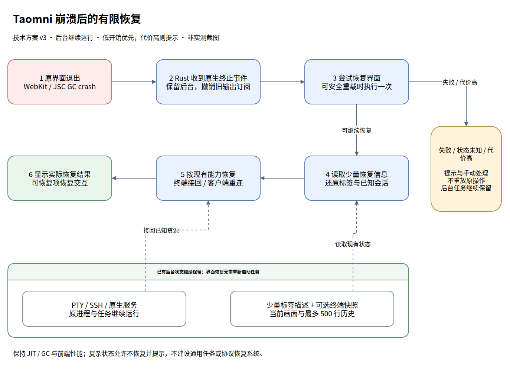

# Taomni 渲染进程崩溃后的有限恢复方案

日期：2026-10-14；最终修订：2026-10-15，v3.1（文本镜像优化移交独立feat，恢复流程不变）。状态：**只读诊断与设计完成；未修改产品代码，未实施或测试恢复机制**。当前 Taomni 和终端未被刷新、重启、发送信号或附加调试器。

配套文档：[全类型恢复矩阵](webview-renderer-crash-recovery/recovery-policy-matrix.md)、[详细执行与三端验证计划](webview-renderer-crash-recovery/execution-plan.md)。v3 保留原 AC/TASK/V/DEC 编号，但按用户最后提出的“小概率故障，不能动太多逻辑，代价高就提示”原则收缩范围；v1/v2 中通用运行注册、全操作幂等、完整 VT 状态复制等不再是本次要求。

## 1. 结论与实施边界

本次白屏的直接原因已确认：WebKit/JSC 渲染进程在原生 GC 扫描中 SIGSEGV，Rust 主进程与原终端任务仍运行。现有证据倾向引擎缺陷被负载触发，未发现用户使用不当；不能唯一归因 Taomni 升级或系统升级。JavaScript try/catch 不能恢复已经退出的进程，应用层应监听原生退出事件，尝试恢复界面。

**优先小范围、低开销恢复；代价高就保留后台并说明未恢复项。** 不把此问题扩成通用任务调度、完整会话持久化或跨模块事务工程。

- shell/SSH 以及终端承载的客户端：保留原进程，优先恢复当前屏幕、光标、必要输入模式和最多 500 行历史。使用现有 xterm 公开能力与有界输出尾部；不能可靠或便宜恢复时明确提示，允许本次不恢复该画面。正常 scrollback 不变。
- SFTP、DB、S3/AzureBlob、VNC/RDP、email 等客户端：现有能力足够时重连；不自动重放查询、写入、发送和传输。旧连接/任务状态难以安全核对时先显示“需重新打开/确认状态”，不为它新建完整操作日志系统。
- Tools 与后台服务：已能查询状态的重建控制界面；后端工作继续。只有前端状态且恢复昂贵的，明确丢失/中断，不自动重做。
- 正常路径不关闭 JIT/DFG、不强制 GC、不周期重启、不增加全量 store/DOM 快照或第二套终端模拟器。任何可重复的前端性能退化均不接受；恢复功能可以缩减。

前提是主进程和具体后台资源仍存活。此方案不保证主进程崩溃、系统重启或远端断线后的任务保活。当前实例没有预先保存这些状态，本轮不能宣称刷新即可找回其旧画面，也不对它做实验。

## 2. 已查明的故障与升级记录

### 2.1 本次证据

| 项目 | 结果与确定性 |
|---|---|
| 运行版本 | /usr/bin/taomni，0.4.38；发布标签 v0.4.38 对应 a20a2a0e |
| 运行时间 | 2026-10-11 21:36:08 启动，2026-10-14 21:33:52 渲染进程退出，约 71 小时 58 分钟 |
| 进程归属 | Taomni PID 2550643；崩溃 WebKitWebProcess PID 2550696，其 core 中 PPid 为 2550643；WebKitNetworkProcess 2550675 仍存活 |
| 系统 | Linux Mint 22.3 / Ubuntu noble，X11，内核 6.14.0-37，glibc 2.39 |
| WebKit/JSC | 两个系统包均为 2.52.6-0ubuntu0.24.04.1；包校验无差异，未发现版本混装 |
| 崩溃位置 | HeapHelper 线程，JSFinalObject::visitChildrenImpl 扫描 inlineStorage，经 appendHiddenUnbarriered 进入 MarkedBlock::aboutToMarkSlow，读取无效内部 handle 的 m_directory 时 SIGSEGV |
| 精确符号 | 使用匹配的 Ubuntu 调试包离线解析；JSC Build ID 为 14805d0df706cbdc5cffba389c9d23eae62aa42d |
| 非法地址 | handle 为 0x80375866，故障读取地址为 handle + 0x18，即 0x8037587e；主线程同时在等待 full GC |
| 内存与资源 | 未找到 OOM kill；崩溃时 renderer RSS 约 971 MiB，历史峰值约 2.51 GiB；主机可用内存约 41 GiB。大虚拟地址空间不等于实际内存占用 |
| 使用方式 | 未发现 JSC_/WEBKIT_/LD_PRELOAD/LD_LIBRARY_PATH 覆盖项；发布源码中未发现直接操作 JSC 堆引用或自定义 GC/JIT 配置 |
| 后台任务 | 四组 bash 及 codex/agy 子进程仍存在；先前采样观测到 CPU 和磁盘活动。后续只读复查时仍存活 |

**确认的直接原因**：JSC GC 扫描时解引用无效内部句柄，导致整个渲染进程退出。core 不能还原更早的对象破坏来源，也不能证明某个 Taomni 页面、DFG 优化或特定上游缺陷就是最初触发点。

**归因判断**：现有证据倾向 WebKit/JSC 引擎缺陷被应用负载触发，没有支持“长期开终端是用户使用不当”的证据。应用负载变化可能改变触发概率；这与违规调用底层引擎 API 是两回事。另一项已经确认的应用问题是缺少原生渲染进程退出后的恢复，以及 release 持久诊断记录。

### 2.2 更新记录能说明什么

依据本机 /var/log/dpkg.log 及轮转日志、历史 coredump journal、发布标签的 Cargo.lock：

| 时间 | 系统或应用变化 | 可得出的结论 |
|---|---|---|
| 2026-05-07 | WebKit/JSC 2.50.4 → 2.52.3 | 历史系统引擎版本基线 |
| 2026-06-26、06-30、07-02、07-18 | 已有 WebKit SIGSEGV 记录；6 月 26 日还有 2.52.3 同版本重装 | 旧版本也出现过 WebKit 崩溃；部分 cwd 位于 Taomni 工程，但不能将所有记录都认作生产 Taomni 的同一种故障 |
| 2026-09-02 15:16 | WebKit/JSC 2.52.3 → 2.52.6 | 此后至本次故障未再更新这两个包 |
| 2026-09-25 11:33:51 | Taomni 0.4.26 → 0.4.27 | 10 秒后有另一种 WebKit 崩溃栈；时间相邻不证明升级造成当前 GC 故障 |
| Taomni 0.4.34 → 0.4.35，本机 10 月 9 日安装 | Tauri 2.11.5 → 2.12.0；wry 0.55.1 → 0.57.0；tao 0.35.3 → 0.37.1 | 应用端确有 WebView 集成层升级，值得保留为对照变量；不是本次根因证明 |
| 2026-10-11 21:36 | Taomni 0.4.37 → 0.4.38 | 本次运行版本；两版 Tauri/wry 相同 |
| 2026-10-14 21:33:52 | 本次有精确符号的 GC SIGSEGV | 当前故障特征已确认 |

旧记录多为其他指令地址或 start_thread 附近的异常；部分 core 已丢失。不能据此认定以往白屏与本次同源，也不能按“以前运行更久”推断后来一定变差。间歇性引擎错误受负载、对象存活时间、JIT 和线程时序影响，单次运行时长不足以确定回归版本。

后续归因实验应在隔离环境做应用版本 × 引擎版本的对照：同一引擎比较 0.4.34/0.4.35/0.4.38 的可重复负载；同一 Taomni 构建比较经安全维护的引擎版本。先记录每次实际加载的库版本及 Build ID，再比较相同崩溃特征的发生率。旧软件只用于隔离实验，不在当前主机回退系统包。没有重现或样本不足时，结果只能是“尚未观察到”，不能写“已修复”。

### 2.3 2026-10-15 活体复查

约 10:25 +08，只读检查结果：同一个主进程及 WebKitNetworkProcess 仍在；原 renderer 已不存在，也没有新的 renderer 接替，白屏已经持续约 12 小时 51 分钟。自原故障起未发现新的对应 WebKit crash、OOM 或 GPU reset 记录，组件包版本未变。因此当前持续白屏是原 renderer 退出后没有恢复，不能据此另判定 Rust 主进程卡死。

主进程约 383 MiB RSS、127 个 FD、50 个线程，10 秒采样约 1.19% CPU；四组原 shell 及 codex/agy 仍有存活和执行活动证据。主进程约 152 MiB 已换出页，而主机 MemAvailable 约 39 GiB，内存 PSI 的 avg10/60/300 为零；swap 数值本身不能作为本次 OOM 或内存压力的证明。另有四个已经退出、exit code 为 0 的 bash zombie，应在恢复清单中识别为已结束，不能把所有登记会话都当作运行中；未对它们作任何处理。

新增线索是源码层面的负载与恢复缺口，见 §3.1/3.2。未获得能进一步确定 JSC 对象最初何时损坏的新证据，升级归因结论仍保持 §2.2 的限制。

## 3. 现有源码与可复用基础

源码调研基线：HEAD a11c227c；开始方案编写前工作区干净。诊断运行版本和当前源码基线不同，本文明确区分两者。

| 位置与符号 | 当前行为及方案影响 |
|---|---|
| src-tauri/src/lib.rs，主窗口创建、Linux with_webview | 已能访问原生 WebView；未发现进程终止恢复处理，适合注册平台适配器 |
| src-tauri/src/lib.rs，日志初始化 | tauri_plugin_log 仅在 debug_assertions 下启用；需增加低频 release 故障日志，不能直接打开全部业务 Info 日志 |
| src-tauri/src/windowing/mod.rs，open_detached_window | 分离窗口也创建 WebView，需要相同的生命周期策略和窗口归属 |
| src-tauri/src/state.rs，terminals、terminal_outputs | Rust 保存实际终端对象和输出订阅；它们不依赖 React 存活 |
| src-tauri/src/terminal/mod.rs，read_loop_local、SSH 输出回调、send_terminal_output | 已持续读取 PTY/SSH 输出，但没有可用于恢复的屏幕快照或重放缓存；失效订阅只在发送失败时淘汰 |
| src-tauri/src/terminal/mod.rs，attach_terminal_output | 已可按现有 sessionId 增加输出通道，不必重新创建 shell；目前没有原子快照/增量边界和订阅代次 |
| src/components/terminal/TerminalPanel.tsx，adoptedTerminal、collectReattachState | 已有采用现存 session 的分支；snapshotText 是 getBufferText 得到的纯文本，不能表达完整 VT 状态 |
| 同上，handleConnected、清理逻辑 | 创建、启动命令、CWD 集成、detach/unmount、SocksCap 清理等均有副作用，需要明确区分重挂接与新建 |
| src/stores/appStore.ts | 初始只有 Welcome；tabs、terminalRuntimeByTab 等主要运行态在前端内存，不能靠 renderer 重载自动恢复 |
| src/main.tsx，RootErrorBoundary | 能处理部分 React 错误，无法在原生 renderer 退出后继续执行 |
| src/App.tsx | 现有生产行为屏蔽 F5/Ctrl+R，避免破坏会话；不能把解除屏蔽或普通页面刷新当作本方案 |
| src/lib/welcomeSessionResume.ts、src/hooks/useWelcomeSessionResume.ts、src-tauri/src/session/resume.rs | 欢迎页恢复是从保存配置重开会话；不是接回本次存活进程。恢复握手期间须避免默认 Welcome 状态覆盖已有快照 |
| src/components/detached/DetachedSessionWindow.tsx、src/lib/detachedSession.ts | 当前分离/归位依赖短期 handoff 和页面内关闭回调；60 秒 payload 不能作为崩溃恢复的权威状态 |
| src/layouts/MainLayout.tsx，onCloseRequested、requestAppExit | 正常退出确认依赖前端；renderer 死亡时须由原生层保证关闭按钮不会绕过正在运行任务的确认 |
| src/components/database/DbClientTab.tsx | SQL workspace 已有防抖保存及 flushWorkspace；应复用实际已提交的状态，不能假定崩溃时 cleanup 会执行 |
| src/stores/codeWorkspaceStore.ts、src/components/editor/CodeWorkspaceTab.tsx | 编辑器打开缓冲区在内存，local history 的保存/替换快照不等于每次编辑都受保护；需要独立确认草稿覆盖范围 |

### 3.1 发布版中的全量终端文本镜像

`TerminalPanel.tsx:2732` 的 `syncAutomationState` 每次执行 `getBufferText(term)`，将活动缓冲区所有行转成字符串并写入 `data-terminal-text`。触发包含每 500 ms 定时器、每次 `onRender` 和输出处理后的回调；`getBufferText` 在约 4445 行遍历所有行。已用 `git show v0.4.38:src/components/terminal/TerminalPanel.tsx` 确认发布版也有这一行为。默认 scrollback 为 10000，允许最高 200000 行。

这是已确认的额外遍历/分配路径，可能增加长时间负载下的 GC 压力；**不是已证明的原生堆损坏起因**。用户已要求将其移交[独立终端性能feat](../docs-feature/terminal-buffer-text-performance-design.md)，具体开发任务不再由本GC恢复方案承担。独立设计选择生产构建关闭自动镜像、QA/开发保留现有属性协议；ready/CWD/startup及按需读取保持。这里只保留诊断来源，不把优化作为恢复实施前置。

### 3.2 Tauri Channel 不能充当前端消费确认

已核对当前加载的 Tauri 2.12.0 发布 crate 源码及与锁文件相符的 crate 校验值。`src/ipc/channel.rs` 中小于 1024 字节的 Raw 消息会转为 JSON 字节数组并经 eval 投递；更大消息存入按 WebView 索引的 `ChannelDataIpcQueue`，再通知 JS fetch。此队列无应用级字节上限；`.send()` 成功只说明原生投递接受，不说明 renderer 已消费。WebView 的 `is_registered` 也不是 renderer 健康检查。

GTK eval 可异步接受请求；当前订阅只在 send 返回 Err 时淘汰。渲染进程消失后可能继续向不可消费的通道排队。框架的 `remove_webview_entries` 是内部方法，窗口/WebView 关闭时清理，**不能假定 reload 会清空旧队列**。当前进程读数没有证明已经发生无界泄漏，必须用隔离实验验证。

最小处理是原生死亡事件立即撤销旧终端输出订阅，并验证普通 reload 是否存在明显队列残留。这里没有证据支持立即重写通道协议或给正常输出增加逐块确认。TASK-01 先做隔离验证；确有残留时优先采用受支持的小范围清理/替换，若必须大幅改框架或窗口生命周期，则该恢复分支改为原生提示，不扩张本次范围。不能使用私有队列字段，也不能把泄漏风险写成已经发生的事实。

## 4. 决策与验收契约

### 4.1 有效决定

| ID | 当前决定、来源与代价 | 关联 |
|---|---|---|
| DEC-01 | 用户确定应用层优先、保留后台；恢复单位是界面，不是继续执行损坏的 GC | AC-01/06，TASK-01/02 |
| DEC-02 | 用户确定性能优先；保留正常 JIT/GC，不使用禁 DFG 或周期重启作为产品方案 | AC-07/09，TASK-03/06/07 |
| DEC-03 | agent 的实现候选：当前 xterm 的有限检查点加原生有界输出尾部；不默认第二模拟器。按 DEC-09，能力缺口允许提示，不要求补全所有 parser 状态 | AC-04/10，TASK-03/04 |
| DEC-04 | agent 参数提案：每窗口 60 秒内最多 1 次自动尝试，bootstrap 15 秒超时；再次失败用原生提示及手动重试。v1 的 2 次改为更保守的 1 次以减少复杂度和循环风险 | AC-06，TASK-01 |
| DEC-05 | 用户仅授权诊断/方案，不修改代码，不触碰当前故障实例 | 全文 |
| DEC-06 | 用户明确选择当前画面、光标、必要输入模式、历史最多 500 行；随后 DEC-09 允许恢复代价高时提示。保留目标，但不再要求为每种 TUI 状态建设完备恢复能力 | AC-04/10，TASK-03/04 |
| DEC-07 | 用户允许 SFTP/DB/S3/VNC/RDP/email 重连，要求检查其他 session 和 Tools；具体策略按源码 owner 决定 | AC-02/03/11/12，TASK-05 |
| DEC-08 | 用户确定前端不得退化，随后要求文本镜像优化独立。恢复只比较R0实施前与R1仅恢复改动，两组的文本优化状态一致；原2%/1ms/5%不是允许损失额度 | AC-07，TASK-06；优化移交独立feat |
| DEC-09 | 用户最新明确原则：小概率事件，不动太多逻辑，能恢复就恢复，代价太高不用恢复，提示即可。优先级高于前稿完整恢复要求；本次不要求全功能无损，也不新增通用操作注册/精确重放架构 | 全部 TASK/AC/V |

关键取舍均已回答，无待用户确认项。下面的技术原型用于决定哪些恢复分支值得实现，不是要求用户再次选择已确定目标。

### 4.2 验收要求

| ID | 必须达到的行为；允许的明确降级 |
|---|---|
| AC-01 | renderer 退出不主动关闭原 PTY/SSH、后台服务器或任务；能接回时使用相同终端 ID/PID。已经退出的终端显示已结束 |
| AC-02 | 恢复不重复创建 shell，不补发用户按键、启动命令、SQL、邮件、上传、安装和 AI 操作；不能确认时提示，不猜测结果 |
| AC-03 | 从有限恢复描述还原已记录的标签/选中项/必要布局；客户端按策略重连或显示待重新打开。描述缺失不触发批量新建 |
| AC-04 | 通过原型的终端状态恢复当前画面、光标、必要模式及最多 500 行历史；不完整或成本超限明确标记，不冒充完整恢复 |
| AC-05 | 正常关标签、detach/归位、关闭与退出仍按现有语义；恢复不是用户关闭。只给实际受影响的清理入口加原因/代次校验 |
| AC-06 | 一次有限自动恢复；失败时原生提示仍可用，保留后台。休眠、隐藏或一次长 GC 不触发强制 reload |
| AC-07 | 正常输入、帧、吞吐无可重复退化，无全量周期扫描或无界恢复缓存；不达标则关闭对应自动快照/恢复分支 |
| AC-08 | release 有低频生命周期记录：版本、时间、终止原因、恢复结果；不记录终端正文或凭据 |
| AC-09 | Linux/macOS/Windows 分别编译/验证；不提升现有平台下限。平台分支实现代价过高时支持明确原生失败提示，不能崩溃或误停后台 |
| AC-10 | 输出断档、解析状态未知、草稿未同步等情况显示准确限制；不注入 Ctrl+L、resize 循环或重跑程序来伪装成功 |
| AC-11 | 全部 SessionType、TabKind、Tools 和辅助功能均有恢复或提示策略；不要求为每种策略新增一套状态后端 |
| AC-12 | 邮件发件箱、宏/多执行、AI 权限、录音/录屏/滚动截屏等有副作用的恢复不得盲目重启；保留已有可控任务，否则按具体功能安全停止/提示 |

## 5. 最小恢复流程与三端适配

PNG 内嵌可编辑 draw.io XML。图展示正常恢复与代价过高/失败时的提示路径，不是新的产品布局。

1. 在已有主窗口、通用分离窗口和独立 SFTP 窗口创建处注册原生终止回调；回调仅记录和排队，不在引擎回调栈直接重建 UI。
2. 将受影响窗口标为 recovering，撤销旧输出订阅；PTY 继续读取。只为窗口恢复和终端订阅维护小型代次标记，防旧 attach/cleanup 晚到。不要给全应用每个 IPC 增加租约。
3. 优先在原生主循环 reload 当前 WebView；若运行时要求重建，仅在现有 API 可安全完成的小范围内做。复杂替换、不可控清理副作用或队列残留无法低成本解决时，停止自动恢复并原生提示。
4. 新前端挂载业务页面前读取有限恢复描述，区分冷启动与同一主进程下的界面重建。冷启动保留原欢迎页逻辑；恢复期间不让初始 Welcome 空值覆盖描述，也不自动重开未记录的会话。
5. 优先接回当前终端或当前客户端；其他终端分批补接，客户端重连并发从 2 起步、隐藏重型页面按需处理。每项结果为已恢复、需重连、状态不完整或需重新打开。
6. 单次失败/超时后保持后台，用原生对话框提供“重试界面”“稍后处理”。用户主动关闭优先于恢复；死 renderer 下由原生确认应用退出，不绕过后台任务提醒。

### 平台行为

| 平台 | 接口与正常路径 | 小范围实现边界及验证 |
|---|---|---|
| Linux | webkit2gtk 的 `connect_web_process_terminated`，Tauri `with_webview` 获取原生对象；主循环 reload | 信号自 WebKit 2.20 可用；保留 Ubuntu22.04/glibc2.35 构建基线。核对本机2.52.6/X11，另验 Wayland、共享 renderer、队列清理 |
| macOS | Tauri `on_web_content_process_terminate` → 同一恢复入口 | 最低系统配置10.15；x86_64 与 aarch64 分别验证。交叉编译不等于 Intel 真机测过；不修改 WKWebView delegate 私有行为 |
| Windows | WebView2 `ProcessFailed`；RenderProcessExited 可 reload/重建 | BrowserProcessExited 后关联 controls 已关闭，需重建；两类事件无固定顺序。若重建要求侵入 Tauri 内部，本次只提示。GPU 自动恢复、frame 故障、unresponsive 不能统一触发全窗口重载 |

不增加健康心跳。共享 renderer 的重复回调由每窗口状态合并，保持入口幂等，不建立通用进程编排系统。截图覆盖层、录屏控制窗的 Destroyed 回调有业务清理作用，禁止通用“销毁所有窗口”恢复，见矩阵。

### 有限恢复描述与接口

Rust 内存只保存 `instanceId/windowId/revision`、标签 ID/类型/顺序/选中项、已保存配置 ID、已知 terminalSessionId、分离归属，以及可选终端检查点引用。只监听这些轻量状态的变化，合并提交；不序列化完整 Tab、Zustand store、结果集、文件树或编辑器模型。快捷连接缺少可安全复用的配置时提示重新输入，不为之新增凭据持久化。

拟新增 `recovery_get` / `recovery_update` / `recovery_ready`，及可选 `terminal_commit_checkpoint`；复用现有 attach。名称为设计占位，当前不可调用。窗口身份从真实调用上下文获取；恢复描述带主进程 instanceId，不能跨应用重启沿用 backendSessionId。新增资源仍走现有路径，只在现有后端完成创建/关闭时记录必要终端 ID；未收到创建回执且无法关联的资源作为“后台仍可能运行、未自动恢复”，不能再次创建。

只对终端 attach/输入恢复状态、分离交接和实际会误关闭资源的 cleanup 做必要保护。前端若已发送但未收到确认的操作一律不自动再提交，因此不要求为全应用补 requestId 和通用 exactly-once 协议。

## 6. 终端：先验证便宜的恢复能力

### 6.1 有界状态

候选是与 xterm6 匹配的官方 SerializeAddon，限制 `scrollback: 500`，保存当前主/备用屏幕及其已支持的模式。500 为正常缓冲区的历史显示行，当前屏幕另计；不是500块数据/命令/换行字节。正常用户 scrollback 上限保持原值；恢复解析期间使用有限历史，恢复结束再启用原设置。

本地 PTY/SSH 输出出口增加同一会话的递增序号与有界尾部，正常发送沿用现有通道；终端不存在订阅时也继续读取。检查点记录尺寸、版本和已应用序号。只有检查点与尾部连续且状态在已验证支持范围内，才报告画面恢复成功；raw 字节尾部本身不能重建 vim 屏幕。

起始预算：每终端原始尾部最多2 MiB、全局32 MiB；检查点每个最多1 MiB、全局16 MiB；恢复描述总量1 MiB。另限条目数和临时拷贝。均按需分配、可由原型校准，不是实测值；进程 RSS 另含框架和分配器开销。达到上限记录 gap/too-large，继续读取程序输出，跳过对应恢复，不改正常 scrollback、不阻塞 PTY。

### 6.2 检查点的成本约束

SerializeAddon 同步逐行逐列遍历，放入 `requestIdleCallback` 也不会变成可抢占任务。只在脏终端的输出突发结束且有空闲预算时尝试；合并请求、设置冷却时间，全局一次只做一个。静止终端不反复保存，持续高吞吐且无预算时可以不更新并在恢复时说明缺口。禁止每次 write/onRender/每500ms全量复制。

TASK-03 只验证公开能力和必要小型适配，不要求自研完整 parser、访问大批私有字段、复制整个 xterm 或增加后台完整模拟器。若常见80×24、160×50、240×80及宽屏压力场景也无法在帧/输入预算内保存，取消该自动检查点分支，保留界面恢复和后台存活提示。不得为了“成功率”降性能。

### 6.3 正确性与允许不恢复的边界

测试主/备用屏幕、光标、应用光标/小键盘、bracketed paste、鼠标、UTF-8/宽字符、半个CSI/OSC/DCS、resize以及 Taomni 的输出过滤状态。`xterm.write` 回调完成不等于 parser 无半包。若现有公开 API 和小范围校验无法证明某状态可重放，就标为受限，不为它重建完整 VT 状态机。

重放不能发送用户输入、启动命令、OSC52剪贴板、下载、ZMODEM、铃声、自动链接或协议答复。可以低成本关闭恢复期这些处理器才启用重放；复杂终端查询中间态无需建设逐查询去重账本，无法安全恢复时提示。对于模式未知的会话，先显示已保存画面/状态且不自动开放输入，告知后台还在运行，使用已有手动重连/重新打开入口并说明会创建新连接或影响旧会话，不自动执行。

终端进程保活、画面完整、历史完整是三项不同结果。界面恢复成功不等于该终端已安全可交互。超限或不支持状态不算缺陷掩盖，但常见终端路径的能力与测量结果必须明确报告，不能用“允许降级”省略原型。

## 7. 其他 Session、Tools 与功能

全量矩阵已覆盖26个 SessionType、21个 TabKind和9个 Tools入口；每项标明“利用现有状态恢复 / 重连 / 提示重开或中断”，以及不能自动重复的动作。**矩阵是策略审计，不是要求修改每个模块。** 只有当前挂载/销毁会重做或误停工作的入口需要守卫，其余复用已有读取接口。

特别注意：FTP/Telnet/Rlogin/Serial/Mosh 当前是 terminal 承载；HBaseShell 当前是HTTP/REST客户端。Tools的 nettools 标签实际为隧道管理；“网络工具”菜单目前是占位页，不能发明不存在的后台任务。

| 功能 | 本次最小处理 |
|---|---|
| 本地servers、隧道、SocksCap、X server | 查现有状态，恢复控制面，保持端口/任务；不重新启动、不执行启动修复或规则切换 |
| DB/Redis/HBase | 可重连。db_disconnect 会取消任务，旧查询/事务未知时不盲目调用；显示状态未知/需处理，不要求补通用事务恢复，绝不重执行SQL或COMMIT |
| SFTP/S3/AzureBlob/下载 | 页面可重连。已存在传输保持；现有 TransferHandle 只有暂停/取消且结束会删除，不能据此声称进度可完整恢复。缺少查询能力时提示查看最终文件/重新打开，不另造任务系统 |
| Mail/统一Mail | 读缓存/已保存草稿并重连。挂载3秒后会处理Outbox，恢复启动先暂停自动发送并提示核对；不增加SMTP exactly-once系统。正常冷启动行为保持原契约 |
| Git/Code Workspace/AI | 重读仓库、已保存文件/草稿/对话和已有运行状态。未保存编辑、调试中间态、丢失流或结果无法便宜找回就提示；不重跑commit/build/turn/tool，不自动批准权限 |
| 截图/录屏/语音 | 优先使用已有查询/停止入口恢复控制或安全结束。滚动截图停止输入驱动；失去控制的语音不无限持续；保留已有文件/转录，不自动重录或发送 |
| 宏/多执行/任务命令 | 已发出的命令继续运行；取消前端续发/录制状态并提示，不重新播放宏，不恢复自动广播输入 |

不为本次新增每秒草稿同步：复用已落盘的 SQL workspace、邮件草稿、笔记和编辑器文件；最后未提交状态允许丢失并说明。不要让空白初始组件自动保存覆盖原数据。后端仍存活的后台操作无需为重建页面而被取消，确实无法查询时显示未知。

## 8. 性能验收与三端计划

恢复基线R0=实施本恢复改动前的固定版本，R1=R0仅加入有限恢复。R1/R0不得出现可重复的输入、帧或吞吐退化。两组的终端文本镜像优化状态必须相同：独立feat已合并则都包含，未合并则都不包含。优化与恢复可以按各自进度发布，没有先后依赖；不得用优化收益抵消恢复开销。

| 测量 | 验收与取舍 |
|---|---|
| 1/4/16终端，静止/纯文本/ANSI/TUI/小包/持续输出 | 相同尺寸、正常scrollback、引擎和构建，至少5轮交错对照；报告吞吐、输入p50/p95/p99、帧和最坏停顿，无可重复退化 |
| 快照与分配 | 单次主线程目标≤2ms，观察p95/p99/最大值；新增>50ms长任务必失败，低于50ms仍须满足交互门槛。达不到就缩小/关闭该恢复分支 |
| CPU/内存 | 分别测renderer与Rust；有界缓冲释放、无持续增长。不得把持续全量解析转移到Rust后声称免费；静止终端无新增周期快照 |
| IPC/重复故障 | 隔离测试确认死亡后停止投递，少量连续恢复验证订阅/队列是否累积；发现问题才扩大为20轮定位。需要大改框架则保留提示分支 |
| 恢复时间 | 当前选中项优先，4终端普通负载的参考目标3秒内可用；不以此强迫同步快照或批量拉取所有页面数据 |
| 长时运行 | Linux至少覆盖本次72小时量级，建议96小时；先通过短时探针再做soak。macOS/Windows做各自功能/性能对照，长时样本不足明确未验证 |

2%吞吐、1ms/5%延迟只可作为初始测量灵敏度，不是允许退化。噪声大则补样本；“在测量分辨率内未见下降”不能写成零成本保证。

现有 `native_build.py --release` 强制 `CARGO_PROFILE_RELEASE_DEBUG_ASSERTIONS=true`，适合QA功能探针，不等于生产release。性能用真实release flags及相同最小测量设施，最后以生产等同配置确认。用QA app identity `com.taomni.app.qa` 或独立OS用户隔离；`NEWMOB_DATA_DIR` 只在debug_assertions下生效，Windows不能假设APPDATA覆盖KnownFolder。不要启动指向真实配置的第二实例。

Linux保留Ubuntu22.04构建下限并测本机noble/X11、Wayland；macOS保留10.15配置并分别测Intel/ARM；Windows按现有x64产物测WebView2。每端记录系统/引擎版本、架构、二进制hash、真实结果；缺设备就标未验证，不能拿交叉编译或browser stub代替。

## 9. 工作包与停止条件

详细步骤及文件责任见[执行计划](webview-renderer-crash-recovery/execution-plan.md)。任务尚未执行。

| TASK | 收缩后的职责 | 完成或停止条件 |
|---|---|---|
| TASK-07 | 已移交[独立终端性能feat开发任务](../docs-feature/terminal-buffer-text-performance/development-tasks.md)，保留旧编号用于追踪 | 不在本GC恢复任务集内执行，不是其他TASK的前置 |
| TASK-01 | 原生终止监听、低频日志、一次恢复/原生提示；先测reload与队列、Windows重建 | 能用支持API小范围实现就做；复杂重建分支只提示，不改Tauri内部 |
| TASK-02 | 小型恢复描述与bootstrap；只保护实际受影响的终端/窗口归属和cleanup | 不重建全局资源注册、幂等操作或持久化层；缺描述就准确提示 |
| TASK-03 | 500行+当前屏幕的公开xterm能力和成本原型 | 输出支持/受限表；失败状态转提示，不要求修完所有VT模式 |
| TASK-04 | 复用attach；有界尾部、可选检查点、必要恢复隔离 | 常见支持状态接回原进程；gap/高开销状态可不恢复；不建设协议回复账本或第二模拟器 |
| TASK-05 | 按矩阵复用已有读取/重连，仅修危险remount/cleanup入口，增加必要提示 | 包括Outbox守卫、后台任务不重发、特殊窗口；未保存/不可查询状态允许丢失，无通用任务系统 |
| TASK-06 | 集成定向回归、三端兼容及真实release性能，记录各分支结果 | 性能优先；不达标分支关闭自动恢复并保留提示。证据不足不宣称三端通过 |

顺序：冻结隔离R0基线 → TASK-01最小平台探针与TASK-03能力原型 → TASK-02/04 → TASK-05实际危险入口 → TASK-06。原TASK-07已移交独立feat，不参与依赖链。这只是执行顺序，不授权现在改代码。

本次明确不做：引擎/框架升级或回退、JIT降级、完整VT状态机、全应用operationId/重放账本、所有草稿实时镜像、下载/AI/DB统一任务系统、远程桌面帧缓存、全窗口生命周期重构。若这些成为某分支的前提，停止该分支自动恢复，按DEC-09提示即可。

## 10. 验证与交接

以下均**待执行**。本轮完成的是原故障离线符号分析、活体只读复查、版本/源码审计及文档检查，未构建或故障注入。

| V | 输入与断言 | AC/TASK |
|---|---|---|
| V-01 | 窗口一次恢复/代次、bootstrap空状态、恢复描述缺失、正常关闭竞态；不触发资源新建/误关闭 | AC01/02/03/05/06；TASK01/02 |
| V-02 | 同一数据流的基准/恢复终端差分：主/备用屏幕、光标、必要模式、500行、UTF8/ANSI分片、resize；不支持状态必须提示而不是假成功 | AC04/10；TASK03/04 |
| V-03 | 隔离实例中shell持续写计数、vim/Codex等交互任务；只终止确认归属的测试renderer，检查主进程/任务PID及计数、原session接回或明确限制 | AC01/02/04/09；TASK01/04/06 |
| V-04 | 重复终止/超时、多窗口、用户关闭、隐藏/休眠；只一次自动尝试，原生提示可用，后台继续，无误重载 | AC05/06/09；TASK01/02/06 |
| V-05 | 正常关闭/detach/归位/Welcome、新建、CWD/startup、复制/导出/自动化读文本、原有草稿读取；原来正常的行为仍正常 | AC02/03/05/07；TASK02/04/05 |
| V-06 | §8 R0/R1前端性能、正常/压力、缓存上限和必要长时运行；文本优化状态相同，性能不达标分支关闭，不能放宽门槛 | AC07；TASK03/06 |
| V-07 | 三端真实release构建与原生事件。Windows browser退出单独覆盖，平台提示分支也验；Linux22.04下限、macIntel/ARM分别记证据 | AC06/08/09；TASK01/06 |
| V-08 | 可选后续引擎归因：隔离应用×引擎版本对照、同一崩溃签名统计；不作为此次小范围恢复完成前置 | AC08；不扩张本次实现 |
| V-09 | 矩阵静态覆盖26/21/9；选各实际生命周期类别原生验证端口/PID/文件，不要求每个相同SQL引擎重复同一公共组件测试 | AC01/03/05/11；TASK05/06 |
| V-10 | 恢复邮件发件箱不自动发；SQL/传输/AI/宏不重做；录音/录屏/截图保持可控制或安全结束；未知状态明确提示 | AC02/10/12；TASK05/06 |

后续定向测试命令使用当前工程的 `pnpm test -- <实际测试文件>`、`cargo test --lib <实际模块>`、必要的 `cargo test --test integration <过滤>`；稳定后完成 `pnpm build`、`cargo fmt --manifest-path src-tauri/Cargo.toml -- --check` 和原生打包。新增测试名尚未存在，执行时按落点填写；本轮文档修改不运行这些命令。

SSH真服务测试需明确opt-in及独立凭据，不使用本次现有连接故障注入。Browser/Vitest不能证明原生进程保活、终止事件、真实服务副作用或性能。报告放 `qa-ui-auto-report/` 对应专题目录，仅清理测试资源。

## 11. 剩余风险与证据

本方案不修复尚未定位的JSC堆损坏，只减少白屏持续时间并保护已存活后台。有限缓存、高输出、未保存草稿、复杂协议中间态允许不恢复，必须显示真实结果。平台重建、队列清理或窗口业务回调若不能小改解决，走原生提示，不默默扩大改动。

Release日志仅记录启动、原生终止、恢复结果与缺口代码，建议3×2MiB轮转；不全量开启业务Info，不记录命令/SQL/邮件正文/凭据。终端检查点只存本次主进程有界内存，不写localStorage或自动上传。关闭自动恢复可保留诊断和后台保护，不能回退成杀主进程。

本机原始证据：`/tmp/taomni-white-screen-20261014-213352/`（私有目录，临时目录可能被系统清理）。包含 diagnosis.md、component-cause-analysis.md、core校验、精确符号、历史更新与crash记录；本轮增加 research/recheck-20261015-process-sample.json、recheck-20261015-events.json、recheck-20261015-runtime.json，以及Tauri发布crate、xterm实现和官方平台文档。原始core可能含敏感内存，不入库。

- [WebKit 2.52.6 MarkedBlock](https://github.com/WebKit/WebKit/blob/webkitgtk-2.52.6/Source/JavaScriptCore/heap/MarkedBlock.cpp#L252) 与 [JSObject](https://github.com/WebKit/WebKit/blob/webkitgtk-2.52.6/Source/JavaScriptCore/runtime/JSObject.cpp#L471)：匹配本机符号。
- [Tauri Explorer #1026](https://github.com/xnmp/tauri-explorer/issues/1026)、[PR #1136](https://github.com/xnmp/tauri-explorer/pull/1136)、[#1137](https://github.com/xnmp/tauri-explorer/issues/1137)：同Ubuntu包、相似GC路径；其SIGABRT与本次SIGSEGV不同，DFG实验不能证明同一缺陷。
- [WebKit bug313224](https://bugs.webkit.org/show_bug.cgi?id=313224)：不同版本的相似JS-only崩溃，不是本次归因证明。
- [WebKitGTK2.54.1发布说明](https://webkitgtk.org/2026/10/02/webkitgtk2.54.1-released.html)：未找到匹配本次签名的明确修复，noble候选仍2.52.6。
- [xterm6 SerializeAddon实现](https://github.com/xtermjs/xterm.js/blob/6.0.0/addons/addon-serialize/src/SerializeAddon.ts)：同步遍历与模式范围；能力/性能未实测。
- [WebView2进程事件](https://learn.microsoft.com/en-us/microsoft-edge/webview2/concepts/process-related-events)、[WebKitGTK终止信号](https://webkitgtk.org/reference/webkit2gtk/stable/signal.WebView.web-process-terminated.html)：平台适配依据。

外网读取使用用户提供的 `http://10.1.0.80:3228` 代理，未修改系统或应用代理。全方案仍是后续执行计划；没有对当前实例采取恢复动作。
