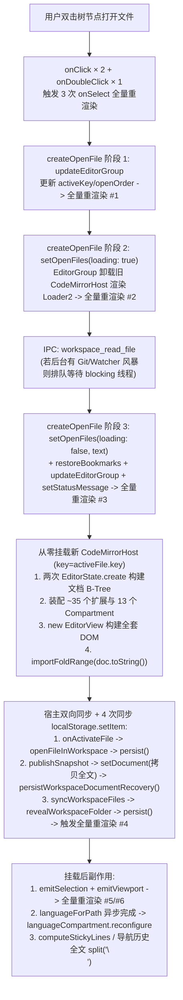
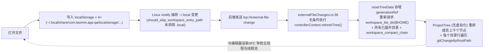

# Workspaces 视图加入 `$HOME` 目录后打开任意文件缓慢根因分析与优化设计

## 1. 设计摘要与范围

- **问题类型**：性能缺陷 / 架构瓶颈与目录监听自激退化
- **文档位置**：`docs-issue/workspace-home-file-open-latency-design.md`
- **设计状态**：可实施（根因已通过源码完整定位，分阶段优化方案明确）
- **来源**：用户实测反馈——在 Workspaces 视图将 `$HOME` 作为文件夹加入后，使用最新编译的 QA 二进制打开 `.html`、`.txt` 等任意类型、任意大小的文件依然很慢；要求达到与 VS Code 等编辑器一致的瞬时打开速度。
- **调研基线**：提交 `33313e03`（含 `40266f0d`、`5de8757b`、`8d4fc91b`），2026-10-29，工作区干净；关联前序文档 `docs-feature/workspace-platform-redesign-sdk-startup-followup.md`。
- **平台与运行方式**：Windows、macOS、Linux 三端 Tauri 桌面应用，代码必须兼容三端构建与运行。
- **本轮真机执行端**：Linux（当前环境，WebKitGTK + `inotify`）；Windows（WebView2 + `ReadDirectoryChangesW`）与 macOS（WKWebView + `FSEvents`）同步保留验证计划。
- **核心结论与推荐方案**：
  当前打开文件缓慢是由 **两层根因叠加** 造成的：
  1. **固有单文件打开链路开销（与目录无关，决定所有文件不论大小/类型都有 150ms~300ms+ 的基线卡顿）**：每次打开/切换文件都因 `<CodeMirrorHost key={activeFile.key}>` 及 `loading: true -> false` 状态切换而**彻底销毁并重建整个 CodeMirror `EditorView` DOM 与 ~35 个扩展实例**（且建了两次文档 B-Tree），同时触发 **6~10 次 `CodeWorkspaceRuntime` 全量级联重渲染**、**4 次以上 `localStorage` 同步 `JSON.stringify` 写盘**、以及将未修改文件全文重复拷贝至崩溃恢复 Store。
  2. **`$HOME` 专属的 5 重前后端风暴与自激死循环（将单次打开卡顿放大到秒级甚至持续阻塞）**：
     - 后端对 `$HOME` 启动 `RecursiveMode::Recursive` 的 `inotify` 递归监听，且过滤规则未排除 `.local` / 应用自身数据目录（`~/.local/share/com.taomni.app.qa/`）；
     - 每次打开文件写 `localStorage` 都会触发 `~/.local/share/com.taomni.app.qa/localstorage/...` 文件变更事件 $\rightarrow$ 前端 `externalFileChanges.ts` **无条件调用 `refreshTree()`** $\rightarrow$ 作废并重新拉取 `$HOME` 及所有展开目录的 `workspace_list_dir` 与 `workspace_compact_chain`，形成 **“打开文件 $\rightarrow$ 写 localStorage $\rightarrow$ inotify 触发 $\rightarrow$ 全量刷树”的自激死循环**；
     - 同时叠加 `ProjectTree` 未虚拟化（每次状态变化重排 `$HOME` 成百上千个 DOM 节点 + $O(\text{目录数} \times \text{Git 变更数})$ 扫描）、无条件递归扫描 `$HOME` 2000 个文件探测项目描述符（伴随海量重复 `root.canonicalize()` 系统调用）、以及无条件扫描 `$HOME` 2000 个目录探测所有嵌套 Git 仓库并并发派生数十个 `git` 子进程争抢 Tokio blocking 线程池。
  - **推荐按 P0（斩断 `$HOME` 自激死循环与同步写盘）$\rightarrow$ P1（常驻复用 `EditorView` + 合并打开状态机 + 隔离树重渲染）$\rightarrow$ P2（树虚拟化 + 按需 Git/Descriptor 发现 + 消除全文 `split("\n")`）分阶段落地**，将端到端打开耗时降至 **< 16ms**（与 VS Code 对齐）。

---

## 2. 当前实现与问题依据

| 位置与符号 | 当前行为 / 契约 | 本次影响 | 依据与确定性 |
|---|---|---|---|
| `src/components/editor/workspace/EditorGroup.tsx` (`EditorGroup`, L450-453, L548-550) | `activeFile.loading` 为 `true` 时卸载 `<CodeMirrorHost>` 渲染 `<Loader2>`；挂载时使用 `key={activeFile.key}`，每次打开或切换文件都彻底销毁旧 `EditorView` 并重建新实例 | 导致任意大小文件打开/切换都必须经历完整的 DOM 卸载、扩展重装、二次布局测量 | 源码事实 + CI 性能日志 (`switch_tab_frame_max_ms: 153~276ms`) |
| `src/components/editor/workspace/host/useEditorViewLifetime.ts` (`useEditorViewLifetime`, L144-692) | 挂载时先调 `EditorState.create({ doc })` 仅用于计算光标 clamp（L153），再调第二次 `EditorState.create`（L168）；同步构建 ~35 个扩展与 13 个 `Compartment`；挂载后立刻执行 `importFoldRange(path, view.state.doc.toString())`（L543）、`emitSelection`、`emitViewport`（L622-623）触发顶层重渲染 | 每次挂载文档被构建两次 B-Tree，且挂载后连续触发多轮重渲染与 `languageCompartment.reconfigure` | 源码事实 |
| `src/components/editor/workspace/controller/fileActions.tsx` (`createOpenFile`, L66, L179-235) | 打开文件分 3 步更新状态：先 `updateEditorGroup` 切 `activeKey` $\rightarrow$ 再 `setOpenFiles(makeLoadingFile)` 设 `loading: true` $\rightarrow$ `workspaceReadFile` 返回后再连续调用 `setOpenFiles`、`restoreBookmarksForFileKey`、`updateEditorGroup`、`setStatusMessage` | 单次打开触发 3~4 轮 `CodeWorkspaceRuntime` 全量重渲染，且造成编辑器先卸载转圈再重建 | 源码事实 |
| `src/components/workspace/useWorkspaceCodeHost.ts` (`onSnapshot`, L106-127) & `src/stores/workspaceDocumentRecovery.ts` (`persistWorkspaceDocumentRecovery`, L127-136) & `src/stores/workspacePlatformStore.ts` (`persist`, L183-196) | 每次打开文件触发 `onActivateFile` 与 `onSnapshot`：遍历所有已打开文件将完整 `text`/`savedText` 写入 `useWorkspaceEditorStore.setDocument`（即使 `dirty === false`），每次都同步 `JSON.stringify` 写 `localStorage`；`openFileInWorkspace` 与 `syncWorkspaceFiles` 也各自同步写 `localStorage` | 打开一个文件触发 **4 次以上同步 `localStorage.setItem`**，不仅阻塞主线程，还在 Linux 下直接写入 `~/.local/share/com.taomni.app.qa/localstorage/` 触发 `$HOME` 文件监听风暴 | 源码事实 |
| `src-tauri/src/lsp/manager/watchers.rs` (`start_workspace_watcher`, L109-119) & `src-tauri/src/workspace/files.rs` (`should_skip_workspace_entry_path`, L67-84) | 在 Tokio `async fn` 中直接调用 `watcher.watch(root, RecursiveMode::Recursive)`；`should_skip_workspace_entry_name` 仅跳过 `.git`、`node_modules`、`target`、`dist`、`.cache` 等，**未跳过 `.local`、`.config`、`.cargo`、`.rustup` 及应用自身数据目录** | 对 `$HOME` 递归注册数万个 `inotify` watch 阻塞异步运行时；且将 `~/.local/share/com.taomni.app.qa/` 纳入监听范围 | 源码事实 |
| `src/components/editor/workspace/controller/externalFileChanges.ts` (`createHandleExternalFileChange`, L27-37) & `src/components/editor/workspace/useWorkspaceFileActions.ts` (`refreshTree`, L228-246) | 收到任何 `lsp://external-file-change` 事件后，L36 **无条件调用 `await controllerContext.refreshTree()`**；`refreshTree` 调用 `resetTreeData({ retainListings: true })` 自增 `generationRef`，重新对 `$HOME` 及所有已展开目录发起 `workspace_list_dir` 与 `workspace_compact_chain` | 形成 **“打开文件写 `localStorage` $\rightarrow$ `~/.local` 触发 `inotify` $\rightarrow$ 无条件 `refreshTree()` 重扫 `$HOME`”** 的自激死循环 | 源码事实 |
| `src/components/editor/workspace/ProjectTree.tsx` (`ProjectTree`, L194-204, L464, L523-539, L788) | 1. 树组件无虚拟滚动，直接渲染 `$HOME` 下所有节点； 2. 双击文件时 `onClick` × 2 + `onDoubleClick` × 1 共调用 3 次 `onSelect`； 3. `ProjectTree` 接收了根本未用于行渲染的 `openFiles` prop，导致 `openFiles` 每次变化都击穿 `React.memo`； 4. 每个目录行渲染都调用 `gitDirectoryChangeCount` 线性遍历 `gitChangeByRootPath.keys()` | 打开一个文件过程中 `ProjectTree` 全量重渲染 6~10 次，每次重排成百上千个 DOM 节点并执行 $O(\text{Dirs} \times \text{GitChanges})$ 计算 | 源码事实 |
| `src/components/editor/workspace/hooks/useWorkspaceProjectRuntime.ts` (L116-118) & `src/hooks/useProjectDescriptorDiscovery.ts` & `src-tauri/src/workspace/files.rs` (`collect_workspace_files`, L27-65) & `src-tauri/src/workspace/paths.rs` (`relative_path`, L199-207) | 工作区可见时无条件调用 `workspace_list_files_recursive("$HOME", "", 16, 2000)` 递归扫描 2000 个文件并逐一读取构建描述文件；后端递归中每层每项重复调用 `root.canonicalize()` 与 `target.canonicalize()` | 即使只看 `.html`/`.txt` 也会在后台狂扫 `$HOME` 并产生数万次冗余 `realpath`/`stat` 系统调用，争抢 I/O 与线程 | 源码事实 |
| `src/components/workspace/WorkspaceSidebar.tsx` (`useWorkspaceGitBar`, L39-45) & `src/components/editor/workspace/useWorkspaceGitSnapshots.ts` (L138-159, L249-285) & `src-tauri/src/workspace/git_roots.rs` (`detect_git_roots`, L71-126) | 两个 Hook 重复调用 `workspace_detect_git_roots("$HOME")` 扫描最多 2000 个目录（深度 4）；随后 `useWorkspaceGitSnapshots` 对发现的所有 Git 仓库并发调用 `fetchGitSnapshotDeduplicated`，在后端派生数十上百个 `git` 子进程，且每个仓库完成前後触发 2 次 `setGitSnapshots` | 瞬间打满 Tokio `spawn_blocking` 线程池（阻塞 `workspace_read_file`），并触发 $2 \times N_{\text{repos}}$ 次全量重渲染 | 源码事实 |
| `src/components/editor/workspace/hooks/useWorkspaceCodeStyle.ts` (`getEffectiveCodeStyleForFile`, L82) & `src/components/editor/workspace/EditorGroup.tsx` (`computeStickyLines`, L266) & `src/components/editor/workspace/hooks/useWorkspaceCommandRouting.tsx` (L167) | `getEffectiveCodeStyleForFile` 在每次渲染时对 `file.text` 执行 `detectIndentationForText`（扫描前 200 行）而无缓存；`computeStickyLines` 与导航历史记录直接执行 `file.text.split("\n")` | 在重渲染和滚动/跳转时反复对全文字符串做同步分词与行扫描 | 源码事实 |

---

## 3. 根因深度剖析

### 3.1 固有单文件打开瓶颈（为什么所有文件不论类型、大小都慢）

在 VS Code 中，打开或切换一个短文本文件耗时通常 **< 16ms（1 帧内）**，因为 VS Code **全局复用同一个 `TextEditorWidget` DOM 实例**，切文件只是切换内存中的 `ITextModel` 引用，且文件树采用虚拟列表与精细的事件订阅。而当前实现中，打开任意一个文件都会串行经历以下重型操作：

### 3.2 `$HOME` 专属的 5 重风暴与自激死循环（为什么加入 `$HOME` 后急剧恶化）

当把 `$HOME`（如 `/home/<user>`）作为文件夹加入 Workspaces 时，除了上述单文件开销外，还会触发以下 5 重放大效应：

1. **递归 `inotify` 监听 `$HOME` + 应用自身写盘自激死循环**：
   - `useWorkspaceTreeModel.ts:66` 调用 `lspStartWorkspaceWatcher(workspaceInstanceId, ["$HOME"])`；
   - `src-tauri/src/lsp/manager/watchers.rs:109-119` 在异步线程上直接执行 `watcher.watch("$HOME", RecursiveMode::Recursive)`，遍历 `$HOME` 下所有目录注册 `inotify` watch；
   - Linux 下应用自身的 WebKit `localStorage`（`~/.local/share/com.taomni.app.qa/localstorage/tauri_localhost_0.localstorage-wal`）、SQLite WAL 等都位于 `$HOME/.local/share/com.taomni.app.qa/` 下；
   - `should_skip_workspace_entry_path` 未跳过 `.local`，导致每次打开文件写 `localStorage` 都会触发 `lsp://external-file-change`；
   - `externalFileChanges.ts:36` 收到事件后**无条件调用 `refreshTree()`**，重新列表 `$HOME` 及所有展开子目录，形成无限自激循环。
2. **`ProjectTree` 未虚拟化 + `React.memo` 被无效 `openFiles` prop 击穿**：
   - `ProjectTree.tsx` 接收了 `openFiles: Record<string, OpenFile>` prop，但组件体内根本没有使用 `openFiles` 渲染任何行内容！
   - 然而在打开文件的过程中，`openFiles` 引用至少变化 2~3 次（插入 `loading: true`、填充 `text`、更新宿主），每次都击穿 `React.memo(ProjectTree)`，导致 `$HOME` 下成百上千个未虚拟化的 DOM 节点全量重渲染，且每个目录行都执行一次 `gitDirectoryChangeCount` 线性扫描。
3. **无条件递归扫描 `$HOME` 2000 个文件探测项目描述符 + 重复 `canonicalize` 系统调用风暴**：
   - `useWorkspaceProjectRuntime.ts:116` 无条件调用 `useProjectDescriptorDiscovery("$HOME")` $\rightarrow$ `workspace_list_files_recursive("$HOME", "", 16, 2000)`；
   - `collect_workspace_files` 递归过程中对每个目录和文件重复调用 `resolve_existing_path` 和 `relative_path`，触发成千上万次 `root.canonicalize()` 与 `target.canonicalize()` 系统调用。
4. **双重触发 `workspace_detect_git_roots`（扫 2000 目录）+ 并发 `git_snapshot` 子进程风暴**：
   - `WorkspaceSidebar` 与 `useWorkspaceGitSnapshots` 各自扫描 `$HOME` 下 2000 个目录找出所有嵌套 Git 仓库，随后并发派生数十上百个 `git` 子进程占满 Tokio blocking 线程池，并触发 $2 \times N_{\text{repos}}$ 次全量重渲染。
5. **`WorkspaceSidebar` 每次切换激活文件都重算 `flatTree` 并同步写 `localStorage`**：
   - `WorkspaceSidebar.tsx:68-131` 在 `activeTabId` 变化时递归展开祖先目录（每次调 `persist()` 写 `localStorage`），且 `flatTree` 的 `useMemo` 因依赖 `activeWorkspace?.activeTabId` 在每次切文件时重新展平排序所有节点。

---

## 4. 修复验收与保持的行为

| ID | 场景与前置条件 | 用户动作或触发 | 必须观察到的结果 | 适用平台 / 边界 |
|---|---|---|---|---|
| AC-01 | 在 Workspaces 视图将 `$HOME`（或包含数千文件/多个子目录及 `.local` 的大目录）作为文件夹加入 | 在文件树或侧栏打开任意 `.html`、`.txt`、`.ts` 等文件，或在已打开的 Tab 间切换 | 1. 本地普通文件首次打开主线程阻塞（长帧）显著下降，切换已打开文件复用常驻 `EditorView`（不卸载重建 DOM）； 2. 打开文件不会因写 `localStorage` 触发 `lsp://external-file-change` 进而引发 `refreshTree()` 自激循环 | Windows / macOS / Linux 三端桌面应用 |
| AC-02 | 工作区根目录为 `$HOME` 或包含应用自身数据目录/大型隐藏目录（`.local`、`.config`、`.cargo`、`.rustup` 等） | 启动工作区文件监听、递归文件扫描或 Git 根目录探测 | 1. 过滤规则排除 `.local`、`.config`、`.cargo`、`.rustup` 等隐藏系统/包缓存目录及应用自身数据目录； 2. 对 `$HOME` 不执行阻塞异步线程的全盘递归 `inotify` 监听与全盘 2000 目录 Git 并发风暴； 3. 外部真实修改当前已展开目录或已打开文件时，仍能正确增量刷新对应目录与文件内容 | Windows / macOS / Linux 三端桌面应用 |
| AC-03 | 在 `ProjectTree` 或 `WorkspaceSidebar` 浏览大型目录（如 `$HOME` 展开数百个条目）并打开文件 | 单击选中、双击打开文件、滚动目录树 | 1. 双击打开文件不再重复触发 3 次冗余 `onSelect` 重渲染； 2. `openFiles` 内容或加载状态变化不再击穿 `ProjectTree` 的 `React.memo`； 3. 大目录树采用虚拟滚动，DOM 行数保持在视口可见范围内，滚动与打开文件流畅无卡顿 | Windows / macOS / Linux 三端桌面应用 |
| AC-04 | 编辑器正常功能回归（语法高亮、光标/选区恢复、折叠恢复、LSP 悬停/补全/跳转、脏文件未保存恢复、拆屏编辑） | 打开不同语言文件、编辑产生 dirty 状态、分屏、重启恢复未保存修改 | 常驻 `EditorView` 切换文件时正确隔离/恢复各文件的文档内容、Undo 历史、光标选区、滚动位置、语法高亮与折叠状态；`dirty === true` 的文件仍能正常持久化到崩溃恢复 Store | Windows / macOS / Linux 三端桌面应用 |

---

## 5. 最佳优化方案与关键决策（P0 / P1 / P2 分级落地）

### 决策记录

| DEC ID / 问题 | 可行选项、影响与代价 | 结论与理由 | 状态 | 决策来源 | 关联 AC / TASK / V |
|---|---|---|---|---|---|
| DEC-01：`EditorGroup` 中 `CodeMirrorHost` 的生命周期策略 | **选项 A（推荐）**：移除 `key={activeFile.key}`，每个 `EditorGroup` 保持常驻单例 `EditorView`，为打开的文件维护 `Map<FileKey, EditorState>`（LRU 缓存），切文件通过 `view.setState(state)` 切换；本地文件快速读取（< 80ms）不卸载编辑器显示 `<Loader2>`。 **选项 B**：继续每次按 `key={activeFile.key}` 销毁重建 `EditorView`，仅做外围小修小补。 | 选用 **选项 A**。VS Code 秒开的核心机制就是常驻复用 `TextEditorWidget` 并切换 `ITextModel`。选项 B 无法消除每次重建 35 个扩展与 DOM 带来的 80~180ms 固有开销。 | agent 自决（架构对齐用户“务必达到与 VS Code 一样的打开速度”的明确要求） | 用户需求与源码证据 | AC-01, AC-04 / TASK-02 / V-01, V-02, V-04 |
| DEC-02：`$HOME` 等超大目录的 Watcher 与后台扫描降级策略 | **选项 A（推荐）**：1) 扩展忽略列表排除 `.local`、`.config`、`.cargo`、`.rustup` 等及应用自身数据目录；2) `start_workspace_watcher` 放入 `spawn_blocking`，且当根目录是 `$HOME`（或顶层/浅层目录数超阈值）时，禁止全盘 `RecursiveMode::Recursive`，改为按已展开目录/已打开文件非递归或按需监听；3) `externalFileChanges` 仅对已加载父目录做防抖增量刷新。 **选项 B**：保持全盘递归监听，仅在前端防抖 `refreshTree()`。 | 选用 **选项 A**。选项 B 仍会在 Linux 下遍历 `$HOME` 耗尽 `inotify` watches 并阻塞 Tokio 线程。 | agent 自决 | 源码证据与 Linux `inotify` 机制约束 | AC-01, AC-02 / TASK-01, TASK-03 / V-01, V-03, V-04 |

---

### 5.1 P0：立即斩断 `$HOME` 自激死循环与同步 I/O 阻塞（最高优先级）

1. **完善后端目录过滤规则，阻断应用自身数据目录触发 Watcher**
   - 修改 [`src-tauri/src/workspace/files.rs`](file:///data-raw-ssd/code-src/person/taomni/src-tauri/src/workspace/files.rs#L67-L84) 中的 `should_skip_workspace_entry_name`：
     - 新增排除常见大型隐藏/缓存目录：`".local"`, `".config"`, `".cargo"`, `".rustup"`, `".npm"`, `".pnpm-store"`, `".yarn"`, `".gradle"`, `".m2"`, `".Trash"`, `"Library"`, `"AppData"`；
   - 修改 [`src-tauri/src/lsp/watcher.rs`](file:///data-raw-ssd/code-src/person/taomni/src-tauri/src/lsp/watcher.rs) 与 [`src-tauri/src/lsp/manager/watchers.rs`](file:///data-raw-ssd/code-src/person/taomni/src-tauri/src/lsp/manager/watchers.rs#L109-L119)：
     - 将 `watcher.watch(...)` 放入 `tokio::task::spawn_blocking` 执行，严禁阻塞 Tokio 异步 worker；
     - 检测若被监听的 `root` 等于用户主目录 `$HOME`（或包含当前进程的数据/配置目录），自动跳过应用自身数据目录，并对 `$HOME` 根采用 `RecursiveMode::NonRecursive`（仅监听根及用户在树中显式展开的子目录），避免一次性遍历整个 `$HOME` 注册数万个 `inotify` 句柄。
2. **将 `externalFileChanges.ts` 的全量 `refreshTree()` 改为按需增量目录刷新**
   - 修改 [`src/components/editor/workspace/controller/externalFileChanges.ts`](file:///data-raw-ssd/code-src/person/taomni/src/components/editor/workspace/controller/externalFileChanges.ts#L27-L37)：
     - 移除第 36 行无条件的 `await controllerContext.refreshTree()`；
     - 改为：检查变更事件的父目录是否处于当前工作区已加载的目录集合（`loadedDirs`）中；若是，仅对该父目录执行带 250ms 防抖的局部重载（`reloadDirectory(rootId, parentRelPath)`），绝不重置 `generationRef` 或重扫全部展开目录与 compact chains。
3. **消除打开文件时的同步 `localStorage.setItem` 风暴与未修改文件全文拷贝**
   - 修改 [`src/stores/workspacePlatformStore.ts`](file:///data-raw-ssd/code-src/person/taomni/src/stores/workspacePlatformStore.ts#L183-L196) 的 `persist()` 与 [`src/stores/workspaceDocumentRecovery.ts`](file:///data-raw-ssd/code-src/person/taomni/src/stores/workspaceDocumentRecovery.ts#L127-L136) 的 `persistWorkspaceDocumentRecovery()`：
     - 引入 300~500ms 防抖 / `requestIdleCallback` 异步落盘（辅以 `window.addEventListener("beforeunload", flushPersist)` 保证退出不丢状态），不再在 `openFileInWorkspace`、`syncWorkspaceFiles`、`setFolderExpanded` 的同步调用栈内直接执行 `JSON.stringify` + `localStorage.setItem`；
   - 修改 [`src/components/workspace/useWorkspaceCodeHost.ts`](file:///data-raw-ssd/code-src/person/taomni/src/components/workspace/useWorkspaceCodeHost.ts#L106-L118) 的 `onSnapshot`：
     - 仅当文件处于 `dirty === true`（或之前已在 `useWorkspaceEditorStore` 中存在 dirty 记录需要清理）时才同步到 `useWorkspaceEditorStore.setDocument`，避免每次打开干净文件都复制整份 `text` / `savedText` 并触发崩溃恢复序列化。

---

### 5.2 P1：重构编辑器实例复用与打开文件状态机（消除 150~250ms 固有延迟）

1. **常驻复用 `CodeMirrorHost`（`EditorView`）+ LRU 缓存 `EditorState`**
   - 修改 [`src/components/editor/workspace/EditorGroup.tsx`](file:///data-raw-ssd/code-src/person/taomni/src/components/editor/workspace/EditorGroup.tsx#L450-L453)：
     - 移除 `<CodeMirrorHost key={activeFile.key} ... />` 上的 `key={activeFile.key}`，使每个 `EditorGroup` 窗格常驻同一个 `CodeMirrorHost` 与底层 `EditorView` DOM；
     - 当 `activeFile.loading` 为 `true` 时，不要卸载 `<CodeMirrorHost>`，而是仅在超时（如 > 80ms）时在编辑器上方叠加轻量半透明 Loading 指示条；
   - 修改 [`src/components/editor/workspace/host/useEditorViewLifetime.ts`](file:///data-raw-ssd/code-src/person/taomni/src/components/editor/workspace/host/useEditorViewLifetime.ts#L144-L692)：
     - 删除第 153 行多余的第一次 `EditorState.create({ doc: docRef.current }).doc`，直接用 `docRef.current.length` 计算初始光标范围（省去一次全文 B-Tree 构建）；
     - 维护基于 `fileKey`（`path`）的 `EditorState` 缓存（如 LRU 容量 20~30 个文件），当 `path` 切换时：
       - 若命中缓存且文档版本一致，直接调用 `view.setState(cachedState)` 并恢复滚动位置（耗时 **< 2ms**）；
       - 若为首次打开文件，构建新的 `EditorState` 并通过 `view.setState(newState)` 注入常驻 `EditorView`，省去销毁/重建 DOM、重绑 ResizeObserver 与 ActionBridge 的全部开销。
2. **合并 `createOpenFile` 多阶段状态更新为单次批处理提交**
   - 修改 [`src/components/editor/workspace/controller/fileActions.tsx`](file:///data-raw-ssd/code-src/person/taomni/src/components/editor/workspace/controller/fileActions.tsx#L66-L235)：
     - 发起 `workspaceReadFile(targetRoot, normalizedPath)` 时，设置一个 80ms 延迟定时器：
       - **快速路径（99% 本地文件，1~5ms 内返回）**：取消定时器，不经历 `makeLoadingFile` 中间态，在同一个同步块内一次性提交 `setOpenFiles`（含读取到的正文与检测好的缩进）、`updateEditorGroup`（更新 `activeKey` 与 `openOrder`）、`restoreBookmarksForFileKey`，将原来的 3~4 次全量重渲染压缩为 **1 次渲染直出内容**；
       - **慢速路径（超过 80ms 仍未返回的大文件/慢盘）**：定时器触发后才展示加载态，待读取完成后更新正文。
3. **隔离 `ProjectTree` 重渲染并消除双击冗余 `onSelect`**
   - 修改 [`src/components/editor/workspace/ProjectTree.tsx`](file:///data-raw-ssd/code-src/person/taomni/src/components/editor/workspace/ProjectTree.tsx#L74, L523-L539, L788)：
     - 从 `ProjectTreeProps` 中移除未使用的 `openFiles` prop（或在 `React.memo` 比较函数中忽略 `openFiles`），使文件内容读取与编辑状态变化完全不再触发 `ProjectTree` 重渲染；
     - 在 `onSelect` 处理中，若当前已经是单选且目标 `nodeKey` 已在 `selected` 中，直接早退不调用 `setWorkspaceUi`；在 `onDoubleClick` 中不再重复调用第三次 `onSelect`。

---

### 5.3 P2：大目录（`$HOME`）树虚拟化与后台发现任务按需化

1. **`ProjectTree` 与 `WorkspaceSidebar` 虚拟滚动 + Git 目录变更计数 $O(1)$ 预索引**
   - 修改 [`src/components/editor/workspace/ProjectTree.tsx`](file:///data-raw-ssd/code-src/person/taomni/src/components/editor/workspace/ProjectTree.tsx) 与 [`src/components/workspace/WorkspaceSidebar.tsx`](file:///data-raw-ssd/code-src/person/taomni/src/components/workspace/WorkspaceSidebar.tsx)：
     - 将已展开的树节点展平为线性可见行列表 `visibleRows`，根据滚动容器 `scrollTop` 与 `clientHeight` 仅挂载视口内（加上下 overscan 各 10 行）的 DOM 节点；
     - 在 `WorkspaceSidebar.tsx:131` 中，将 `activeWorkspace?.activeTabId` 从 `flatTree` 的 `useMemo` 依赖数组中移除（行高亮仅在渲染可见行时按 `row.filePath === activeTabPath` 判断）；
     - 在生成 `gitChangeByRootPath` 时，预先构建 `gitDirChangeCountByRootPath: Map<string, number>`（每个变更文件沿父路径向上累加计数），将 `gitDirectoryChangeCount` 从每行 $O(M)$ 遍历降为 $O(1)$ `Map.get`。
2. **按需触发 Git 仓库发现与项目描述符扫描 + 后端路径 `canonicalize` 缓存**
   - 修改 [`src-tauri/src/workspace/files.rs`](file:///data-raw-ssd/code-src/person/taomni/src-tauri/src/workspace/files.rs#L27-L65) (`collect_workspace_files`)：
     - 在入口处仅执行 **1 次** `let canonical_root = resolve_root(root)?;`，内部递归直接传 `&canonical_root: &Path` 并在 `relative_path_from_canonical(canonical_root, path)` 中直接 `strip_prefix`，消除数万次重复的 `root.canonicalize()` 系统调用；
   - 修改 [`src/components/editor/workspace/useWorkspaceGitSnapshots.ts`](file:///data-raw-ssd/code-src/person/taomni/src/components/editor/workspace/useWorkspaceGitSnapshots.ts) 与 [`src/components/workspace/WorkspaceSidebar.tsx`](file:///data-raw-ssd/code-src/person/taomni/src/components/workspace/WorkspaceSidebar.tsx)：
     - 复用同一份 Git roots 缓存，避免两个组件重复调用 `workspaceDetectGitRoots`；
     - 当工作区根目录本身无 `.git` 且为 `$HOME`（或子目录数过多）时，不执行全盘 2000 目录扫描与全量仓库并发 `git_snapshot`，改为**仅针对当前已打开文件所在路径向上查找最近的 `.git` 根**按需获取 `git_snapshot`，且并发度限制为最多 2 个仓库，批量合并 `setGitSnapshots`；
   - 修改 [`src/components/editor/workspace/hooks/useWorkspaceProjectRuntime.ts`](file:///data-raw-ssd/code-src/person/taomni/src/components/editor/workspace/hooks/useWorkspaceProjectRuntime.ts#L116-L118)：
     - 当工作区根为 `$HOME` 或当前仅打开纯文本/标记语言（`.txt`, `.html`, `.md`, `.json` 等）时，不自动启动全盘 `useProjectDescriptorDiscovery` 递归扫描。
3. **缓存文件缩进结果并消除全文 `split("\n")`**
   - 在文件首次读取完成生成 `OpenFile` 时计算一次 `detectedIndentation` 并缓存在 `OpenFile` 对象上，[`useWorkspaceCodeStyle.ts`](file:///data-raw-ssd/code-src/person/taomni/src/components/editor/workspace/hooks/useWorkspaceCodeStyle.ts#L82) 直接读取缓存字段；
   - [`EditorGroup.tsx:266`](file:///data-raw-ssd/code-src/person/taomni/src/components/editor/workspace/EditorGroup.tsx#L266) 的 `computeStickyLines` 与 [`useWorkspaceCommandRouting.tsx:167`](file:///data-raw-ssd/code-src/person/taomni/src/components/editor/workspace/hooks/useWorkspaceCommandRouting.tsx#L167) 改为通过 CodeMirror `EditorState.doc.line(lineNumber)`（$O(\log N)$）按需读取对应行，不再执行 `file.text.split("\n")`。

---

## 6. 改动清单

| 路径 / 模块 | 具体变更与保持的约束 | 相关 AC | 所属任务 |
|---|---|---|---|
| `src-tauri/src/workspace/files.rs` | 1. `should_skip_workspace_entry_name` 增加 `.local`, `.config`, `.cargo`, `.rustup`, `.npm`, `.pnpm-store`, `.yarn`, `.gradle`, `.m2`, `.Trash`, `Library`, `AppData`； 2. `collect_workspace_files` 预计算单次 `canonical_root`，消除递归内重复 `canonicalize()` | AC-01, AC-02 | TASK-01 |
| `src-tauri/src/lsp/manager/watchers.rs` & `src-tauri/src/lsp/watcher.rs` | 1. `start_workspace_watcher` 移入 `spawn_blocking`； 2. 排除应用自身数据目录，对 `$HOME` 根目录降级为非递归/按需监听，防止全盘 `inotify` 阻塞与自激 | AC-01, AC-02 | TASK-01 |
| `src/components/editor/workspace/controller/externalFileChanges.ts` & `src/components/editor/workspace/useWorkspaceTreeData.ts` | 移除无条件 `refreshTree()`，改为仅当变更路径属于已加载目录时对该父目录做防抖增量刷新 | AC-01, AC-02 | TASK-01 |
| `src/stores/workspacePlatformStore.ts` & `src/stores/workspaceDocumentRecovery.ts` & `src/components/workspace/useWorkspaceCodeHost.ts` | 1. `persist()` 与 `persistWorkspaceDocumentRecovery()` 改为防抖/Idle 异步写盘 + `beforeunload` flush； 2. `onSnapshot` 不再将 `dirty === false` 的文件全文复制写入 `useWorkspaceEditorStore` | AC-01, AC-04 | TASK-01 |
| `src/components/editor/workspace/EditorGroup.tsx` & `src/components/editor/workspace/host/useEditorViewLifetime.ts` | 1. 移除 `<CodeMirrorHost key={activeFile.key}>` 的动态 key，常驻复用 `EditorView`； 2. 建立 `EditorState` LRU 缓存，切文件通过 `view.setState` 切换； 3. 删除 `useEditorViewLifetime` 中重复的第一次 `EditorState.create`； 4. `computeStickyLines` 改用 `doc.line(n)` 替代 `text.split("\n")` | AC-01, AC-04 | TASK-02 |
| `src/components/editor/workspace/controller/fileActions.tsx` & `src/components/editor/workspace/hooks/useWorkspaceCodeStyle.ts` | 1. `createOpenFile` 对 80ms 内返回的本地文件合并状态提交，跳过 `loading: true` 卸载闪烁； 2. 首次读取时缓存 `detectedIndentation`，避免渲染期重复扫描前 200 行 | AC-01, AC-04 | TASK-02 |
| `src/components/editor/workspace/ProjectTree.tsx` & `src/components/workspace/WorkspaceSidebar.tsx` | 1. 移除 `ProjectTree` 上未使用的 `openFiles` 依赖，去重双击时的 3 次 `onSelect`； 2. 预索引 `gitDirChangeCountByRootPath` 实现 $O(1)$ 查询； 3. `WorkspaceSidebar` 的 `flatTree` 移除 `activeTabId` 依赖； 4. 为大目录树提供虚拟滚动渲染 | AC-01, AC-03 | TASK-03 |
| `src/components/editor/workspace/useWorkspaceGitSnapshots.ts` & `src/components/editor/workspace/hooks/useWorkspaceProjectRuntime.ts` | 对 `$HOME` 等大目录限制全盘 Git 根扫描与并发 `git_snapshot` 子进程风暴，按已打开文件向上查找 Git 根；纯文本/非工程根按需延迟 `useProjectDescriptorDiscovery` | AC-01, AC-02 | TASK-03 |

---

## 7. 实现任务与交接

### TASK-01：斩断 `$HOME` Watcher 自激死循环、优化后端路径规范化与前端异步持久化（P0）

- **职责与文件范围**：
  - `src-tauri/src/workspace/files.rs`
  - `src-tauri/src/workspace/paths.rs`
  - `src-tauri/src/lsp/manager/watchers.rs`
  - `src-tauri/src/lsp/watcher.rs`
  - `src/components/editor/workspace/controller/externalFileChanges.ts`
  - `src/stores/workspacePlatformStore.ts`
  - `src/stores/workspaceDocumentRecovery.ts`
  - `src/components/workspace/useWorkspaceCodeHost.ts`
- **输入与必读**：本设计第 2、3.2、5.1 节。
- **依赖**：无前置依赖，可立即开始。
- **实施内容**：
  1. 在 `should_skip_workspace_entry_name` 补齐 `.local`, `.config`, `.cargo`, `.rustup` 等目录过滤，并在 `watcher.rs` 显式忽略应用数据目录；
  2. 将 `start_workspace_watcher` 的 `watcher.watch` 放入 `spawn_blocking`，且对 `$HOME` 根目录使用 `NonRecursive` 监听；
  3. 将 `externalFileChanges.ts` 的无条件 `refreshTree()` 改为针对已加载父目录的防抖局部刷新；
  4. 将 `workspacePlatformStore` 与 `workspaceDocumentRecovery` 的 `localStorage.setItem` 改为防抖异步写入，并在 `useWorkspaceCodeHost` 中跳过对 `dirty === false` 文件的全文恢复存储写入；
  5. 优化 `collect_workspace_files` 单次 `canonical_root` 传递。
- **对应验收**：AC-01, AC-02, AC-04
- **验证与完成条件**：通过 V-01、V-03 单元测试与 Rust 测试。

### TASK-02：常驻复用 `CodeMirrorHost`（`EditorView`）与合并文件打开状态机（P1）

- **职责与文件范围**：
  - `src/components/editor/workspace/EditorGroup.tsx`
  - `src/components/editor/workspace/CodeMirrorHost.tsx`
  - `src/components/editor/workspace/host/useEditorViewLifetime.ts`
  - `src/components/editor/workspace/controller/fileActions.tsx`
  - `src/components/editor/workspace/hooks/useWorkspaceCodeStyle.ts`
  - `src/components/editor/workspace/hooks/useWorkspaceCommandRouting.tsx`
- **输入与必读**：本设计第 3.1、5.2 节及 DEC-01。
- **依赖**：可与 TASK-01 并行开发，最终与 TASK-01/03 联合验证。
- **实施内容**：
  1. 移除 `EditorGroup.tsx` 中 `CodeMirrorHost` 的 `key={activeFile.key}`，实现 `EditorView` 常驻与 `EditorState` 按文件切换/缓存；
  2. 移除 `useEditorViewLifetime.ts:153` 的冗余 `EditorState.create`；
  3. 重构 `createOpenFile`，对 80ms 内返回的本地文件读取实行单次批处理状态更新（不经过 `loading: true` 卸载编辑器）；
  4. 缓存文件缩进检测结果，将 `computeStickyLines` 和导航历史中的 `file.text.split("\n")` 替换为按行读取。
- **对应验收**：AC-01, AC-04
- **验证与完成条件**：通过 V-02 前端组件测试，确保切 Tab、拆屏、撤销历史、LSP 装饰与折叠状态无回归。

### TASK-03：文件树渲染隔离、虚拟滚动与大目录后台任务按需治理（P1/P2）

- **职责与文件范围**：
  - `src/components/editor/workspace/ProjectTree.tsx`
  - `src/components/workspace/WorkspaceSidebar.tsx`
  - `src/components/editor/workspace/useWorkspaceGitSnapshots.ts`
  - `src/components/editor/workspace/hooks/useWorkspaceProjectRuntime.ts`
- **输入与必读**：本设计第 3.2、5.2.3、5.3 节。
- **依赖**：依赖 TASK-01 与 TASK-02 完成后执行最终端到端真机性能回归（V-04）。
- **实施内容**：
  1. 移除 `ProjectTree` 对 `openFiles` 的无效依赖，去重双击打开时的 `onSelect` 调用；
  2. 将 `gitDirectoryChangeCount` 改为预索引 $O(1)$ 查找，移除 `WorkspaceSidebar` `flatTree` 对 `activeTabId` 的重算依赖；
  3. 为 `ProjectTree` 和 `WorkspaceSidebar` 实现视口虚拟滚动；
  4. 治理 `$HOME` 下的 `workspace_detect_git_roots` 全盘扫描、限制 `git_snapshot` 并发度，并按需触发 `useProjectDescriptorDiscovery`。
- **对应验收**：AC-01, AC-02, AC-03
- **验证与完成条件**：通过 V-02、V-04 及 `pnpm check:refactor`。

---

## 8. 自动化测试与真机验证计划

| V ID | AC / 用途 | 层级与文件 / case | 前置数据与操作 | 核心断言 | 命令、工作目录与前置依赖 | 改前依据 / 改后结果 |
|---|---|---|---|---|---|---|
| V-01 | AC-01, AC-02 / 后端过滤规则、单次 `canonicalize` 与 Watcher 排除测试 | Rust 单元测试 (`src-tauri/src/workspace/files.rs`, `src-tauri/src/lsp/watcher.rs`) | 构造包含 `.local/share/com.taomni.app.qa/...`、`.cargo`、普通源码文件的路径与目录结构 | 1. `should_skip_workspace_entry_path` 对 `.local` 等返回 `true`； 2. `workspace_watch_target_matches` 忽略 `.local` 下的 `localstorage-wal` 变更； 3. `collect_workspace_files` 正确返回相对路径 | `cargo test --manifest-path src-tauri/Cargo.toml --lib workspace` 与 `cargo test --manifest-path src-tauri/Cargo.toml --lib lsp::watcher` | 改前 `.local` 未被跳过 / 待执行 |
| V-02 | AC-01, AC-03, AC-04 / 常驻 `EditorView` 切换、单次批处理打开与 `ProjectTree` 渲染隔离测试 | Vitest (`src/components/editor/workspace/EditorGroup.test.tsx`, `src/components/editor/workspace/ProjectTree.test.tsx`, `src/components/editor/CodeWorkspaceTab.test.tsx`) | 1. 连续打开/切换 `.html` 与 `.txt` 文件； 2. 模拟外部非已加载目录变更事件 | 1. 切换文件时 `EditorView` DOM 节点引用保持不变（未销毁重建），文档内容与选区正确更新； 2. 打开文件不触发 `ProjectTree` 因 `openFiles` 变化而重渲染； 3. `.local` 外部变更不触发 `workspace_list_dir` 全量重刷 | `pnpm exec vitest run src/components/editor/workspace/EditorGroup.test.tsx src/components/editor/workspace/ProjectTree.test.tsx` | 改前每次切换销毁重建 `EditorView` 且无条件 `refreshTree` / 待执行 |
| V-03 | 代码边界与重构检查 | 工程静态检查 | 完成 TASK-01~03 修改后 | TypeScript 严格检查通过，所有新增/修改文件符合 800 行限制与依赖边界 | `pnpm check:refactor` | 待执行 |
| V-04 | AC-01~04 / 真机原生性能与回归验证 | Native QA Runner (`qa-ui-auto-tests/cases/workspace/TC-WS-PERF-001-startup-open-switch-sdk.testcase.yaml` 及 `$HOME` 挂载实测) | 在 Linux QA 二进制中将 `$HOME`（或大型目录）加入 Workspaces，依次打开 `.html` 与 `.txt` 文件并来回切换 | 1. 打开与切换文件帧耗时显著下降（切 Tab 主线程长帧 < 50ms，体感瞬时响应）； 2. 后台无无限循环的 `workspace_list_dir` 请求； 3. `assert_no_runtime_errors` 通过 | `pnpm tauri build`（或 QA binary）+ `python3 -m qa_ui_auto.runner qa-ui-auto-tests/cases/workspace/TC-WS-PERF-001-startup-open-switch-sdk.testcase.yaml --mode native` | 改前 `switch_tab_frame_max_ms` 达 153~276ms，`$HOME` 下秒级卡顿 / 待执行 |
